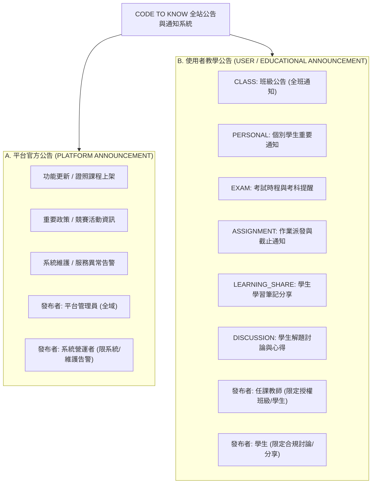
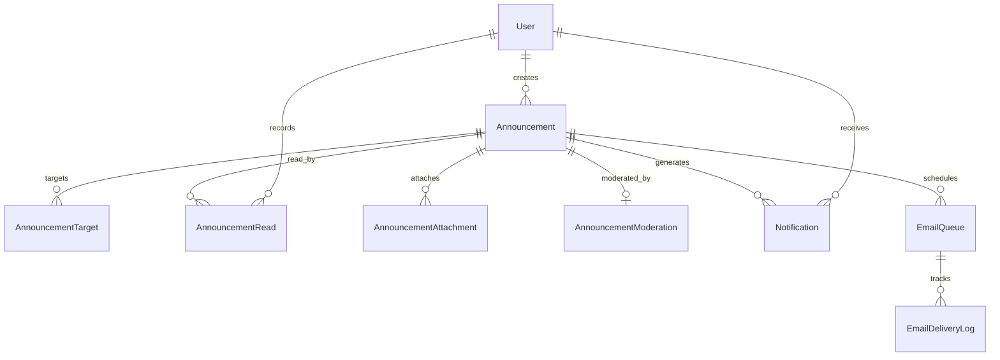
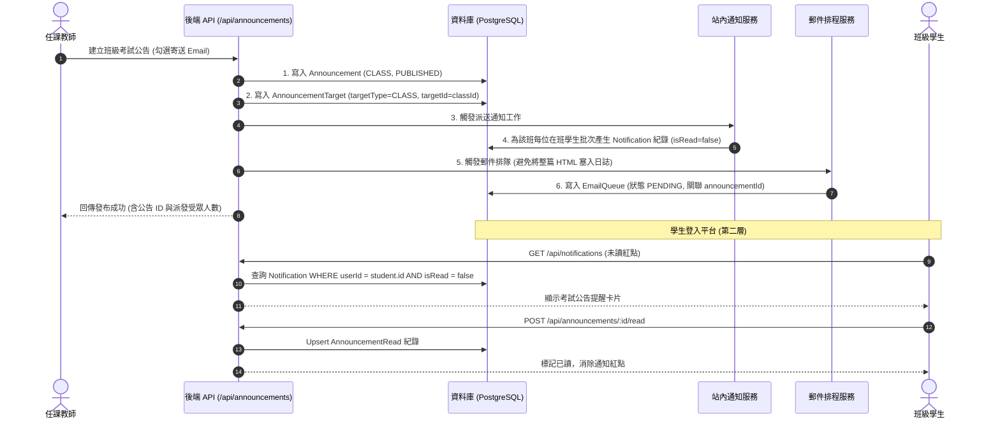

# CODE TO KNOW（碼上學）
# 公告與通知系統架構與功能規格書 (ANNOUNCEMENT & NOTIFICATION SYSTEM SPECIFICATION)

- **系統名稱**：碼上學 AI 智慧學習與教育科技平台 (CODE TO KNOW)
- **文件版本**：v1.0.0 (Pre-Database Implementation)
- **建立日期**：2026-11-07
- **文件路徑**：`docs/ANNOUNCEMENT_SYSTEM_SPEC.md`
- **架構定位**：全站五層公告與訊息通知系統之唯一權威規格標準，貫穿公開宣傳、學生學習、教師教學、平台治理與系統維運。

---

## 一、系統核心定位與設計哲學

CODE TO KNOW 作為教育科技平台，公告與訊息系統不應只是單純的「文章發布」，而必須嚴格區分**「平台官方宣達（營運與治理）」**與**「師生教學互動（班級與個別化學習）」**兩大完全不同的業務生命週期與權限邊界。



---

## 二、兩大類公告分類與業務邊界

### A. 平台官方公告（PLATFORM ANNOUNCEMENT）

1. **發布者身分與授權控制**：
   - **`PLATFORM_ADMIN`（平台管理員）**：擁有發布全域官方公告（更新、課程、政策、活動）之完整權限。
   - **`SYSTEM_OPERATOR`（系統營運管理者）**：**嚴格受限**。僅在被授予系統運維職責時，允許發布「系統維護通知（`SYSTEM_MAINTENANCE`）」與「系統服務異常通知（`SERVICE_OUTAGE`）」。**系統營運者絕不自動繼承所有內容管理或業務公告發布權**。
2. **公告類型代碼**：
   - `FEATURE_UPDATE`：平台新功能上線。
   - `COURSE_NEW`：新證照檢定或專業課程上線。
   - `PLATFORM_POLICY`：服務條款、隱私權政策或會員規範變更。
   - `EVENT`：全真模擬考競賽、開學活動。
   - `SYSTEM_MAINTENANCE`：預定伺服器升級與停機維護。
   - `SERVICE_OUTAGE`：即時服務降級或非預期故障告警。
3. **顯示範圍（五層過濾）**：
   - 公告主體設定公開層級（`PUBLIC`、`AUTHENTICATED_ONLY`、`ROLE_SPECIFIC`），經伺服器端過濾後輸出至各層，禁止未授權內容混入公開層。

### B. 使用者教學公告（USER / EDUCATIONAL ANNOUNCEMENT）

1. **發布者身分與授權控制**：
   - **`TEACHER`（任課教師）**：
     - 僅能對本人被授權之班級（存在於 `ClassTeacher` 表中）發布公告。
     - 支援指定特定班級（`CLASS`）、個別學生（`PERSONAL`）、考試通知（`EXAM`）、作業截止（`ASSIGNMENT`）。
     - 具備建立、編輯草稿、發布、撤回及檢視學生已讀簽收率之完整管理權。
     - 可勾選是否觸發站內通知與 Email 派送。
   - **`STUDENT`（學生）**：
     - **嚴禁發布全平台官方公告**，亦嚴禁發布班級置頂公告。
     - 僅能在平台允許之「學習討論區」或「解題筆記公開」情境下發布 `LEARNING_SHARE` 或 `DISCUSSION`。
     - 發布之內容若涉及檢舉，需經由 `AnnouncementModeration` 機制接受平台管理員審查。
     - 僅能接收與本人直接相關之班級或個別公告，**絕無權限讀取其他班級之私人公告**。

---

## 三、五層網站顯示與存取規則

| 網站架構層級 | 官方公告 (Platform Announcement) 顯示規範 | 教學公告 (Educational Announcement) 顯示規範 |
|---|---|---|
| **第一層：公開宣傳網站**<br/>(`HomePage`, `#hero`, `#story`) | **僅顯示公開（`visibility = 'PUBLIC'`）之官方重大消息**（如新證照上架、維護通知）。未登入訪客可自由閱讀。 | **完全隱藏、嚴禁顯示**任何班級、個別作業或學生內部討論。 |
| **第二層：學生學習平台**<br/>(`StudentDashboardPage`, `#progress`) | 顯示全體學生可見之官方更新公告、維護通知。 | **核心收件中心**：顯示學生所屬班級公告、指派考試提醒、個人成績通知、以及已讀/未讀徽章。 |
| **第三層：教師教學專區**<br/>(`TeacherDashboardPage`, `#teacher`) | 顯示全體教師可見之官方政策變更、題庫更新與維護通知。 | **核心管理中心**：發布本班公告、指派測驗通知、發送個別補考通知、檢視學生已讀清單與簽收狀況。 |
| **第四層：平台管理後台**<br/>(`AdminDashboard`, `#admin`) | 集中管理官方公告草稿、預約發布、全站公告下架，並留存管理稽核日誌。 | 監控全站教學公告發布量，受理使用者對學生分享內容之檢舉審查（`AnnouncementModeration`）。 |
| **第五層：系統營運監控後台**<br/>(`OpsDashboard`, `#ops`) | **專用發布入口**：發布維護通知、即時故障排查通知。 | **嚴格禁止存取**教師私人班級名冊與個別教學內容（恪守最小權限原則）。 |

---

## 四、資料庫實體結構與關聯設計 (Database Architecture)

為兼顧架構彈性與資料完整性，本系統採用**「單一主資料表 (`Announcement`) + 目標對象表 (`AnnouncementTarget`) + 已讀簽收表 (`AnnouncementRead`) + 審核附件擴充表」**的關聯模型，並與底層通用通知（`Notification`）與郵件排程（`EmailQueue`）無縫解耦。



### 1. `Announcement`（公告主表）
- **用途**：儲存官方公告與教學公告的核心內文、狀態與時程。
- **欄位規格**：
  | 欄位名稱 | 型別 | 必填 | 預設值 | 說明 |
  |---|---|:---:|---|---|
  | `id` | UUID / String | 是 | `gen_random_uuid()` | 公告唯一識別碼 (PK) |
  | `category` | VarChar(20) | 是 | — | `PLATFORM`（平台官方）或 `EDUCATIONAL`（使用者教學） |
  | `type` | VarChar(30) | 是 | — | 類型：`FEATURE_UPDATE`, `SYSTEM_MAINTENANCE`, `CLASS`, `PERSONAL`, `EXAM`, `ASSIGNMENT`, `LEARNING_SHARE`, `DISCUSSION` |
  | `title` | VarChar(150) | 是 | — | 公告標題 |
  | `content` | Text | 是 | — | 公告內文（支援 Markdown 與安全白名單 HTML） |
  | `publisherId` | UUID / String | 是 | — | 發布人 FK -> `User.id` (Restrict) |
  | `visibility` | VarChar(20) | 是 | `'AUTHENTICATED'` | `PUBLIC`（全公開）, `AUTHENTICATED`（會員）, `ROLE`（指定角色）, `CLASS`（指定班級）, `INDIVIDUAL`（個別指派） |
  | `status` | VarChar(20) | 是 | `'DRAFT'` | `DRAFT`（草稿）, `SCHEDULED`（預約發布）, `PUBLISHED`（已發布）, `WITHDRAWN`（已撤回/下架）, `EXPIRED`（已逾期） |
  | `priority` | VarChar(10) | 是 | `'NORMAL'` | `NORMAL`, `PINNED`（置頂）, `URGENT`（緊急紅標） |
  | `scheduledAt` | Timestamp(3) | 否 | NULL | 預約發布時間（排程作業於時間抵達後轉為 PUBLISHED） |
  | `publishedAt` | Timestamp(3) | 否 | NULL | 實際生效發布時間 |
  | `expiresAt` | Timestamp(3) | 否 | NULL | 公告下線到期時間（逾期自動不顯示） |
  | `isEmailTriggered` | Boolean | 是 | `false` | 是否一併觸發寄送 Email |
  | `createdAt` | Timestamp(3) | 是 | `NOW()` | 建立時間 |
  | `updatedAt` | Timestamp(3) | 是 | `NOW()` | 更新時間 |
- **索引**：`@@index([category, status])`, `@@index([publisherId])`, `@@index([publishedAt])`。

### 2. `AnnouncementTarget`（公告發布受眾對象表）
- **用途**：實現多租戶與精準對象投遞，支援全校、多班級或指定學生。
- **欄位規格**：
  | 欄位名稱 | 型別 | 必填 | 說明 |
  |---|---|:---:|---|
  | `id` | UUID / String | 是 | 主鍵 (PK) |
  | `announcementId` | UUID / String | 是 | FK -> `Announcement.id` (Cascade) |
  | `targetType` | VarChar(20) | 是 | `ALL`（全體）, `ROLE`（特定角色）, `CLASS`（特定班級）, `USER`（個別使用者） |
  | `targetId` | VarChar(100) | 否 | 當 targetType 為 ROLE 時為角色名稱；CLASS 時為班級 ID；USER 時為使用者 ID。為 ALL 時為 NULL。 |
- **索引**：`@@index([announcementId])`, `@@index([targetType, targetId])`。

### 3. `AnnouncementRead`（公告簽收與已讀紀錄表）
- **用途**：記錄每位使用者對特定公告的已讀時間，供學生消除紅點標記，並供教師檢視班級簽收率。
- **欄位規格**：
  | 欄位名稱 | 型別 | 必填 | 預設值 | 說明 |
  |---|---|:---:|---|---|
  | `id` | UUID / String | 是 | `gen_random_uuid()` | 主鍵 (PK) |
  | `announcementId` | UUID / String | 是 | — | FK -> `Announcement.id` (Cascade) |
  | `userId` | UUID / String | 是 | — | 讀取人 FK -> `User.id` (Cascade) |
  | `readAt` | Timestamp(3) | 是 | `NOW()` | 首次開啟閱讀時間 |
- **約束**：複合唯一鍵 `@@unique([announcementId, userId])`，防止重複寫入膨脹。

### 4. `AnnouncementAttachment`（公告附件索引表）
- **用途**：支援教師或管理員上傳參考教材、測驗規範或題組作業範本。
- **欄位規格**：`id`, `announcementId` (FK), `fileName`, `fileUrl`, `fileSize`, `mimeType`, `createdAt`。

### 5. `AnnouncementModeration`（學生分享審核表）
- **用途**：當學生發布 `LEARNING_SHARE` 或 `DISCUSSION` 時，若被檢舉或需事前審查，由平台管理員留存裁決紀錄。
- **欄位規格**：`id`, `announcementId` (FK, Unique), `moderatorId` (FK), `status` (`APPROVED`, `REJECTED`), `reason`, `reviewedAt`。

---

## 五、站內通知與 Email 整合運作流程



### 1. 站內即時通知設計
- **資料表 `Notification`**：
  - `id`, `userId` (收件者), `type` (`ANNOUNCEMENT`, `EXAM_DUE`, `GRADE_POSTED`), `title`, `message`, `sourceEntity` (`ANNOUNCEMENT`), `sourceId` (UUID), `isRead` (Boolean), `readAt`, `createdAt`。
- **消除機制**：支援單則標記已讀（`POST /api/notifications/:id/read`）與全部標記已讀（`POST /api/notifications/read-all`）。

### 2. 電子郵件發送安全性與冪等性規範
- **嚴禁內容冗餘儲存**：公告長篇 HTML 內文**絕不直接拷貝複製至 `EmailQueue` 資料表**，郵件工作僅保存 `announcementId`、收件者 Email 與範本參數，節省儲存空間並保持 Single Source of Truth。
- **防重複寄送（Idempotency）**：在 `EmailQueue` 建立複合唯一索引 `@@unique([announcementId, recipientUserId])`。排程重試時比對工作狀態，防止伺服器重啟造成全班被轟炸重複信件。
- **脫敏政策**：`EmailDeliveryLog` 僅記錄遞送狀態（`SENT`, `FAILED`）與供應商 MessageId，嚴禁將帳號密碼、個資正文落入 log。
- **現階段狀態聲明**：目前專案後端 `email.provider.ts` 為 Console Mock 模式，**正式環境郵件服務尚未啟用，資料庫僅負責維護排程與佇列結構**。

---

## 六、後端授權與防越權（BOLA / IDOR）實作規範

### 1. 查詢過濾原則 (Server-Side Enforced)
當學生請求 `GET /api/announcements` 時，後端**嚴格依據 Session 中的 `req.user.id`** 進行多表關聯查詢，嚴禁信任客戶端傳遞的班級或使用者參數：

```sql
-- 學生端公告安全查詢邏輯 (SQL 範式)：
SELECT a.* FROM "Announcement" a
WHERE a.status = 'PUBLISHED'
  AND (a.expiresAt IS NULL OR a.expiresAt > NOW())
  AND (
    -- 1. 全公開或全會員官方公告
    a.visibility IN ('PUBLIC', 'AUTHENTICATED')
    OR
    -- 2. 針對該學生所屬班級的教學公告
    EXISTS (
      SELECT 1 FROM "AnnouncementTarget" t
      JOIN "Enrollment" e ON e."classId" = t."targetId"
      WHERE t."announcementId" = a.id
        AND t."targetType" = 'CLASS'
        AND e."studentId" = $currentUserId
        AND e.status = 'ENROLLED'
    )
    OR
    -- 3. 針對該學生個人的個別通知
    EXISTS (
      SELECT 1 FROM "AnnouncementTarget" t
      WHERE t."announcementId" = a.id
        AND t."targetType" = 'USER'
        AND t."targetId" = $currentUserId
    )
  )
ORDER BY a.priority = 'PINNED' DESC, a.publishedAt DESC;
```

### 2. 教師操作班級公告之安全防護
教師調用 `POST /api/announcements` 發布 `CLASS` 類型公告時，Service 層強制執行：
```typescript
const isTeacherOfClass = await prisma.classTeacher.findFirst({
  where: { classId: targetClassId, teacherId: req.user.id }
});
if (!isTeacherOfClass) {
  throw new ForbiddenError('權限不足：您並非目標班級之任課教師，無法發布公告', 'NOT_CLASS_TEACHER');
}
```
此機制徹底杜絕教師越權發布其他學校或其他班級之公告。
