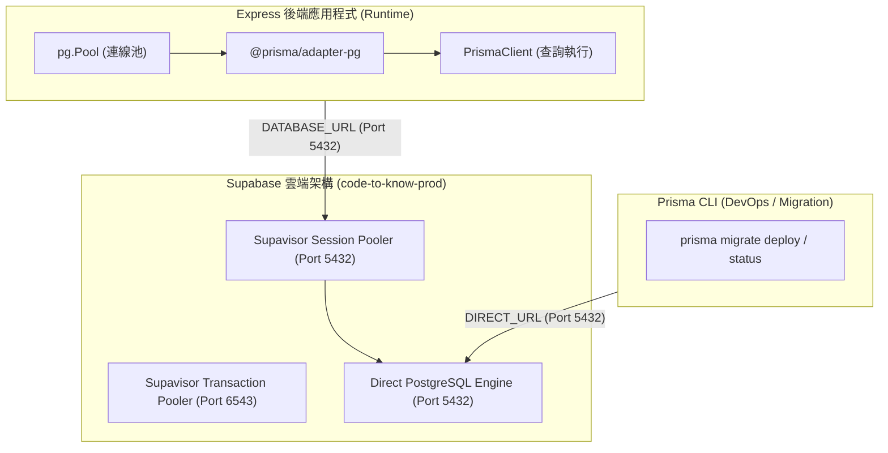

# CODE TO KNOW（碼上學）
# 資料庫連線策略：Docker、Supabase Pooler 與 Migration
# (DATABASE CONNECTION STRATEGY)

- **系統名稱**：碼上學 AI 智慧學習與教育科技平台 (CODE TO KNOW)
- **文件版本**：v1.0.0
- **建立日期**：2026-11-07
- **文件路徑**：`docs/DATABASE_CONNECTION_STRATEGY.md`
- **目的**：釐清本機 Docker 與 Supabase 雲端環境中，應用程式即時查詢（Runtime Queries）與結構遷移（Schema Migrations）之連線架構、埠位選擇與連線池配置策略。

---

## 一、連線模式架構分析 (Connection Topologies)

在雙環境架構中，共有三種主要的連線模式：



### 三種連線模式詳細比對矩陣：

| 評估指標 | 1. 本機 Docker Direct | 2. Supabase Session Pooler | 3. Supabase Direct Connection | 4. Supabase Transaction Pooler |
|---|---|---|---|---|
| **連線主機範例** | `127.0.0.1` | `aws-0-ap-southeast-2.pooler.supabase.com` | 需自 Dashboard 取得 (如 IPv6 / Dedicated) | `aws-0-ap-southeast-2.pooler.supabase.com` |
| **連線埠位** | `5432` | `5432` | `5432` | `6543` |
| **網路協議** | 原生 TCP | TCP IPv4 / IPv6 代理 | TCP (預設依託管環境而定) | TCP IPv4 / IPv6 代理 |
| **Prepared Statements** | 完整支援 | **完整支援** | 完整支援 | **不支援** (需加上 `?pgbouncer=true`) |
| **Advisory Locks (諮詢鎖)** | 完整支援 | 待 Staging 實測驗證 (`NOT TESTED`) | **官方建議首選 (`NOT TESTED`)** | **完全不支援 (嚴禁用於 Migration)** |
| **應用程式查詢 (Runtime)** | 本機開發首選 | **雲端 Express 候選連線** | 雲端 Express 備選 (連線數受限) | 僅適合極短生命週期 Serverless |
| **Prisma Migration 適用性** | 本機遷移首選 | **IPv4 候選連線，需實際測試相容性 (`NOT TESTED`)** | **優先評估作為 Migration 連線 (`NOT TESTED`)** | **不作為預設 Migration 連線** |
| **目前驗證狀態** | `PASS` (規格就緒，待 Docker 啟動) | `NOT TESTED` (待 Staging 實測) | `NOT TESTED` (待取得連線資訊與實測) | `NOT TESTED` (確定不作為預設遷移連線) |

> [!IMPORTANT]
> **連線模式與測試原則澄清**：
> 1. **Direct Connection**：優先評估作為雲端 Prisma Migration 的主要連線，以確保原生支援 PostgreSQL Session-level Advisory Lock。目前尚未自 Supabase Dashboard 取得正式直連參數，標示為 `NOT TESTED`。
> 2. **Session Pooler (Port 5432)**：可作為 IPv4 環境下連線 Supabase 的候選通道，但其對 Prisma Migration DDL 鎖與長時間結構變更的相容性，必須在 Staging 環境中實際發起測試驗證，在實測前標示為 `NOT TESTED`。
> 3. **Transaction Pooler (Port 6543)**：因交易層連線頻繁交替，不保證保持 Session 連線與諮詢鎖，**明確不作為預設 Migration 連線**。
> 4. **嚴禁混為一談**：嚴禁將 Session Pooler (Port 5432) 與 Transaction Pooler (Port 6543) 混為一談。
> 5. **杜絕虛構連線**：嚴禁在文件中自行臆測或虛構 Direct Connection 或 Pooler 的實際帳密與連線字串，所有雲端連線能力以 Staging 實際測試報告為準。

---

## 二、Express 應用程式即時連線策略 (Application Runtime)

### 1. 為何選擇 Session Pooler (Port 5432) 而非 Transaction Pooler (Port 6543)？

Express 是一個持久性執行的 Node.js 伺服器，而非無伺服器架構（Serverless Functions）：
1. **Prepared Statements 相容性**：
   - Prisma Client 在執行高頻率的查詢（例如驗證使用者 Session、提取學生成績）時，高度依賴 PostgreSQL 的預編譯敘述（Prepared Statements）以提升效能並防禦 SQL Injection。
   - Session Pooler 完整保留客戶端連線生命週期內的 Prepared Statements 快取；Transaction Pooler 則會在交易結束時立即解綁連線，導致 Prepared Statement 遺失拋出異常。
2. **多階層連線池協調**：
   - 本機 Node.js 行程透過 `pg.Pool` 維護 10-20 條長連線。
   - Supabase 端的 Supavisor Pooler 負責集中收納各個伺服器節點的連線，避免高併發時灌爆 PostgreSQL 實體連線上限（Free 方案 Direct 連線上限僅約 50-60 個）。

### 2. 連線逾時與重試機制配置

在 `backend/src/config/database.ts` 中配置強韌之連線池參數：

```typescript
const pool = new pg.Pool({
  connectionString: env.DATABASE_URL,
  max: env.NODE_ENV === 'production' ? 20 : 10, // 最大連線數
  min: 2,                                       // 保持之最小閒置連線
  idleTimeoutMillis: 30000,                     // 閒置 30 秒自動釋放
  connectionTimeoutMillis: 5000,                // 5 秒逾時中斷並拋錯
  ssl: env.DATABASE_URL.includes('sslmode=require') 
    ? { rejectUnauthorized: false } 
    : undefined,
});

// 監聽連線池例外，防止未捕獲錯誤導致 Node.js 行程無預警崩潰
pool.on('error', (err) => {
  console.error('[DATABASE POOL ERROR] Unexpected error on idle client:', err.message);
});
```

---

## 三、Prisma Migration 結構遷移連線策略 (Schema Migrations)

### 1. 遷移執行痛點與諮詢鎖 (Advisory Lock)

Prisma CLI 在執行以下指令時：
- `prisma migrate dev`
- `prisma migrate deploy`
- `prisma migrate reset`

必須在資料庫層執行 `pg_advisory_lock`，以鎖定 `_prisma_migrations` 歷史表，避免多個部屬作業同時執行產生 Race Condition。

### 2. 雙連線分離架構 (`DATABASE_URL` + `DIRECT_URL`)

依據 Prisma 官方標準，正式環境建議將應用程式連線與遷移連線解耦：

- **`DATABASE_URL`**：配置為 **Supabase Session Pooler (Port 5432)**，供 Express 後端在執行階段調用。
- **`DIRECT_URL`**：配置為 **Supabase Direct Connection (Port 5432)**，供 CI/CD Pipeline 執行 `prisma migrate deploy`。

在 `backend/prisma.config.ts` 中的適配：
```typescript
import 'dotenv/config';
import { defineConfig, env } from 'prisma/config';

export default defineConfig({
  schema: 'prisma/schema.prisma',
  migrations: {
    path: 'prisma/migrations',
  },
  datasource: {
    // 優先使用 DIRECT_URL (確保取得遷移鎖)，若無則使用 DATABASE_URL
    url: env('DIRECT_URL') || env('DATABASE_URL'),
  },
});
```

---

## 四、連線異常排查與降級因應 (Troubleshooting & Fallback)

| 常見異常代碼 / 錯誤訊息 | 發生環境 | 根本原因分析 | 標準處置程序 |
|---|---|---|---|
| **`P1001: Can't reach database server at 127.0.0.1:5432`** | 本機 Development / Test | 本機 Docker Desktop 未開啟，或容器尚未啟動。 | 1. 開啟 Docker Desktop。<br/>2. 執行 `docker compose up -d`。<br/>3. 確認 5432 埠位監聽正常。 |
| **`Prepared statement "s0" already exists`** | Supabase 雲端環境 | 誤將 Transaction Pooler (Port 6543) 作為 `DATABASE_URL`，且未加上 `?pgbouncer=true`。 | 切換為 Session Pooler (Port 5432)，或於連線字串後方附加 `&pgbouncer=true`。 |
| **`Timed out fetching a new connection from the pool`** | 高負載營運環境 | Express 連線池已滿載，或有未釋放的長時間 Transaction。 | 1. 檢查慢查詢日誌。<br/>2. 適度調大 `max` 連線數。<br/>3. 檢查未關閉的交易。 |
| **`SSL connection has been closed unexpectedly`** | Supabase 雲端環境 | 網路中斷或 Supabase 專案因 7 天閒置而進入 Paused 休眠狀態。 | 1. 登入 Supabase Dashboard。<br/>2. 若專案顯示 Paused，點擊「Restore project」。<br/>3. 升級 Pro 或配置定時健康檢查 Ping。 |
