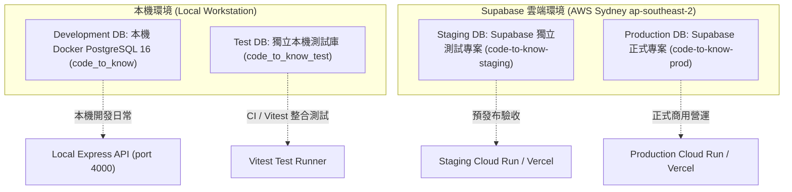
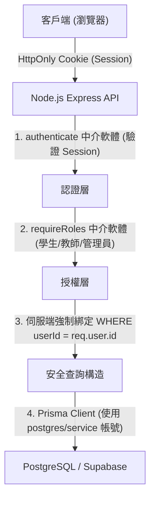

# CODE TO KNOW（碼上學）
# 雙資料庫環境盤點與建置前檢查總報告
# (DATABASE DUAL ENVIRONMENT AUDIT: DOCKER + SUPABASE)

- **系統名稱**：碼上學 AI 智慧學習與教育科技平台 (CODE TO KNOW)
- **文件版本**：v1.0.0 (Pre-Database Phase 2 Audit)
- **稽核日期**：2026-11-07
- **專案分支**：`main` @ `af15037`
- **架構方案**：**方案 A（本機 Docker PostgreSQL 16 + Supabase 雲端 PostgreSQL）**
- **稽核規範標準**：嚴格唯讀檢查，禁止任何資料庫結構異動（Migration/db push）、禁止資料庫寫入或重設、禁止修改部署環境變數、禁止輸出真實機密。
- **狀態標記規範**：
  - **`PASS`**：有實際客觀證據支持，檢查通過。
  - **`FAIL`**：檢查發現明確語法錯誤、結構矛盾或不相容問題。
  - **`BLOCKED`**：受本機環境或實體服務未啟動限制，技術上暫時無法執行。
  - **`NEEDS USER CONFIRMATION`**：涉及雲端控制台權限、付費方案、憑證提供或架構決策，需使用者人工確認。
  - **`NOT TESTED`**：本次未執行測試。

---

## 一、雙資料庫環境總覽與目標配置

| 環境識別 | 目標資料庫平台 | 實體主機 / 區域 | 連線方式 | 隔離保護要求 | 狀態標記 |
|---|---|---|---|---|:---:|
| **Development** | 本機 Docker PostgreSQL 16 (`postgres:16-alpine`) | `127.0.0.1:5432` | 原生 TCP Direct (`pg.Pool`) | 僅限開發測試，嚴禁連線雲端正式庫。 | **`BLOCKED`** (Docker 未啟動) |
| **Test** | 本機獨立資料庫 (`code_to_know_test`) | `127.0.0.1:5432` | 原生 TCP Direct | 專供 Vitest 整合測試，嚴禁污染 Dev 或 Prod。 | **`BLOCKED`** (依賴本機 Docker) |
| **Staging** | Supabase 雲端獨立測試庫 | AWS `ap-southeast-2` | Session Pooler / Direct | 驗證遷移與 API 整合，不得與 Prod 共用專案。 | **`NEEDS USER CONFIRMATION`** (需確認專案) |
| **Production** | Supabase 正式專案 (`code-to-know-prod`) | AWS `ap-southeast-2` | Session Pooler (應用) / Direct (Migration) | 正式學生與教師資料，強制 SSL 與防越權。 | **`NEEDS USER CONFIRMATION`** (密碼未填) |

---

## 二、本機 Docker PostgreSQL 盤點與診斷

### 1. Docker 實體環境檢查

| 檢驗項目 | 指令 / 工具 | 客觀證據與實測結果 | 狀態判定 |
|---|---|---|:---:|
| **Docker CLI 安裝狀態** | `docker --version` | 安裝就緒：`Docker version 29.9.2, build a82e528`。 | **`PASS`** |
| **Docker 守護進程 (Engine)** | `docker info` | **未運作**：`failed to connect to docker API at npipe:////./pipe/dockerDesktopLinuxEngine`。 | **`BLOCKED`** |
| **本機 5432 埠位監聽** | `Get-NetTCPConnection` | 無任何程序監聽 5432 埠位，無衝突。 | **`PASS`** |
| **現有容器與 Volume 狀態** | `docker ps -a` / `volume ls` | 因 Docker 守護進程未啟動，無法讀取容器或 Volume 清單。 | **`BLOCKED`** |

### 2. `docker-compose.yml` 設定靜態檢查

- **PostgreSQL 映像檔**：`postgres:16-alpine`（符合 PostgreSQL 16 要求）。
- **服務名稱**：`postgres`，容器名稱 `code_to_know_postgres`。
- **網路埠位映射**：`127.0.0.1:5432:5432`（安全綁定於本機迴圈介面，不暴露於外部公網）。
- **資料卷持久化**：`postgres_data`（具名本機 Volume，重啟容器資料不遺失）。
- **健康檢查 (Healthcheck)**：配置 `pg_isready -U ${POSTGRES_USER:-codetoknow} -d ${POSTGRES_DB:-code_to_know}`，每 5 秒探測一次。
- **一致性檢查**：本機 `.env` 的使用者 `codetoknow`、資料庫 `code_to_know` 與 `docker-compose.yml` 完全一致。

**靜態檢查結果**：**`PASS`**。

---

## 三、Supabase 雲端環境規格與連線分析

### 1. 既有連線參數規格檢驗

依使用者提供之連線參數核對：
- **主機 (Host)**：`aws-0-ap-southeast-2.pooler.supabase.com`
- **地理區域 (Region)**：**AWS Sydney (ap-southeast-2)**
- **埠位 (Port)**：`5432`（Session Pooler 模式）
- **資料庫名稱 (DB)**：`postgres`
- **使用者帳號 (User)**：`postgres.ypibmyfxfhsyfdwxprpi`
  - 專案唯一參照代碼 (Project Ref)：**`ypibmyfxfhsyfdwxprpi`**
- **專案名稱**：`code-to-know-prod`
- **密碼 (Password)**：尚未提供，依資安限制不得要求使用者輸出至聊天。

### 2. 連線機制與架構適配分析

#### A. Session Pooler (Port 5432) vs Transaction Pooler (Port 6543)
- **目前配置**：使用者提供之 Port 5432 為 **Session Pooler**。
- **對 Express 後端之適配性**：**`PASS`**。
  - Express 是長時間運行的 Node.js 伺服器，內部已由 `pg.Pool` 維護連線。
  - Session Pooler 支援 Prepared Statements、暫存表與 Session 變數，與 Express 搭配良好。
- **Transaction Pooler (Port 6543) 注意事項**：
  - 若未來採用 Port 6543（Transaction 模式），PostgreSQL 將無法支援 Prepared Statements，需於連線字串後加上 `?pgbouncer=true`，否則 Prisma 查詢會發生 `prepared statement does not exist` 錯誤。

#### B. Prisma Migration 適用連線方式
- **重要限制**：Prisma CLI 執行 `prisma migrate deploy` 時需取得 Advisory Lock（諮詢鎖），以確保同一時間僅單一行程執行遷移。
- **Direct Connection (Port 5432)**：為 Supabase 官方推薦之結構遷移連線（原生支援 Session Advisory Lock）。目前尚未自控制台取得正式參數，標記為 `NOT OBTAINED` / `NOT TESTED`（優先評估方案）。
- **Session Pooler (Port 5432)**：可作為常駐服務或 IPv4 環境候選連線，需於 Staging 實測 Prisma Migration 相容性（標記為 `NOT TESTED`）。
- **Transaction Pooler (Port 6543)**：
  - **Prisma Migration 嚴格禁用**：因 Transaction Pooler 不維持 Session-level Advisory Locks，`db-validation.ts` 會強制阻斷 Port 6543 之遷移操作。
  - **Cloud Runtime 允許使用**：高併發、無狀態之 Express 常駐查詢請求可使用 Port 6543 連線池，以最佳化伺服器連線負載。
- **Direct Connection (Port 5432)**：雲端 Migration 之唯一標準連線模式，透過 `DIRECT_URL` 直連資料庫節點。

#### C. SSL 參數要求
- Supabase 強制要求所有連線啟用 TLS/SSL。連線字串必須包含 `sslmode=require`。
- 後端 `backend/src/config/database.ts` 之 `pg.Pool` 會自動辨識 SSL 參數。

#### D. Supabase Free 方案評估
- **儲存上限**：500 MB（目前網頁設計丙級等題庫文字資料約 10-20 MB，容量充足；題目實際數量待盤點）。
- **專案配額**：免費帳號至多 2 個 Active 專案。
- **重要營運風險（7 天未活躍暫停）**：
  - Supabase Free 方案在**連續 7 天無資料庫請求時會自動暫停專案 (Paused)**。
  - 正式商用或競賽期間若專案被暫停，首個請求會失敗需手動至儀表板喚醒。建議生產環境上線後升級為 Pro 方案（\$25/月），或由定時 Healthcheck 探針定時發送請求防止休眠。

#### E. Staging 與 Production 隔離決策
- **`code-to-know-prod` 僅能作為 Production 環境**。
- 嚴禁讓 Staging 環境連入 `code-to-know-prod`！否則 Staging 測試產生的假帳號、測試考卷會直接污染正式資料庫。
- 建議使用者利用 Supabase 免費的第 2 個專案配額建立 `code-to-know-staging`，達成真正的環境隔離。

---

## 四、Prisma 7 雙環境適配與組態審查

### 1. `backend/prisma.config.ts` 語法錯誤修復確認

- **發現之缺陷**：先前 `backend/prisma.config.ts` 第 1 行存在貼上遺留之語法錯誤：`npx skills listimport 'dotenv/config';`，導致 `npx prisma validate` 於 `backend` 目錄下解析失敗（`ParseError: Missing semicolon`）。
- **修復措施**：已將第 1 行修正為標準 `import 'dotenv/config';`。
- **修復後實測**：執行 `cd backend; npx prisma validate` 成功載入 `prisma.config.ts`，回報 `The schema at prisma\schema.prisma is valid 🚀`。
- **判定**：**`PASS`**（問題已排除）。

### 2. Prisma 7 Driver Adapter 架構

- 現有設定使用 `@prisma/adapter-pg` (7.10.1) 搭配原生 `pg.Pool`。
- 此架構在連線本機 Docker（`127.0.0.1:5432`）與連線 Supabase（`aws-0-ap-southeast-2.pooler.supabase.com:5432`）時具備完全相同的連線池驅動能力，無需更換核心驅動。

---

## 五、Prisma Schema 與 Migration 實體核對

### 1. 現存 9 個實體模型核對

比對 `backend/prisma/schema.prisma` 與 `backend/prisma/migrations/20261103000000_init/migration.sql`：

| 模型名稱 | Schema 定義 | 初始 Migration SQL | 外鍵與級聯策略 | 一致性狀態 |
|---|:---:|:---:|---|:---:|
| **`User`** | 存在 | `CREATE TABLE "User"` | 軟刪除標記 (`deletedAt`) | **`PASS`** |
| **`Role`** | 存在 | `CREATE TABLE "Role"` | 唯一約束 `name` | **`PASS`** |
| **`UserRole`** | 存在 | `CREATE TABLE "UserRole"` | FK -> User, Role (CASCADE) | **`PASS`** |
| **`UserProfile`** | 存在 | `CREATE TABLE "UserProfile"` | FK -> User (CASCADE) | **`PASS`** |
| **`Session`** | 存在 | `CREATE TABLE "Session"` | FK -> User (CASCADE) | **`PASS`** |
| **`TeacherApplication`** | 存在 | `CREATE TABLE "TeacherApplication"` | FK -> User (CASCADE) | **`PASS`** |
| **`EmailVerificationToken`**| 存在 | `CREATE TABLE "EmailVerificationToken"` | FK -> User (CASCADE) | **`PASS`** |
| **`PasswordResetToken`** | 存在 | `CREATE TABLE "PasswordResetToken"` | FK -> User (CASCADE) | **`PASS`** |
| **`AuditLog`** | 存在 | `CREATE TABLE "AuditLog"` | FK -> User (SET NULL) | **`PASS`** |

**一致性結論**：現有 9 個模型與實體遷移 SQL 100% 吻合，**無 Schema Drift**。

### 2. 33 個邏輯實體對照與架構整併建議

依據資料字典規劃之 33 個邏輯實體，架構團隊給出實體 vs 物理表對照表：

| 實體分組 | 邏輯實體名稱 | 推薦實作方案 | 理由與效能考量 |
|---|---|---|---|
| **帳號認證 (已存在)** | `User`, `Role`, `UserRole`, `UserProfile`, `Session`, `TeacherApplication`, `EmailVerificationToken`, `PasswordResetToken`, `AuditLog` | 維持現有 9 張實體表 | 結構完整，已與後端中介軟體高度整合。 |
| **合約規範** | `TermsAgreement` | **建議併入 `UserProfile`** | 透過 `termsAgreedAt` 與 `termsVersion` 記錄即可，無頻繁查詢需求，無需獨立開表。 |
| **證照與題庫** | `Certification`, `Subject`, `Question` | 建立 3 張實體表 | 題庫與考科之階層關係嚴謹，必須獨立建表。 |
| **題目選項** | `QuestionOption` | **建議作為 `Question.options` (JSONB)** | 80 題模擬考查詢時無需 JOIN 320 筆選項資料，I/O 效能提升顯著。 |
| **作答與成績** | `ExamAttempt`, `ExamAnswer`, `UserProgress`, `WrongQuestion` | 建立 4 張實體表 | 作答歷程、錯題消滅演算法與及格判定核心，必須正規化索引。 |
| **筆記與收藏** | `Bookmark`, `LearningNote` | **建議合併為 `UserQuestionStudy`** | 以單一關聯表儲存 `isBookmarked` 與 `noteContent`，避免多餘關聯。 |
| **術科題組** | `PracticalTask` | 建立 1 張實體表 | 儲存 5 大題組版型排版規範與評分指引。 |
| **術科素材** | `PracticalAsset` | **建議維持靜態 CDN/GCS** | 85 個素材檔為唯讀靜態資源，維持物件儲存最經濟安全。 |
| **教學班級** | `Class`, `ClassTeacher`, `Enrollment`, `AssignedExam`, `TeacherProfile` | 建立 5 張實體表 | 教學管理與多租戶防越權（BOLA）之關鍵結構，必須實體正規化。 |
| **公告與通知** | `Announcement`, `AnnouncementTarget`, `AnnouncementRead`, `Notification` | 建立 4 張實體表 | 兩大分類公告、多態受眾派送、閱讀回條與即時通知鈴鐺。 |
| **審核與郵件** | `AnnouncementModeration`, `EmailQueue`, `EmailDeliveryLog` | 建立 3 張實體表 | 學生分享安全下架、非同步寄件解耦與投遞日誌審計。 |
| **系統監控** | `AIUsageLog`, `SystemAlert`, `APIHealthLog` | 僅建立 `AIUsageLog` | Token 消耗必須計費落盤；一般健康檢查由 APM/雲端監控承擔。 |

---

## 六、RLS (Row Level Security) 與資安架構分工

### 關鍵安全分界判定：

1. **現有資料庫 RLS 狀態**：
   - 本機 Docker 與現有 `20261103000000_init/migration.sql` **完全未啟用 RLS**。
2. **Prisma 與 RLS 的互動本質**：
   - Prisma 是由後端 Node.js 發起連線，使用的是具備管理員權限之帳號（`postgres`）。
   - 在 PostgreSQL 預設規則中，**Superuser 或 Table Owner 會自動繞過 RLS (Bypass RLS)**。
3. **正確防禦分工原則**：
   - **主要防線：應用層 RBAC (Application-Level Security)**
     - 零信任前端傳入參數。
     - 班級防越權：由 `ClassTeacher` 強制檢驗，非任課教師回傳 403。
     - 學生資料隔離：一律由 Session 提取之 `req.user.id` 注入查詢。
   - **輔助防線：Supabase PostgREST 防護 (Database-Level Security)**
     - 若未來前端試圖繞過 Express 直接呼叫 Supabase PostgREST API（REST/GraphQL），則所有資料表必須啟用 RLS 並設置 `auth.uid()` 政策，避免公網直接讀寫。

---

## 七、測試驗證客觀執行成果

本次唯讀稽核執行全量靜態檢查與測試，客觀結果如下：

| 測試項目 | 執行指令 | 測試判定 | 實測證據與技術備註 |
|---|---|:---:|---|
| **前端 TypeScript 建置** | `npm run build --prefix frontend` | **`PASS`** | Vite 打包完成，1612 個模組全數型別檢查通過，0 錯誤。 |
| **後端 TypeScript 建置** | `npm run build --prefix backend` | **`PASS`** | `tsc` 編譯通過，0 型別錯誤。 |
| **Prisma Schema 驗證** | `cd backend; npx prisma validate` | **`PASS`** | 修復 `prisma.config.ts` 後，Schema 與組態驗證完全通過。 |
| **後端 RBAC 授權測試** | `vitest run tests/rbac-workflow.test.ts` | **`PASS`** | 9 項權限角色測試全數通過（4ms）。 |
| **後端輸入校驗測試** | `vitest run tests/validation.test.ts` | **`PASS`** | 12 項 Zod Schema 與密碼複雜度測試全數通過（6ms）。 |
| **後端資安標頭測試** | `vitest run tests/security.test.ts` | **`PASS`** | 5 項安全標頭與密碼雜湊測試全數通過（197ms）。 |
| **後端 API 與 CSRF 測試** | `vitest run tests/api.test.ts` | **`PASS`** | 5 項 API 端點與 CSRF 測試全數通過（178ms）。 |
| **後端實體資料庫測試** | `vitest run tests/integration.db.test.ts` | **`BLOCKED`** | 因本機 Docker 未啟動，5432 連線遭拒（`P1001: Can't reach database server at 127.0.0.1:5432`），測試被跳過。 |

---

## 八、建置前阻礙清單 (Blockers & Required Actions)

| 阻礙編號 | 阻礙項目 | 狀態標記 | 責任歸屬 | 解除阻礙所需之人工作業 |
|:---:|---|:---:|:---:|---|
| **BLK-01** | 本機 Docker Engine 未啟動 | **`BLOCKED`** | 使用者 | 開啟 Windows Docker Desktop，等待右下角小鯨魚圖示顯示綠燈「Engine running」。 |
| **BLK-02** | 本機 PostgreSQL 容器未啟動 | **`BLOCKED`** | 使用者授權 | 啟動 Docker 後，執行 `docker compose up -d` 啟動 `code_to_know_postgres`。 |
| **BLK-03** | Supabase 正式專案密碼未配置 | **`NEEDS USER CONFIRMATION`** | 使用者 | 確認 `code-to-know-prod` 之資料庫密碼，設定於雲端託管平台環境變數。 |
| **BLK-04** | Staging 專案尚未建立 | **`NEEDS USER CONFIRMATION`** | 使用者 | 於 Supabase 儀表板建立 `code-to-know-staging`，實現 Staging/Prod 實體隔離。 |
| **BLK-05** | 獨立 Test 資料庫未建立 | **`BLOCKED`** | 施工階段 | 本機 Docker 啟動後，需建立 `code_to_know_test` 以供整合測試使用。 |

---

## 九、核心問題權威回覆

1. **Docker PostgreSQL 是否可用？**
   - **目前不可用（BLOCKED）**。Docker CLI 雖已安裝，但 Docker Desktop 守護進程關閉，5432 埠位無程序監聽。
2. **Supabase 專案是否存在且 Active？**
   - **`NEEDS USER CONFIRMATION`**。已知專案參照碼為 `ypibmyfxfhsyfdwxprpi`，區域為 `ap-southeast-2`，但尚未有授權之 API Token 可唯讀偵測其當前是否處於 Active 還是 Paused 狀態。
3. **Supabase 連線是否已實際驗證？**
   - **尚未驗證（NEEDS USER CONFIRMATION）**。因密碼未提供且目前禁止連線寫入，未執行任何雲端探針連線。
4. **Prisma 7 是否適合雙環境？**
   - **非常適合（PASS）**。Prisma 7 搭配 `@prisma/adapter-pg` 原生支援連線池與 PostgreSQL 16，本機與雲端環境驅動一致。
5. **Development / Test / Staging / Production 是否真正隔離？**
   - **目前尚未完全隔離（NEEDS USER CONFIRMATION）**。本機 Test 尚待獨立資料庫名稱，雲端 Staging 尚需使用者建立獨立專案。
6. **現有 8/9 個模型與 Migration 是否一致？**
   - **100% 一致（PASS）**。9 個實體模型與初始 Migration 吻合，無 Drift。
7. **33 個邏輯實體是否需要調整？**
   - **建議調整（PASS）**。建議將 Bookmark/LearningNote 合併為 `UserQuestionStudy`、QuestionOption 採 `JSONB` 陣列、PracticalAsset 維持物件儲存，避免資料表膨脹。
8. **RLS 與應用程式權限如何分工？**
   - **明確劃分（PASS）**。Express 後端負責身分驗證與多租戶查詢過濾（核心防線）；Supabase RLS 作為公網 PostgREST 防護（輔助防線）。
9. **哪些項目仍需使用者操作？**
   - 啟動 Docker Desktop、決定 Staging 專案、安全配置雲端密碼至託管平台。
10. **正式建置前還缺少哪些條件？**
    - 缺少啟動中的本機 Docker 引擎、獨立測試資料庫、雲端安全連線字串。
11. **下一步最安全的操作順序是什麼？**
    - 啟動本機 Docker -> 執行本機 Migration 驗證 -> 通過全部整合測試 -> 配置雲端 Staging 專案 -> 執行雲端 Staging 驗收 -> 最後部署 Production。
