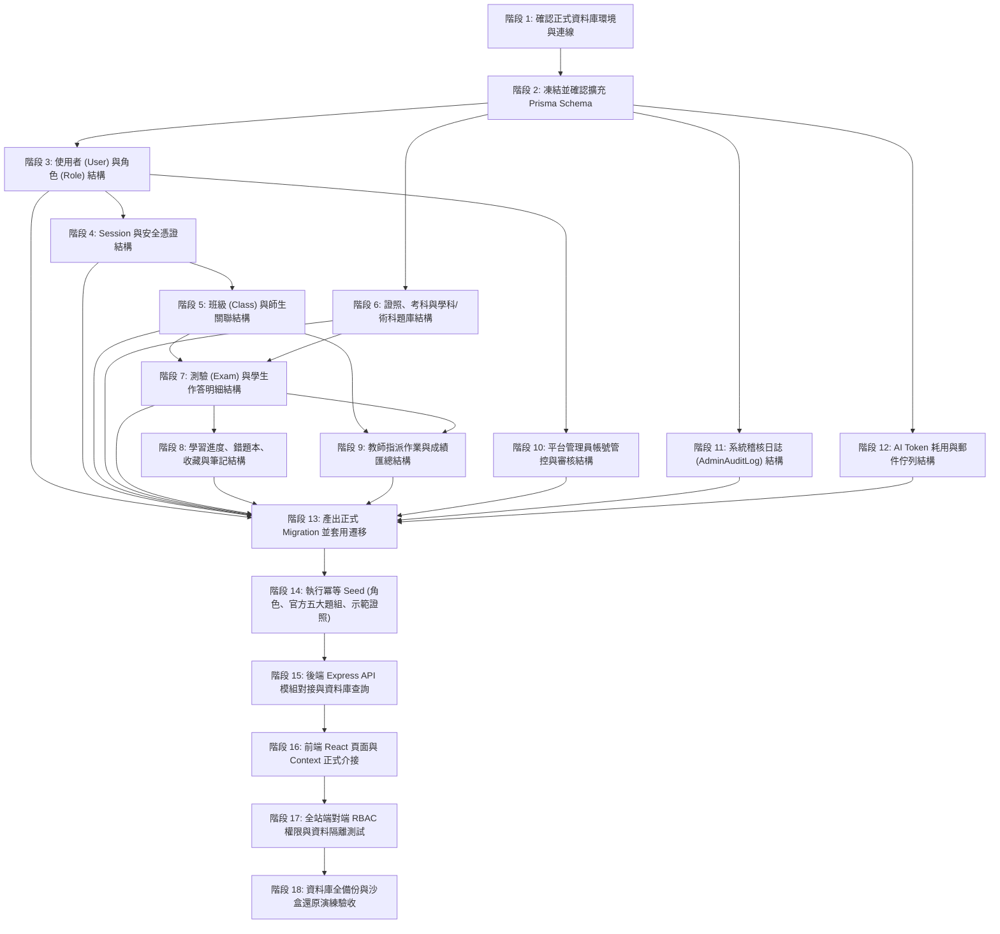

# CODE TO KNOW（碼上學）
# 資料庫正式施工順序與階段里程碑藍圖 (DATABASE IMPLEMENTATION ROADMAP)

- **系統名稱**：碼上學 AI 智慧學習與教育科技平台 (CODE TO KNOW)
- **文件版本**：v1.0.0 (Pre-Database Implementation)
- **建立日期**：2026-11-07
- **文件路徑**：`docs/DATABASE_IMPLEMENTATION_ROADMAP.md`
- **施工指導原則**：依賴關係由底向上（Bottom-Up），確保資料表無斷裂外鍵相依；先遷移基礎核心、再導入業務關聯、最後進行應用對接與驗收。

---

## 一、18 階段正式施工順序甘特邏輯

---

## 二、各階段施工詳細規格與驗收基準

### 階段 1：確認正式資料庫環境 (Database Environment Bootstrap)
- **前置條件**：使用者啟動本機 Docker Desktop 引擎，或提供雲端託管 PostgreSQL 連線參數。
- **預計產出**：5432 埠位處於監聽狀態，`pg_isready` 回傳正常。
- **驗收方式**：`prisma.$queryRaw'SELECT 1'` 成功連線，無連線遭拒錯誤。

### 階段 2：確認並凍結 Prisma Schema (Schema Consolidation)
- **前置條件**：五層架構資料字典（`docs/DATABASE_DATA_DICTIONARY.md`）經架構小組審查通過。
- **預計產出**：將 25 張資料表實體整合編寫至 `backend/prisma/schema.prisma`。
- **驗收方式**：`npx prisma validate` 通過，無語法或外鍵關聯衝突。

### 階段 3：使用者及角色資料 (User & RBAC Base)
- **預計產出**：`User`, `Role`, `UserRole`, `UserProfile` 擴充定義。
- **驗收方式**：能建立多個不同角色並正確映射至單一帳號。

### 階段 4：Session 與認證資料 (Stateful Session & Tokens)
- **預計產出**：`Session`, `EmailVerificationToken`, `PasswordResetToken` 關聯綁定。
- **驗收方式**：登入發布 Cookie 雜湊能精確落入 `Session` 表。

### 階段 5：班級與師生關係 (Class & Enrollment)
- **預計產出**：`Class`, `ClassTeacher`, `Enrollment` 資料表。
- **驗收方式**：建立班級後，學生能透過唯一 `inviteCode` 成功寫入 `Enrollment`。

### 階段 6：題庫及教材資料 (Question Bank & Certifications)
- **預計產出**：`Certification`, `Subject`, `Question`, `QuestionOption`, `PracticalTask`, `PracticalAsset`。
- **驗收方式**：將網頁設計丙級官方素材與學科題庫資料格式化轉換為資料庫種子。

### 階段 7：考試與作答資料 (Exam Attempts & Answers)
- **預計產出**：`ExamAttempt`, `ExamAnswer`, `ExamResult`。
- **驗收方式**：學生模擬考提交後，正確於資料庫保存每題作答歷程與總分。

### 階段 8：學習進度、錯題本及筆記 (User Progress, Wrong Questions & Notes)
- **預計產出**：`UserProgress`, `WrongQuestion`, `Bookmark`, `LearningNote`。
- **驗收方式**：答錯題目自動觸發 `WrongQuestion` Upsert，不重複插入。

### 階段 9：教師教學資料 (Teacher Assignments & Grades)
- **預計產出**：`TeacherProfile`, `AssignedExam`, `StudentGrade`。
- **驗收方式**：教師指派測驗後，該班學生專區能即時看見作業通知。

### 階段 10：平台管理資料 (Platform Administration)
- **預計產出**：`TeacherApplication` 審核與使用者狀態異動機制。
- **驗收方式**：管理員核准教師申請後，使用者角色自動在資料庫提升為 `TEACHER`。

### 階段 11：公告、通知與審核系統 (Announcements & Notifications)
- **預計產出**：`Announcement`, `AnnouncementTarget`, `AnnouncementRead`, `AnnouncementAttachment`, `AnnouncementModeration`, `Notification`。
- **驗收方式**：驗證平台官方公告發布流、班級教學公告多租戶隔離、學生心得分享防洗版與檢舉機制、已讀回條狀態記錄。

### 階段 12：系統稽核、AI 用量與非同步郵件佇列 (Audit Trail, Telemetry & Queues)
- **預計產出**：`AdminAuditLog`, `SystemAuditLog`, `AIUsageLog`, `EmailQueue`, `EmailDeliveryLog`。
- **驗收方式**：管理操作自動落盤稽核；AI Token 消耗與延遲落盤；郵件解耦排入佇列非同步發送，記錄投遞日誌並脫敏。

### 階段 13：產出正式 Migration 並套用遷移 (Execute Migration)
- **前置條件**：確認資料庫備份就緒，環境變數指向目標環境。
- **預計產出**：`prisma migrate dev --name init_five_layer_system` 生成全新 Migration SQL。
- **驗收方式**：資料庫實體產生全量 33 張資料表與各項索引約束。

### 階段 14：執行冪等 Seed (Data Seeding)
- **預計產出**：執行 `prisma/seed.ts`，灌入預設角色、網頁設計丙級五大題組、官方題庫、初始管理員。
- **驗收方式**：重複執行 Seed 指令不會發生主鍵或唯一索引衝突。

### 階段 15：API 串接 (Backend Service & Controller Wiring)
- **預計產出**：完成 `students`, `teachers`, `admin`, `ops` 各模組之 Express 路由與 Service。
- **驗收方式**：整合測試 `vitest run tests/api.test.ts` 全數通過。

### 階段 16：前端串接 (Frontend API Integration)
- **預計產出**：將 `StudentDashboardPage`、`TeacherDashboardPage`、`LearningProgressPage` 的寫死假資料徹底拔除，替換為真實 API 呼叫。
- **驗收方式**：未登入者無法看到任何名冊；登入後展示真實個人數據。

### 階段 17：權限測試 (Comprehensive RBAC E2E Test)
- **預計產出**：執行跨角色（學生試圖進入教師後台、非本班教師調閱其他班級名冊）攻擊測試。
- **驗收方式**：全數觸發 403 Forbidden，零資料越權外洩。

### 階段 18：備份及還原測試 (Disaster Recovery Validation)
- **預計產出**：執行 `pg_dump` 導出資料，並於全新乾淨資料庫中成功 `pg_restore`。
- **驗收方式**：還原後的資料筆數與校驗碼完全相符，驗證通過。
