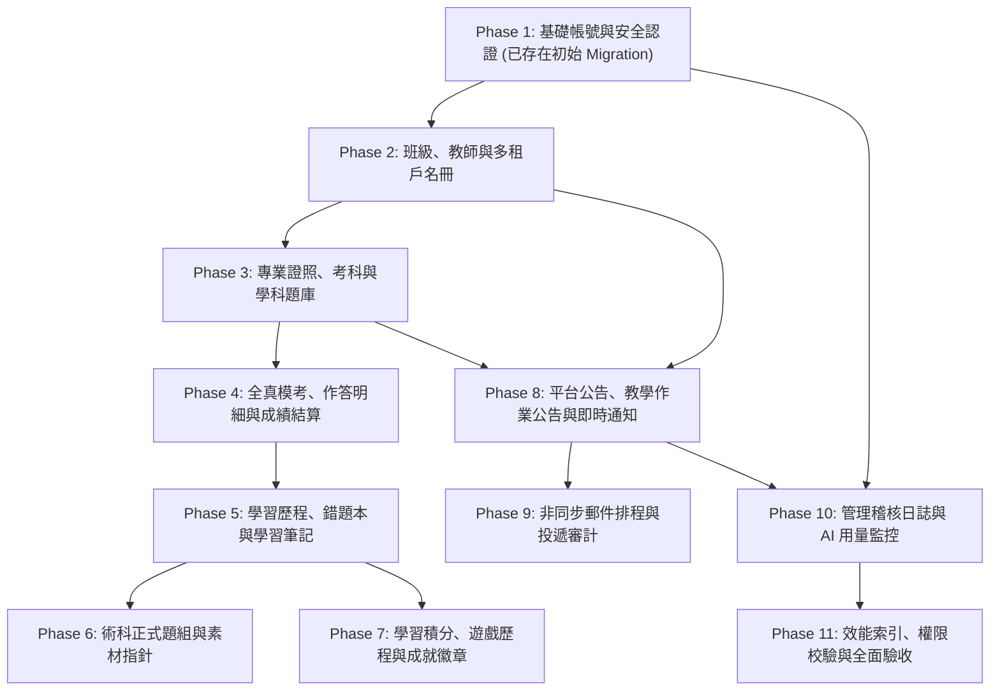

# CODE TO KNOW（碼上學）
# 分階段資料庫遷移施工計畫 (DATABASE MIGRATION EXECUTION PLAN)

- **系統名稱**：碼上學 AI 智慧學習與教育科技平台 (CODE TO KNOW)
- **文件版本**：v1.0.0 (Pre-Database Implementation)
- **建立日期**：2026-11-07
- **文件路徑**：`docs/DATABASE_MIGRATION_EXECUTION_PLAN.md`
- **執行原則**：
  1. **本文件僅作為未來正式施工之規範指南，本次任務絕對不執行任何 Migration 指令**。
  2. 依循由底層至上層、低耦合至高耦合的漸進式遷移策略。
  3. 每一階段均定義具體的依賴模型、回滾風險與驗收條件。
  4. 實體整併原則：**33 個邏輯實體不等於必須盲目建立 33 張實體資料表**。

---

## 一、遷移施工階梯總覽 (Migration Staging Roadmap)

---

## 二、初始 Migration 安全執行原則與工具用途區分

目前專案已存在初始遷移檔案：
`backend/prisma/migrations/20261103000000_init/migration.sql`

為確保 Migration 歷史與 Schema 精確對齊，嚴格落實以下執行規範：

### 1. 嚴禁重複建立 `init` 遷移
- **禁止指令**：`npx prisma migrate dev --name init`
- **原因**：初始 Migration 檔案已落盤存在。若重複執行帶有 `--name init` 的建立指令，Prisma 將嘗試生成重複的遷移目錄（如 `2026xxxxxx_init`），導致遷移衝突或資料表重複建立報錯。

### 2. `prisma migrate dev` 與 `prisma migrate deploy` 的明確用途劃分
| 命令類型 | 核心機制 | 適用環境與情境 | 是否要求 Shadow DB |
| :--- | :--- | :--- | :---: |
| **`prisma migrate deploy`** | 1. 僅讀取既有的 `prisma/migrations` 歷史。 2. 依序將尚未執行的遷移 SQL 套用至目標資料庫。 3. 記錄執行狀態至 `_prisma_migrations`。 4. **絕不修改 Schema、絕不產生新遷移檔案**。 | **• 本機全新空白資料庫初始化** • Staging / Production 雲端正式遷移 • CI/CD 自動化建置管線 | **否** |
| **`prisma migrate dev`** | 1. 比對 `schema.prisma` 與現有遷移歷史。 2. 自動在 Shadow Database 上模擬演繹。 3. 生成新的 Migration SQL 檔案並套用。 4. 自動重新生成 Prisma Client。 | • 僅用於開發階段**修改了 `schema.prisma` 欄位**，需要產生下一個全新 Migration 時。 | **是** |

### 3. 本機初始建置安全標準作業程序 (SOP)
1. **確認空白狀態**：連線本機資料庫執行 `SELECT count(*) FROM information_schema.tables WHERE table_schema = 'public';`，確認為 0 張表。
2. **安全套用既有遷移**：執行 `npx prisma migrate deploy`，直接套用既有 `20261103000000_init/migration.sql`。
3. **驗證歷史記錄**：確認 `_prisma_migrations` 表已寫入 `20261103000000_init`，狀態為 `finished_at IS NOT NULL`。
4. **授權紅線**：在真正執行 Migration 前，**必須取得使用者明確文字授權**，本階段嚴格不執行任何遷移操作。

---

## 三、十一階段施工細部規格

### Phase 1：基礎帳號與角色權限 (Auth & RBAC Foundation)
- **現況**：✅ **已包含於現有遷移 `20261103000000_init`**。
- **涵蓋模型**：`User`, `Role`, `UserRole`, `UserProfile`, `Session`, `TeacherApplication`, `EmailVerificationToken`, `PasswordResetToken`, `AuditLog`。
- **依賴模型**：無。
- **建議 Migration 名稱**：`20261103000000_init`。
- **回滾風險**：極高（需清空整個資料庫）。
- **驗收條件**：使用者註冊、密碼 bcrypt 雜湊、發行 HttpOnly Session Cookie、角色核准流程通過。

---

### Phase 2：班級、教師與多租戶名冊 (Class & Educator Multi-Tenancy)
- **目標**：拔除教師儀表板之硬編碼 5 位假學生，建立多租戶班級隔離骨幹。
- **新增/修改模型**：`TeacherProfile`, `Class`, `ClassTeacher`, `Enrollment`。
- **依賴模型**：`User` (Phase 1)。
- **建議 Migration 名稱**：`20261108000001_class_and_enrollment`。
- **外鍵與約束**：
  - `ClassTeacher`: `@@unique([classId, teacherId])`
  - `Enrollment`: `@@unique([classId, studentId])`, `code` 與 `inviteCode` 唯一索引。
- **回滾風險**：低（僅影響新建立之班級名冊）。
- **測試項目**：驗證跨班調閱名冊回傳 403 `ACCESS_DENIED_NOT_CLASS_TEACHER`。
- **驗收條件**：教師能建立班級、產生 8 碼邀請碼，學生能自主加入，導師能檢視在籍名冊。

---

### Phase 3：專業證照、考科與學科題庫 (Certifications & Question Bank)
- **目標**：將前端靜態 `unifiedQuestionBankData.ts` 數百題完整遷移至後端。
- **新增/修改模型**：`Certification`, `Subject`, `Question`（選項採 `JSONB options` 嵌入以提升抽題效能）。
- **依賴模型**：無。
- **建議 Migration 名稱**：`20261108000002_certifications_and_questions`。
- **回滾風險**：中（題庫資料量大，回滾需備份題庫 SQL）。
- **測試項目**：證照代碼唯一性、題號排序、題目狀態過濾（`status = 'ACTIVE'`）。
- **驗收條件**：執行 `prisma/seed.ts` 能冪等匯入學科題目（實際題數待盤點確認，Seed 作業與結構遷移嚴格脫鉤並獨立驗收）。

---

### Phase 4：考試、作答與成績 (Mock Exams & Assessment Engine)
- **目標**：支援全真模擬考抽題、學生交卷自動比對答案、及格門檻判定。
- **新增/修改模型**：`ExamAttempt`, `ExamAnswer`, `AssignedExam`。
- **依賴模型**：`User`, `Class`, `Certification`, `Question`。
- **建議 Migration 名稱**：`20261108000003_exam_and_attempts`。
- **外鍵與約束**：`Question -> ExamAnswer` 設為 **`RESTRICT`**（已有作答紀錄之題目嚴禁物理刪除）。
- **回滾風險**：高（涉及學生正式測驗成績，禁止隨意刪表）。
- **測試項目**：單次測驗 80 題隨機抽題、計分事務原子性、防超時交卷。
- **驗收條件**：交卷後 500ms 內完成算分並寫入 `ExamAttempt`，及格狀態正確標記。

---

### Phase 5：學習歷程、錯題與筆記 (Learning Progress & Study Artifacts)
- **目標**：儲存個人進度儀表板累計指標、智能錯題本消滅演算法與解題筆記。
- **新增/修改模型**：`UserProgress`, `WrongQuestion`, `UserQuestionStudy`（合併 Bookmark 與 LearningNote）。
- **依賴模型**：`User`, `Certification`, `Question`。
- **建議 Migration 名稱**：`20261108000004_progress_and_wrong_questions`。
- **回滾風險**：低。
- **測試項目**：答錯自動 Upsert 至 `WrongQuestion`、連續答對 3 次標記 `isMastered = true`。
- **驗收條件**：學生跨裝置登入能同步錯題本與收藏題目。

---

### Phase 6：實作素材索引與物件儲存 (Practical Tasks & Asset Pointers)
- **目標**：收錄網頁設計丙級五大題組（104301~104305）之規範與 85 個素材指針。
- **新增/修改模型**：`PracticalTask`（85 個素材檔維持 CDN/GCS 靜態儲存，資料表僅儲存題組規格 JSON）。
- **依賴模型**：`Certification`。
- **建議 Migration 名稱**：`20261108000005_practical_tasks`。
- **回滾風險**：極低。
- **測試項目**：五大題組代碼唯一性校驗、官方題組名稱精準對齊。
- **驗收條件**：前端能藉由 API 動態讀取五大題組版型說明與素材下載位址。

---

### Phase 7：遊戲、積分與獎勵 (Gamification & Achievements)
- **目標**：激勵自主學習，記錄通關打卡、打字練習成績與成就徽章。
- **新增/修改模型**：`Achievement`, `UserAchievement`, `UserPoints`。
- **依賴模型**：`User`。
- **建議 Migration 名稱**：`20261108000006_gamification`。
- **回滾風險**：低。
- **測試項目**：成就解鎖唯一性 `@@unique([userId, achievementId])`、點數累加防負值。
- **驗收條件**：學生完成模擬考自動增加學習積分並觸發徽章解鎖。

---

### Phase 8：平台公告、教學公告與通知 (Announcements & Notification Hub)
- **目標**：落實全站兩大類公告（平台官方 vs 使用者教學）與多態受眾派送。
- **新增/修改模型**：`Announcement`, `AnnouncementTarget`, `AnnouncementRead`, `Notification`。
- **依賴模型**：`User`, `Class`。
- **建議 Migration 名稱**：`20261108000007_announcements_and_notifications`。
- **外鍵與約束**：
  - `AnnouncementRead`: `@@unique([announcementId, userId])`（已讀冪等）
  - `User -> Announcement`: **`RESTRICT`**（發布者刪除時歷史公告保留）。
- **回滾風險**：中。
- **測試項目**：學生跨班查詢公告阻絕、官方公告公開查詢、未讀紅點計數。
- **驗收條件**：通過 12 項公告專屬驗收測試 (`TP-ANN-01` ~ `TP-ANN-12`)。

---

### Phase 9：Email 佇列與投遞審計 (Async Email Queue & Delivery Logs)
- **目標**：非同步解耦郵件寄送任務，防止 SMTP 延遲阻塞 HTTP API 主執行緒。
- **新增/修改模型**：`EmailQueue`, `EmailDeliveryLog`, `AnnouncementModeration`。
- **依賴模型**：`Announcement`, `User`。
- **建議 Migration 名稱**：`20261108000008_email_queue_and_moderation`。
- **外鍵與約束**：`Announcement -> EmailQueue`: **`SET NULL`**（公告刪除保留寄件審計）。
- **回滾風險**：極低。
- **測試項目**：佇列狀態流轉 (`PENDING` -> `PROCESSING` -> `SENT`/`FAILED`)、3 次退避重試、Email 脫敏。
- **驗收條件**：大量發信 API 能在 50ms 內完成排程寫入並返回 HTTP 200。

---

### Phase 10：平台管理稽核日誌與 AI 監控 (Admin Auditing & AI Telemetry)
- **目標**：落實 ISO 27001 資安規範與 AI Token 成本用量監控。
- **新增/修改模型**：`AdminAuditLog` (WORM 策略，嚴禁刪除), `AIUsageLog`。
- **依賴模型**：`User`。
- **建議 Migration 名稱**：`20261108000009_audit_and_telemetry`。
- **回滾風險**：低。
- **測試項目**：管理員審批教師時原子寫入稽核表、AI 教練呼叫延遲與 Token 消耗落盤。
- **驗收條件**：所有提權與封鎖操作皆具備不可抹除之審計日誌。

---

### Phase 11：效能索引、權限校驗與全面驗收 (Hardening & Final Verification)
- **目標**：建立複合查詢索引、檢驗 PostgreSQL 連線池水位與備份還原演練。
- **新增/修改**：
  - `@@index([userId, createdAt])` (作答記錄快查)
  - `@@index([classId, status])` (班級名冊快查)
  - `@@index([category, status, publishedAt])` (公開公告快查)
- **建議 Migration 名稱**：`20261108000010_indexes_and_optimizations`。
- **回滾風險**：低。
- **測試項目**：`vitest run tests/integration.db.test.ts` 全數通過、100 名併發壓力測試。
- **驗收條件**：全站 31 項單元測試 ＋ 實體資料庫整合測試全數為 **`PASS`**。
