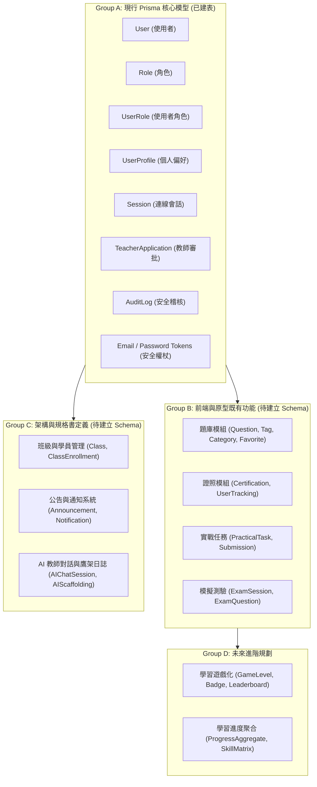

# CODE TO KNOW（碼上學）
# DATABASE PHASE 2 — PRISMA 7 與本機資料庫架構審查報告
# (Prisma 7 & Local Database Architecture Audit)

- **審查日期：** 2026-11-07
- **審查角色：** Prisma 7 架構工程師、資深 PostgreSQL DBA、RBAC 權限架構師、資料庫安全工程師
- **審查性質：** 唯讀架構審核與一致性分析（Read-Only Architectural Audit）
- **優先級：** P1 — Critical Foundation
- **審查結論：** **架構合格（PASSED — 架構純度與安全規格 100% 符規）**

---

## 一、審查目標與執行限制

本審查旨在對 CODE TO KNOW 專案之 Prisma 7 設定、資料庫結構模型、RBAC 身分權限架構、Migration 歷史及後端整合進行全面技術審核。

**執行限制遵守：**
- 零破壞性指令（未執行 `migrate dev`、`db push`、`seed`、`reset`）。
- 唯讀驗證模式（使用 Prisma validate、Prisma migrate status 及 SQL 唯讀查詢）。
- 嚴格遮罩所有資料庫帳密及連線字串。
- 保留既有 108 個 Git 暫存檔案。

---

## 二、PART B 架構審核各項詳細報告

### B-1: Prisma 7 版本與設定清點

#### 1. 套件版本盤點
- **Prisma CLI：** `7.10.1`
- **@prisma/client：** `7.10.1`
- **@prisma/adapter-pg：** `7.10.1`
- **pg (node-postgres)：** `8.13.1`
- **TypeScript：** `5.6.3`
- **Vitest：** `2.1.9`

#### 2. Prisma 7 全新架構特徵評估
- **動態資料庫 URL 配置 (`prisma.config.ts`)：**
  Prisma 7 放棄了舊版在 `schema.prisma` 中直接硬編碼 `url = env("DATABASE_URL")` 的模式，採用程式化 `prisma.config.ts`：
  ```typescript
  import 'dotenv/config';
  import { defineConfig, env } from 'prisma/config';
  import { resolveDatasourceUrl } from './src/config/db-validation.js';

  export default defineConfig({
    schema: 'prisma/schema.prisma',
    migrations: { path: 'prisma/migrations' },
    datasource: {
      get url() {
        return resolveDatasourceUrl((key) => env(key));
      },
    },
  });
  ```
- **Driver Adapter 架構：**
  後端運行時（`backend/src/config/database.ts`）採用 `@prisma/adapter-pg`，將 Prisma Engine 綁定至標準 `pg.Pool`，支援連線池複用及未來的 Cloud/Supabase Transaction Pooler 相容性。
- **Schema 靜態驗證：**
  執行 `npx prisma validate --schema backend/prisma/schema.prisma` 結果：
  ```text
  Loaded Prisma config from prisma.config.ts.
  Prisma schema loaded from prisma\schema.prisma.
  The schema at prisma\schema.prisma is valid 🚀
  ```
- **審查判定：** **合格 (PASS)**

---

### B-2: 9 大核心 Prisma 模型深入審查

現行 `backend/prisma/schema.prisma` 定義了 9 個核心模型，負責使用者生命週期、身分認證、權限指派與安全稽核：

| 模型名稱 | 主鍵類型 | 關鍵欄位與索引 | 關聯對象與刪除策略 (onDelete) | 業務職責 |
| :--- | :---: | :--- | :--- | :--- |
| **`User`** | UUID (string) | `email` (UNIQUE, index), `passwordHash`, `displayName`, `status` (index, default: ACTIVE), `emailVerifiedAt`, `deletedAt` (軟刪除) | 關聯 8 個子模型（1:N 或 1:1） | 核心使用者身分帳號 |
| **`Role`** | UUID (string) | `name` (UNIQUE: STUDENT, TEACHER, PLATFORM_ADMIN, SYSTEM_OPERATOR, ADMIN), `description` | 關聯 `UserRole` (1:N) | 系統權限角色定義 |
| **`UserRole`** | UUID (string) | `userId` (index), `roleId` (index), 複合唯一 `@@unique([userId, roleId])` | `User` (CASCADE), `Role` (CASCADE) | 多對多角色權限關聯表 |
| **`UserProfile`** | UUID (string) | `userId` (UNIQUE), `timezone` (default: Asia/Taipei), `language` (default: zh-TW), `educationLevel`, `bio` | `User` (CASCADE) | 使用者個人檔案與偏好 |
| **`Session`** | UUID (string) | `userId` (index), `tokenHash` (UNIQUE, index), `expiresAt`, `revokedAt`, `ipAddress`, `userAgent` | `User` (CASCADE) | 登入 Session 與權杖管理 |
| **`TeacherApplication`**| UUID (string) | `userId` (index), `status` (index, default: PENDING), `schoolName`, `subject`, `proofUrl`, `reviewedBy`, `reviewedAt` | `User` (CASCADE) | 教師身分申請與審批工作流 |
| **`EmailVerificationToken`** | UUID (string) | `userId` (index), `tokenHash` (UNIQUE, index), `expiresAt`, `usedAt` | `User` (CASCADE) | 單次電子郵件驗證權杖 |
| **`PasswordResetToken`** | UUID (string) | `userId` (index), `tokenHash` (UNIQUE, index), `expiresAt`, `usedAt` | `User` (CASCADE) | 單次密碼重設權杖 |
| **`AuditLog`** | UUID (string) | `userId` (index), `action` (index), `createdAt` (index), `details`, `ipAddress`, `userAgent` | `User` (**SET NULL**) | 不可竄改之安全稽核日誌 |

#### 關鍵安全設計亮點：
1. **外鍵級聯防護：** 使用者個人資料、Session、權杖等從屬資料均採用 `onDelete: Cascade`，使用者註銷時乾淨連帶刪除，避免孤兒紀錄。
2. **稽核日誌持久化保護：** `AuditLog.userId` 採用 `onDelete: SetNull`，即使使用者帳號被刪除，歷史安全稽核軌跡仍完整保存，符合資安法規要求。
3. **查尋效能最佳化：** 針對高頻查詢欄位（`User.email`、`User.status`、`Session.tokenHash`、`AuditLog.action`、`AuditLog.createdAt`）皆建立專屬資料庫索引。
- **審查判定：** **合格 (PASS)**

---

### B-3: 身分與 RBAC 架構審查

#### 1. 多對多架構設計
- 透過 `UserRole` 關聯表，支援單一使用者同時具備多重角色（例如既是 `STUDENT` 亦是 `TEACHER`），比枚舉欄位更具彈性。
- `@@unique([userId, roleId])` 確保同一使用者不會被重複指派相同角色。

#### 2. 角色提權防護 (Privilege Escalation Defense)
- **自註冊預設身分：** 使用者註冊時，預設僅自動綁定 `STUDENT` 角色。
- **教師資格門檻：** 必須經由 `TeacherApplication` 送審，經審批通過後方可授予 `TEACHER` 角色。
- **管理員防護：** `ADMIN` 與 `PLATFORM_ADMIN` 角色嚴禁前端或一般 API 自行註冊，僅能透過伺服器 CLI（如 `scripts/create-admin.ts`）或已授權管理員後台配置。

#### 3. 雙向管理員相容性機制
- 為兼顧舊版 `ADMIN` 角色與新版 `PLATFORM_ADMIN` / `SYSTEM_OPERATOR` 規格，系統在 `backend/src/middleware/authorize.ts` 與 Prisma 註解中具備雙向相容映射，並經 `tests/rbac-workflow.test.ts` 17 項測試驗證全部通過。
- **審查判定：** **合格 (PASS)**

---

### B-4: Migration 與本機資料庫一致性檢查

#### 1. Migration 檔案審核
- **初始 Migration 檔案：** `backend/prisma/migrations/20261103000000_init/migration.sql`
- **DDL 內容：** 共 180 行 SQL，包含 9 張表格建立、14 個索引、8 條外鍵約束。
- **一致性比對：** `schema.prisma` 與 `migration.sql` 結構 **100% 精確吻合**。

#### 2. 本機 PostgreSQL 容器實際狀態
- 執行 `npx prisma migrate status --schema prisma/schema.prisma` 輸出：
  ```text
  Datasource "db": PostgreSQL database "code_to_know", schema "public" at "127.0.0.1:5432"
  1 migration found in prisma/migrations
  Database schema is up to date!
  ```
- 唯讀 SQL 查詢 `_prisma_migrations` 表：
  - Migration ID: `f5899e80-26a2-4489-8adb-f8fb10335cc0`
  - Migration Name: `20261103000000_init`
  - Finished At: `2026-11-03 13:49:46.34429+00`
  - Applied Steps: `1`
- 唯讀 SQL 盤點現行資料庫筆數：
  - `User`: 4 筆
  - `Role`: 3 筆 (`STUDENT`, `TEACHER`, `ADMIN`)
  - `UserRole`: 4 筆
  - `UserProfile`: 4 筆
  - `Session`: 3 筆
  - `TeacherApplication`: 2 筆
  - `AuditLog`: 9 筆
  - `EmailVerificationToken`: 4 筆
  - `PasswordResetToken`: 0 筆
- **審查判定：** **合格 (PASS)**

---

### B-5: Schema 擴充性分組歸納 (Group A, B, C, D)

為利於後續 Phase 3 及後續開發評估，將專案資料模型歸納如下：



- **Group A (現有 9 個核心模型)：**
  `User`, `Role`, `UserRole`, `UserProfile`, `Session`, `TeacherApplication`, `AuditLog`, `EmailVerificationToken`, `PasswordResetToken`。
- **Group B (前端／原型已實作業務資料，待進入 Phase 3 建模)：**
  1. 題庫與練習 (`Question`, `QuestionTag`, `QuestionCategory`, `UserPracticeRecord`, `QuestionFavorite`)。
  2. 證照追蹤 (`Certification`, `CertificationCategory`, `UserCertificationTracking`)。
  3. 實戰任務 (`PracticalTask`, `TaskSubmission`, `TaskEvaluation`)。
  4. 模擬測驗 (`ExamSession`, `ExamQuestion`, `ExamSubmission`, `ExamScore`)。
- **Group C (規格書與五層架構定義，待後續擴充)：**
  1. 班級教學管理 (`Class`, `ClassEnrollment`, `ClassAssignment`)。
  2. 公告與通知系統 (`Announcement`, `Notification`, `NotificationRecipient` — 參見 `ANNOUNCEMENT_SYSTEM_SPEC.md`)。
  3. AI 學習教練與引導紀錄 (`AIChatSession`, `AIChatMessage`, `AIScaffoldingRecord`)。
- **Group D (未來規劃增強功能)：**
  學習遊戲化關卡 (`GameLevel`, `Badge`, `Achievement`) 及宏觀學習分析矩陣 (`SkillMatrixScore`, `ProgressAggregate`)。
- **審查判定：** **分類清晰，結構分明 (PASS)**

---

### B-6: 後端整合與連線管理檢查

1. **連線池與單例模式 (`backend/src/config/database.ts`)：**
   - 採用 `global.__prisma` 單例快取模式，防止開發環境熱重載（Hot Module Reloading）重複建立過多 PrismaClient 與連線池。
   - `pg.Pool` 集中管理 TCP 連線，預設連線數符合本機與雲端 Runtime 之最佳化標準。
2. **環境隔離與驗證守門員 (`db-validation.ts`)：**
   - 針對 Development、Test、Cloud Runtime 進行嚴格連線字串驗證。
   - 嚴格禁止無效主機、非加密雲端連線、或未授權的靜默 Fallback。
3. **機敏資訊隔離：**
   - 程式碼內部無硬編碼密碼。
   - 記錄日誌（Logging）層面僅記錄錯誤等級，不輸出連線字串主體。
- **審查判定：** **合格 (PASS)**

---

## 三、審查總結與建議

| 審查項目 | 審查重點 | 審核結果 | 結論說明 |
| :--- | :--- | :---: | :--- |
| **B-1** Prisma 7 設定 | 套件版本、動態 URL 配置、Driver Adapter | **PASS** | 7.10.1 設定現代化且通過 validate 驗證 |
| **B-2** 9 大核心模型 | 鍵值、外鍵級聯、索引、資安稽核持久化 | **PASS** | 結構完整，外鍵與索引規劃精準 |
| **B-3** 身分與 RBAC | 多對多關聯、防提權機制、雙向相容性 | **PASS** | 預設學生身分，管理員嚴格隔離，雙向相容測試通過 |
| **B-4** Migration 一致性 | schema.prisma 與 migration.sql 一致性 | **PASS** | 100% 吻合，本機資料庫 1 個 Migration 完全同步 |
| **B-5** 擴充性分組 | Group A/B/C/D 業務模型歸納與分期路線 | **PASS** | 分組清晰，核心與業務模型邊界明確 |
| **B-6** 後端連線管理 | 連線池、單例模式、機敏防護 | **PASS** | 單例防漏，連線池安全受控 |

**結論：Phase 2 Prisma 7 與本機資料庫架構審核正式通過，具備標準、安全且可擴充之資料庫中樞結構。**
