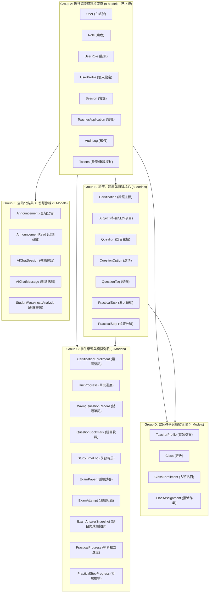
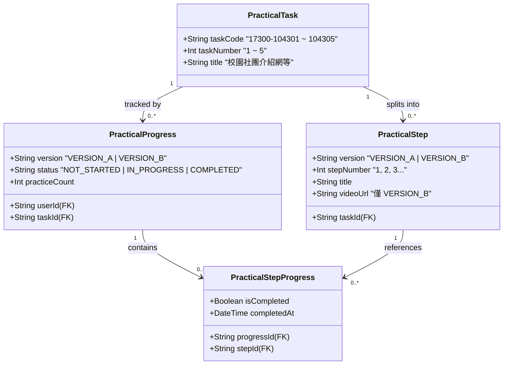
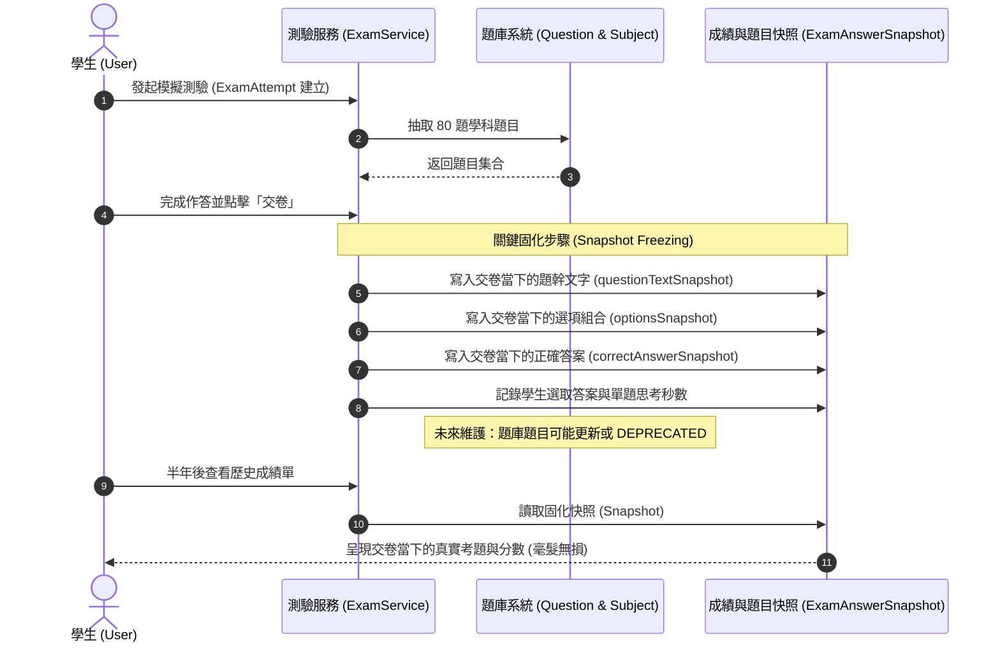

# CODE TO KNOW（碼上學）
# PHASE 3B：實體關聯圖與模型拓撲架構書
# (Entity-Relationship Diagram & Topology Specification)

- **系統名稱**：碼上學 AI 智慧學習與教育科技平台 (CODE TO KNOW)
- **文件版本**：v1.0.0 (Phase 3 Architecture Design)
- **建立日期**：2026-11-07
- **文件路徑**：`docs/DATABASE_PHASE3B_ERD.md`
- **審查團隊**：資深 PostgreSQL DBA、Prisma 7 資料庫架構師、系統分析師
- **管理狀態**：架構關聯設計（READ-ONLY DESIGN）

---

## 一、全系統實體關聯總圖 (High-Level Domain ERD)

下圖展示 CODE TO KNOW 完整業務模型之實體關聯，涵蓋現有 9 個核心模型與 Phase 3B 新增之 22 個業務模型：

```mermaid
erDiagram
    %% ==========================================
    %% 核心身分與認證層 (Existing Core Models)
    %% ==========================================
    User ||--o{ UserRole : "has"
    Role ||--o{ UserRole : "assigned_to"
    User ||--o| UserProfile : "profile"
    User ||--o{ Session : "maintains"
    User ||--o{ TeacherApplication : "submits"
    User ||--o{ EmailVerificationToken : "receives"
    User ||--o{ PasswordResetToken : "requests"
    User ||--o{ AuditLog : "triggers (SetNull)"

    %% ==========================================
    %% 證照與題庫管理層 (Certification & Question Bank)
    %% ==========================================
    Certification ||--o{ Subject : "contains"
    Subject ||--o{ Question : "groups"
    Question ||--o{ QuestionOption : "has"
    Question ||--o{ QuestionTagRelation : "tagged_with"
    QuestionTag ||--o{ QuestionTagRelation : "categorizes"

    %% ==========================================
    %% 術科實戰題組層 (Practical Exam System)
    %% ==========================================
    Certification ||--o{ PracticalTask : "offers"
    PracticalTask ||--o{ PracticalStep : "structured_into"
    User ||--o{ PracticalProgress : "tracks"
    PracticalTask ||--o{ PracticalProgress : "practiced_by"
    PracticalProgress ||--o{ PracticalStepProgress : "checks_off"
    PracticalStep ||--o{ PracticalStepProgress : "evaluated_in"

    %% ==========================================
    %% 學生個人學習進度層 (Student Learning Progress)
    %% ==========================================
    User ||--o{ CertificationEnrollment : "enrolled_in"
    Certification ||--o{ CertificationEnrollment : "learns"
    User ||--o{ UnitProgress : "achieves"
    Subject ||--o{ UnitProgress : "measured_by"
    User ||--o{ WrongQuestionRecord : "records"
    Question ||--o{ WrongQuestionRecord : "failed_at"
    User ||--o{ QuestionBookmark : "bookmarks"
    Question ||--o{ QuestionBookmark : "saved"
    User ||--o{ StudyTimeLog : "logs"

    %% ==========================================
    %% 模擬測驗與歷史快照層 (Mock Exam & Snapshots)
    %% ==========================================
    Certification ||--o{ ExamPaper : "designs"
    User ||--o{ ExamAttempt : "takes"
    ExamPaper ||--o{ ExamAttempt : "generates"
    ExamAttempt ||--o{ ExamAnswerSnapshot : "freezes"
    Question ||--o{ ExamAnswerSnapshot : "referenced_at"

    %% ==========================================
    %% 教師教學與班級層 (Teacher & Classes)
    %% ==========================================
    User ||--o| TeacherProfile : "qualifies"
    User ||--o{ Class : "creates (Teacher)"
    Certification ||--o{ Class : "targets"
    Class ||--o{ ClassEnrollment : "has_students"
    User ||--o{ ClassEnrollment : "joins (Student)"
    Class ||--o{ ClassAssignment : "assigns"

    %% ==========================================
    %% 全站公告層 (Announcements)
    %% ==========================================
    User ||--o{ Announcement : "publishes (Admin)"
    Announcement ||--o{ AnnouncementRead : "tracked_in"
    User ||--o{ AnnouncementRead : "acknowledges"

    %% ==========================================
    %% AI 學習教練與智慧分析層 (AI Coach & Analytics)
    %% ==========================================
    User ||--o{ AIChatSession : "initiates"
    AIChatSession ||--o{ AIChatMessage : "contains"
    User ||--o{ StudentWeaknessAnalysis : "diagnosed"
    Subject ||--o{ StudentWeaknessAnalysis : "focuses_on"
```

---

## 二、子領域拓撲圖與模型群組劃分

全域 31 個模型依功能聚合為五大群組，各群組具備明確的聚合根（Aggregate Root）與外鍵邊界：



---

## 三、關鍵關聯路徑與級聯刪除行為分析 (Cascade Topologies)

### 1. 使用者註銷時之級聯拓撲 (User Cascade Matrix)
當系統觸發使用者帳號刪除作業時，關聯資料表之處置行為如下：

| 行為類別 | 包含資料表 | 處置原因與資安考量 |
| :--- | :--- | :--- |
| **`ON DELETE CASCADE`**<br/>(連帶刪除) | `UserProfile`, `UserRole`, `Session`, `EmailVerificationToken`, `PasswordResetToken`, `TeacherProfile`, `CertificationEnrollment`, `UnitProgress`, `WrongQuestionRecord`, `QuestionBookmark`, `StudyTimeLog`, `PracticalProgress`, `ExamAttempt`, `ClassEnrollment`, `AIChatSession`, `StudentWeaknessAnalysis`, `AnnouncementRead` | 符合 GDPR/個資保護法「被遺忘權」規範，個人敏感資料與作答歷程連帶清除，避免資料庫累積孤兒紀錄。 |
| **`ON DELETE SET NULL`**<br/>(置空留痕) | `AuditLog.userId` | **資安不可否認性（Non-repudiation）保護**。帳號註銷後，歷史安全事件日誌（含 IP、動作代碼、情境文字）永久存續，防止惡意攻擊者藉由註銷銷毀犯罪跡證。 |
| **`ON DELETE RESTRICT`**<br/>(禁止刪除) | `Class.creatorId` (若班級尚有學員), `Announcement.authorId` (若公告仍有效) | 保護既有班級架構與營運公告之穩定性，需先指派替代負責人或完成歸檔後方可執行帳號刪除。 |

---

### 2. 術科獨立進度拓撲：Version A 與 Version B 之隔離邊界
術科系統的核心架構在於嚴格區分「Version A（官方教材版）」與「Version B（影音教學版）」：



- **隔離保證**：`PracticalProgress` 透過 `@@unique([userId, taskId, version])`，保證學生進行 Version A 時的打勾與完成狀態，絕不影響 Version B。
- **步驟獨立檢核**：`PracticalStepProgress` 透過 `progressId` 綁定特定進度實例，學生重新練習時（`practiceCount++`）可選擇保留或重置打勾清單。

---

### 3. 模擬測驗歷史快照拓撲 (Historical Exam Snapshot Isolation)
模擬測驗系統透過快照表徹底切斷對題庫後續更動之動態依賴：



- **防篡改效益**：歷史考題文字、選項與正確答案皆固化於 `ExamAnswerSnapshot`，即使題庫日後依據新考綱修改了題目，過去產生的測驗紀錄與成績單亦永遠精確保真。

---

## 四、實體關聯設計驗收清單

| 檢驗指標 | 設計達成說明 | 判定 |
| :--- | :--- | :---: |
| **五層架構全覆蓋** | 完整涵蓋公開宣傳、學生學習、教師教學、題庫管理、AI 智慧分析五大層級 | **PASS** |
| **現有 9 個核心模型相容** | 100% 保持既有 User、Role、UserRole、AuditLog 等核心表格關聯不變 | **PASS** |
| **五大官方術科題組對齊** | 嚴格收錄 104301 至 104305 五大正式題組，排除非官方題組 | **PASS** |
| **術科雙版本進度隔離** | 複合唯一鍵 `[userId, taskId, version]` 徹底實現進度獨立 | **PASS** |
| **測驗快照防竄改** | `ExamAnswerSnapshot` 固化作答文字與選項，確保成績真實可溯 | **PASS** |
| **資安與稽核留痕** | `AuditLog` 採 `SetNull`，使用者刪除時歷史資安日誌永久留存 | **PASS** |

**結論：實體關聯圖架構拓撲完備，結構嚴謹、級聯邊界清晰，具備工業級資料庫之擴充性與強韌度。**
