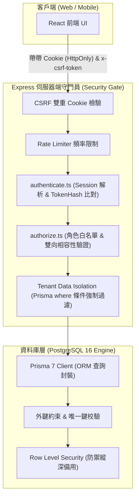

# CODE TO KNOW（碼上學）
# PHASE 3B：資料存取控制與 RBAC 權限矩陣規格書
# (Role-Based Access Control & Security Matrix)

- **系統名稱**：碼上學 AI 智慧學習與教育科技平台 (CODE TO KNOW)
- **文件版本**：v1.0.0 (Phase 3 Architecture Design)
- **建立日期**：2026-11-07
- **文件路徑**：`docs/DATABASE_PHASE3B_PERMISSION_MATRIX.md`
- **審查團隊**：資料庫資安工程師、Prisma 7 資料庫架構師、後端全端架構師
- **管理狀態**：安全架構規範（READ-ONLY SECURITY SPECIFICATION）

---

## 一、權限架構與多層防禦縱深 (Defense-in-Depth Architecture)

CODE TO KNOW 採用**「以伺服器端為權威核心（Authoritative Server Gateway）」**之存取控制體系，嚴禁信任前端傳入之身分標記：



### 關鍵防禦機制：
1. **身分權杖保護**：Session Token 存於 `HttpOnly`、`SameSite=Lax` 之加密 Cookie 中，資料庫僅保留 SHA-256 雜湊值（`tokenHash`），前端 JavaScript 無法存取 Token，徹底免疫 XSS 竊聽。
2. **多租戶數據隔離（Tenant Isolation）**：學生讀取任何學習資料（進度、錯題、測驗、AI 紀錄）時，伺服器一律由已驗證之 `req.user.id` 強制注入查詢條件，杜絕水準越權漏洞（IDOR）。
3. **教師權限審批保護**：教師資格必須透過 `TeacherApplication` 審核，學生無法透過發送特定 API 欄位自封為教師或管理員。

---

## 二、角色定義與職責邊界 (Role Taxonomy)

系統劃分四種標準角色身分：

| 角色代碼 | 角色全稱 | 獲取途徑 | 核心職責與邊界 |
| :--- | :--- | :--- | :--- |
| **`ANONYMOUS`** | 訪客 / 未登入者 | 預設無憑證訪客 | 僅能瀏覽首頁宣傳、公開證照清單、公開公告，無法存取個人進度或作答。 |
| **`STUDENT`** | 認證學員 (學生) | 網站自由註冊（預設） | 參與學科練習、術科沙盒演練、模擬測驗、錯題收藏、AI 鷹架學習、加入班級。 |
| **`TEACHER`** | 認證教師 | 提交 `TeacherApplication` 經管理員核准 | 建立教學班級、派發班級測驗與作業、查看班級學員學習分析報告。 |
| **`ADMIN` / `PLATFORM_ADMIN`** | 系統管理員 / 平台營運長 | 僅限伺服器 CLI（`create-admin.ts`）或已授權管理員配置 | 全站考綱與題庫維護、審核教師身分、發布公告、調閱資安稽核日誌。 |

---

## 三、各業務資料模型 CRUD 權限矩陣 (Model-Level Permission Matrix)

標記符號說明：
- **`C`**：建立 (Create)
- **`R`**：讀取 (Read)
- **`U`**：更新 (Update)
- **`D`**：刪除 (Delete)
- **`own`**：僅限存取與本人關聯之數據（`where: { userId: req.user.id }`）
- **`class`**：僅限存取該教師所管轄班級內部學員之數據
- **`—`**：完全無權限 (Forbidden 403)

| 資料模組 | 模型名稱 (Model) | 訪客 (ANONYMOUS) | 學生 (STUDENT) | 教師 (TEACHER) | 管理員 (ADMIN) |
| :--- | :--- | :---: | :---: | :---: | :---: |
| **帳號認證** | `User` | C (註冊) | R (own), U (own) | R (own), U (own) | R (全), U (全), D (軟刪除) |
| | `UserProfile` | — | R (own), U (own) | R (own), U (own) | R (全), U (全) |
| | `Session` | — | R (own), D (own 登出) | R (own), D (own 登出) | R (全), D (強制作廢) |
| | `TeacherApplication`| — | C (申請), R (own) | R (own) | R (全), U (審核核准/駁回) |
| | `AuditLog` | — | — | — | **R (僅讀取，不可增刪改)** |
| **全站公告** | `Announcement` | R (公開過期前) | R (公開 + 學生專屬) | R (公開 + 教師專屬) | **C, R, U, D (全權管理)** |
| | `AnnouncementRead` | — | C (own), R (own) | C (own), R (own) | R (統計) |
| **證照考綱** | `Certification` | R (公開部分) | R (全覽) | R (全覽) | C, R, U, D |
| | `Subject` | R (公開目錄) | R (全覽) | R (全覽) | C, R, U, D |
| **題庫模組** | `Question` | — | R (練習模式) | R (教學調閱) | C, R, U, D (題庫維護) |
| | `QuestionOption` | — | R (練習模式) | R (教學調閱) | C, R, U, D |
| | `QuestionTag` | — | R (篩選用) | R (篩選用) | C, R, U, D |
| **學生學習** | `CertificationEnrollment` | — | C (own), R (own), D (own) | R (class 班級學員) | R (全) |
| | `UnitProgress` | — | C (own), R (own), U (own) | R (class 班級學員) | R (全) |
| | `WrongQuestionRecord` | — | C (own), R (own), U (own), D (own)| R (class 匯總統計) | R (全) |
| | `QuestionBookmark` | — | C (own), R (own), D (own) | — | — |
| | `StudyTimeLog` | — | C (own), R (own) | R (class 班級統計) | R (全) |
| **術科實戰** | `PracticalTask` | R (公開目錄) | R (全題組解構) | R (全題組解構) | C, R, U, D |
| | `PracticalStep` | — | R (全步驟指引) | R (全步驟指引) | C, R, U, D |
| | `PracticalProgress` | — | C (own), R (own), U (own) | R (class 班級學員) | R (全) |
| | `PracticalStepProgress` | — | C (own), R (own), U (own) | R (class 步驟完成度) | R (全) |
| **模擬測驗** | `ExamPaper` | — | R (公開試卷) | R (試卷清單) | C, R, U, D |
| | `ExamAttempt` | — | C (own), R (own), U (own 繳卷) | R (class 班級成績) | R (全) |
| | `ExamAnswerSnapshot`| — | R (own 考後複查) | R (class 答題分析) | R (全) |
| **班級管理** | `TeacherProfile` | — | — | R (own), U (own) | R (全), U (審核) |
| | `Class` | — | R (憑 joinCode 入班) | **C (own), R (own), U (own), D (own)** | R (全), D (違規關閉) |
| | `ClassEnrollment` | — | C (own 自行加入), D (own 退出)| R (class 名冊), D (踢除學生) | R (全) |
| | `ClassAssignment` | — | R (class 查看作業) | **C (own), R (own), U (own), D (own)** | R (全) |
| **AI 智慧** | `AIChatSession` | — | C (own), R (own), D (own) | — | R (個資去識別稽核) |
| | `AIChatMessage` | — | C (own), R (own) | — | R (個資去識別稽核) |
| | `StudentWeaknessAnalysis`| — | R (own 個人畫像) | R (class 班級弱點診斷) | R (全) |

---

## 四、越權防禦細節實作指引 (Anti-Privilege Escalation Rules)

### 1. 垂直越權防護 (Vertical Privilege Escalation Defense)
- **攻擊場景**：惡意學生發送 `POST /api/auth/register` 或 `PATCH /api/users/profile`，意圖注入 `roles: ['ADMIN']` 或 `roles: ['TEACHER']`。
- **後端處置**：
  - 註冊 DTO 與個人更新 DTO 採用嚴格 Zod Schema 白名單校驗，嚴禁反序列化 `roles` 欄位。
  - 角色指派僅限內部授權管理員專用端點（如 `POST /api/admin/roles/assign`），並強制受 `authorize(['PLATFORM_ADMIN', 'ADMIN'])` 保護。

### 2. 水平越權防護 (Horizontal Privilege Escalation Defense)
- **攻擊場景**：學生 A 偽造請求 `GET /api/exams/attempts/attempt-uuid-of-student-B`，試圖竊取學生 B 的測驗考卷與成績。
- **後端處置**：
  - 查詢層強制注入擁有者約束：
    ```typescript
    const attempt = await prisma.examAttempt.findFirst({
      where: {
        id: req.params.attemptId,
        userId: req.user.id, // 強制鎖定目前 Session 登入者
      },
      include: { snapshots: true },
    });
    if (!attempt) throw new NotFoundError('Exam attempt not found.');
    ```

### 3. 教師跨班級穿透防護 (Cross-Class Teacher Boundary)
- **攻擊場景**：教師 X 試圖查詢非其所屬班級 Y 的學員成績名冊。
- **後端處置**：
  - 伺服器端必須校驗該教師是否為該班級之建立者：
    ```typescript
    const targetClass = await prisma.class.findFirst({
      where: {
        id: req.params.classId,
        creatorId: req.user.id, // 確保為該班級負責教師
      },
    });
    if (!targetClass) throw new ForbiddenError('You do not have access to this class.');
    ```

---

## 五、權限矩陣驗收清單

| 檢核項目 | 規劃標準 | 達成狀況 |
| :--- | :--- | :---: |
| **四種角色權責分明** | 訪客、學生、教師、管理員界限清晰無模糊空間 | **PASS** |
| **防提權機制落地** | 註冊強制預設學生，教師須經審批，管理員嚴禁前端註冊 | **PASS** |
| **多租戶數據隔離** | 個人作答、筆記、AI 對話一律綁定 `req.user.id` | **PASS** |
| **班級邊界隔離** | 教師僅能存取其管轄班級學員，杜絕跨班穿透 | **PASS** |
| **稽核日誌唯讀性** | `AuditLog` 嚴禁任何角色（含管理員）進行修改或刪除 | **PASS** |

**結論：RBAC 權限矩陣規格完整，存取控制路徑縝密，為後續 API 與 Prisma 查詢實裝提供了最高等級之資安防護基石。**
