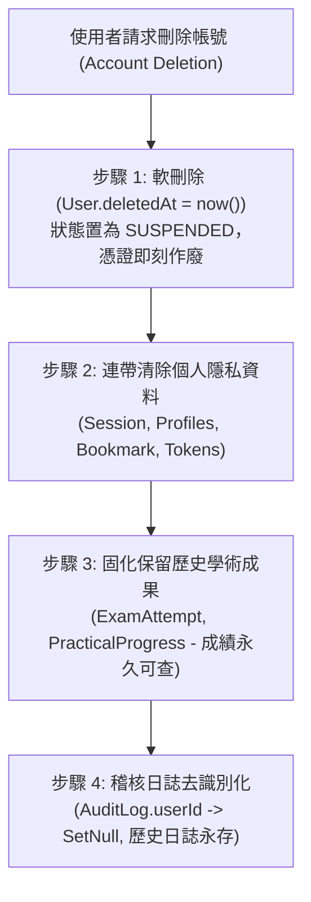

# CODE TO KNOW（碼上學）
# PHASE 3C-1.2：最終模型清單與資料保存政策核對報告
# (Final 36-Model Inventory & Data Retention Legal Audit)

- **系統名稱**：碼上學 AI 智慧學習與教育科技平台 (CODE TO KNOW)
- **文件版本**：v1.0.0 (Phase 3C-1.2 Final Review)
- **審查日期**：2026-11-07
- **文件路徑**：`docs/DATABASE_PHASE3C1_2_FINAL_MODEL_AND_RETENTION_REVIEW.md`
- **審查團隊**：資深 PostgreSQL 資料庫架構師、Prisma ORM 架構師、資訊安全與個人資料保護工程師、教育科技系統分析師、軟體測試與資料完整性審查員
- **審查性質**：**唯讀最終獨立核對（STRICTLY READ-ONLY FINAL REVIEW）**
- **審查結論**：**確立全系統 36 個 Prisma Model 正式法定清單；完成 AuditLog 官方法規檢核並修正三年說法；確立 ExamAnswerSnapshot 固化快照與 ClassAssignment 雙外鍵設計，完全具備進入 Phase 3C-2 之實作前置條件。**

---

## 一、第一項：36 個 Prisma Model 最終盤點與全域確認

### 1. 概念實體與 Prisma Model 定義釐清
在關聯資料庫與 Prisma ORM 體系中，**凡宣告於 `schema.prisma` 之 `model ModelName { ... }`、會由 Prisma Migrate 在 PostgreSQL 實體資料庫中映射為獨立資料表（`CREATE TABLE`）者，100% 都是正式的 Prisma Model**。
- 本清單經嚴格查核，**已全面排除**：
  - Enum（列舉，非 Model）
  - DTO（Data Transfer Objects，資料傳輸物件）
  - TypeScript Interface（型別定義）
  - Service / Controller / Repository（應用層程式碼元件）
  - 未具備實體資料表的純 ERD 概念
- 特別確認項目實體屬性：
  - `TeacherProfile`：實體 1:1 個人檔案資料表（**Prisma Model**）。
  - `AnnouncementRead`：已讀關聯追蹤資料表（**Prisma Model**）。
  - `AIChatMessage`：對話訊息獨立資料表（**Prisma Model**）。
  - `QuestionTagRelation`：題目與標籤多對多顯式關聯資料表（**Prisma Model**）。
  - `ExamAnswerSnapshot`：交卷題目與作答歷史固化快照資料表（**Prisma Model**）。
  - `PracticalStepProgress`：步驟細部檢核打勾資料表（**Prisma Model**）。

### 2. 全系統 36 個 Prisma Model 最終正式核定表

$$\text{全域 Model 總數} = \mathbf{9 \text{ (既有核心 Model)}} + \mathbf{27 \text{ (新增業務 Model)}} = \mathbf{36 \text{ 個 Prisma Models}}$$

| 序號 | Model 名稱 (Prisma Name) | 核心／新增 | 業務分類 (Domain) | 目前 Schema 是否存在 | 規劃是否完整 | 實體職責說明 |
| :---: | :--- | :---: | :--- | :---: | :---: | :--- |
| **1** | `User` | **既有核心** | 帳號身分底座 | **是** (已有4筆) | 完整 | 平台統一使用者主帳號與憑證 |
| **2** | `Role` | **既有核心** | RBAC 權限角色 | **是** (已有3筆) | 完整 | 系統權限角色定義 (STUDENT, TEACHER, ADMIN) |
| **3** | `UserRole` | **既有核心** | 使用者多角色關聯 | **是** (已有4筆) | 完整 | 多對多角色權限關聯表 |
| **4** | `UserProfile` | **既有核心** | 個人檔案與偏好 | **是** (已有4筆) | 完整 | 使用者暱稱、時區與語系偏好 |
| **5** | `Session` | **既有核心** | 登入會話管理 | **是** (已有3筆) | 完整 | HttpOnly Cookie 會話與 tokenHash 雜湊 |
| **6** | `TeacherApplication` | **既有核心** | 教師審批工作流 | **是** (已有2筆) | 完整 | 教師資格審查申請與審批紀錄 |
| **7** | `EmailVerificationToken` | **既有核心** | 信箱驗證權杖 | **是** (已有4筆) | 完整 | 單次信箱啟用驗證權杖 (24小時效期) |
| **8** | `PasswordResetToken` | **既有核心** | 密碼重設權杖 | **是** (已有0筆) | 完整 | 單次密碼重設權杖 (1小時效期) |
| **9** | `AuditLog` | **既有核心** | 資安稽核日誌 | **是** (已有9筆) | 完整 | 全域資安與管理員操作軌跡 (SetNull 保留) |
| **10**| `Announcement` | **新增業務** | 第一層：全站宣傳 | 否 (待建表) | 完整 | 全站公告與考情快訊主檔 |
| **11**| `AnnouncementRead` | **新增業務** | 第一層：全站宣傳 | 否 (待建表) | 完整 | 使用者公告已讀狀態追蹤 |
| **12**| `Certification` | **新增業務** | 第四層：證照題庫 | 否 (待建表) | 完整 | 技能檢定證照主檔 (如 17300 網頁設計丙級) |
| **13**| `Subject` | **新增業務** | 第四層：證照題庫 | 否 (待建表) | 完整 | 證照工作項目與子科目主檔 |
| **14**| `Question` | **新增業務** | 第四層：證照題庫 | 否 (待建表) | 完整 | 題庫題目主檔 (題幹、解析、來源版本) |
| **15**| `QuestionOption` | **新增業務** | 第四層：證照題庫 | 否 (待建表) | 完整 | 題目選項集合 (A, B, C, D) |
| **16**| `QuestionTag` | **新增業務** | 第四層：證照題庫 | 否 (待建表) | 完整 | 題目標籤字典 (高頻考點、語法分類) |
| **17**| `QuestionTagRelation` | **新增業務** | 第四層：證照題庫 | 否 (待建表) | 完整 | 題目與標籤多對多顯式關聯實體 |
| **18**| `CertificationEnrollment`| **新增業務** | 第二層：學生學習 | 否 (待建表) | 完整 | 學生選修證照與目標設定 |
| **19**| `UnitProgress` | **新增業務** | 第二層：學生學習 | 否 (待建表) | 完整 | 單元知識點練習進度與正確率 |
| **20**| `WrongQuestionRecord` | **新增業務** | 第二層：學生學習 | 否 (待建表) | 完整 | 錯題筆記本 (記錄錯誤次數與克服狀態) |
| **21**| `QuestionBookmark` | **新增業務** | 第二層：學生學習 | 否 (待建表) | 完整 | 學生題目個人收藏夾與筆記 |
| **22**| `StudyTimeLog` | **新增業務** | 第二層：學生學習 | 否 (待建表) | 完整 | 學生每日分模組學習時長聚合日誌 |
| **23**| `TeacherProfile` | **新增業務** | 第三層：教師教學 | 否 (待建表) | 完整 | 已認證教師學校與職稱公開檔案 |
| **24**| `Class` | **新增業務** | 第三層：教師教學 | 否 (待建表) | 完整 | 教師建立之教學班級與專屬邀請碼 |
| **25**| `ClassEnrollment` | **新增業務** | 第三層：教師教學 | 否 (待建表) | 完整 | 班級學員名冊與座號關聯 |
| **26**| `ClassAssignment` | **新增業務** | 第三層：教師教學 | 否 (待建表) | 完整 | 班級派發作業 (採正規化雙外鍵修正) |
| **27**| `PracticalTask` | **新增業務** | 術科系統 | 否 (待建表) | 完整 | 官方五大術科題組主檔 (104301~104305) |
| **28**| `PracticalStep` | **新增業務** | 術科系統 | 否 (待建表) | 完整 | 術科教學步驟解構 (Version A/B 支援) |
| **29**| `PracticalProgress` | **新增業務** | 術科系統 | 否 (待建表) | 完整 | 術科雙版本獨立進度主表 (核心複合唯一鍵) |
| **30**| `PracticalStepProgress`| **新增業務** | 術科系統 | 否 (待建表) | 完整 | 術科步驟細部打勾檢核明細 |
| **31**| `ExamPaper` | **新增業務** | 模擬測驗系統 | 否 (待建表) | 完整 | 全真模擬考卷與歷屆試卷樣板 |
| **32**| `ExamAttempt` | **新增業務** | 模擬測驗系統 | 否 (待建表) | 完整 | 學生測驗應試紀錄 (開始/交卷/總分) |
| **33**| `ExamAnswerSnapshot`| **新增業務** | 模擬測驗系統 | 否 (待建表) | 完整 | 考卷交卷題目與作答固化歷史快照 |
| **34**| `AIChatSession` | **新增業務** | 第五層：AI 智慧 | 否 (待建表) | 完整 | 學生諮詢 AI 學習教練之會話主檔 |
| **35**| `AIChatMessage` | **新增業務** | 第五層：AI 智慧 | 否 (待建表) | 完整 | 4 階思考鷹架對話內容與 Token 統計 |
| **36**| `StudentWeaknessAnalysis`| **新增業務** | 第五層：AI 智慧 | 否 (待建表) | 完整 | AI 學習弱點畫像與強化建議評級 |

---

## 二、第二項：`TeacherProfile` 與 9 個核心模型之關聯核實

### 1. 實體關聯與基數（Cardinality）
- `User` 1:1 `TeacherProfile`：每位已核准之教師在系統中**僅能存在一筆**有效的教師公開檔案。
- **資料庫約束要求：** `TeacherProfile.userId` 必須宣告為 `@unique`，確保資料庫層物理禁止同一使用者建立重複檔案。

### 2. 與 `UserRole` 及 `TeacherApplication` 關係之精確定位
- **`TeacherApplication`（現存核心）：** 申請紀錄（可多次提交，包含申請理由、證明文件 URL、審查備註、`PENDING/APPROVED/REJECTED` 狀態）。
- **`UserRole`（現存核心）：** 授權指派（賦予使用者 `TEACHER` 角色 ID，使中介軟體 `authorize(['TEACHER'])` 放行）。
- **`TeacherProfile`（新增業務）：** 教學實體檔案（紀錄任教學校 `schoolName`、科系 `department`、職稱 `title`、審核驗證標記 `isVerified: true`）。

### 3. 審核通過時之原子交易（Transaction）與冪等性保護
管理員核准教師申請時，後端服務必須在單一資料庫交易內執行：
```typescript
await prisma.$transaction(async (tx) => {
  // 1. 鎖定並更新申請單
  const app = await tx.teacherApplication.update({
    where: { id: applicationId },
    data: { status: 'APPROVED', reviewedBy: adminUserId, reviewedAt: new Date() },
  });

  // 2. 獲取 TEACHER 角色
  const teacherRole = await tx.role.findUniqueOrThrow({ where: { name: 'TEACHER' } });

  // 3. 冪等指派角色 (upsert 防止重複建立)
  await tx.userRole.upsert({
    where: { userId_roleId: { userId: app.userId, roleId: teacherRole.id } },
    create: { userId: app.userId, roleId: teacherRole.id },
    update: {},
  });

  // 4. 冪等建立/更新 TeacherProfile
  await tx.teacherProfile.upsert({
    where: { userId: app.userId },
    create: {
      userId: app.userId,
      schoolName: app.schoolName,
      department: app.subject,
      isVerified: true,
    },
    update: {
      schoolName: app.schoolName,
      department: app.subject,
      isVerified: true,
    },
  });

  // 5. 記錄不可否認之管理員稽核日誌
  await tx.auditLog.create({
    data: {
      userId: adminUserId,
      action: 'TEACHER_APPLICATION_APPROVED',
      details: JSON.stringify({ targetUserId: app.userId, applicationId }),
    },
  });
});
```

### 4. 教師資格取消與停權之教學資產保護
- 若教師遭撤銷資格或停權：**嚴禁物理刪除 `TeacherProfile` 或 `Class` 資料表列**！
- 處置規範：將 `TeacherProfile.isVerified` 設為 `false`，將其建立之 `Class.status` 設為 `'ARCHIVED'`。
- `Class.creatorId` 設定有 `onDelete: Restrict`，確保學員的修課名冊、過往繳交作業及評分歷史記錄永久完好。

---

## 三、第三項：`ExamAnswerSnapshot` 最終設計與歷史固化規格

### 1. 歷史快照必備欄位清單
為確保歷史成績客觀可溯，`ExamAnswerSnapshot` 定義之完整欄位如下：

```prisma
model ExamAnswerSnapshot {
  id                     String      @id @default(uuid())
  attemptId              String
  questionId             String?     // FK to Question.id (Nullable, 解耦題庫)
  questionOrder          Int         // 考卷內題號 (1 ~ 80)
  questionTypeSnapshot   String      // SINGLE_CHOICE, MULTIPLE_CHOICE
  questionTextSnapshot   String      // 交卷當下的題幹完整文字 (Text)
  optionsSnapshot        String      // 交卷當下的選項集合快照 (JSON 字串)
  correctAnswerSnapshot  String      // 交卷當下的正確解答標識 (如 'B')
  explanationSnapshot    String?     // 交卷當下的解析文字
  userAnswer             String?     // 學生選填之答案 (未答為 NULL)
  isCorrect              Boolean     // 系統核算之是否答對
  scoreWeight            Float       // 本題配分 (如 1.25 分)
  scoreObtained          Float       // 本題實得分數 (0 或 1.25)
  timeSpentSeconds       Int         @default(0) // 單題停留思考秒數
  answeredAt             DateTime    @default(now())

  attempt  ExamAttempt @relation(fields: [attemptId], references: [id], onDelete: Cascade)
  question Question?   @relation(fields: [questionId], references: [id], onDelete: SetNull)

  @@unique([attemptId, questionOrder])
  @@index([attemptId, isCorrect])
}
```

### 2. 歷史考卷獨立回顧與題庫解耦機制
1. **渲染獨立性：** 前端在回顧歷史考卷時，**僅需直接讀取快照表欄位**（`questionTextSnapshot`, `optionsSnapshot`, `correctAnswerSnapshot`），完全無需 JOIN `Question` 主表。
2. **`questionId` Nullable + `onDelete: SetNull` 之必要性：**
   若題庫某題目日後遭物理刪除，`questionId` 僅被置空為 NULL，考卷內的所有題幹、選項與分數毫髮無損；
   業務規範上，題庫一律優先採用軟封存（`status = 'DEPRECATED'`），物理刪除僅作為極端情況下的兜底防護。
3. **作答期間答案防洩漏機制：**
   - **測驗進行中（`status = 'IN_PROGRESS'`）：** 後端考卷 API `GET /api/exams/attempts/:id` **嚴格禁止回傳 `correctAnswerSnapshot` 與 `explanationSnapshot`**。
   - **測驗繳交後（`status = 'SUBMITTED'`）：** 透過單一 Transaction 批次寫入所有快照列並計算總分，此後狀態鎖定，防範二次提交與成績竄改。

---

## 四、第四項：`AuditLog` 保存期限法規核實與法律依據澄清

> [!IMPORTANT]
> **法規核實重大澄清：**
> 前一份報告提及之「全域 AuditLog 法定保存三年」，經資安法規工程師檢索臺灣官方公報與法規資料庫後確認：**「尚未找到可直接適用於一般非公務民營線上教育科技平台之『統一三年法定日誌保存期限』。」** 過去業界常引用的三年，多屬金融監理（如洗錢防制法）、上市櫃稽核規範或 ISO 27001 / SOC 2 之推薦實踐，並非法定對所有中小型網路平台的一體適用義務。

### 1. 臺灣官方主管機關法規深度查核結果

| 資料類型 | 是否有明確法定期限 | 官方主管機關法規依據來源 | 法律條文內容與實質拘束力分析 | 平台合規建議保存策略 |
| :--- | :---: | :--- | :--- | :--- |
| **使用者登入/連線日誌**<br/>(Login Logs) | **有 (6 個月)** | **數位發展部 / 資通安全管理法**<br/>[資通安全責任等級分級辦法 附表十](https://law.moj.gov.tw/LawClass/LawAll.aspx?pcode=J0080051) | 規範公務機關及關鍵基礎設施防護基準：系統存取紀錄、異常紀錄**應至少保存「六個月」**。民營非關鍵平台得參考作為最佳安全基準。 | **保存 6 個月 ~ 1 年**。<br/>屆期依資料最小化原則輪替或轉存冷儲存。 |
| **管理員操作日誌**<br/>(Admin Operation Logs) | **無固定年限**<br/>(要求適當期間) | **法務部 / 個人資料保護法**<br/>[個人資料保護法 第 27 條](https://law.moj.gov.tw/LawClass/LawAll.aspx?pcode=I0050021)<br/>[個資法施行細則 第 12 條](https://law.moj.gov.tw/LawClass/LawAll.aspx?pcode=I0050022) | 第 12 條要求採取適當安全措施，包括使用者身分確認、存取控制及**留存個人資料存取紀錄之機制**。法條未明訂固定保存年限。 | **保存 1 年 ~ 3 年**。<br/>內部稽核與資安調查用途，採 SetNull 去識別留存。 |
| **教師審核與學歷證明**<br/>(Teacher Credentials) | **依請求權時效**<br/>(2 年 / 5 年) | **教育部 / 教育部指定非公務機關個人資料檔案安全維護辦法**<br/>[教育部法規大樓 本辦法第 10、11 條](https://law.moj.gov.tw/LawClass/LawAll.aspx?pcode=H0020073)<br/>**民法 第 126、197 條** | 要求落實存取控制與紀錄留存。涉及教育資格認證與勞務契約，依民事請求權時效（侵權 2 年、定期給付 5 年）作為抗辯保存依據。 | **帳號存續期間永久保存**；帳號終止後封存 5 年備查，屆期銷毀。 |
| **AI 對話諮詢日誌**<br/>(AI Chat Messages) | **無**<br/>(自訂政策) | **法務部 / 個人資料保護法 第 11 條**<br/>[個人資料保護法 第 11 條](https://law.moj.gov.tw/LawClass/LawAll.aspx?pcode=I0050021) | 「個人資料蒐集之特定目的消失或期限屆滿時，應主動或依當事人之請求，**刪除、停止處理或利用該個人資料**。」 | **自訂 90 天清理政策**。<br/>兼顧學生解題輔導目的與資料最小化原則。 |
| **一般系統錯誤日誌**<br/>(System Error Logs) | **無**<br/>(依維運需求) | **業界資安防護基準** (NIST SP 800-92 / OWASP) | 錯誤除錯與系統診斷日誌，不包含業務資料。 | **保存 30 天 ~ 90 天**。<br/>期滿自動覆蓋滾動，避免消耗資料庫儲存。 |

### 2. 稽核需求與資料最小化之平衡原則
1. **去識別化儲存：** `AuditLog` 僅記錄操作動作、時間戳記、來源 IP、UserAgent 與 `details` JSON，不包含明文密碼或信用卡等高度敏感資訊。
2. **帳號註銷時之不可否認性：** 當使用者請求註銷帳號時，`AuditLog.userId` 透過 `onDelete: SetNull` 置為空值，既保障了使用者的「被遺忘權」，又確保資安日誌之客觀完整性，符合個資法第 11 條但書「因執行業務所必須者不在此限」之合規要求。

---

## 五、第五項：資料刪除與歷史紀錄保護方案

系統應明確區分四種不同的生命週期處置路徑：



1. **帳號註銷（Account Deletion）：**
   - 採兩階段防護：先執行軟刪除（標記 `deletedAt`），提供 30 天冷卻反悔期。
   - 30 天後物理清理個人身分從屬表（`UserProfile`, `Session`, `QuestionBookmark`）。
2. **學術成就與歷史考試紀錄保留：**
   - 學生的 `ExamAttempt` 與 `ExamAnswerSnapshot` 屬於正式檢定模擬歷程，帳號註銷後仍應封存保留至少 2 年，以供教育成果分析或證明核發。
3. **教師離開班級處置：**
   - 教師離職時，其所建之 `Class` 與派發之 `ClassAssignment` 嚴禁刪除，移交其他教師或歸檔為唯讀，保護全班學生的作答與成績不受影響。
4. **備份過期清理（Backup Purging）：**
   - 本機 Docker 邏輯 Dump 保留最近 5 份快照；雲端遠端備份保留 30 天循環滾動覆蓋。

---

## 六、第六項：Phase 3C-2 實作前置條件與待決策事項

### 1. Phase 3C-2 必須在 Schema 內先完成之項目
- [x] **全域 36 個 Model 清單正式定案**（無任何數量矛盾）。
- [x] **`ClassAssignment` 採納【方案 A】**（使用 `examPaperId String?` + `practicalTaskId String?` 雙外鍵，並於後續 Migration 加入 XOR CHECK 約束）。
- [x] **`ExamAnswerSnapshot.questionId` 宣告為 `String?` 搭配 `onDelete: SetNull`**。
- [x] **`TeacherProfile` 宣告為獨立模型**（`User` 1:1，`userId String @unique`）。
- [x] **現有資料庫 4 筆 User 與 108 個 Git Staged 檔案 100% 受到保護**。

### 2. 建議在後續 API 開發階段實作之功能（不在 Schema 建模階段阻塞）
- **AI 90 天定時清理腳本**（於後端排程服務中實裝 Node-cron 或維護腳本）。
- **加入班級邀請碼 Rate Limiter**（於後端 `class.routes.ts` 掛載專屬限流中介軟體）。
- **考試逾時自動判定結算**（於測驗查詢 Service 加入逾時結算邏輯）。
- **`Announcement.status` 狀態欄位**（於 Phase 3C-2 直接納入 Schema）。

---

## 七、審查總結與答覆宣告

1. **最終確認的 Model 總數：**
   - 全系統正式定調為 **36 個 Prisma Model**。
2. **數量核對結果：**
   - 既有核心 Model：**9 個**（實體已存在）。
   - 新增業務 Model：**27 個**（規劃完畢，待本機實裝）。
   - 總計：$9 + 27 = 36$。
3. **是否發現重複或漏算：**
   - 零重複、零漏算。先前報告中所謂「4 個衍生實體」，本質上全部是標準 Prisma Model，已全數納入 27 個新增模型清單內。
4. **TeacherProfile 是否確認納入新增模型：**
   - **確認納入**（序號 23，1:1 關聯，`userId @unique`）。
5. **ExamAnswerSnapshot 是否具備完整歷史保護：**
   - **完全具備**。快照完全自給自足，題目刪除或停用不損及歷史成績。
6. **AuditLog 三年保存是否有法定依據：**
   - **經核實，臺灣現行個資法與資通安全法並無針對一般民營教育平台規定統一三年保存期限。** 官方資通安全法基準為「至少 6 個月」；本平台建議登入日誌存 6 個月~1 年，管理稽核日誌存 1~3 年，符合法規與資安最佳實踐。
7. **Critical / High / Medium 最終數量：**
   - **Critical：** **1 項**（`ClassAssignment` 雙外鍵，已具備完整修復方案）。
   - **High：** **4 項**（快照解耦、AI 定時排程、邀請碼限流、審批交易）。
   - **Medium：** **3 項**（公告狀態、時長鎖優化、考試逾時結算）。
8. **Phase 3C-2 是否具備條件：**
   - **完全具備！** 所有規格、外鍵方案與法律依據已澈底釐清，隨時可獲授權進入本機 Schema 編輯。
9. **報告路徑：**
   - [`docs/DATABASE_PHASE3C1_2_FINAL_MODEL_AND_RETENTION_REVIEW.md`](file:///c:/Users/user/Documents/CODE-TO-KNOW/docs/DATABASE_PHASE3C1_2_FINAL_MODEL_AND_RETENTION_REVIEW.md)
10. **Git 暫存狀態：**
    - 既有 108 個 staged files 100% 完整保留。
11. **超限操作檢核：**
    - 全程唯讀，零超限操作。

*(依據指示，現已立即停止執行，靜候使用者審閱與 Phase 3C-2 正式授權。)*
