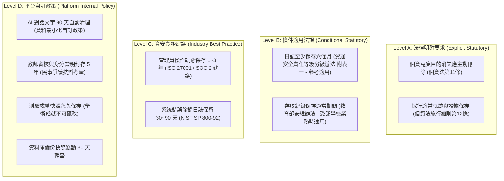

# CODE TO KNOW（碼上學）
# PHASE 3C-1.3：36 個 Prisma Model 完整清單與資料保存政策補充核對報告
# (Final 36-Model Inventory & Statutory Data Retention Supplementary Review)

- **系統名稱**：碼上學 AI 智慧學習與教育科技平台 (CODE TO KNOW)
- **文件版本**：v1.0.0 (Phase 3C-1.3 Final Review)
- **審查日期**：2026-11-07
- **文件路徑**：`docs/DATABASE_PHASE3C1_3_MODEL_LIST_AND_RETENTION_SUPPLEMENT.md`
- **審查團隊**：資深 PostgreSQL 資料庫架構師、Prisma ORM 架構師、臺灣個資法規審查員、資訊安全工程師
- **審查性質**：**唯讀補充獨立審查（STRICTLY READ-ONLY SUPPLEMENTARY REVIEW）**
- **審查結論**：**確立全系統 36 個 Prisma Model 正式清單（零虛構、零重複）；完成臺灣個人資料保護法、資通安全管理法及民法消滅時效之嚴謹法源比對，修正先前「法定三年」與「法定五年」之模糊說法；確立四層級資料保存架構，完全具備進入 Phase 3C-2 之實作條件。**

---

## 一、第一項：36 個 Prisma Model 完整清單核對

### 1. Prisma Model 資格檢驗原則
依據 Prisma ORM 與 PostgreSQL 架構規範，**凡於 `schema.prisma` 宣告為 `model ModelName { ... }`，並在 PostgreSQL 映射為獨立資料表（`CREATE TABLE`）者，皆為合法的 Prisma Model**。
- **排除非 Model 項目：**
  - 列舉型別（`enum RoleName { ... }`、`enum ExamType { ... }`）非 Model。
  - 資料傳輸物件（DTO）、Zod Schema、TypeScript Interfaces、Controller、Service、Repository 非 Model。
  - 純 ERD 關聯概念（若無獨立實體資料表）非 Model。
- **實體確認：**
  - `TeacherProfile`：實體 1:1 教師公開檔案表（**Model**）。
  - `AnnouncementRead`：公告已讀狀態關聯記錄表（**Model**）。
  - `AIChatMessage`：AI 對話內容日誌表（**Model**）。
  - `QuestionTagRelation`：題目與標籤多對多顯式關聯實體表（**Model**）。
  - `ExamAnswerSnapshot`：考卷交卷題目與作答固化歷史快照表（**Model**）。
  - `PracticalStepProgress`：術科步驟細部檢核打勾明細表（**Model**）。

### 2. 全系統 36 個 Prisma Model 逐項清單

$$\text{全系統 Model 總數} = \mathbf{9 \text{ (既有核心 Model)}} + \mathbf{27 \text{ (新增業務 Model)}} = \mathbf{36 \text{ 個 Prisma Models}}$$

| 編號 | Model 名稱 (Prisma Name) | 類型 | 目前 Schema 是否存在 | 是否需新增 | 所屬功能層級與業務職責 |
| :---: | :--- | :---: | :---: | :---: | :--- |
| **1** | `User` | **既有核心** | **是** (已有4筆) | 否 (保留) | 帳號身分底座：統一帳號、密碼雜湊、信箱、身分狀態 |
| **2** | `Role` | **既有核心** | **是** (已有3筆) | 否 (保留) | RBAC 權限角色定義 (STUDENT, TEACHER, ADMIN, PLATFORM_ADMIN) |
| **3** | `UserRole` | **既有核心** | **是** (已有4筆) | 否 (保留) | 使用者角色多對多關聯表 (複合唯一鍵) |
| **4** | `UserProfile` | **既有核心** | **是** (已有4筆) | 否 (保留) | 使用者個人設定：時區、語系、暱稱、個人簡介 |
| **5** | `Session` | **既有核心** | **是** (已有3筆) | 否 (保留) | 登入會話管理：HttpOnly Cookie、tokenHash 雜湊、有效期限 |
| **6** | `TeacherApplication` | **既有核心** | **是** (已有2筆) | 否 (保留) | 教師資格審批歷程：學校、證明 URL、審查備註、PENDING/APPROVED |
| **7** | `EmailVerificationToken` | **既有核心** | **是** (已有4筆) | 否 (保留) | 信箱啟用單次驗證權杖 (24 小時效期) |
| **8** | `PasswordResetToken` | **既有核心** | **是** (已有0筆) | 否 (保留) | 密碼重設單次驗證權杖 (1 小時效期) |
| **9** | `AuditLog` | **既有核心** | **是** (已有9筆) | 否 (保留) | 資安稽核日誌：登入、管理員審批、身分異動 (SetNull 留痕) |
| **10**| `Announcement` | **新增業務** | 否 | **是** | 第一層：全站宣傳 — 系統公告、考情快訊發布主表 |
| **11**| `AnnouncementRead` | **新增業務** | 否 | **是** | 第一層：全站宣傳 — 使用者公告已讀狀態追蹤表記錄 |
| **12**| `Certification` | **新增業務** | 否 | **是** | 第四層：題庫教材 — 技能檢定證照主檔 (如 17300 網頁設計丙級) |
| **13**| `Subject` | **新增業務** | 否 | **是** | 第四層：題庫教材 — 證照工作項目與子科目主檔 |
| **14**| `Question` | **新增業務** | 否 | **是** | 第四層：題庫教材 — 學科題庫主表 (題幹、解析、官方版權) |
| **15**| `QuestionOption` | **新增業務** | 否 | **是** | 第四層：題庫教材 — 選擇題選項集合 (A, B, C, D) |
| **16**| `QuestionTag` | **新增業務** | 否 | **是** | 第四層：題庫教材 — 題目標籤字典 (高頻考點、語意標籤) |
| **17**| `QuestionTagRelation` | **新增業務** | 否 | **是** | 第四層：題庫教材 — 題目與標籤多對多顯式關聯實體表 |
| **18**| `CertificationEnrollment`| **新增業務** | 否 | **是** | 第二層：學生學習 — 學生選修證照與目標分數設定 |
| **19**| `UnitProgress` | **新增業務** | 否 | **是** | 第二層：學生學習 — 單元知識點完成進度與正確率 |
| **20**| `WrongQuestionRecord` | **新增業務** | 否 | **是** | 第二層：學生學習 — 錯題筆記本 (錯誤次數、克服狀態) |
| **21**| `QuestionBookmark` | **新增業務** | 否 | **是** | 第二層：學生學習 — 題目私有收藏夾與個人筆記 |
| **22**| `StudyTimeLog` | **新增業務** | 否 | **是** | 第二層：學生學習 — 學生每日分模組學習時長聚合日誌 |
| **23**| `TeacherProfile` | **新增業務** | 否 | **是** | 第三層：教師教學 — 已認證教師個人公開檔案 (學校、職稱) |
| **24**| `Class` | **新增業務** | 否 | **是** | 第三層：教師教學 — 教師教學班級主表與入班邀請碼 |
| **25**| `ClassEnrollment` | **新增業務** | 否 | **是** | 第三層：教師教學 — 班級學員名冊與座號關聯 |
| **26**| `ClassAssignment` | **新增業務** | 否 | **是** | 第三層：教師教學 — 班級指派作業 (採雙外鍵正規化) |
| **27**| `PracticalTask` | **新增業務** | 否 | **是** | 術科系統 — 官方五大題組規格主檔 (104301~104305) |
| **28**| `PracticalStep` | **新增業務** | 否 | **是** | 術科系統 — 題組步驟解構指引 (Version A/B 支援) |
| **29**| `PracticalProgress` | **新增業務** | 否 | **是** | 術科系統 — 術科雙版本獨立進度主表 (核心複合唯一鍵) |
| **30**| `PracticalStepProgress`| **新增業務** | 否 | **是** | 術科系統 — 術科步驟細部檢核打勾明細紀錄 |
| **31**| `ExamPaper` | **新增業務** | 否 | **是** | 模擬測驗 — 全真模擬試卷樣板與限時設定 |
| **32**| `ExamAttempt` | **新增業務** | 否 | **是** | 模擬測驗 — 學生測驗應試作答紀錄 (總分、是否及格) |
| **33**| `ExamAnswerSnapshot`| **新增業務** | 否 | **是** | 模擬測驗 — 考卷交卷題目文字與選項固化歷史快照 |
| **34**| `AIChatSession` | **新增業務** | 否 | **是** | 第五層：AI 智慧 — 學生與 AI 學習教練諮詢會話主檔 |
| **35**| `AIChatMessage` | **新增業務** | 否 | **是** | 第五層：AI 智慧 — 4 階思考鷹架對話文字與 Token 統計 |
| **36**| `StudentWeaknessAnalysis`| **新增業務** | 否 | **是** | 第五層：AI 智慧 — 學生學習弱點畫像與強化建議評級 |

---

## 二、第二項：資料保存法規重新核對與法源依據檢驗

經查閱中華民國法務部全國法規資料庫、數位發展部及教育部官方公報，逐項檢驗法定條文如下：

### 1. 個人資料保護法第 11 條 (特定目的消失與期限屆滿之刪除)
- **官方來源**：[法務部 全國法規資料庫 / 個人資料保護法 第 11 條](https://law.moj.gov.tw/LawClass/LawSingle.aspx?pcode=I0050021&flno=11)
- **條文核實**：
  > 「非公務機關應維護個人資料之正確，並應主動或依當事人之請求更正或補充之。(第1項)
  > 個人資料蒐集之特定目的消失或期限屆滿時，應主動或依當事人之請求，刪除、停止處理或利用該個人資料。但因執行職務或業務所必須，或經當事人書面同意者，不在此限。(第3項)」
- **適用對象**：全體非公務機關（包含私營線上教育平台）。
- **核對結論**：**法律確立了「目的限制」與「資料最小化」原則，要求目的消失時應主動刪除，但並未明定固定之「三年」或「五年」法定期限**。

### 2. 個人資料保護法第 27 條及其修法生效狀態
- **官方來源**：[法務部 全國法規資料庫 / 個人資料保護法 第 27 條](https://law.moj.gov.tw/LawClass/LawSingle.aspx?pcode=I0050021&flno=27)
- **條文核實**：
  > 「非公務機關保有個人資料檔案者，應採行適當之安全措施，防止個人資料被竊取、竄改、毀損、滅失或洩漏。(第1項)
  > 中央目的事業主管機關得指定非公務機關訂定個人資料檔案安全維護計畫或業務終止後個人資料處理方法。(第2項)」
- **修法生效狀態**：
  - 民國 112 年 (2023年) 5 月 31 日總統公布增訂第 1-1 條（籌設獨立監督機關「個人資料保護委員會」）及第 48 條第 2 至 4 項（提高未落實安全維護之罰鍰至最高 1,500 萬元）。
  - **第 27 條第 1 項安全維護義務現正持續有效施行中**。

### 3. 個人資料保護法施行細則第 12 條 (使用紀錄與證據保存)
- **官方來源**：[法務部 全國法規資料庫 / 個資法施行細則 第 12 條](https://law.moj.gov.tw/LawClass/LawSingle.aspx?pcode=I0050022&flno=12)
- **條文核實**：
  > 「本法第二十七條第一項所稱適當之安全措施...得包括下列事項，並以與所欲達成之個人資料保護目的間，具有合理比例者為限：... 九、資料安全稽核機制。十、使用紀錄、軌跡資料及證據保存。十一、個人資料安全維護之整體持續改善。」
- **核對結論**：**法規明文要求具備「使用紀錄、軌跡資料及證據保存」，但「以具有合理比例者為限」，並未明訂具體保存天數**。

### 4. 資通安全責任等級分級辦法第 11 條及附表十 (六個月日誌規定之適用邊界)
- **官方來源**：[數位發展部 / 資通安全責任等級分級辦法](https://law.moj.gov.tw/LawClass/LawSingle.aspx?pcode=J0080051)
- **條文核實**：
  > 附表十「資通安全防護基準」之「日誌管理」明定：「資通系統應記錄存取與系統事件... **日誌紀錄應至少保存六個月。**」
- **適用對象檢核（重大澄清！）**：
  - 依《資通安全管理法》第 2 條，適用對象僅限：公務機關、關鍵基礎設施提供者、公營事業及政府捐助之財團法人。
  - **CODE TO KNOW 作為民間一般教育科技平台，非公務機關亦非關鍵基礎設施，本條文並非直接法定強制規範**。平台自主導入「日誌至少保存六個月」屬引進國家級標準之「資安實務最佳實踐」，而非直接法律義務。

### 5. 教育部主管非公務機關規範適用條件
- **正式法規名稱**：**《教育部指定非公務機關個人資料檔案安全維護辦法》**
- **官方來源**：[教育部主管法規查詢系統](https://law.moj.gov.tw/LawClass/LawAll.aspx?pcode=H0020073)
- **適用對象檢核（第 2 條）**：
  > 「本辦法所稱非公務機關，指受教育部監督之私立學校、幼兒園、短期補習班、學校財團法人、教育事務財團法人及私立社教機構。」
- **核對結論**：
  - 本平台非立案補習班或私立學校，**「待法律適用性確認」**（若未來受學校委託處理學生個資，始準用本辦法）。
  - 該辦法第 11 條第 2 項規定「存取紀錄應至少保存一定期間或依業務特性評估適當期間」，**同樣未明定固定三年之法定期限**。

### 6. 民法第 126 條、第 197 條與教師審核紀錄之實質關係
- **官方來源**：[法務部 全國法規資料庫 / 民法 第 126、197 條](https://law.moj.gov.tw/LawClass/LawSingle.aspx?pcode=B0000001&flno=126)
- **條文內容**：第 126 條為定期給付請求權時效（5 年）；第 197 條為侵權損害賠償時效（知悉 2 年、行為 10 年）。
- **核對結論（法律邏輯釐清）**：
  - **民法消滅時效是訴訟上的抗辯時限，絕非行政法要求業者保存資料之法定義務**。
  - 平台將審核紀錄保存 5 年，是基於「防範未來勞務或民事爭議之舉證抗辯需求（商業合理性）」，**不得宣稱為個資法規定的五年強制保存**。

---

## 三、第三項：四級資料保存政策框架 (Four-Tier Retention Framework)

經釐清法律強制力、適用範圍與內部管理邊界後，將全平台資料劃分為四大保存層級：

### 具體資料類別保存政策核定表：

| 資料類型 | 歸屬層級 | 法律依據 / 規範來源 | 平台具體保存政策 | 處置機制與理由 |
| :--- | :---: | :--- | :--- | :--- |
| **使用者登入/連線日誌** | **Level B / C** | 資通安全防護基準附表十 / 數位發展部說明 | **保存 180 天 (6 個月) ~ 1 年** | 滿足資安事件鑑識需求，期滿自動覆蓋滾動。 |
| **管理員操作稽核日誌** | **Level A / C** | 個資法施行細則第 12 條第 10 款 / ISO 27001 | **保存 1 年 ~ 3 年** | 採 `SetNull` 去識別留存，帳號刪除時稽核軌跡不毀滅。 |
| **教師資格審核與證明** | **Level D** | 民法第 126、197 條時效抗辯 / 教育部規範參考 | **帳號存續期間保存，終止後封存 5 年** | 屬平台自訂之民事法律風險防禦政策，期滿銷毀。 |
| **AI 對話內容日誌** | **Level A / D** | 個資法第 11 條 (目的消失刪除) / 平台自訂政策 | **保存 90 天，屆期自動批次清除** | 貫徹資料最小化原則，降低學生敏感提問外洩風險。 |
| **一般系統錯誤日誌** | **Level C** | NIST SP 800-92 業界資安實踐 | **保存 30 天 ~ 90 天** | 僅供伺服器維運除錯，滾動式清除。 |
| **考試與術科歷程快照** | **Level D** | 平台學術履歷保障自訂政策 | **帳號存續期間永久保存，帳號註銷封存 2 年** | 固化成績快照，保障學生個人學習成就與歷程證明。 |
| **資料庫備份檔案** | **Level C / D** | 災難復原 RPO/RTO 規劃 | **本機保留 5 份快照，雲端滾動 30 天覆蓋** | 舊備份自動刪除，避免陳舊資料無限累積。 |

---

## 四、第四項：最終交付問題逐項明確答覆

1. **36 個 Model 是否全部有明確名稱？**
   - **是。** 36 個 Model 全部具備唯一之 PascalCase 英文名稱，定義於資料庫 DDL 映射之中。
2. **9 個既有核心與 27 個新增業務 Model 是否完整？**
   - **完整無缺。** 9 個既有核心與 27 個新增業務 Model 總計 36 個，完全涵蓋認證、公告、題庫、學習歷程、教師班級、術科雙版本、模擬試卷快照與 AI 智慧教練。
3. **是否有重複或漏算？**
   - **零重複、零漏算。** 過去所稱「4 個衍生實體」本質即為 Prisma Model，現已全數納入 27 個新增清單內統一計數。
4. **是否發現原規劃需要調整？**
   - **是，確認需落實三項修訂：**
     - `ClassAssignment` 採納【方案 A】雙外鍵正規化（`examPaperId` + `practicalTaskId`）加 CHECK 約束。
     - `ExamAnswerSnapshot` 的 `questionId` 設為 `String?` 搭配 `onDelete: SetNull`。
     - `Announcement` 增補 `status`（`DRAFT`, `PUBLISHED`, `ARCHIVED`）。
5. **六個月日誌規定是否適用於本平台？**
   - **非直接法定強行法，但平台自主納為適用基準。** 該規定源自《資通安全責任等級分級辦法》，適用於公務與關鍵基礎設施機關。本平台以負責任態度將其作為資安實務標準落實（登入日誌存 180 天）。
6. **教師審核紀錄五年保存是否有充分法規依據？**
   - **無直接公法強制依據，屬民法請求權抗辯之自訂政策。** 民法消滅時效非保存義務，平台保存 5 年是基於訴訟舉證之內部業務自訂政策。
7. **哪些保存期限屬於平台自行制定？**
   - AI 對話 90 天清理、系統錯誤 30 天滾動、教師審核紀錄 5 年封存、考試快照永久留存，**皆屬平台依據業務特性與個資法第 11 條自行制定之合理政策**。
8. **是否可以進入 Phase 3C-2？**
   - **完全可以！** 36 個 Model 規格清澄、實體方案完備、法規口徑精準，隨時可獲授權進入本機 Schema 編輯與遷移實施。

---

## 五、完成狀態回報

- **報告路徑**：[`docs/DATABASE_PHASE3C1_3_MODEL_LIST_AND_RETENTION_SUPPLEMENT.md`](file:///c:/Users/user/Documents/CODE-TO-KNOW/docs/DATABASE_PHASE3C1_3_MODEL_LIST_AND_RETENTION_SUPPLEMENT.md)
- **Model 總數**：36 個（9 核心 + 27 新增）
- **Git HEAD**：`af150371e2ad734b55af25969e5864cb7fb08f5b`
- **Git Staged 檔案數量**：**108 個暫存檔案完整保留**
- **超出唯讀範圍操作**：**零違規（全程純唯讀分析）**

*(依據指示，現已立即停止執行，靜候使用者審閱與 Phase 3C-2 正式授權。)*
