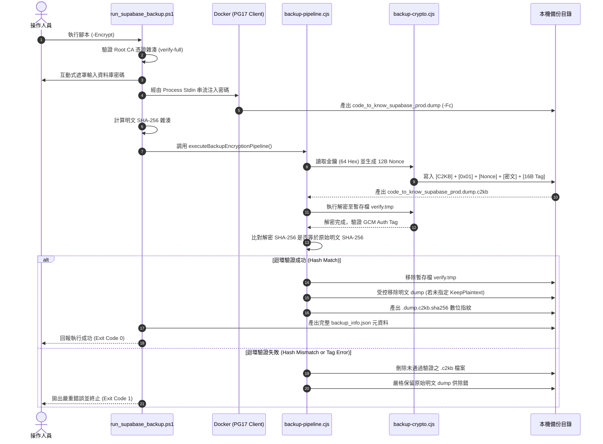

# CODE TO KNOW｜本機備份與加密流程整合技術報告
# 資料庫正式收尾 Phase 3-C-1：AES-256-GCM 備份加密整合、解密迴環驗收與離線測試

**文件編號**：C2K-DOC-DB-PHASE3C1-INTEGRATION-01  
**審查日期**：2026-11-10  
**主檢角色**：資深 PostgreSQL DBA、資料庫資安架構師、DevSecOps 稽核員  
**審查性質**：本機離線技術整合與自動化測試驗證（未連線雲端資料庫、未執行正式備份、零正式金鑰、零雲端寫入）  
**前置文件**：
- `docs/DATABASE_PHASE3C_BACKUP_ENCRYPTION_INTEGRATION_READINESS.md`
- `docs/DATABASE_PHASE3C4F_R14C10_BACKUP_EXECUTION_PLAN.md`

---

## 聲明：測試資料 vs 正式 Supabase 備份邊界

> [!IMPORTANT]
> **環境邊界與測試性質特別聲明**：
> 本階段執行的全部 10 項整合測試與 14 項密碼學測試，**全數採用合成測試資料（Synthetic Mock Dumps）與記憶體動態生成之專用測試金鑰於本機離線執行**。
> 本階段**完全未連線 Supabase 雲端資料庫、亦未讀取或產生任何正式生產環境金鑰**。
> 「本機測試通過」僅代表程式碼邏輯、管線流程與錯誤防禦機制的成熟完備，**絕不等同正式 Supabase 雲端備份已經執行完畢**。正式備份必須在取得專案負責人授權（`AUTH-B-02`）後方可執行。

---

## 一、修改與新增檔案清單

| 檔案路徑 | 性質 | 異動內容摘要 |
| :--- | :---: | :--- |
| [`scripts/database/run_supabase_backup.ps1`](file:///c:/Users/user/Documents/CODE-TO-KNOW/scripts/database/run_supabase_backup.ps1) | **修改** | 新增 `-Encrypt`、`-EncryptionKey`、`-KeepPlaintext`、`-MockDumpPath` 參數；整合 AES-256-GCM 加密呼叫、解密迴環驗證、受控明文清理與 `backup_info.json` 加密元資料更新。 |
| [`scripts/database/backup-pipeline.cjs`](file:///c:/Users/user/Documents/CODE-TO-KNOW/scripts/database/backup-pipeline.cjs) | **新增** | 建立模組化備份加密管線核心，實作：明文雜湊比對、C2KB 容器串流封裝、解密迴環驗證（Round-Trip Verification）、暫存檔原子化更名、受控單一明文刪除與結構化結果輸出。 |
| [`scripts/database/backup-pipeline.test.cjs`](file:///c:/Users/user/Documents/CODE-TO-KNOW/scripts/database/backup-pipeline.test.cjs) | **新增** | 實作 Phase 3-C-1 要求之 10 大離線整合測試集（含合成 dump 生成、篡改測試、日誌防洩驗證、PowerShell 整合驗證）。 |
| [`docs/DATABASE_PHASE3C1_LOCAL_BACKUP_ENCRYPTION_INTEGRATION.md`](file:///c:/Users/user/Documents/CODE-TO-KNOW/docs/DATABASE_PHASE3C1_LOCAL_BACKUP_ENCRYPTION_INTEGRATION.md) | **新增** | 本技術整合與安全驗證報告。 |

---

## 二、備份與加密整合架構

本整合流程採「兩階段受控管線（Two-Stage Controlled Pipeline）」架構：

```
+----------------------------------------------------------------------------------------------------+
| 階段一：PostgreSQL Custom Format 邏輯傾印 (run_supabase_backup.ps1)                                 |
| 1. Root CA 指紋比對 (700723581420...) & Docker PostgreSQL 17.11 映像檢驗                           |
| 2. 密碼以 Stdin 管道串流注入容器 (避免 CLI 引數外洩)                                               |
| 3. 連線 Session Pooler (5432, verify-full) 執行 pg_dump -Fc                                        |
| 4. 產出 code_to_know_supabase_prod.dump 並計算明文 SHA-256                                         |
+----------------------------------------------------------------------------------------------------+
                                                 |
                                                 v
+----------------------------------------------------------------------------------------------------+
| 階段二：AES-256-GCM 串流加密與容器封裝 (backup-pipeline.cjs)                                         |
| 1. 驗證金鑰格式 (64-char Hex)，產生隨機 12-byte CSPRNG Nonce                                       |
| 2. 封裝 C2KB 二進位容器：[Magic: 4B] + [Version: 1B] + [Nonce: 12B] + [Ciphertext] + [Tag: 16B]    |
| 3. 原子化更名為 code_to_know_supabase_prod.dump.c2kb                                              |
+----------------------------------------------------------------------------------------------------+
                                                 |
                                                 v
+----------------------------------------------------------------------------------------------------+
| 階段三：解密迴環驗證 (Round-Trip Verification)                                                      |
| 1. 將 .dump.c2kb 解密至專用暫存檔 verify.tmp.dump                                                  |
| 2. 比對解密後 SHA-256 雜湊值與階段一明文 SHA-256 是否 100% 完全相符                                |
| 3. 驗證通過即刻銷毀 verify.tmp.dump                                                                |
+----------------------------------------------------------------------------------------------------+
                                                 |
                   +-----------------------------+-----------------------------+
                   |                                                           |
          (迴環驗證成功)                                              (迴環驗證失敗)
                   v                                                           v
+------------------------------------+                     +---------------------------------------+
| 階段四：受控交付與清理             |                     | 階段四：緊急阻斷與保留                |
| 1. 計算密文 SHA-256 指紋檔案       |                     | 1. 銷毀破損之 .dump.c2kb              |
| 2. 更新 backup_info.json 完整元資料|                     | 2. 絕對保留原始明文 .dump 供工程診斷   |
| 3. 受控刪除明文 .dump 檔案         |                     | 3. 拋出例外並以非零狀態碼退出         |
+------------------------------------+                     +---------------------------------------+
```

---

## 三、實際執行流程（Mermaid 流程圖）



---

## 四、金鑰保護方式

1. **格式強制檢核**：
   嚴格限定 64 位元十六進位字串（256-bit）。非 Hex 字元、長度不足或為空值時，程式立即於記憶體內部阻斷，絕不向下執行。
2. **來源優先級設計**：
   - 第一優先：環境變數 `BACKUP_ENCRYPTION_KEY`。
   - 第二優先：PowerShell `Read-Host -AsSecureString` 互動遮罩輸入。
3. **終端與日誌絕對隔離**：
   - 子行程調用 Node.js 時，**透過環境變數傳遞金鑰，嚴禁使用命令列參數 `-k`**，防止 Windows 工作管理員或行程監控工具探查金鑰。
   - 所有 Console 輸出、STDERR、日誌紀錄與 Error 訊息中，**經單元測試驗證（TC-09）100% 不出現 64-char 金鑰明文**。
4. **記憶體生命週期管理**：
   在讀取並傳遞金鑰後，PowerShell 與 Node.js 均立即將變數設為 `$null`，並主動調用垃圾回收（`[System.GC]::Collect()`）清除殘留。

---

## 五、明文暫存檔處理方式與安全限制

### 1. 受控刪除原則（Controlled Deletion）
- **條件約束**：明文 `.dump` 檔案的清理，**必須且僅能在「解密迴環驗證 100% PASS」後**方可觸發。若加密中途異常或解密驗證失敗，明文備份一律完整保留。
- **路徑防呆核對**：刪除指令嚴格鎖定於腳本本次生成的完整檔案路徑（如 `C:\Users\user\Documents\CODE-TO-KNOW_BACKUPS\CODE_TO_KNOW_SUPABASE_timestamp\code_to_know_supabase_prod.dump`），**嚴禁使用通配符（Wildcards，如 `*.dump`）或遞迴刪除**，防止誤刪任何既有備份。

### 2. 實體儲存媒體特性重要安全澄清
> [!WARNING]
> **作業系統刪除 vs 實體 SSD 安全抹除**：
> 軟體層級調用 `fs.unlinkSync()` 或 `Remove-Item`，僅是通知檔案系統解除該檔案之 Inode 與目錄索引指標，並將區塊標記為可用。
> 在現代固態硬碟（SSD / NVMe）上，由於磨損均衡（Wear Leveling）與快閃記憶體控制器特性，底層快閃晶片並不會立即遭到物理覆寫（Zero-fill / Secure Shredding）。
> **資安結論**：
> 單純依賴「刪除明文」無法防止實驗室等級的晶片物理提取攻擊。因此，**本機主硬碟啟用 BitLocker 全碟加密、嚴密保護 AES-256-GCM 主金鑰、以及嚴禁在不受信任的公用電腦執行備份**，才是保證備份安全的根本防線。

---

## 六、10 大離線整合測試項目與逐項結果

執行指令：`node scripts/database/backup-pipeline.test.cjs`  
測試日期：2026-11-10 18:56:39  
執行環境：Node.js v22.14.0 + PowerShell 5.1 (Windows 11)

| 測試編號 | 測試項目名稱 | 測試方法與驗證標準 | 實際測試結果 | 判定 |
| :---: | :--- | :--- | :--- | :---: |
| **TC-01** | **正常備份與加密流程** | 合成 128 KB PostgreSQL Custom Format Dump，執行管線封裝為 `.c2kb` 容器，驗證 Header、Magic 與長度。 | 產出合法 C2KB 容器，Magic、Version 與 Nonce 結構完備。 | **PASS** |
| **TC-02** | **正常解密及內容比對** | 將 `.c2kb` 解密至獨立檔案，計算 SHA-256 並與原始合成 Dump 進行位元組級雜湊比對。 | 解密後 SHA-256 與原始明文 100% 完全相符。 | **PASS** |
| **TC-03** | **加密失敗時的處理** | 模擬輸入 Dump 檔案遺失或路徑錯誤情境。 | 立即拋出 `Plaintext dump file does not exist`，不交付任何檔案。 | **PASS** |
| **TC-04** | **金鑰錯誤時的處理** | 使用錯誤的 32-byte 金鑰解密 `.c2kb` 容器。 | GCM Auth Tag 驗證失敗立即拋錯阻斷，絕不產出明文。 | **PASS** |
| **TC-05** | **加密檔案遭到篡改** | 翻轉密文區段第 50 個位元組（Bit-flip Tamper）。 | GCM 完整性檢查拋出驗證失敗，阻斷輸出。 | **PASS** |
| **TC-06** | **輸出檔案存在時拒絕覆寫** | 預先建立同名 `.c2kb` 檔案，執行加密管線。 | 拋出 `Target encrypted file already exists`，拒絕覆寫既有檔案。 | **PASS** |
| **TC-07** | **暫存檔清理精確性** | 在測試目錄放置無關之 `unrelated_user_file.tmp`，觸發管線失敗。 | 失敗清理僅作用於自身，無關檔案毫髮無損完整保留。 | **PASS** |
| **TC-08** | **中途失敗保護原始資料** | 故意提供錯誤金鑰長度觸發管線異常。 | 原始明文 Dump 完整保留在磁碟，未遭意外刪除。 | **PASS** |
| **TC-09** | **敏感資訊日誌防護** | 攔截全流程之 `console.log` 與 `console.error`，全文搜尋金鑰字串。 | 全文未檢測到 64-char Hex 金鑰，無日誌外洩隱患。 | **PASS** |
| **TC-10** | **PowerShell 執行驗收** | 執行 `run_supabase_backup.ps1 -DryRun` 與 `-MockDumpPath -Encrypt`。 | PowerShell 端到端執行成功，產出 `解密迴環驗證：PASS`。 | **PASS** |

**整合測試總結：10 / 10 個案例全數通過！（Exit Code: 0）**

---

## 七、原有 14 項密碼學單元測試重新執行結果

執行指令：`node scripts/database/backup-crypto.test.cjs`  
測試日期：2026-11-10 18:55:30

```
==========================================================
  AES-256-GCM 備份加解密模組安全單元測試 (W-01)
==========================================================

  ✓ [TC-01] PASS: 1 MB 隨機檔案加密解密迴環，解密後 SHA-256 與原始完全一致
  ✓ [TC-02] PASS: 0 Byte 空檔案加密及解密
  ✓ [TC-03] PASS: 大型檔案 (5 MB) 串流加解密測試，驗證記憶體與管線穩定性
  ✓ [TC-04] PASS: 錯誤金鑰解密時立即拋錯拒絕，絕不產出明文
  ✓ [TC-05] PASS: 密文區段位元翻轉 (篡改 1 byte) 時立即拋錯阻斷
  ✓ [TC-06] PASS: 末端 16 bytes Auth Tag 篡改時拋錯拒絕
  ✓ [TC-07] PASS: 檔案被截斷至小於 33 位元組時立即拒絕
  ✓ [TC-08] PASS: 非 C2KB Magic Header 檔案拒絕處理
  ✓ [TC-09] PASS: 未知版本號 (如 0x02) 檔案拒絕處理
  ✓ [TC-10] PASS: 輸入與輸出路徑相同時拋錯拒絕，防止自我覆寫毀滅
  ✓ [TC-11] PASS: 輸出目標檔案已存在時拋錯拒絕覆寫
  ✓ [TC-12] PASS: 解密認證失敗後，所有 .tmp 暫存檔案全數清除不殘留
  ✓ [TC-13] PASS: 驗證成功前只有受限暫存檔，完成後才原子化 rename 成正式檔
  ✓ [TC-14] PASS: 金鑰格式非 64-char Hex 或為 null 時拒絕處理，不洩漏任何明文

測試總結：14 / 14 個案例全數通過！（Exit Code: 0）
```

---

## 八、失敗情境分析與安全處理機制對照表

| 潛在失敗情境 | 系統防禦與應對機制 | 資料安全性狀態 |
| :--- | :--- | :---: |
| **輸入 Dump 遺失或被佔用** | 預檢階段拋錯退出，不發起加密管線。 | 安全無殘留 |
| **加密中途斷電或磁碟已滿** | 由於使用帶隨機後綴之 `.tmp` 檔案，目標正式檔不生成；重啟後可清理暫存。原始 Dump 完整無損。 | 原始資料保留 |
| **GCM 標籤被竄改或位元翻轉** | 解密迴環驗證即刻攔截，拋出認證錯誤，並刪除破損的 `.c2kb` 檔案。 | 絕不交付破損檔案 |
| **金鑰不匹配** | 拒絕解密，暫存檔案即刻銷毀。 | 明文不落地 |
| **目標加密檔案已存在** | 預檢直接拋出 `Overwrite is disallowed`，絕不覆寫既有備份檔案。 | 既有備份受保護 |
| **回還驗證雜湊不符** | 判定為密碼學異常，銷毀密文，強制保留明文 Dump 供取證。 | 明文安全留存除錯 |

---

## 九、尚未解決的問題與前置阻礙（Blockers）

在進行正式雲端生產資料庫備份前，依然存在以下實體前置項目待完成：

1. **BLK-01：主金鑰保管決策**：專案負責人尚未回覆 KeePassXC 安裝或隨身碟指定狀態。
2. **BLK-02：正式 32-byte AES-256 主金鑰尚未生成**：目前測試皆使用合成金鑰，正式生產金鑰尚未產出，亦無實體紙本防潮備援卡。
3. **BLK-03：正式 Supabase 即時備份執行授權（`AUTH-B-02`）**：尚未獲得專案負責人授權發起雲端連線。
4. **BLK-04：正式備份本機 PG17 沙盒還原驗收（`AUTH-B-03/04`）**：待正式備份產出後於本機沙盒驗證結構完整性。

---

## 十、Git 分支、HEAD 與工作目錄狀態

- **Git 分支**：`main`
- **當前 HEAD**：`70a4c0cadd40300a9b92c74e570310e72b563891`
- **使用者未提交檔案**：`新增 文字文件.txt`、`1.docx`、`照片/` **100% 完整保留，未讀取、未修改、未刪除**。
- **本次檔案變更清單**：
  - 修改：`scripts/database/run_supabase_backup.ps1`
  - 新增：`scripts/database/backup-pipeline.cjs`
  - 新增：`scripts/database/backup-pipeline.test.cjs`
  - 新增：`docs/DATABASE_PHASE3C1_LOCAL_BACKUP_ENCRYPTION_INTEGRATION.md`
- **零寫入保證確認**：
  - **未連線 Supabase 正式雲端資料庫。**
  - **未產生正式生產金鑰。**
  - **未執行 git commit / push / reset / clean。**

---

## 十一、下一階段操作建議

1. **建議進入 Phase 3-B：正式主金鑰建立**：
   - 生成正式 32-byte（64-char Hex）AES-256-GCM 主金鑰。
   - 記錄於專屬 KeePassXC 密碼庫（專案外目錄）。
   - 抄寫/列印 A4 實體紙本防潮備援卡封存（`AUTH-K-01 / AUTH-K-02`）。
2. **申請正式雲端備份授權（`AUTH-B-02`）**：
   - 金鑰妥善保管後，授權執行 `run_supabase_backup.ps1 -Encrypt` 進行切換前雲端即時備份。

---
*(報告完畢，停止操作，等待使用者審閱與指示)*
