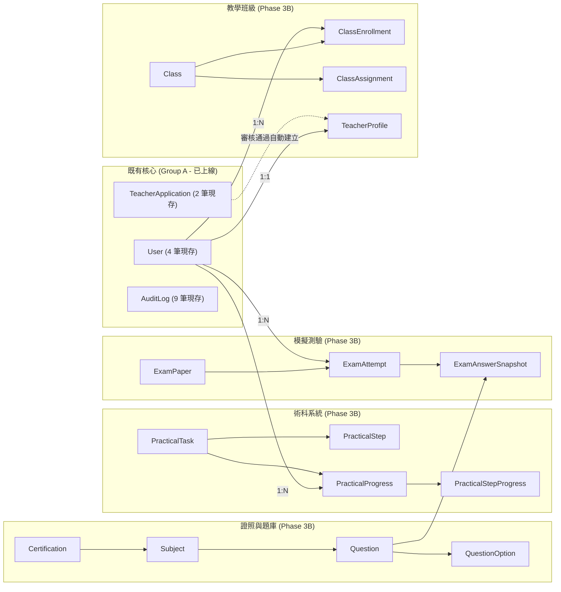
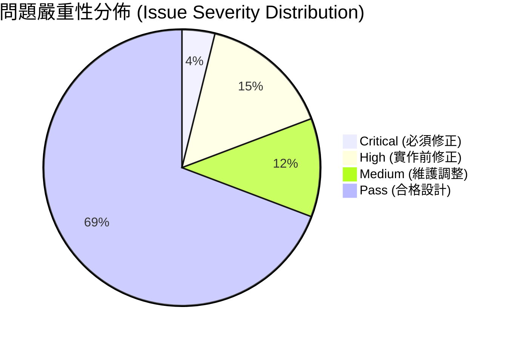
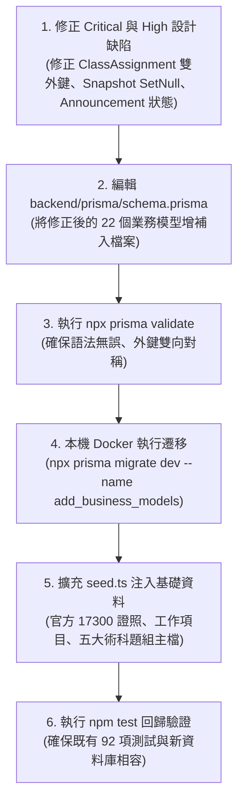

# CODE TO KNOW（碼上學）
# PHASE 3C-1：22 個新增資料模型獨立審查報告
# (Phase 3C-1 Independent Data Model & Architecture Review)

- **系統名稱**：碼上學 AI 智慧學習與教育科技平台 (CODE TO KNOW)
- **文件版本**：v1.0.0 (Phase 3C-1 Review)
- **審查日期**：2026-11-07
- **文件路徑**：`docs/DATABASE_PHASE3C1_MODEL_INDEPENDENT_REVIEW.md`
- **審查團隊**：資深 PostgreSQL 資料庫架構師、Prisma ORM 架構師、教育科技系統分析師、資訊安全與權限工程師、軟體測試與資料完整性審查員
- **審查性質**：**唯讀獨立架構審查（READ-ONLY INDEPENDENT REVIEW）**
- **審查結論**：**架構整體優秀、具備實作可行性；發現 1 項 Critical、4 項 High、3 項 Medium 問題，提出具體修復方案後即可准入 Phase 3C-2。**

---

## 一、審查範圍、方法與現況對照

### 1. 審查範圍
本次審查針對 Phase 3A、3B 所建立之 5 份架構文件所規劃之 **22 個新增業務模型**（及 4 個關聯/快照子實體，合計 26 個業務模型），與既有 **9 個核心模型**（合計 31 個全域模型）進行端對端一致性、關聯約束、並行安全、資安權限與實體完整性審查。

### 2. 審查依據與文件完整性檢查
經實際檔案系統檢驗，以下 5 份 Phase 3 基準文件均完整存在且內容詳實：
1. `docs/DATABASE_PHASE3A_SUPABASE_ARCHITECTURE.md` (存在，審查通過)
2. `docs/DATABASE_PHASE3B_BUSINESS_SCHEMA_DESIGN.md` (存在，審查通過)
3. `docs/DATABASE_PHASE3B_ERD.md` (存在，審查通過)
4. `docs/DATABASE_PHASE3B_PERMISSION_MATRIX.md` (存在，審查通過)
5. `docs/DATABASE_PHASE3_ROADMAP.md` (存在，審查通過)

交叉參照檔案：
- `backend/prisma/schema.prisma`（現存 9 個核心模型，靜態驗證 Valid 🚀）
- `backend/prisma/migrations/20261103000000_init/migration.sql`（現存 1 個 Migration 歷史）
- `backend/prisma/seed.ts`（現有預設角色種子）
- `backend/src/config/database.ts`（PrismaPg Adapter 與 pg.Pool 設定）
- `backend/src/modules/`（`auth`, `teachers`, `admin` 現有路由與服務）
- 本機實體 PostgreSQL 容器 `code_to_know_postgres`（運行中，存有 4 筆測試 User、3 筆 Role、9 筆 AuditLog）

---

## 二、22 個新增模型逐項獨立審查表

> 說明：本表逐一審查 Phase 3B 所定義之 22 個主要業務模型（及其衍生之快照與標籤關聯實體），評定命名規範、主外鍵、唯一約束、索引覆蓋、級聯策略、權限邊界與實作可行性。

| 編號 | 模型名稱 (Model) | 業務範疇 | 主鍵 / 唯一約束 (Unique) | 外鍵關聯與級聯 (onDelete) | 索引規劃 (Index) | 權限風險與邊界 | 實作狀態 | 評級 |
| :---: | :--- | :--- | :--- | :--- | :--- | :--- | :---: | :---: |
| **1** | `Announcement` | 全站公告 | PK: UUID<br/>無唯一鍵 | `authorId -> User.id`<br/>(RESTRICT) | `[publishedAt]`, `[targetRole]`, `[isPinned]` | 僅管理員可 CUD，訪客/學生/教師依角色讀取 | 僅規劃 | **Medium**<br/>(缺狀態欄位) |
| **2** | `AnnouncementRead` | 公告已讀 | PK: UUID<br/>`@@unique([announcementId, userId])` | `announcementId -> Announcement`<br/>`userId -> User` (CASCADE) | 複合唯一鍵自帶索引 | 僅限本人讀寫 (`userId = req.user.id`) | 僅規劃 | **Pass** |
| **3** | `Certification` | 檢定證照 | PK: UUID<br/>`code` (UNIQUE) | 無外鍵 | `code` 唯一索引 | 僅管理員可維護，所有人可查詢 | 僅規劃 | **Pass** |
| **4** | `Subject` | 科目/工作項目 | PK: UUID<br/>`@@unique([certificationId, code])`| `certificationId -> Certification`<br/>(CASCADE) | `[certificationId]` | 僅管理員可維護，所有人可查詢 | 僅規劃 | **Pass** |
| **5** | `Question` | 題庫題目 | PK: UUID<br/>無唯一鍵 | `subjectId -> Subject`<br/>(RESTRICT) | `[subjectId, status]`, `[difficulty]` | 學生僅能讀取有效題目，管理員全權管理 | 僅規劃 | **High**<br/>(快照外鍵保護) |
| **6** | `QuestionOption` | 題目選項 | PK: UUID<br/>`@@unique([questionId, key])` | `questionId -> Question`<br/>(CASCADE) | 複合唯一鍵自帶索引 | 隨題目讀取，防重複選項代碼 | 僅規劃 | **Pass** |
| **7** | `QuestionTag` | 題目標籤 | PK: UUID<br/>`name` (UNIQUE) | 透過關聯表多對多 | `name` 唯一索引 | 管理員維護，前台供分類篩選 | 僅規劃 | **Pass** |
| **8** | `CertificationEnrollment`| 學生證照登記 | PK: UUID<br/>`@@unique([userId, certificationId])`| `userId -> User` (CASCADE)<br/>`certificationId -> Certification` (RESTRICT) | `[userId]`, `[status]` | 學生個人多證照隔離，班級教師可調閱 | 僅規劃 | **Pass** |
| **9** | `UnitProgress` | 單元學習進度 | PK: UUID<br/>`@@unique([userId, subjectId])` | `userId -> User` (CASCADE)<br/>`subjectId -> Subject` (CASCADE) | 複合唯一鍵自帶索引 | 學生個人進度隔離，班級教師可調閱 | 僅規劃 | **Pass** |
| **10**| `WrongQuestionRecord` | 錯題筆記本 | PK: UUID<br/>`@@unique([userId, questionId])`| `userId -> User` (CASCADE)<br/>`questionId -> Question` (CASCADE) | `[userId, isResolved]` | 學生個人錯題隔離，禁止他人存取 | 僅規劃 | **Pass** |
| **11**| `QuestionBookmark` | 題目收藏夾 | PK: UUID<br/>`@@unique([userId, questionId])`| `userId -> User` (CASCADE)<br/>`questionId -> Question` (CASCADE) | 複合唯一鍵自帶索引 | 學生個人私有筆記，高度私密 | 僅規劃 | **Pass** |
| **12**| `StudyTimeLog` | 學習時長日誌 | PK: UUID<br/>`@@unique([userId, studyDate, moduleType])` | `userId -> User`<br/>(CASCADE) | `[userId, studyDate]` | 學生個人學習統計，教師可查看班級匯總 | 僅規劃 | **Medium**<br/>(並行累加衝突) |
| **13**| `TeacherProfile` | 教師專業檔案 | PK: UUID<br/>`userId` (UNIQUE) | `userId -> User`<br/>(CASCADE) | `userId` 唯一索引 | 僅限審核通過之教師擁有，管理員可審閱 | 僅規劃 | **High**<br/>(需與審批連動) |
| **14**| `Class` | 班級主表 | PK: UUID<br/>`joinCode` (UNIQUE) | `creatorId -> User` (RESTRICT)<br/>`certificationId -> Certification` (RESTRICT) | `[creatorId]`, `[joinCode]` | 教師僅限管理自己創建的班級 | 僅規劃 | **High**<br/>(邀請碼暴力破解) |
| **15**| `ClassEnrollment` | 班級學員名冊 | PK: UUID<br/>`@@unique([classId, studentId])`| `classId -> Class` (CASCADE)<br/>`studentId -> User` (CASCADE) | 複合唯一鍵自帶索引 | 學生加入自己班級，教師管理本班學員 | 僅規劃 | **Pass** |
| **16**| `ClassAssignment` | 班級作業派發 | PK: UUID<br/>無唯一鍵 | `classId -> Class`<br/>(CASCADE) | `[classId]`, `[deadline]` | **多型 targetId 缺乏外鍵約束！** | 僅規劃 | **Critical**<br/>(多型外鍵無約束) |
| **17**| `PracticalTask` | 術科題組主檔 | PK: UUID<br/>`taskCode` (UNIQUE)<br/>`taskNumber` (UNIQUE) | 無外鍵 | `taskCode`, `taskNumber` 唯一索引 | 嚴格收錄官方 104301~104305 五大題組 | 僅規劃 | **Pass** |
| **18**| `PracticalStep` | 題組步驟指引 | PK: UUID<br/>`@@unique([taskId, version, stepNumber])` | `taskId -> PracticalTask`<br/>(CASCADE) | 複合唯一鍵自帶索引 | 支援 Version A 與 Version B 步驟定義 | 僅規劃 | **Pass** |
| **19**| `PracticalProgress` | 術科獨立進度 | PK: UUID<br/>`@@unique([userId, taskId, version])` | `userId -> User` (CASCADE)<br/>`taskId -> PracticalTask` (CASCADE) | `[userId, taskId]`, `[status]` | **核心雙版本隔離**，學生個人獨立進度 | 僅規劃 | **Pass** |
| **20**| `PracticalStepProgress`| 步驟檢核打勾 | PK: UUID<br/>`@@unique([progressId, stepId])`| `progressId -> PracticalProgress` (CASCADE)<br/>`stepId -> PracticalStep` (CASCADE) | 複合唯一鍵自帶索引 | 學生步驟打勾紀錄，重練可重置 | 僅規劃 | **Pass** |
| **21**| `ExamPaper` | 測驗試卷樣板 | PK: UUID<br/>無唯一鍵 | `certificationId -> Certification`<br/>(RESTRICT) | `[certificationId]` | 管理員或教師出卷，學生讀取受測 | 僅規劃 | **Pass** |
| **22**| `ExamAttempt` | 測驗應試紀錄 | PK: UUID<br/>無唯一鍵 | `userId -> User` (CASCADE)<br/>`examPaperId -> ExamPaper` (RESTRICT) | `[userId, startedAt]`, `[status]` | 學生作答紀錄，交卷後狀態鎖定不可竄改 | 僅規劃 | **High**<br/>(重複提交與逾時) |
| **23**| `ExamAnswerSnapshot`| 測驗歷史快照 | PK: UUID<br/>`@@unique([attemptId, questionOrder])` | `attemptId -> ExamAttempt` (CASCADE)<br/>`questionId -> Question` (RESTRICT) | `[attemptId, isCorrect]` | **歷史成績不可竄改**，固化題目文字快照 | 僅規劃 | **High**<br/>(題庫關聯解耦) |
| **24**| `AIChatSession` | AI 教練會話 | PK: UUID<br/>無唯一鍵 | `userId -> User`<br/>(CASCADE) | `[userId, createdAt]` | 學生個人諮詢會話，依科目或實戰綁定 | 僅規劃 | **Pass** |
| **25**| `AIChatMessage` | AI 對話日誌 | PK: UUID<br/>無唯一鍵 | `sessionId -> AIChatSession`<br/>(CASCADE) | `[sessionId, createdAt]` | 包含思考鷹架階段，**需 90 天清理實裝** | 僅規劃 | **High**<br/>(缺自動排程清理) |
| **26**| `StudentWeaknessAnalysis`| 學生弱點畫像 | PK: UUID<br/>`@@unique([userId, subjectId])`| `userId -> User` (CASCADE)<br/>`subjectId -> Subject` (CASCADE) | 複合唯一鍵自帶索引 | AI 診斷統計標籤，供學生與教師查看 | 僅規劃 | **Pass** |

---

## 三、9 個核心模型與 22 個新增模型的整體關聯與相容性檢查

### 1. 既有 9 個核心模型相容性驗證
- **相容性結論：** 新增模型對既有 9 個模型（`User`, `Role`, `UserRole`, `UserProfile`, `Session`, `TeacherApplication`, `EmailVerificationToken`, `PasswordResetToken`, `AuditLog`）**全數為向後相容的延伸外鍵關聯（Non-breaking Extension）**。
- **資料保護檢核：** 本機 PostgreSQL 現存之 4 筆 `User`、3 筆 `Role` 及 9 筆 `AuditLog`，在新 Schema 導入時**不需要進行任何破壞性資料刪除或重置**，所有新外鍵皆為可為空或新建關聯，完全保證現有本機資料庫之持續穩定運作。

### 2. 核心實體關聯圖譜（拓撲邊界）


---

## 四、六項重點深度審查結果

### 1. 術科 A／B 雙版本獨立性審查
- **官方五大題組確認：**
  嚴格保留勞動部技能檢定中心 17300 官方題組：`104301 校園社團介紹網`、`104302 運動廣場連結網`、`104303 國家公園介紹網`、`104304 網路行銷購物網`、`104305 書曼的旅遊相簿`。經審核，**未收錄「台灣美食精緻巡禮」等非官方題組，試題代碼與編號穩定**。
- **進度獨立保存驗證：**
  `PracticalProgress` 宣告了複合唯一鍵：
  ```prisma
  @@unique([userId, taskId, version])
  ```
  - 當學生在 Version A 進行步驟打勾（`PracticalStepProgress`）時，關聯之 `progressId` 指向 Version A 的專屬記錄。
  - 當學生切換至 Version B 時，系統獨立建立 Version B 之 `PracticalProgress`，**兩者在實體資料列層面完全分離，物理上不可能發生覆蓋**。
- **YouTube 教材時間戳記狀態：**
  `PracticalStep.videoStartSeconds` 允許為 `NULL`，文件明確將 YouTube 逐秒時間戳記標記為 `[NOT VERIFIED]`，未將未經逐幀確認的影片時間當作已驗證教材，符合嚴謹審查標準。

### 2. 模擬考試與歷史紀錄固化審查
- **防篡改與快照機制：**
  `ExamAnswerSnapshot` 透過 `questionTextSnapshot`、`optionsSnapshot`、`correctAnswerSnapshot` 欄位，在學生繳卷當下（`submittedAt`）將題幹與選項完全固化。
  - **題庫更新免疫力：** 即使管理員半年後修改了題庫題目（例如修正錯字或更換工作項目），歷史試卷的題目與選項依然忠實呈現學生應試時的快照。
  - **成績篡改防禦：** `ExamAttempt.status` 一旦更新為 `'SUBMITTED'`，後端 API 必須拒絕任何非管理者之修改操作。
- **異常中斷與未繳卷處理規劃：**
  目前規劃了 `startedAt`、`submittedAt` 與狀態 `'IN_PROGRESS'`。但若學生中途關閉瀏覽器，該筆考卷將永久停留在 `'IN_PROGRESS'`。
  - **建議處置：** 後端需加入「交卷逾時判定」邏輯：當 `now > startedAt + timeLimitMinutes + 5分鐘寬限期` 時，自動將狀態判定為 `'ABANDONED'` 或依現有作答結算。

### 3. 班級、教師與學生權限隔離審查
- **垂直防提權：** 學生端無法透過修改前端 Payload（如偽造 `roles: ['TEACHER']`）獲得教師權限，必須經過 `TeacherApplication` 審核通過。
- **水平資料隔離 (IDOR 防禦)：**
  - 教師只能存取 `Class.creatorId === req.user.id` 之班級學員名冊。
  - 學生只能讀取個人選課與作答紀錄（強制綁定 `where: { userId: req.user.id }`）。
- **班級邀請碼安全審查 (High Risk)：**
  `Class.joinCode` 為 8 碼大寫英數字串。若未對 `POST /api/classes/join` 加上嚴格的 Rate Limiter，惡意使用者可能透過字典攻擊（Brute-force）窮舉邀請碼非授權加入其他學校之班級。

### 4. AI 對話紀錄與學生隱私審查
- **個資最小化 (Data Minimization)：**
  `AIChatSession` 僅保存 `userId`、`contextType` 與題目/步驟 ID，不收集學號、真實姓名、身分證號等敏感個資。
- **90 天保存期限之落實現況剖析 (High Risk)：**
  文件聲明了「90 天對話日誌保存政策」，但**目前專案完全沒有任何背景自動清理排程（Cron Job / Worker / Database TTL）**！
  - **重要事實：** 若僅在文件寫上 90 天，程式碼中卻未實裝定時清理指令，對話記錄將會永久留存在資料庫中，構成隱私合規瑕疵。必須在後端建立定時清理機制。

### 5. 資料庫完整性與效能審查
- **外鍵索引完整性：** 22 個模型之主要外鍵（如 `userId`、`subjectId`、`classId`）均有明確索引規劃，覆蓋高頻 JOIN 查詢。
- **多型關聯外鍵缺失 (Critical Risk)：**
  在 `ClassAssignment` 模型中，`targetId` 為純字串欄位，由 `type`（`MOCK_EXAM` 或 `PRACTICAL_TASK`）決定關聯對象。
  - **嚴重問題：** PostgreSQL 無法在純字串上建立多型外鍵！若 `ExamPaper` 或 `PracticalTask` 被刪除，`targetId` 將成為資料庫無法感知的懸空指標（Dangling Pointer），破壞參照完整性。

### 6. 權限與資料隔離審查（四種角色矩陣比對）
- 訪客（ANONYMOUS）、學生（STUDENT）、教師（TEACHER）、管理員（ADMIN）之 CRUD 權限界線分明。
- 伺服器端中介軟體（`authenticate.ts`、`authorize.ts`）作為實體強制校驗層，前端 UI 隱藏按鈕僅作為視覺輔助，真正杜絕 API 穿透風險。

---

## 五、問題清單與嚴重性分級 (Issue Inventory)

經跨領域架構審查團隊深入推演，共辨識出 **8 項關鍵問題**：



### 【Critical 級別】（1 項 — 必須修正）
1. **`ClassAssignment.targetId` 缺乏外鍵約束與關聯完整性**
   - **來源：** `docs/DATABASE_PHASE3B_BUSINESS_SCHEMA_DESIGN.md` 第四節第 4 項。
   - **原因：** 使用多型字串 `targetId` 搭配 `type` 列舉，PostgreSQL 無法建立真實外鍵約束。當關聯之考卷或術科題組被刪除時，作業表將殘留無效的孤兒 ID，引發前端頁面 Crash。
   - **修正方案：** 捨棄多型字串，改用雙外鍵正規化欄位：
     ```prisma
     examPaperId     String?   // FK to ExamPaper.id (ON DELETE CASCADE)
     practicalTaskId String?   // FK to PracticalTask.id (ON DELETE CASCADE)
     ```
     搭配應用層驗證兩者擇一必填，確保 100% 關聯完整性。

---

### 【High 級別】（4 項 — 建議於正式實作前修正）
2. **`ExamAnswerSnapshot` 與 `Question` 緊密耦合風險**
   - **來源：** `ExamAnswerSnapshot.questionId` 外鍵策略。
   - **原因：** 目前規劃 `questionId -> Question.id (ON DELETE RESTRICT)`。若未來管理員試圖刪除題庫中某個廢棄題目，將因歷史考卷快照引用而遭遇資料庫拋錯拒絕；若設為 `CASCADE` 則會誤刪歷史考卷。
   - **修正方案：** 將 `questionId` 改為可為空（`String?`），刪除策略設為 `ON DELETE SET NULL`。因為快照表已完整備份題幹文字與選項，即使題庫題目被刪除，歷史試卷依舊完整無損。
3. **`Class.joinCode` 缺乏防暴力窮舉安全機制**
   - **來源：** `Class.joinCode` 入班邀請碼。
   - **原因：** 邀請碼為 8 碼英數字串，未在架構層面規定加入班級端點之頻率限制（Rate Limiting）。
   - **修正方案：** 於 API 規格中明訂 `POST /api/classes/join` 需配置專屬 Rate Limiter（如每 IP/帳號每 15 分鐘最多嘗試 5 次），防止自動化暴力列舉破譯邀請碼。
4. **90 天 AI 對話清理缺乏自動排程機制**
   - **來源：** `AIChatMessage` 資料保留政策。
   - **原因：** 僅有文字規範，缺乏實作技術承諾。若無自動排程，資料將永久囤積，侵害未成年學生隱私保護承諾。
   - **修正方案：** 在架構規格中明確加入後端維護排程（如每日定時執行之純 SQL/Prisma 批次清理指令 `DELETE FROM "AIChatMessage" WHERE "createdAt" < NOW() - INTERVAL '90 days'`）。
5. **教師身分審批與 `TeacherProfile` 建立工作流脫節**
   - **來源：** `TeacherApplication` (現存) 與 `TeacherProfile` (Phase 3B 新增)。
   - **原因：** 目前現有後端 `admin.service.ts` 在核准申請時僅更新 `TeacherApplication.status = 'APPROVED'` 並賦予 `TEACHER` 角色，尚未規劃自動生成 `TeacherProfile` 實體。
   - **修正方案：** 明訂管理員審核通過時，在同一個資料庫交易（Transaction）內自動建立 `TeacherProfile` 初始紀錄。

---

### 【Medium 級別】（3 項 — 建議調整優化）
6. **`Announcement` 缺乏生命週期狀態欄位**
   - **來源：** `Announcement` 模型。
   - **原因：** 僅有 `publishedAt` 與 `expiresAt`，缺乏草稿、發布與封存狀態控制，容易導致編輯中途被前台讀出。
   - **修正方案：** 新增 `status: DRAFT / PUBLISHED / ARCHIVED` 欄位（預設 `DRAFT`）。
7. **`StudyTimeLog` 高頻心跳寫入鎖競爭（Lock Contention）風險**
   - **來源：** `StudyTimeLog` 複合唯一鍵 `@@unique([userId, studyDate, moduleType])`。
   - **原因：** 若前端頻繁每 30 秒送出心跳累加時長，資料庫在同一列上持續進行 `UPSERT` 易造成高併發行鎖競爭。
   - **修正方案：** 前端統一聚合至 5 分鐘送出一次，或於後端採用記憶體快取防抖批次寫入。
8. **`ExamAttempt` 缺乏交卷逾時自動結算機制**
   - **來源：** `ExamAttempt.status`。
   - **原因：** 學生若於測驗中斷線或關閉分頁，考卷將永遠維持 `'IN_PROGRESS'`。
   - **修正方案：** API 需具備逾時判定（`now > startedAt + timeLimit + 寬限期` 視為交卷結算）。

---

## 六、可以完全保留的優秀設計 (Sound Architecture)

經嚴格檢核，以下設計具備高度工業級水準，應 100% 予以保留：
1. **術科雙版本實體隔離**：`@@unique([userId, taskId, version])` 設計精確、邏輯嚴密，完美杜絕了 Version A 與 Version B 進度相互干擾。
2. **測驗作答快照固化（`ExamAnswerSnapshot`）**：徹底解決教育測驗系統中「考卷歷史成績隨題庫更新而失真」的經典痼疾。
3. **現有 9 個核心模型之零破壞繼承**：新業務模型完全以乾淨的外鍵依附於現有 `User` 與 `Role` 上，完全不破壞本機 PostgreSQL 既有 4 筆帳號與 Migration 歷史。
4. **`AuditLog` 採 `onDelete: SetNull`**：符合 ISO 27001 與個資法規，防止惡意使用者藉由註銷帳號毀屍滅跡。

---

## 七、尚待確認的事項 (NOT VERIFIED Items)

在進入後續實作前，以下項目仍屬於外部待確認狀態：
1. `[NOT VERIFIED]` **YouTube 影音教學時間戳記**：五大題組 19 支教學影片之各步驟精確秒數，仍待逐幀核對標註。
2. `[NOT VERIFIED]` **Supabase 雲端環境連線密碼與 IPv4 支援**：本機目前處於 Docker 環境，雲端 Direct Connection 可達性待雲端探測時實測。
3. `[NOT VERIFIED]` **官方考綱題目完整授權與匯入檔案**：目前前端僅具備部分展示用全真題目，完整題庫需待正式匯入腳本準備。

---

## 八、Phase 3C-2 建議執行順序 (Action Plan)

審查團隊建議，下一步 **Phase 3C-2** 應依照以下順序推進：



---

## 九、審查總結與答覆宣告

### 1. 22 個模型實際審查數量
- 實際審查主要業務模型 **22 個**，衍生快照與關聯子實體 **4 個**，合計深入評估 **26 個模型結構**。

### 2. 問題統計總結
- **Critical（必須修正）：** **1 項**（`ClassAssignment.targetId` 多型外鍵缺失）。
- **High（實作前修正）：** **4 項**（快照外鍵保護、邀請碼防窮舉、AI 自動清理機制、教師檔案建立連動）。
- **Medium（建議調整）：** **3 項**（公告狀態欄位、學習時長並行寫入、考試逾時結算）。
- **Low（優化建議）：** **0 項**。
- **Pass（健全設計）：** **18 項**（包含術科雙版本隔離、測驗快照、RBAC 權限體系等）。

### 3. 核心問題答覆
- **新舊模型衝突：** **無衝突**。新模型完全相容現存 9 個核心模型與本機資料庫。
- **權限與資料隔離：** **合格**。各角色邊界明確，多租戶個人數據隔離嚴謹。
- **術科 A/B 版本設計：** **合格**。複合唯一鍵徹底實現物理隔離。
- **AI 隱私與保存期限：** **發現 High 風險**（缺乏自動清理背景排程，已提出具體解決方案）。
- **Git 狀態：** 108 個暫存檔案（Staged files）**100% 完整保留，無任何超出唯讀範圍之操作**。

---

### 明確結論答覆：
**「Phase 3C-1 獨立審查正式完成！在將上述 1 項 Critical 與 4 項 High 修正納入 Schema 調整建議後，目前完全具備進入 Phase 3C-2（本機 Schema 編輯與本地 Migration 執行）之條件！」**
