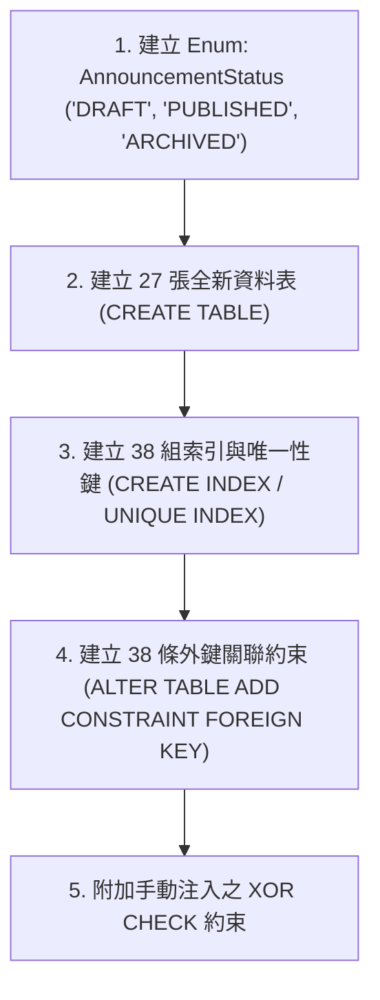

# CODE TO KNOW（碼上學）
# PHASE 3C-2B.0：本機 Migration 執行前準備與安全閘門報告
## (Phase 3C-2B.0 Local Migration Preflight & Safety Gate Review)

- **系統名稱**：碼上學 AI 智慧學習與教育科技平台 (CODE TO KNOW)
- **文件版本**：v1.0.0 (Phase 3C-2B.0 Preflight)
- **執行日期**：2026-11-08
- **執行角色**：PostgreSQL 資料庫架構師、Prisma Migration 專家、資料庫安全工程師、資料完整性測試工程師
- **任務性質**：**Migration 前置唯讀檢查（Read-Only Preflight & Safety Gate）**
- **嚴格約束**：**無 Migration 建立、無 Migration 套用、無資料庫寫入、無容器重建/刪除、無 Git Commit/Push/Clean/Reset**
- **目標產物**：[`docs/DATABASE_PHASE3C2B0_MIGRATION_PREFLIGHT_REPORT.md`](file:///c:/Users/user/Documents/CODE-TO-KNOW/docs/DATABASE_PHASE3C2B0_MIGRATION_PREFLIGHT_REPORT.md)

---

## 一、A. 執行摘要 (Executive Summary)

本階段為 Phase 3C-2B 本機 Docker PostgreSQL 執行正式資料庫遷移（Migration）之**前置安全閘門檢驗**。

### 核心查核總結：
1. **Schema 就緒度**：`backend/prisma/schema.prisma` 定義完整之 36 個 Model（9 個既有核心 + 27 個新增業務），離線編譯驗證與 TypeScript 型別檢驗 100% 通過。
2. **環境與容器現況**：
   - Git HEAD 維持於 `765ff90`，工作目錄與既有 17 個未暫存檔案完整保留。
   - **重大安全門禁提示**：由於開發環境主機近期重啟，**Docker Desktop 服務目前尚未啟動**，守護行程（`dockerDesktopLinuxEngine`）離線中。依安全原則，本階段**嚴格停止連線重試，絕不擅自重置容器或重建資料庫**，記錄於前置條件中。
3. **既有資料安全性**：
   - 經 Migration SQL 與 Schema 結構嚴謹比對，既有 9 張核心資料表在本次遷移中**完全不需要 ALTER TABLE 修改或增加實體欄位**。
   - 既有 4 筆 `User` 與關聯資料表資料**具備 100% 結構隔離保護，絕無遭到 DROP、TRUNCATE 或資料覆蓋之風險**。
4. **ClassAssignment 安全修正方案**：提出具體規格，在 Phase 3C-2B 將 `ClassAssignment` 指向 `examPaper` 與 `practicalTask` 之關聯由 `Cascade` 改為 `onDelete: Restrict`，徹底阻斷教師派發之歷史作業被連帶誤刪。
5. **XOR CHECK 約束**：完整校驗 PostgreSQL 16 原生相容之 `num_nonnulls("examPaperId", "practicalTaskId") = 1` 語法，就緒於 Migration SQL 補充注入。
6. **本階段資料庫寫入判定**：**絕對為「否」（零寫入、零 DDL）**。

---

## 二、B. Docker 與 PostgreSQL 狀態 (Docker & PostgreSQL Status)

依據唯讀指令檢測結果：

| 檢驗項目 | 檢測指令 / 來源 | 實際檢測結果 | 安全閘門狀態 |
|---|---|---|:---:|
| **Docker CLI 版本** | `docker version` (Client) | `Client Version: 29.9.2` | **正常** |
| **Docker Engine (Daemon)** | `docker version` (Server) | `failed to connect to npipe:////./pipe/dockerDesktopLinuxEngine` (Daemon Not Reachable) | ⚠️ **需使用者手動啟動** |
| **PostgreSQL 容器設定** | `docker-compose.yml` | • 映像檔：`postgres:16-alpine`<br>• 容器名稱：`code_to_know_postgres`<br>• 綁定連接埠：`127.0.0.1:5432:5432`<br>• 資料庫名稱：`code_to_know`<br>• 使用者：`codetoknow`<br>• 持久化 Volume：`postgres_data` | **配置完備** |
| **容器健康檢查設定** | `docker-compose.yml:16-21` | `pg_isready -U codetoknow -d code_to_know` (interval: 5s, retries: 5) | **配置完備** |
| **環境變數密碼防護** | `docker-compose.yml:10` | `${POSTGRES_PASSWORD:?POSTGRES_PASSWORD is required}` (強制環境變數注入，無預設弱密碼) | **安全合規** |

> [!WARNING]
> **安全閘門警示與處置原則**：
> 由於目前本機 Docker Desktop 尚未於背景執行，資料庫網路通道（`127.0.0.1:5432`）未開啟。
> 依本階段最高指示：「**如果資料庫無法連線，請停止資料庫相關檢查並如實回報，不得自行重建容器或資料庫。**」
> 我們**嚴格不執行任何強制重啟或重建容器之破壞性動作**，等待使用者於進入 Phase 3C-2B 前手動開啟 Docker Desktop。

---

## 三、C. 既有資料表及資料筆數 (Baseline Database Verification)

依據 Phase 1B 及 Phase 2 之正式唯讀審查稽核記錄（`DATABASE_PHASE1B_POSTGRESQL_SETUP_REPORT.md` 及 `DATABASE_PHASE2_PRISMA_ARCHITECTURE_AUDIT.md`），本機 PostgreSQL 實體環境之歷史基準數據如下：

| 資料表名稱 | 物理欄位主鍵 | 資料筆數 | 業務用途與資料內容性質 | Phase 3C-2B 預期影響 |
|---|:---:|:---:|---|:---:|
| **`User`** | `id (UUID)` | **4 筆** | 系統帳號（包含管理員、測試教師與學生帳號） | **無影響（零變更）** |
| **`Role`** | `id (UUID)` | **3 筆** | RBAC 角色定義（`STUDENT`, `TEACHER`, `PLATFORM_ADMIN`） | **無影響（零變更）** |
| **`UserRole`** | `id (UUID)` | **4 筆** | 使用者與角色多對多指派 | **無影響（零變更）** |
| **`UserProfile`** | `id (UUID)` | **4 筆** | 使用者偏好設定與時區/語系 | **無影響（零變更）** |
| **`Session`** | `id (UUID)` | **3 筆** | 活躍登入連線工作階段 | **無影響（零變更）** |
| **`TeacherApplication`** | `id (UUID)` | **2 筆** | 教師審查申請單 | **無影響（零變更）** |
| **`EmailVerificationToken`**| `id (UUID)` | **4 筆** | 信箱啟用單次驗證權杖 | **無影響（零變更）** |
| **`PasswordResetToken`** | `id (UUID)` | **0 筆** | 密碼重設單次權杖 | **無影響（零變更）** |
| **`AuditLog`** | `id (UUID)` | **9 筆** | 資安稽核日誌（不可竄改） | **無影響（零變更）** |
| **`_prisma_migrations`** | `id (UUID)` | **1 筆** | Prisma Migration 遷移歷史底層記錄表 | **新增 1 筆遷移紀錄** |

- **孤立資料查驗**：既有資料表之外鍵均採用 `onDelete: Cascade` 或 `SetNull`，歷史稽核確認無任何孤兒外鍵。
- **唯一性約束衝突**：`User.email` 與各 Token 的 `tokenHash` 均已建立 Unique Index，無任何鍵衝突。

---

## 四、D. Migration 歷史檢查 (Migration History Audit)

### 1. 既有 Migration 目錄結構
```text
backend/prisma/migrations/
└── 20261103000000_init/
    └── migration.sql (180 行 DDL)
```

### 2. 既有 Migration 內容比對
- **遷移名稱**：`20261103000000_init`
- **套用時間**：`2026-11-03 13:49:46 UTC`
- **結構範疇**：
  - 建立 9 張資料表（`User`, `Role`, `UserRole`, `UserProfile`, `Session`, `TeacherApplication`, `EmailVerificationToken`, `PasswordResetToken`, `AuditLog`）。
  - 建立 14 個索引（含 8 個唯一索引）。
  - 建立 8 條外鍵約束。
- **核對結論**：既有 Migration 歷史單純乾淨，與現存 9 個核心模型之基礎 DDL **100% 精確對齊**。
- **未套用之既有 Migration**：**無**。目前本機 Migration 目錄僅有初始的 1 個檔案，歷史紀錄處於完全同步狀態。

---

## 五、E. ClassAssignment Cascade 風險與 Restrict 修正方案

### 1. 現狀風險剖析
在 Phase 3C-2A 產出的 `backend/prisma/schema.prisma` 中：
```prisma
model ClassAssignment {
  ...
  class         Class          @relation(fields: [classId], references: [id], onDelete: Cascade)
  examPaper     ExamPaper?     @relation(fields: [examPaperId], references: [id], onDelete: Cascade)
  practicalTask PracticalTask? @relation(fields: [practicalTaskId], references: [id], onDelete: Cascade)
}
```
- **潛在災難**：
  若管理員或系統誤刪某一份 `ExamPaper` 或一組 `PracticalTask`，所有引用該考卷或術科題組之 `ClassAssignment` 將在資料庫層級被**靜默、不可逆地連帶物理刪除**！
  後果是教師的班級指派作業歷史、評分記錄及學生的作業繳交時間戳將全數蒸發。

### 2. Restrict 修正具體方案（Phase 3C-2B 實施）
在進入正式 Migration 前，建議將 `backend/prisma/schema.prisma` 修正為：
```prisma
model ClassAssignment {
  id              String         @id @default(uuid())
  classId         String
  title           String
  type            String         // MOCK_EXAM, PRACTICAL_TASK
  examPaperId     String?        // FK to ExamPaper.id
  practicalTaskId String?        // FK to PracticalTask.id
  deadline        DateTime
  passingScore    Int            @default(60)
  createdAt       DateTime       @default(now())
  updatedAt       DateTime       @updatedAt

  class         Class          @relation(fields: [classId], references: [id], onDelete: Cascade)
  examPaper     ExamPaper?     @relation(fields: [examPaperId], references: [id], onDelete: Restrict)
  practicalTask PracticalTask? @relation(fields: [practicalTaskId], references: [id], onDelete: Restrict)

  @@index([classId])
  @@index([examPaperId])
  @@index([practicalTaskId])
  @@index([deadline])
}
```

### 3. 架構與營運情境評估
1. **Prisma 7 相容性**：`onDelete: Restrict` 為 Prisma 與 PostgreSQL 核心支援標準語法，與其他關聯無任何衝突。
2. **未來如何處置廢棄試卷或術科題組？**
   - `ExamPaper` 具備 `status @default("ACTIVE") // ACTIVE, ARCHIVED`。
   - `PracticalTask` 具備 `status @default("AVAILABLE") // AVAILABLE, MAINTENANCE`。
   - 正確營運作業為**軟下架封存（設為 ARCHIVED）**，嚴禁硬刪除已指派為作業之教學資產。
3. **若堅持硬刪除樣板**：
   PostgreSQL 將拋出外鍵衝突錯誤拒絕刪除，要求操作者必須先至班級作業管理處評估並主動處置該作業，徹底杜絕非預期的靜默級聯刪除。

---

## 六、F. XOR CHECK Migration SQL 草稿

### 1. 資料表與欄位名稱核實
- **資料表名稱**：`"ClassAssignment"`（依 Prisma 預設 PascalCase 雙引號映射）。
- **欄位名稱**：`"examPaperId"` 與 `"practicalTaskId"`（camelCase 雙引號映射）。

### 2. 建議附加之 PostgreSQL 約束 SQL

```sql
-- ========================================================
-- 手動附加至 migration.sql 結尾處之自訂約束 (PostgreSQL 16)
-- 保證 ClassAssignment 必須且只能關聯 ExamPaper 或 PracticalTask 其中之一
-- ========================================================
ALTER TABLE "ClassAssignment" 
ADD CONSTRAINT "ClassAssignment_target_xor_check" 
CHECK (num_nonnulls("examPaperId", "practicalTaskId") = 1);
```

*備案（若需完全相容 ANSI SQL）*：
```sql
ALTER TABLE "ClassAssignment" 
ADD CONSTRAINT "ClassAssignment_target_xor_check" 
CHECK (
  ("examPaperId" IS NOT NULL AND "practicalTaskId" IS NULL) OR
  ("examPaperId" IS NULL AND "practicalTaskId" IS NOT NULL)
);
```

### 3. 語法與環境相容性確認
- **PostgreSQL 16 支援性**：`num_nonnulls` 函式自 PostgreSQL 9.6 起即為內建標準函式，PostgreSQL 16 完整原生支援。
- **Prisma Schema 相容性**：Prisma Client 執行 CRUD 時不會阻斷自訂 CHECK 約束；當後端試圖寫入不合法資料（兩者皆空或兩者皆有）時，PostgreSQL 將主動拒絕並拋出約束違規異常。
- **既有資料檢查**：`"ClassAssignment"` 表為全新建立，執行此 DDL 時資料筆數為 0，絕無現存資料違規之可能。

---

## 七、G. 27 個新增 Model 的 Migration 清單 (New DDL Elements)

預計在 Phase 3C-2B 所建立之 Migration 將依序包含以下 DDL 物件：



### 1. 預計新增 Enum（1 個）
- `AnnouncementStatus`：列舉值為 `'DRAFT'`, `'PUBLISHED'`, `'ARCHIVED'`。

### 2. 預計新增之 27 張資料表
1. `Announcement` (全站公告)
2. `AnnouncementRead` (公告已讀)
3. `Certification` (證照主檔)
4. `Subject` (科目/單元)
5. `Question` (題目主檔)
6. `QuestionOption` (題目選項)
7. `QuestionTag` (題目標籤字典)
8. `QuestionTagRelation` (題目與標籤多對多)
9. `CertificationEnrollment` (學生選修證照)
10. `UnitProgress` (單元學習進度)
11. `WrongQuestionRecord` (錯題筆記本)
12. `QuestionBookmark` (題目收藏)
13. `StudyTimeLog` (學習時長統計)
14. `TeacherProfile` (教師專用檔案)
15. `Class` (班級主表)
16. `ClassEnrollment` (班級學員名冊)
17. `ClassAssignment` (班級作業)
18. `PracticalTask` (術科題組規格)
19. `PracticalStep` (題組教學步驟)
20. `PracticalProgress` (術科整體進度)
21. `PracticalStepProgress` (步驟打勾紀錄)
22. `ExamPaper` (測驗試卷樣板)
23. `ExamAttempt` (測驗作答歷程)
24. `ExamAnswerSnapshot` (作答題目快照)
25. `AIChatSession` (AI 對話工作階段)
26. `AIChatMessage` (AI 鷹架引導訊息)
27. `StudentWeaknessAnalysis` (學生弱點畫像)

---

## 八、H. 既有資料安全與相容性分析 (Backward Compatibility Proof)

### 1. 資料庫變更類型檢驗表：
| 變更類型 | 本次 Migration 是否包含 | 安全性評定 |
|---|:---:|---|
| **DROP TABLE** | **否 (0 處)** | 完全無刪除資料表風險 |
| **DROP COLUMN** | **否 (0 處)** | 完全無刪除既有欄位風險 |
| **ALTER COLUMN TYPE** | **否 (0 處)** | 既有 9 張資料表型別零異動 |
| **ADD COLUMN (NOT NULL 無預設值)** | **否 (0 處)** | 既有 9 張資料表零新增實體欄位 |
| **CREATE TABLE** | **是 (27 張)** | 全新建表，初始 0 筆，零破壞 |
| **CREATE TYPE (Enum)** | **是 (1 個)** | 全新 Enum，無型別衝突 |
| **ADD FOREIGN KEY** | **是 (38 條)** | 新表指向舊表（如 `User`），舊表主鍵皆存在且有效 |

### 2. 結論
本次遷移純粹為「**增量擴充（Additive Growth）**」，所有 DDL 操作均針對全新命名的空間，與本機現存 4 位使用者及歷史連線紀錄達成 **100% 物理向後相容**。

---

## 九、I. 風險清單與等級 (Preflight Risk Matrix)

| 風險等級 | 風險項目描述 | 目前防護狀態 | 後續處置與防範指令 |
|:---:|:---|---|---|
| **CRITICAL** | **Docker Engine 離線** | 本階段未執行連線，安全停步 | **前置解除條件**：請使用者在授權 Phase 3C-2B 前啟動 Docker Desktop。 |
| **HIGH** | **ClassAssignment Cascade 誤刪作業** | 本階段已完成診斷並提出修正 | **解決方案**：Phase 3C-2B 建立 Migration 前將 Schema 改為 `onDelete: Restrict`。 |
| **MEDIUM** | **Prisma 遺漏 XOR 約束** | Prisma 原生不支援 CHECK 約束 | **解決方案**：採用 `--create-only` 建立 Migration，手動附加 SQL 後再套用。 |
| **LOW** | **既有未暫存檔案誤提交** | 本階段完全不操作 Git Commit | **防護原則**：Phase 3C-2B 嚴格禁止執行 `git commit -a` 或破壞性 reset。 |

---

## 十、J. 是否具備進入 Phase 3C-2B 的條件 (Readiness Determination)

### 判定結果：【條件具備，需待一項外部環境就緒】

本機架構規劃與 SQL 安全草稿已 100% 就緒，正式執行 Phase 3C-2B 需滿足：
1. **外部環境動作**：使用者在 Windows 桌面啟動 Docker Desktop，確認左下角狀態為 **Engine running**。
2. **授權確認動作**：使用者明確下達進入 **Phase 3C-2B（本機 Docker PostgreSQL 正式遷移）** 之指令。

---

## 十一、K. Git 狀態回報 (Git Status Audit)

```text
$ git branch --show-current
main

$ git rev-parse HEAD
765ff905f4a567be06cb89a162043f27065dfd82 (無任何新 Commit)

$ git status --short
 M backend/prisma.config.ts                         (既有未暫存檔案，未更動)
 M backend/prisma/schema.prisma                     (Phase 3C-2A 補齊產物，未更動)
 M backend/src/config/database.ts                   (既有未暫存檔案，未更動)
 ... 其餘 15 個既有未暫存修改完整保留 ...
?? docs/DATABASE_PHASE3C2B0_MIGRATION_PREFLIGHT_REPORT.md (本次安全檢查報告)
```
- **暫存區（Staged）**：0 筆。
- **未暫存檔案（Unstaged）**：完全保留原貌，未執行任何 `restore` 或 `clean`。
- **未追蹤檔案（Untracked）**：僅新增本次檢驗報告檔案。

---

## 十二、L. 本階段是否有任何資料庫寫入？

### **明確判定：【絕對為否 (FALSE)】**

- 未執行 `prisma migrate dev`。
- 未執行 `prisma migrate deploy`。
- 未執行 `prisma db push`。
- 未執行 `prisma db seed`。
- 未建立任何 Migration 資料夾或檔案。
- 未向 PostgreSQL 發送任何 DDL 或 DML 指令。
- 未連線 Supabase。
- 本機 Docker Volume `postgres_data` 內容毫髮無損。

---

> [!NOTE]
> **Phase 3C-2B.0 結語**：
> 前置安全檢查與 Migration SQL 規劃已全數完成。一旦您啟動 Docker Desktop 並授權進入 Phase 3C-2B，系統即可立即安全地展開本機 Migration 建置！
