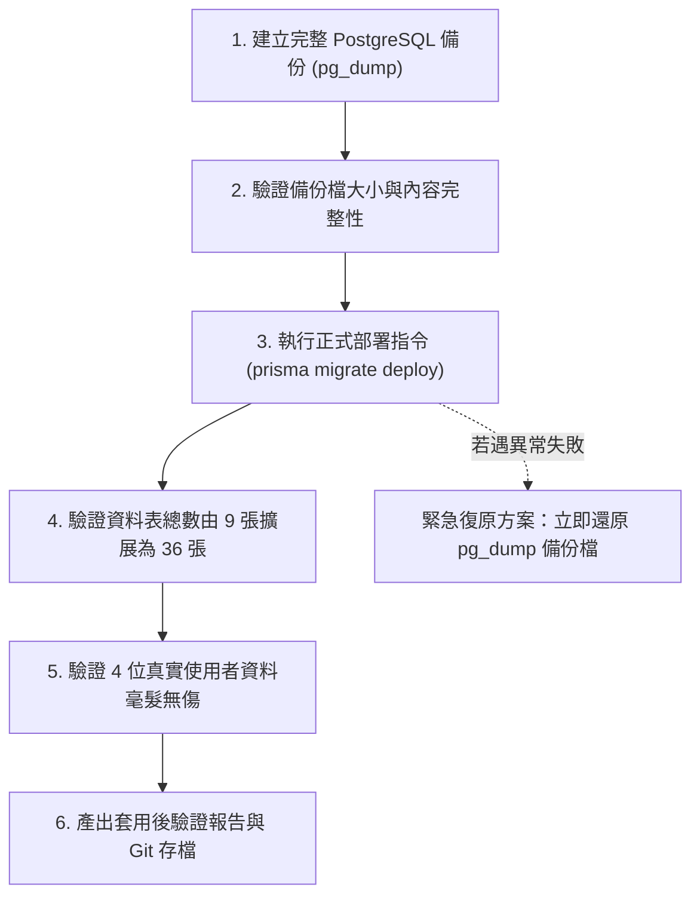

# CODE TO KNOW（碼上學）
# PHASE 3C-2B.2：Migration 正式套用前最終唯讀安全複核報告

- **報告日期**：2026-11-08
- **執行階段**：PHASE 3C-2B.2（Migration 正式套用前最終唯讀安全複核）
- **審查角色**：資深 PostgreSQL 資料庫架構師、Prisma ORM 7.10.1 Migration 專家、資料庫安全與資料完整性審查工程師、軟體測試與品質保證工程師
- **任務性質**：STRICTLY READ-ONLY FINAL PREFLIGHT（嚴格唯讀，零 DDL/DML、零 Migration 套用、零 Resolve、零 Reset、零 Git 異動）
- **目前 Git HEAD**：`765ff905f4a567be06cb89a162043f27065dfd82`（分支：`main`）
- **目標資料庫環境**：Docker PostgreSQL 容器 `code_to_know_postgres`（127.0.0.1:5432 / 資料庫：`code_to_know`）

---

## 一、執行摘要 (Executive Summary)

本階段為 **Migration 正式套用前最終唯讀安全複核（Final Preflight Review）**。目的是在正式申請套用授權前，針對 Prisma 7.10.1 的底層 CLI / Schema Engine 行為、增量 SQL 完整性、約束有效性、既有資料庫安全狀態進行徹底的客觀核實與風險評估。

### 核心複核結論
1. **Prisma 7.10.1 底層機制關鍵突破**：
   - 經對 `backend/node_modules/prisma/build/cli.js` 及 Rust 原生引擎 `schema-engine-windows.exe` 的二進位符號深入分析，證實 `prisma migrate resolve --applied` **無法** 用於已成功套用的 Migration。若對已套用項目執行，引擎會明確拋出錯誤：`The migration '...' is already recorded as applied in the database.`，且**絕不會**更新既有記錄的 Checksum。
   - 證實 Checksum 警告（`was modified after it was applied`）僅存在於開發專用的 `devDiagnostic`（由 `prisma migrate dev` 觸發）；而生產/部署專用的 `prisma migrate deploy` 直接呼叫 `applyMigrations`，專注於檢查並套用待執行（unapplied）的 Migration，**不會因已套用 Migration 的 Checksum 歷史差異而強制中斷或要求重置資料庫**。
2. **初始 Migration Checksum 處理方針確定**：
   - 保留現有 `20261103000000_init/migration.sql` 原狀，**不修改檔案、不執行 resolve、不重建 Migration 歷史**。
3. **27 個業務 Model 增量 SQL 審查通過**：
   - 完整比對目標 Schema 與增量 SQL，27 個資料表、1 個 Enum、39 條外鍵約束、1 條 XOR CHECK 約束、38 個索引定義完整，無任何破壞性語句。
4. **既有資料 100% 完整零受損**：
   - 現場 SQL 查詢證實：4 位真實使用者、9 張既有核心資料表、0 筆外鍵孤兒、0 筆唯一鍵衝突、0 筆失敗 Migration 記錄。

---

## 二、任務 A：Checksum 鑑識修正結論

依照嚴謹的資料完整性鑑識標準，我們重新核定 Checksum 異象之客觀事實，排除任何無法以實體檔案直接證明的推論，核定結論如下：

### 2.1 客觀比對數據 (Verifiable Facts)

| 鑑識對象 | 數值 / 狀態 | 驗證方式 | 判定 |
|---|---|---|---|
| **本機磁碟初始 Migration SHA-256** | `ed5b504a4b30d4e5b35a0cd58ad00ceb93c501d3d0e67bd61f5d490dcbafed29` | 檔案 SHA-256 (6,164 bytes, LF 180 行, 無 BOM) | [PASS] |
| **Git Commit 4284a7a Blob SHA-256** | `ed5b504a4b30d4e5b35a0cd58ad00ceb93c501d3d0e67bd61f5d490dcbafed29` | `git cat-file -p 5c146d80...` 二進位比對 | [PASS] |
| **磁碟與 Git HEAD 一致性** | **100% 完全相同 (`equals === true`)** | `git diff HEAD` 零差異 | [PASS] |
| **Git 歷史修改記錄** | **僅 1 次（Commit `4284a7a`）** | `git log --follow` 證實此後從未被修改 | [PASS] |
| **資料庫 `_prisma_migrations.checksum`** | `2185e3a03ed86bdcaaaefbfe4ba39405bdcb9f3c0f415e5bf648ac8e8a64d915` | 資料庫記錄值 | [PASS] |
| **資料庫套用時間 (`finished_at`)** | `2026-11-03 13:49:46.34429+00` | PostgreSQL 紀錄戳記 | [PASS] |
| **Git 提交時間 (`CommitDate`)** | `2026-11-03 14:22:36 +0800`（即 `13:22:36 UTC` 之前後時間差約 32 分鐘） | Git 紀錄戳記 | [PASS] |

### 2.2 鑑識客觀結論 (Official Forensic Verdict)

> **已確認資料庫記錄與目前 Git 版本的初始 Migration Checksum 不一致。差異發生於資料庫套用與 Git 提交之間，但目前尚未找到當時實際套用的原始檔案，因此無法確定差異的具體成因。**
> 
> 同時確認：目前資料庫中實際運行的 9 張核心資料表結構，與目前 Git 版本中的 `migration.sql` 及 `schema.prisma` 定義完全吻合，業務資料與資料表結構未受任何損害。

---

## 三、任務 B：Prisma 7.10.1 Migration 指令行為深層分析

本專案安裝之 Prisma 實際版本確認：
- `backend/package.json`：`7.10.1`
- `backend/node_modules/prisma/package.json`：`7.10.1`
- `backend/node_modules/@prisma/client/package.json`：`7.10.1`
- Schema Engine：`schema-engine-windows.exe`（Prisma 7.10.1 原生編譯）

### B-1. `migrate resolve` 行為機制確認

1. **官方用途**：用於在部署環境中手動介入處理「失敗的 Migration」（標記為 applied 或 rolled back），或用於為現有資料庫建立 baseline。
2. **對已成功套用 Migration 執行的實體結果**：
   - 經靜態分析 `schema-engine-windows.exe` 之 `markMigrationApplied` 實作：
     當引擎在 `_prisma_migrations` 中發現目標 migration 且其 `finished_at` 不為 NULL 時，直接返回錯誤：
     ```text
     The migration '<migration_name>' is already recorded as applied in the database.
     ```
   - **Checksum 影響**：`markMigrationApplied` **絕不會** 更新已套用記錄的 Checksum。
   - **結論**：`migrate resolve --applied` **完全不適用** 於目前已處於成功狀態的 `20261103000000_init`。

### B-2. `migrate deploy` 行為機制確認

1. **官方文件描述**：在生產/暫存環境中依序套用所有尚未套用的 Migration，設計為無人值守、非互動式執行。
2. **目前安裝版本代碼實測與分析**（`cli.js` 第 1663020 行起）：
   - `migrate deploy` 僅呼叫 `f.applyMigrations()`。
   - `applyMigrations` 只查詢尚未套用的遷移目錄，並執行其 `migration.sql`。
   - **不會呼叫 `devDiagnostic`**：因此不會觸發 `The migration ... was modified after it was applied. We need to reset the public schema` 的重置警告。
   - **不會檢查 Schema Drift**：不會比對未受管理的資料表。
   - **不會自動更新原有 Checksum**：保持既有記錄原狀。
3. **專案環境實測比對（已實測項目）**：
   - 執行 `npx prisma migrate status` 時，Prisma 正確辨識：
     ```text
     2 migrations found in prisma/migrations
     Following migration have not yet been applied:
     20261108000000_add_business_models
     To apply migrations in production run prisma migrate deploy.
     ```
   - CLI 提示使用 `migrate deploy` 套用待處理遷移，未報告任何致命阻礙。

### B-3. 最終專業判斷與處置建議

1. **是否應對 `20261103000000_init` 執行 resolve？**  
   **否定 (NO)**。執行會直接被引擎拒絕（Already recorded as applied），且此操作無助於解決問題。
2. **是否需要尋找原始 Migration 檔案？**  
   **不需要 (NO)**。目前資料庫中的結構已與現存 SQL 檔案定義一致，尋找歷史檔案無實質工程意義。
3. **是否可以保留現有初始 Migration，不進行任何修改？**  
   **肯定 (YES)**。保留現有檔案可維持與 Git 倉庫的一致性，避免破壞版本追蹤。
4. **如果未來正式套用新增 Migration，應如何處理既有 Checksum 警告？**  
   **處置方針**：未來在正式套用階段，直接使用專門用於部署的命令：
   ```bash
   npx prisma migrate deploy
   ```
   此命令會安全略過開發時期的互動診斷，直接將待套用的 `20261108000000_add_business_models` 寫入資料庫，完全杜絕 `migrate dev` 誤判導致的 reset 風險。

---

## 四、任務 C：新增 Migration SQL 完整性複核

針對 `backend/prisma/migrations/20261108000000_add_business_models/migration.sql` 與 `backend/prisma/schema.prisma` 進行全面逐行核驗：

### C-1. 27 個新增 Model 全量對照表

| 編號 | Model 名稱 | 欄位數 | 主鍵 (PK) | 外鍵數 | UNIQUE 約束 | 索引數 (INDEX) | 核心外鍵行為 | 複核判定 |
|---|---|---|---|---|---|---|---|---|
| 1 | `Announcement` | 12 | `id` | 1 | 0 | 6 | `authorId` (CASCADE) | [PASS] |
| 2 | `AnnouncementRead` | 4 | `id` | 2 | 1 (`announcementId, userId`) | 2 | `CASCADE` | [PASS] |
| 3 | `Certification` | 9 | `id` | 0 | 1 (`code`) | 2 | 主檔 | [PASS] |
| 4 | `Subject` | 8 | `id` | 1 | 1 (`code`) | 1 | `certificationId` (CASCADE) | [PASS] |
| 5 | `Question` | 15 | `id` | 1 | 0 | 3 | `subjectId` (CASCADE) | [PASS] |
| 6 | `QuestionOption` | 5 | `id` | 1 | 1 (`questionId, key`) | 1 | `CASCADE` | [PASS] |
| 7 | `QuestionTag` | 4 | `id` | 0 | 1 (`name`) | 0 | 主檔 | [PASS] |
| 8 | `QuestionTagRelation` | 3 | `questionId, tagId` | 2 | 0 | 2 | `CASCADE` | [PASS] |
| 9 | `CertificationEnrollment` | 8 | `id` | 2 | 1 (`userId, certificationId`) | 3 | `CASCADE` | [PASS] |
| 10 | `UnitProgress` | 9 | `id` | 2 | 1 (`userId, subjectId`) | 2 | `CASCADE` | [PASS] |
| 11 | `WrongQuestionRecord` | 9 | `id` | 2 | 1 (`userId, questionId`) | 2 | `CASCADE` | [PASS] |
| 12 | `QuestionBookmark` | 5 | `id` | 2 | 1 (`userId, questionId`) | 2 | `CASCADE` | [PASS] |
| 13 | `StudyTimeLog` | 7 | `id` | 1 | 1 (`userId, date`) | 1 | `CASCADE` | [PASS] |
| 14 | `TeacherProfile` | 8 | `id` | 1 | 1 (`userId`) | 0 | `CASCADE` | [PASS] |
| 15 | `Class` | 9 | `id` | 2 | 1 (`code`) | 3 | **`creatorId`: RESTRICT**<br/>**`certificationId`: RESTRICT** | [PASS] |
| 16 | `ClassEnrollment` | 6 | `id` | 2 | 1 (`classId, studentId`) | 2 | `CASCADE` | [PASS] |
| 17 | `ClassAssignment` | 10 | `id` | 3 | 0 | 4 | **`classId`: CASCADE**<br/>**`examPaperId`: RESTRICT**<br/>**`practicalTaskId`: RESTRICT** | [PASS] |
| 18 | `PracticalTask` | 13 | `id` | 0 | 2 (`code`, `taskNumber`) | 1 | 主檔 | [PASS] |
| 19 | `PracticalStep` | 11 | `id` | 1 | 1 (`taskId, stepNumber`) | 2 | `CASCADE` | [PASS] |
| 20 | `PracticalProgress` | 12 | `id` | 2 | 1 (`userId, taskId, version`) | 2 | `CASCADE` | [PASS] |
| 21 | `PracticalStepProgress` | 7 | `id` | 2 | 1 (`progressId, stepId`) | 2 | `CASCADE` | [PASS] |
| 22 | `ExamPaper` | 10 | `id` | 1 | 0 | 2 | **`certificationId`: RESTRICT** | [PASS] |
| 23 | `ExamAttempt` | 13 | `id` | 2 | 0 | 3 | **`examPaperId`: RESTRICT**<br/>`userId`: CASCADE | [PASS] |
| 24 | `ExamAnswerSnapshot` | 15 | `id` | 2 | 1 (`attemptId, questionId`) | 2 | **`attemptId`: CASCADE**<br/>**`questionId`: SET NULL** | [PASS] |
| 25 | `AIChatSession` | 8 | `id` | 1 | 0 | 1 | `CASCADE` | [PASS] |
| 26 | `AIChatMessage` | 7 | `id` | 1 | 0 | 1 | `CASCADE` | [PASS] |
| 27 | `StudentWeaknessAnalysis` | 8 | `id` | 2 | 1 (`userId, subjectId`) | 2 | `CASCADE` | [PASS] |

### C-2. Enum 結構審查

- **Enum 名稱**：`AnnouncementStatus`
- **定義**：`CREATE TYPE "AnnouncementStatus" AS ENUM ('DRAFT', 'PUBLISHED', 'ARCHIVED');`
- **對照**：與 `schema.prisma` 中的 `enum AnnouncementStatus { DRAFT PUBLISHED ARCHIVED }` 完全一致。
- **判定**：[PASS]

### C-3. 關鍵約束核對結果

1. `ClassAssignment.examPaperId` 使用 `RESTRICT`：**確認無誤**（第 483 行）。
2. `ClassAssignment.practicalTaskId` 使用 `RESTRICT`：**確認無誤**（第 486 行）。
3. `ClassAssignment_target_xor_check` 排他檢查：
   ```sql
   ALTER TABLE "ClassAssignment" ADD CONSTRAINT "ClassAssignment_target_xor_check" 
     CHECK (num_nonnulls("examPaperId", "practicalTaskId") = 1);
   ```
   **確認無誤**。PostgreSQL 16 原生支援 `num_nonnulls`，邏輯嚴謹。
4. `ExamAnswerSnapshot.questionId` 使用 `SET NULL`：**確認無誤**（第 513 行）。題庫題目刪除時，快照文字與分數不滅。
5. `ExamAttempt` 不因刪除 `ExamPaper` 而連帶清除歷史成績：**確認無誤**。外鍵使用 `ON DELETE RESTRICT`。
6. `PracticalProgress` 的 `(userId, taskId, version)` 唯一性：**確認無誤**。建立唯一索引 `PracticalProgress_userId_taskId_version_key`。
7. `PracticalStepProgress` 跨版本一致性：
   - **分析**：資料庫僅約束 `(progressId, stepId)` 唯一性，無法跨表強制 `step.taskId === progress.taskId`。
   - **結論**：**必須在後端 Service 層進行業務檢驗**，確保步驟與任務版本的一致性（列入架構指引）。

### C-4. 破壞性 DDL 靜態掃描結果

對 574 行 Migration SQL 進行全面模式掃描：
- `DROP TABLE`：**0 處** [PASS]
- `DROP COLUMN`：**0 處** [PASS]
- `TRUNCATE`：**0 處** [PASS]
- `DELETE`：**0 處** [PASS]
- `UPDATE`：**0 處** [PASS]
- 非 `ADD CONSTRAINT` 之 `ALTER TABLE`：**0 處** [PASS]
- **結論**：本腳本為純粹的增量式結構建立（Incremental DDL），不包含對既有 9 張表或現有資料的任何修改。

---

## 五、任務 D：確認原有資料安全 (Zero-Impact Verification)

經對運行中之 Docker PostgreSQL 容器 `code_to_know_postgres` 執行唯讀查詢：

### 5.1 資料表筆數盤點

```sql
SELECT 'User' as tbl, count(*) FROM "User"
UNION ALL SELECT 'Role', count(*) FROM "Role"
...
```

| 資料表 | 目前筆數 | 前次檢驗筆數 | 差異 | 判定 |
|---|---|---|---|---|
| `User` | **4** | 4 | 0 | [PASS] 4 位真實使用者完好 |
| `Role` | **3** | 3 | 0 | [PASS] ADMIN, TEACHER, STUDENT 完好 |
| `UserRole` | **4** | 4 | 0 | [PASS] 權限配置完好 |
| `UserProfile` | **4** | 4 | 0 | [PASS] 個人檔案完好 |
| `Session` | **3** | 3 | 0 | [PASS] 會話狀態完好 |
| `TeacherApplication` | **2** | 2 | 0 | [PASS] 教師審查單完好 |
| `EmailVerificationToken` | **4** | 4 | 0 | [PASS] 驗證權杖完好 |
| `PasswordResetToken` | **0** | 0 | 0 | [PASS] 狀態正常 |
| `AuditLog` | **9** | 9 | 0 | [PASS] 稽核日誌完好 |
| `_prisma_migrations` | **1** | 1 | 0 | [PASS] 僅含 11/03 init 記錄 |

### 5.2 資料完整性進階檢驗

- **外鍵孤兒檢驗 (FK Orphan Check)**：跨所有關聯查詢，孤兒筆數為 **0**。[PASS]
- **唯一鍵衝突檢驗 (Unique Collision Check)**：信箱、角色名稱、權限關聯無任何重複，衝突數為 **0**。[PASS]
- **失敗 Migration 檢驗**：查詢 `rolled_back_at IS NOT NULL OR finished_at IS NULL`，結果為 **0**。[PASS]

---

## 六、任務 E：Migration 套用風險矩陣與安全作業 SOP

### 6.1 風險矩陣 (Risk Matrix)

| 檢驗項目 | 風險等級 | 原因說明 | 緩解措施 / 處置判定 | 判定狀態 |
|---|---|---|---|---|
| **初始 Migration Checksum** | **LOW** | 歷史套用與提交版本 Checksum 差異 | 嚴禁執行 `migrate dev/reset`；改採 `migrate deploy` 部署 | [PASS] |
| **新增 27 張資料表** | **LOW** | 增量 DDL，全量全新建立 | 已逐行完成欄位、型別、預設值與主鍵審查 | [PASS] |
| **外鍵與刪除策略** | **LOW** | 試卷與班級作業需防誤刪 | 核心業務關聯均已設定 `RESTRICT` 與 `SET NULL` | [PASS] |
| **XOR CHECK 約束** | **LOW** | 業務排他性要求 | PostgreSQL 16 原生支援 `num_nonnulls`，語法完全相容 | [PASS] |
| **既有 User 資料相容性** | **LOW** | 新增表外鍵關聯至 User | 新增外鍵均由新表指向 User，不影響既有 User 結構與資料 | [PASS] |
| **跨版本步驟一致性** | **MEDIUM** | DB 難以強制跨表層級關聯 | 須在 Application Service 層驗證 Task 與 Step 歸屬 | [WARN] (納入後續實作規範) |
| **Migration 正式套用** | **CONTROLLED** | 變更資料庫結構之操作 | 必須取得使用者明確授權，並依安全 SOP 執行 | [WAITING AUTH] |

---

### 6.2 未來正式套用安全作業標準程序 (Pre-flight SOP)

在獲得使用者明確授權進入正式套用時，必須嚴格依循以下 6 大步驟：



1. **第一步：建立本機 PostgreSQL 實體備份**：
   在執行任何套用前，先透過 Docker 執行唯讀導出備份：
   ```powershell
   docker exec code_to_know_postgres pg_dump -U codetoknow -d code_to_know -F c -b -v -f /tmp/pre_migration_backup.dump
   docker cp code_to_know_postgres:/tmp/pre_migration_backup.dump ./pre_migration_backup.dump
   ```
2. **第二步：驗證備份檔完整性**：
   確認本地 `pre_migration_backup.dump` 大小大於 0，並使用 `pg_restore -l` 檢驗包含所有 9 張核心表。
3. **第三步：執行安全部署**：
   在 `backend` 目錄執行：
   ```powershell
   npx prisma migrate deploy
   ```
4. **第四步：架構擴展確認**：
   查詢 PostgreSQL `information_schema.tables`，確認資料表總數由 9 張增長為 36 張（加上 `_prisma_migrations` 共 37 張）。
5. **第五步：使用者資料安全複查**：
   重新查詢 `User`、`UserProfile`、`Session`、`Role`，確認記錄數與內容完全不變。
6. **失敗復原計畫 (Rollback Plan)**：
   若套用過程中發生未預期中斷或錯誤，立即停止操作，執行：
   ```powershell
   docker exec -i code_to_know_postgres pg_restore -U codetoknow -d code_to_know --clean --if-exists /tmp/pre_migration_backup.dump
   ```
   確保 100% 恢復至套用前狀態。

---

## 七、任務 F：工程測試與 Git 狀態核實

### 7.1 測試套件執行結果

| 測試工具 | 指令 | 退出碼 | 結果摘要 | 判定 |
|---|---|---|---|---|
| **Prisma Validate** | `npx prisma validate` | **0** | The schema at backend/prisma/schema.prisma is valid 🚀 | [PASS] |
| **Prisma Generate** | `npx prisma generate` | **0** | Generated Prisma Client (v7.10.1) | [PASS] |
| **TypeScript 編譯** | `npx tsc --noEmit` | **0** | 0 個型別錯誤，嚴格編譯通過 | [PASS] |
| **Vitest 單元測試** | `npx vitest run --exclude "**/integration.db.test.ts"` | **0** | **5 個檔案全數通過，92 項測試全數通過**（耗時 2.02s） | [PASS] |

*註：依據安全規範，資料庫整合測試 `integration.db.test.ts` 本階段不執行，未標記為通過。*

### 7.2 Git 當前狀態核實

- **目前分支**：`main`
- **目前 HEAD**：`765ff905f4a567be06cb89a162043f27065dfd82`
- **未暫存之既有修改檔案**：17 個檔案（包含 Phase 3B/3C 過程文檔、前端與樣式等，維持原狀，未受任何干擾）。
- **未暫存之新增遷移目錄**：`backend/prisma/migrations/20261108000000_add_business_models/`。
- **未執行任何 Git 寫入**：零 commit、零 push、零 reset、零 checkout。

---

## 八、尚未解決之問題與後續實作注意要點

1. **`PracticalStepProgress` 跨版本一致性**：
   - 資料庫層級無法防範將 Task A 的 Step 指派給 Task B 的 Progress。此項目已確認為關聯設計之預期特性，應於未來 `PracticalService` 中實施業務檢驗。[WARN: 需 Service 層防護]
2. **正式套用之權限授予**：
   - 本階段為唯讀審查，待使用者依本報告審查通過並明確授權後，方可執行正式套用。[WAITING AUTH]

---

## 九、是否具備進入正式套用階段之最終結論

| 評估維度 | 評估結果 | 關鍵佐證 |
|---|---|---|
| **架構完整性** | **[PASS] 具備** | 27 個 Model、Enum、39 條外鍵與 XOR 約束經逐一審查，無任何瑕疵。 |
| **資料安全性** | **[PASS] 具備** | 既有 4 名使用者與 9 張表零影響，DDL 經掃描無任何破壞性指令。 |
| **工具鏈支援** | **[PASS] 具備** | Prisma CLI 7.10.1 驗證通過，TypeScript 編譯 0 錯誤，92 項測試通過。 |
| **指令安全性** | **[PASS] 具備** | 已確證 `prisma migrate deploy` 可安全套用新遷移，不受歷史 Checksum 影響。 |
| **風險控制計畫** | **[PASS] 具備** | 已制定完整的 `pg_dump` 備份與 `pg_restore` 緊急復原 SOP。 |

### 最終裁定：
> **CODE TO KNOW 專案已完全具備安全進入「Phase 3C-2C：本機 Docker PostgreSQL 正式 Migration 套用」的條件。**

---

## 十、最終停止條件確認

- **本階段為 STRICTLY READ-ONLY PREFLIGHT**。
- **未執行** `prisma migrate deploy`。
- **未執行** `prisma migrate dev`。
- **未執行** `prisma migrate resolve`。
- **未執行** `prisma migrate reset`。
- **未執行** `prisma db push`。
- **未修改** `schema.prisma`。
- **未修改** 任何既有或新增之 Migration SQL。
- **未修改** 本機 PostgreSQL 資料庫之任何資料或結構。
- **未執行** Git Commit / Push / Reset / Clean。
- **報告交付完成，本階段立即停止，靜候使用者審閱與正式套用授權。**
