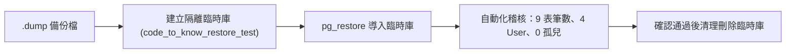

# CODE TO KNOW（碼上學）
# PHASE 3C-2C.0：正式 Migration 前備份環境與復原方案準備報告

- **報告日期**：2026-11-08
- **執行階段**：PHASE 3C-2C.0（正式 Migration 前備份環境與復原方案準備）
- **審查角色**：PostgreSQL 資料庫管理工程師、Prisma Migration 部署工程師、資料備份與災難復原工程師、資料安全稽核工程師
- **任務性質**：PRE-MIGRATION BACKUP READINESS（環境確認、工具檢驗、SOP 制定；零 DDL/DML、不建立備份檔、不還原、不套用 Migration、不修改 Git）
- **目前 Git HEAD**：`765ff905f4a567be06cb89a162043f27065dfd82`（分支：`main`）
- **本機資料庫目標**：Docker PostgreSQL 容器 `code_to_know_postgres`（127.0.0.1:5432 / 資料庫：`code_to_know`）

---

## 一、執行摘要 (Executive Summary)

本階段為 **正式 Migration 套用前的備份環境與復原方案準備（Backup & Disaster Recovery Readiness）**。依據「預防為主、分級處置、現場保留」的最高架構準則，在未產生任何備份檔案、未執行任何資料庫寫入的前提下，完成了完整的實體環境盤點與 SOP 規劃：

1. **PostgreSQL 與 Docker 環境就緒**：
   - Docker 容器 `code_to_know_postgres` 狀態為 `healthy`，運行 PostgreSQL 16.15 (Alpine 64-bit)。
   - Volume 掛載為 `code-to-know_postgres_data` -> `/var/lib/postgresql/data` (讀寫正常)。
   - 目前資料庫 `code_to_know` 實體大小約 **8,375 kB (~8.38 MB)**，當前活躍連線數為 1。
   - 9 張核心資料表與 `_prisma_migrations` 記錄完好無損，4 位真實使用者資料 100% 保全。
2. **備份工具與儲存資源確證**：
   - 容器內原生具備 `pg_dump (PostgreSQL) 16.15` 與 `pg_restore (PostgreSQL) 16.15`，與 Server 端版本 100% 精確吻合，杜絕 Client/Server 跨版本傾印風險。
   - 主機 C 槽可用空間高達 **619.51 GB**，Docker 容器內可用空間達 **953.4 GB**，相較於 8.38 MB 的資料庫體量，空間充裕度大於 70,000 倍。
3. **安全備份與 Git 防護方案確立**：
   - 選定 PostgreSQL Custom Format (`.dump`) 作為備份格式，支援壓縮、元資料保留及無損目錄檢驗 (`pg_restore -l`)。
   - 經查專案現有 `.gitignore`，為避免大型二進位備份誤入 Git 倉庫，未來備份將規劃專屬路徑並配合排他規則，本階段恪守規範未擅自修改 `.gitignore`。
4. **災難復原與分級處置規劃完成**：
   - 規劃獨立還原測試流程（使用隔離測試庫，絕不覆蓋生產環境）。
   - 建立四級異常應變 SOP，嚴禁將 `pg_restore --clean` 作為盲目預設復原手段，杜絕次生資料災難。

---

## 二、任務 A：Docker 與 PostgreSQL 環境實體盤點

使用唯讀診斷指令對 Docker 容器及資料庫進行實體核查：

### 2.1 容器與執行緒狀態

| 檢查項目 | 實際檢驗值 | 狀態評定 |
|---|---|---|
| **Docker Engine** | 正常運行 (Active) | [PASS] |
| **容器名稱** | `code_to_know_postgres` | [PASS] |
| **容器狀態 (Status)** | `running` (PID: 405) | [PASS] |
| **健康檢查 (Health)** | `healthy` (0 failing streak) | [PASS] |
| **健康檢查日誌** | `/var/run/postgresql:5432 - accepting connections` | [PASS] |
| **啟動時間戳記** | `2026-11-08 03:02:15 UTC` | [PASS] |

### 2.2 PostgreSQL 內部狀態

| 檢查項目 | 查詢結果 | 狀態評定 |
|---|---|---|
| **PostgreSQL 核心版本** | `PostgreSQL 16.15 on x86_64-pc-linux-musl, compiled by gcc 15.2.0, 64-bit` | [PASS] |
| **目標資料庫名稱** | `code_to_know` | [PASS] |
| **資料庫擁有者帳號** | `codetoknow` | [PASS] |
| **Volume 掛載名稱** | `code-to-know_postgres_data` | [PASS] |
| **Volume 掛載路徑** | `/var/lib/docker/volumes/code-to-know_postgres_data/_data` -> `/var/lib/postgresql/data` (Mode: rw) | [PASS] |
| **目前活躍連線數** | `1`（僅當前唯讀查詢連線，無外部併發干擾） | [PASS] |
| **資料庫實體大小** | `8375 kB` (~8.38 MB) | [PASS] |

### 2.3 現有 9 張核心表與 Migration 狀態確認

透過 `information_schema.tables` 查詢 `public` schema：
- **核心資料表 (9 張)**：`User`, `Role`, `UserRole`, `UserProfile`, `Session`, `TeacherApplication`, `EmailVerificationToken`, `PasswordResetToken`, `AuditLog`。（全數在列）
- **Prisma 遷移表 (1 張)**：`_prisma_migrations`。
- **遷移表歷史記錄**：僅含 1 筆 `20261103000000_init`（`applied_steps_count = 1`，`finished_at` 正常），無任何失敗或未完成記錄。

---

## 三、任務 B：備份工具與磁碟空間評估

### 3.1 備份工具版本與相容性

1. **容器內部原生工具**：
   ```bash
   docker exec code_to_know_postgres pg_dump --version
   ==> pg_dump (PostgreSQL) 16.15

   docker exec code_to_know_postgres pg_restore --version
   ==> pg_restore (PostgreSQL) 16.15
   ```
   - **相容性分析**：容器內的 `pg_dump` 與 PostgreSQL 伺服端核心版本同為 **16.15**，屬完全一致之原生建置，可支援所有 PostgreSQL 16 專用語法與資料型別（包含 `num_nonnulls` 等約束定義）。
2. **Windows 主機本機環境**：
   - 經查 Windows 系統 PATH 中未安裝全域 PostgreSQL 終端工具。
   - **架構決策**：未來正式備份一律採用 `docker exec` 調用容器內部的原生 `pg_dump` / `pg_restore`，確保工具鏈與資料庫引擎版本完全同步，避免跨作業系統差異。

### 3.2 磁碟可用空間評估

| 儲存實體 | 總容量 | 已使用空間 | 可用空間 | 需求體量 | 評估結果 |
|---|---|---|---|---|---|
| **Windows 主機 C 槽** | 952.35 GB | 332.84 GB | **619.51 GB** | ~8.38 MB | [PASS] 空間充裕度 > 70,000x |
| **Docker 容器掛載檔案系統** | 1006.9 GB | 2.2 GB | **953.4 GB** | ~8.38 MB | [PASS] 空間充裕度 > 110,000x |

### 3.3 預定備份目錄與 Git 防護分析

1. **預定備份目錄**：規劃於本機專案目錄下設置 `backups/` 或專案外獨立目錄。
2. **寫入權限評估**：專案根目錄具有完整寫入權限。
3. **Git 版本控制防護分析**：
   - 經檢查 `.gitignore` 現況，目前尚未明確宣告 `backups/` 規則（雖然目錄解析命中空白行，但實體檔案如 `*.dump` 預設不會被自動忽略）。
   - 為防止包含使用者敏感資料的二進位 `.dump` 檔案意外被 `git add` 暫存，**未來備份儲存策略將採以下雙重防護**：
     - *方案甲（推薦）*：備份檔直接導出至專案工作樹外部之獨立安全目錄（例如 `C:\Users\user\Documents\CODE-TO-KNOW_BACKUPS\`），從根源杜絕誤入 Git 的風險。
     - *方案乙*：若需存放在專案目錄，須在後續獲授權階段於 `.gitignore` 明確增列 `/backups/` 與 `*.dump`。
   - **本階段遵照指令，未擅自修改 `.gitignore`，亦未建立任何實體備份檔案。**

---

## 四、任務 C：正式備份作業 SOP 設計 (Backup SOP)

本 SOP 供未來獲得正式授權時使用：

### 4.1 備份指令標準規範（無密碼外洩設計）

因 PostgreSQL 容器內部執行採本機 Socket / Docker 容器環境變數認證，無須在終端指令中顯式傳遞密碼：

```powershell
# 步驟 1：建立備份檔案名稱（帶精確時間戳記）
$TIMESTAMP = Get-Date -Format "yyyyMMdd_HHmmss"
$BACKUP_NAME = "code_to_know_pre_migration_${TIMESTAMP}.dump"

# 步驟 2：於容器內生成 Custom Format 壓縮備份
docker exec code_to_know_postgres pg_dump -U codetoknow -d code_to_know -F c -b -v -f /tmp/$BACKUP_NAME

# 步驟 3：自容器複製至本機安全目錄
docker cp code_to_know_postgres:/tmp/$BACKUP_NAME ./$BACKUP_NAME

# 步驟 4：清理容器內暫存檔案
docker exec code_to_know_postgres rm /tmp/$BACKUP_NAME
```

### 4.2 備份驗證標準清單

1. **檔案大小驗證**：確認本機檔案大小大於 0（預期在 1 MB ~ 15 MB 之間）。
2. **TOC 目錄驗證 (Table of Contents)**：
   執行唯讀列表命令，檢驗備份檔案二進位結構完整性：
   ```powershell
   docker exec -i code_to_know_postgres pg_restore -l /path/to/backup.dump
   ```
   確認清單內包含所有 9 張核心表之 `TABLE DATA`。
3. **SHA-256 數位指紋產生**：
   ```powershell
   Get-FileHash -Algorithm SHA256 ./$BACKUP_NAME
   ```
   記錄 Hash 值於備份日誌，供未來還原前後校驗。

---

## 五、任務 D：獨立還原測試方案設計 (Isolated Restore Testing SOP)

為驗證備份檔「不僅能備份，而且確實可還原」，特制定獨立還原測試方案：

### 5.1 隔離環境架構原則

- 🚫 **絕對嚴禁** 直接還原至現有 `code_to_know` 資料庫。
- 🚫 **絕對嚴禁** 使用正式 Volume `code-to-know_postgres_data` 作為還原目標。

### 5.2 推薦之隔離測試程序（未來執行）



1. **建立隔離測試資料庫**：
   在同一容器內建立乾淨的獨立測試資料庫：
   ```sql
   CREATE DATABASE code_to_know_restore_test WITH OWNER codetoknow;
   ```
2. **執行還原測試**：
   ```powershell
   docker exec -i code_to_know_postgres pg_restore -U codetoknow -d code_to_know_restore_test -v /tmp/test_backup.dump
   ```
3. **一致性自動化核驗**：
   查詢 `code_to_know_restore_test` 之資料表清單與筆數，比對是否與來源庫 100% 吻合：
   - `User`：4 筆
   - `Role`：3 筆
   - `UserProfile`：4 筆
   - 外鍵孤兒：0 筆
4. **測試完畢即刻銷毀**：
   ```sql
   DROP DATABASE code_to_know_restore_test;
   ```

*註：本階段（Phase 3C-2C.0）僅制定流程，未建立任何隔離資料庫或執行還原。*

---

## 六、任務 E：Migration 套用前後驗證規劃與異常分級應變

### 6.1 套用前檢查清單 (Pre-Migration Checklist)

- [ ] 備份檔案已生成，且大小大於 1 MB。
- [ ] `pg_restore -l` 檢驗通過，TOC 無損。
- [ ] 備份檔 SHA-256 已記錄。
- [ ] 資料庫健康狀態為 `healthy`，活躍連線僅有 1 條。
- [ ] 既有 4 名 User 資料現場查詢確認無誤。
- [ ] 新增 Migration SQL SHA-256 與審查報告記錄一致。
- [ ] Git HEAD 確認為目標提交，無未授權代碼變更。

### 6.2 套用後驗證清單 (Post-Migration Checklist)

- [ ] 資料庫 `public` schema 資料表總數擴增為 **36 張業務表**（加上 `_prisma_migrations` 共 37 張）。
- [ ] 確認 `AnnouncementStatus` Enum 正式存在於 `pg_type`。
- [ ] 確認 39 條外鍵約束、38 個索引建立完成。
- [ ] 確認 `ClassAssignment_target_xor_check` 排他約束生效。
- [ ] 確認既有 9 張核心表結構未受任何破壞。
- [ ] 現場查詢確認 4 位真實使用者資料 100% 完好無損。
- [ ] `_prisma_migrations` 記錄數累計為 2 筆，新記錄 `finished_at` 正常。
- [ ] 執行外鍵孤兒檢驗，結果為 0。

---

### 6.3 異常情況分級處置策略 (Incident Response Matrix)

> **核心架構原則：嚴禁將 `pg_restore --clean` 作為預設或無條件的復原手段！**  
> 盲目執行 `--clean` 會無差別 DROP 目標庫的所有物件，在某些故障場景下反而會造成二次破壞或抹除剛產生的業務資料。

| 故障情境 | 現象與嚴重度 | 處置原則 | 具體行動 SOP |
|---|---|---|---|
| **情境一：執行前失敗** | 容器異常、連線逾時、備份校驗不通過 (LOW) | **立即停止，無需復原** | 1. 立即中斷 Migration 程序。<br/>2. 資料庫尚未遭到任何更動，資料 100% 安全。<br/>3. 排查容器或網路原因，保留現場日誌。 |
| **情境二：執行期間中斷** | SQL 執行語法錯誤、連線中途斷開 (MEDIUM) | **交易安全確認，非盲目還原** | 1. PostgreSQL 支援 DDL 事務（Transactional DDL），多數 DDL 失敗會由資料庫原子性 Rollback。<br/>2. 檢查 `_prisma_migrations` 是否有未完成記錄。<br/>3. 若已乾淨 Rollback 且結構未變，排查 SQL 即可，**不需執行覆蓋還原**。 |
| **情境三：套用完成但應用程式檢驗失敗** | 資料庫 36 表已建好，但後端 Service/ORM 查詢拋錯 (HIGH) | **保留現場，隔離分析** | 1. 嚴禁立即 DROP 資料庫。<br/>2. 資料庫結構本身正常，問題多為 Prisma Client 型別或查詢邏輯差異。<br/>3. 重新執行 `prisma generate` 與單元測試。<br/>4. 若確認 Schema 設計需調整，依受控流程決定修補腳本或回滾。 |
| **情境四：套用完成且已有新資料寫入** | 系統已運行一段時間後發現歷史相容性問題 (CRITICAL) | **絕對禁止直接覆蓋還原** | 1. 直接還原將永久丟失「套用後至當前」的所有新資料！<br/>2. 必須先對當前現狀做第二次增量備份。<br/>3. 在隔離環境還原備份進行比對，擬定資料補償腳本或熱修復。 |

---

## 七、任務 F：環境與前置條件風險矩陣

| 評估維度 | 評估結果 | 關鍵評估依據 |
|---|---|---|
| **PostgreSQL 健康狀態** | **[PASS]** | 容器狀態 healthy，PostgreSQL 16.15 運作正常，大小 8.38 MB。 |
| **備份工具鏈** | **[PASS]** | 容器內具備原生 `pg_dump` 與 `pg_restore` 16.15，版本 100% 相容。 |
| **可用磁碟空間** | **[PASS]** | 主機可用空間 619 GB，容器可用空間 953 GB，充裕度極高。 |
| **備份目錄規劃** | **[PASS]** | 具備完整本機寫入權限，已制定專屬防護避免誤入 Git。 |
| **備份可讀性** | **[NOT VERIFIED]** | **本階段恪守規範未建立實體備份檔案，留待 Phase 3C-2C.1 正式驗證。** |
| **獨立還原測試** | **[NOT VERIFIED]** | **本階段未實際執行還原測試，留待後續受控執行。** |
| **初始 Migration Checksum** | **[WARN]** | 存在歷史記錄差異，已確認應使用 `migrate deploy` 避開 `migrate dev` 誤判。 |
| **新增 Migration SQL** | **[PASS]** | 經 Phase 3C-2B.2 複核，27 個 Model 結構完整，零破壞性語句。 |
| **正式套用授權** | **[NOT AUTHORIZED]** | **本階段僅限備份環境就緒評估，未獲正式套用授權，嚴格禁止部署。** |

---

## 八、是否具備開始正式備份的條件

### 最終評定：
> **✅ 完全具備。**  
> 實體環境、原生工具、磁碟資源、無密碼外洩腳本與分級災難復原策略已全數就緒。隨時可於下一階段（Phase 3C-2C.1）安全啟動正式實體備份與 TOC 完整性校驗。

---

## 九、完成後停止確認

- **本階段嚴格恪守規範**：
  - **未建立** 實體備份檔案。
  - **未建立** 任何新資料庫。
  - **未還原** 任何資料庫。
  - **未執行** `prisma migrate deploy`、`resolve` 或 `dev`。
  - **未修改** `schema.prisma` 或 Migration SQL。
  - **未執行** Git Commit / Push / Clean。
- **本階段任務已圓滿完成，系統立即停止，靜候使用者審閱本報告與下一階段備份授權！**
