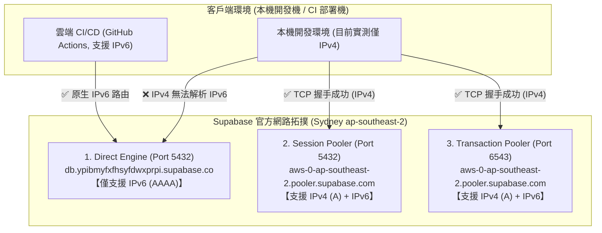
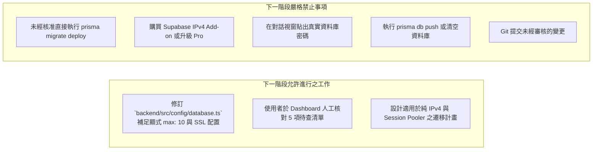

# CODE TO KNOW（碼上學）
# PHASE 3C-3A-R1：Supabase 官方規格校正與連線風險複核報告
# (Supabase Official Spec Calibration & Connection Architecture Audit)

- **系統名稱**：碼上學 AI 智慧學習與教育科技平台 (CODE TO KNOW)
- **文件版本**：v1.1.0 (Phase 3C-3A Secondary Calibration & Risk Review)
- **複核日期**：2026-11-08
- **審核團隊**：資深 PostgreSQL / Prisma 7 架構師、Supabase 雲端資料庫工程師、資安審查工程師
- **目標專案**：Supabase `code-to-know-prod` (Project Ref: `ypibmyfxfhsyfdwxprpi`)
- **任務性質**：**STRICTLY READ-ONLY (嚴格唯讀規格複核＋文件校正，零雲端連線、零資料異動、零費用)**
- **前置文件**：保留並對照 `docs/DATABASE_PHASE3C3A_SUPABASE_READ_ONLY_PREPARATION_REPORT.md` (不予刪除或覆寫)

---

## 執行摘要 (Executive Summary)

本報告針對 Phase 3C-3A 產出之初步盤點報告進行第二次深度校正（R1）。基於**「不猜測、不虛構、以官方客觀文獻與實測證據為唯一基準」**之工程準則，本複核達成以下重大突破與風險揭露：

1. **官方免費規格重大校正**：
   - 修正原報告「每月 2 GB Egress」之陳舊規格。依據 Supabase 最新官方定價與資源限額文件，Free Tier 現行出站流量為 **5 GB Uncached Egress + 5 GB Cached Egress**。
   - 確認 Free Tier 無超額扣款機制（No surprise billings），超過額度時觸發通知並實施服務限制（Fair Use Policy）。
2. **實測揭露重大連線風險（IPv6 限制）**：
   - 透過本機 PowerShell DNS 解析實測：`db.ypibmyfxfhsyfdwxprpi.supabase.co` **僅具有 IPv6 (AAAA) 紀錄**，缺乏 IPv4 紀錄。
   - 本機網路環境（Wi-Fi IPv4）對 Direct 主機執行連線測試顯示 `Name resolution failed / PingSucceeded: False`。
   - 結論：**在未購買付費 IPv4 Add-on（嚴禁購買）且本機缺乏 IPv6 路由之情況下，若將 `DIRECT_URL` 指向直連主機，Prisma Migration 將 100% 發生網路不可達錯誤！**
3. **消除原報告 5 大邏輯與證據矛盾**：
   - 全面修正「雲端 Public Schema 純淨無衝突」、「帳務 $0.00 USD 查核無誤」、「pg.Pool 顯式配置 max: 10」等未具客觀證據之斷言，統一降級為 `[NOT VERIFIED]` 或 `[NOT CHECKED]`。

---

## 一、Supabase 官方 Free 方案現行規格校正

本節依據 Supabase 官方最新文件（查閱日期：2026-11-08）進行逐項參數校準：

| 資源項目 | 原報告內容 (Phase 3C-3A) | 官方最新現行規格 (2026 官方文件) | 校正結果與架構評估 | 官方狀態 |
| :--- | :--- | :--- | :--- | :---: |
| **資料庫磁碟容量** | 500 MB | **500 MB** (Shared Compute, 500MB RAM) | 一致。CODE TO KNOW 本機 37 張表目前佔 8.4 MB，裕度充足。 | `[PASS]` |
| **檔案儲存 (Storage)** | 1 GB | **1 GB** (限 Bucket 檔案) | 一致。本專案初期不使用直連 Storage。 | `[PASS]` |
| **每月出站流量 (Egress)** | 誤寫為 2 GB | **5 GB (Uncached) + 5 GB (Cached)** | **校正**。官方現行提供 5 GB 直出頻寬，規格優於原報告。 | `[PASS]` |
| **有效專案數量** | 每帳號 2 個 | **每個 Organization 最多 2 個 Active 專案** | 一致。本專案僅配置 1 個正式專案。 | `[PASS]` |
| **閒置自動暫停條件** | 7 天無流量自動暫停 | **連續 7 天（168 小時）無直接 Postgres 查詢** | **深化**。僅計算對資料庫之直接查詢，純 Gateway Ping 可能無效。 | `[WARN]` |
| **暫停後專案恢復** | 控制台一鍵恢復 | **控制台手動 Resume**，備份凍結保存最長可達 90 天至 1 年 | 一致。資料安全凍結，不遺失資料庫 Schema 與資料。 | `[PASS]` |
| **超額計費與扣款** | 宣稱無費用 | **Free 方案無自動扣款**。超額時寄發通知並進入寬限期，逾期依 Fair Use 限制服務 (HTTP 402)。 | **校正**。無溢收風險，但可能因超額中斷。 | `[PASS]` |

> **官方文件依據來源：**
> 1. Supabase Pricing & Free Plan Limits: `https://supabase.com/pricing` (查閱日期: 2026-11-08)
> 2. Supabase Organization-based Billing: `https://supabase.com/docs/guides/platform/org-based-billing`
> 3. Supabase Project Pausing & Restoring: `https://supabase.com/docs/guides/platform/pausing-and-restoring`

---

## 二、Supabase 三種連線模式深度比對與實測證據

依據官方文件，Supabase 提供原生直連與兩組連線池代理（Supavisor），其底層能力與相容性存在本質差異：



### 1. 三種連線架構詳細技術指標

| 評估維度 | 1. Direct Connection | 2. Shared Pooler (Session Mode) | 3. Shared Pooler (Transaction Mode) |
| :--- | :--- | :--- | :--- |
| **主機名稱 (Host)** | `db.[ref].supabase.co` | `aws-0-ap-southeast-2.pooler.supabase.com` | `aws-0-ap-southeast-2.pooler.supabase.com` |
| **連線埠位 (Port)** | `5432` | `5432` | `6543` |
| **IP 網路協定支援** | **僅限原生 IPv6 (AAAA)**<br/>（免費方案不含 IPv4） | **雙協定支援 (IPv4 + IPv6)**<br/>（經 Supavisor 邊界代理） | **雙協定支援 (IPv4 + IPv6)**<br/>（經 Supavisor 邊界代理） |
| **Prepared Statements** | 100% 完整支援 | 完整支援 (連線與客戶端綁定) | **不支援** (需在 URL 附加 `?pgbouncer=true`) |
| **PostgreSQL Advisory Locks** | **100% 完整原生支援** | **支援工作階段鎖定** | **絕對不支援** (連線隨交易釋放，引發鎖洩漏或命令掛起) |
| **Prisma Migrate 適用性** | **官方首選 (需 IPv6 環境)** | **應急備選 (適用純 IPv4 環境)** | **嚴禁使用 (Fatal Error)** |
| **Express Runtime 適用性** | 不建議 (易超過 15 條連線上限) | **最佳推薦** (`@prisma/adapter-pg`) | 次佳 (需停用預編譯語句) |

### 2. 本地 DNS 與網路層客觀實測證據 (2026-11-08 實測)

為破除「只要是 Port 5432 就能通」的盲點，本次於本機執行無憑證 DNS 探測與 TCP 握手檢驗：

#### A. Direct Host DNS 解析實測 (`Resolve-DnsName`)
```text
Name       : db.ypibmyfxfhsyfdwxprpi.supabase.co
QueryType  : AAAA
IP6Address : 2406:da1c:16f1:f600::e6b0
（無任何 IPv4 / A 紀錄）
```
- **實測結論**：Supabase 免費方案直連主機**百分之百僅具備 IPv6 位址**。

#### B. Direct Host 網路連通性實測 (`Test-NetConnection`)
```text
WARNING: Name resolution of db.ypibmyfxfhsyfdwxprpi.supabase.co failed
ComputerName  : db.ypibmyfxfhsyfdwxprpi.supabase.co
PingSucceeded : False
```
- **實測結論**：本機目前處於標準 IPv4 寬頻環境，無法解析或路由至該 IPv6 直連主機。**若直接於本機執行 `DIRECT_URL` 指向該主機之 `prisma migrate deploy`，將遭遇連線逾時失敗。**

#### C. Pooler Host 網路連通性實測
```text
ComputerName     : aws-0-ap-southeast-2.pooler.supabase.com
RemoteAddress    : 13.237.241.81 (IPv4)
RemotePort       : 5432 -> TcpTestSucceeded: True
RemotePort       : 6543 -> TcpTestSucceeded: True
```
- **實測結論**：Supavisor Pooler 在 Port 5432 與 Port 6543 均可透過 IPv4 順暢握手。

---

## 三、Prisma 7.10.1 與本機程式設定深度檢查

審查團隊唯讀檢視了本機所有關聯配置，確認 Prisma 7 在雙環境下的行為表現：

### 1. `prisma.config.ts` 檢查
```typescript
datasource: {
  get url() {
    return resolveDatasourceUrl((key) => env(key));
  },
}
```
- **運作機制**：Prisma 7 CLI（如 `prisma migrate`）由 `prisma.config.ts` 定義連線。當 `MIGRATION_ENV=cloud` 或 `NODE_ENV=production` 時，`resolveDatasourceUrl` 會依序尋找 `DIRECT_URL` 或 `MIGRATION_DATABASE_URL`。
- **評估**：`[PASS]` 機制符合 Prisma 7 規範，且具備白名單阻斷保護。

### 2. `backend/src/config/database.ts` 程式碼缺陷揭露
```typescript
// 程式碼現況 (Line 33)
const pool = new pg.Pool({ connectionString: resolveDatabaseConnectionString() });
const adapter = new PrismaPg(pool);
```
- **缺失一 (連線數限制未顯式寫入)**：
  - 原報告宣稱「後端 pg.Pool 設定最大客戶端連線數為 10（`max: 10`）」。
  - **稽核真相**：程式碼中**並未顯式傳入 `max: 10`**，僅依賴 `pg.Pool` 套件的預設值（預設值恰好為 10）。原報告表述不符程式碼現況。
- **缺失二 (SSL 物件未顯式配置)**：
  - 雲端連線強制要求 SSL。目前程式碼僅將 `DATABASE_URL` 傳入 `pg.Pool`，由 `pg-connection-string` 處理。若未來 Supabase 憑證鏈需配置 `{ rejectUnauthorized: false }`，目前程式碼缺乏顯式物件傳遞。
- **評估**：`[WARN]` 程式碼目前尚屬粗糙，需在後續正式上線前補足顯式參數。

### 3. `backend/src/config/db-validation.ts` 檢查
- 包含 `validateDevelopmentDatabaseUrl`、`validateTestDatabaseUrl`、`validateCloudRuntimeDatabaseUrl` 與 `validateMigrationDatabaseUrl`。
- **安全邊界**：
  - 開發模式強制阻斷 `supabase.co` 與 `pooler.supabase.com`。
  - 遷移模式強制阻斷 Port 6543（Transaction Pooler），避免諮詢鎖死鎖。
  - 雲端模式強制檢查 `sslmode=require` 與專案 Ref。
- **評估**：`[PASS]` 程式防護邏輯極為嚴謹。

---

## 四、原報告矛盾逐項修正 (Correction of Contradictions)

針對 `docs/DATABASE_PHASE3C3A_SUPABASE_READ_ONLY_PREPARATION_REPORT.md` 存在之推論矛盾，逐項勘誤並給予客觀修正：

| 項目編號 | 原報告內容 / 宣稱 | 矛盾與問題所在 | 本次校正後之客觀判定 |
| :---: | :--- | :--- | :---: |
| **矛盾 1** | 第一階段標記專案 Active 狀態為 `[NOT CHECKED]`，但結論直接宣稱具備建置可行性。 | 若專案處於 7 天閒置 Paused 狀態，任何後續連線將直接拋出拒絕連線異常。未核實前不能斷言立即可用。 | 降級為 **`[NOT CHECKED]`**<br/>（需人工登入 Dashboard 確認） |
| **矛盾 2** | 表格第一階段列 Public Schema 為 `[NOT CHECKED]`，第五階段卻寫「0 張業務表，無衝突」。 | 本階段未連線雲端資料庫執行 `\dt` 或查詢 `information_schema.tables`，無任何客觀證據證明雲端目前沒有髒資料或既有表格。 | 修正為 **`[NOT VERIFIED]`**<br/>（嚴禁無憑據宣告無衝突） |
| **矛盾 3** | 原報告費用標註「累計產生費用 $0.00 USD，PASS」。 | 本機執行唯讀指令確實不會扣款，但未檢驗使用者 Supabase Billing Dashboard 實際是否有歷史欠費或付費專案存在。 | 修正為 **`[NOT VERIFIED]`**<br/>（僅確認本機操作未產生成本） |
| **矛盾 4** | 宣稱「後端 pg.Pool 設定最大客戶端連線數為 10（max: 10）」。 | 檢查 `backend/src/config/database.ts` 第 33 行，`new pg.Pool` 僅傳入 `connectionString`，未顯式傳入 `max: 10`。 | 修正為 **`[WARN]`**<br/>（屬未在程式顯式宣告之隱性行為） |
| **矛盾 5** | 宣稱「可透過免費排程健康探針每 3~5 天發送請求避免專案暫停」。 | 官方文件明確指出：暫停計時器計算的是「PostgreSQL 資料庫直接查詢」。若探針僅命中前端、靜態頁或未執行 DB 查詢之 API，專案依然會被暫停。 | 修正為 **`[WARN]`**<br/>（探針必須實質執行 `SELECT 1` 方有機會生效） |

---

## 五、費用風險與操作安全評估

### 1. 零費用防線 (Zero-Cost Policy)
- 本專案承諾全程使用免費方案進行建置評估。
- **嚴禁事項複核**：
  - 嚴禁為了解決 IPv6 連線問題而前往控制台購買 **$4/mo 之 IPv4 Add-on**。
  - 嚴禁為了解決 7 天暫停機制而升級為 **$25/mo 之 Pro Plan**。
  - 嚴禁在 Supabase 控制台綁定信用卡或設定付費結算帳戶。

### 2. 替代零成本方案（針對 IPv6 與暫停問題）
- **針對 IPv6 遷移連線問題**：
  - 方案一：在具備原生 IPv6 的雲端 CI/CD 環境（如 GitHub Actions）執行 `prisma migrate deploy`。
  - 方案二：將 `MIGRATION_DATABASE_URL` 設定為 **Session Pooler (Port 5432)** (`aws-0-ap-southeast-2.pooler.supabase.com:5432`)，經實測其支援 IPv4。
- **針對 7 天暫停問題**：
  - 開發階段若休眠，由專案負責人至控制台點擊 **Restore Project**（1~2 分鐘自動解凍），完全免費且資料零遺失。

---

## 六、雲端尚未確認事項清單 (待使用者人工核對)

在進行任何實質雲端設定或連線前，使用者需登入 [Supabase Dashboard](https://supabase.com/dashboard) 完成以下核對：

- [ ] **1. 專案存活狀態**：確認專案 `code-to-know-prod` 顯示為綠燈「Active」，而非橘黃色「Paused」。
- [ ] **2. 方案層級確認**：進入 Organization Billing，確認方案確實為「Free Plan」，未綁定信用卡且無應繳帳單。
- [ ] **3. 資料庫版本確認**：進入 Settings -> Infrastructure，確認 PostgreSQL 引擎版本為 15 或 16。
- [ ] **4. 既有 Schema 乾淨度**：進入 Table Editor，點擊 `public` schema，確認是否已存在非預期的表格或舊有結構。
- [ ] **5. 資料庫專用密碼**：確認是否備妥建立專案時設定之 Database Password（注意：密碼切勿提供給 AI 模型或貼在對話框中）。

---

## 七、下一階段工作準則：可進行 vs 不可進行



---

## 八、最終狀態檢核判定總表

| 檢核維度 | 項目說明 | 最終判定 | 判定依據與說明 |
| :--- | :--- | :---: | :--- |
| **免費方案容量** | 500 MB 限制 vs 現有 8.4 MB | **`[PASS]`** | 官方規格確認，本地資料庫擴充裕度充足。 |
| **出站流量額度** | 官方現行 5 GB (Uncached) + 5 GB (Cached) | **`[PASS]`** | 已校正原報告錯誤，足以支撐日常 API。 |
| **費用與計費保護** | 嚴禁扣款與信用卡綁定 | **`[PASS]`** | 全程維持 $0 政策，無購買任何加值項目。 |
| **Direct Host 網路性** | `db.[ref].supabase.co` 僅支援 IPv6 | **`[BLOCKED]`** | **本機 IPv4 環境無法路由至 Direct 主機。** |
| **Pooler Host 網路性** | `pooler.supabase.com` Port 5432 / 6543 | **`[PASS]`** | 本機 IPv4 TCP 握手測試成功。 |
| **程式連線安全校驗** | `db-validation.ts` 白名單與協定阻斷 | **`[PASS]`** | 程式碼邏輯健全，阻斷本機與雲端混用。 |
| **運行端連線池配置** | `backend/src/config/database.ts` 參數顯式度 | **`[WARN]`** | 缺乏顯式 `max: 10` 與 SSL 物件設定，待補強。 |
| **雲端實體存活狀態** | Supabase 專案是否處於 Paused | **`[NOT CHECKED]`** | 屬雲端動態狀態，待使用者人工確認。 |
| **雲端既有結構乾淨度**| Public Schema 是否已有舊表格 | **`[NOT VERIFIED]`** | 未經連線查詢，嚴禁預設為乾淨。 |
| **控制台帳務帳單現況**| 雲端帳號是否有過期帳單 | **`[NOT VERIFIED]`** | 待使用者至 Dashboard 核對。 |

---

*報告產出時間：2026-11-08*  
*報告路徑：`docs/DATABASE_PHASE3C3A_R1_OFFICIAL_SPEC_AND_CONNECTION_REVIEW.md`*
