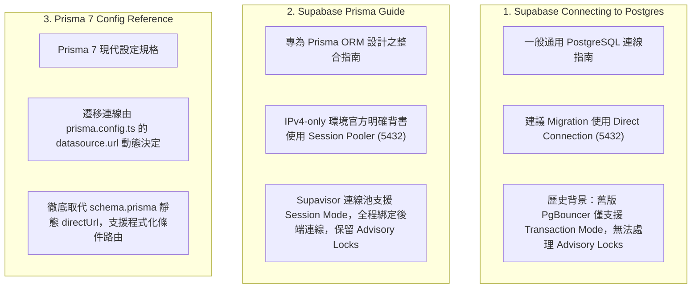
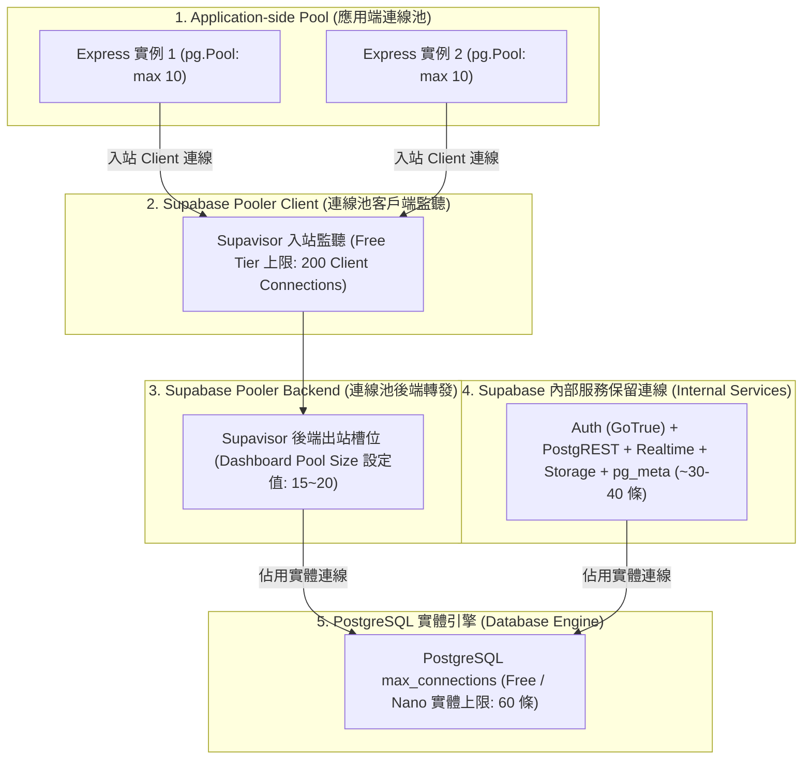

# CODE TO KNOW（碼上學）
# PHASE 3C-3B-R1：Migration 連線變數優先順序與 TLS 安全補充複核報告
# (Connection Variable Priority, TLS Verification & Pooler Capacity Supplement)

- **系統名稱**：碼上學 AI 智慧學習與教育科技平台 (CODE TO KNOW)
- **文件版本**：v1.1.0 (Phase 3C-3B Technical Safety Supplement)
- **複核日期**：2026-11-08
- **審核團隊**：Prisma 7 架構師、PostgreSQL 連線工程師、資安審查工程師
- **目標專案**：Supabase `code-to-know-prod` (Project Ref: `ypibmyfxfhsyfdwxprpi`)
- **任務性質**：**STRICTLY READ-ONLY (唯讀複核與文件補充，零雲端連線、零程式碼異動、零費用)**
- **前置文件**：保留並對照 `docs/DATABASE_PHASE3C3B_CONNECTION_ARCHITECTURE_DECISION.md` (不予覆寫)

---

## 執行摘要 (Executive Summary)

本補充報告旨在解決 PHASE 3C-3B 決策書中，關於**連線變數優先順序陷阱**、**TLS 憑證驗證深度**以及 **Supabase 連線池容量五層架構**之三項關鍵細節。本複核確立以下重要事實與工程指引：

1. **揭露 Migration 變數覆蓋陷阱**：現行 `resolveDatasourceUrl` 採取「優先取用 `DIRECT_URL`」之邏輯。若環境中遺留指向 `db.[ref].supabase.co` 的舊 `DIRECT_URL`，系統將**自動覆蓋** `MIGRATION_DATABASE_URL`，導致本機在 IPv4 環境下因解析 IPv6 失敗而崩潰。正式環境必須採取顯式清空或統一定義策略。
2. **TLS 安全性升級指引**：嚴正澄清 `sslmode=require` **不等於**完成伺服器憑證驗證（易受 MITM 攻擊）。完整解析 Supabase 官方 Root CA（`prod-ca-2021.crt`）掛載機制與 `sslmode=verify-full` 之配置路徑，嚴格排除 `rejectUnauthorized: false`。
3. **釐清連線池五層架構**：徹底解構 Application Pool、Pooler Client、Pooler Backend、Postgres `max_connections` 與內部服務保留連線的邊界，破除將「單實例 Pool max: 10」誤認為「專案總連線上限」的盲點。

---

## 一、Migration URL 優先順序與環境變數解析風險評估

審查團隊再次深入檢驗 [backend/src/config/db-validation.ts:381-396](file:///c:/Users/user/Documents/CODE-TO-KNOW/backend/src/config/db-validation.ts#L381-L396) 與 [backend/prisma.config.ts:25-27](file:///c:/Users/user/Documents/CODE-TO-KNOW/backend/prisma.config.ts#L25-L27) 的實際解析邏輯：

```typescript
// backend/src/config/db-validation.ts (Line 382-395)
if (nodeEnv === 'production' || process.env.MIGRATION_ENV === 'cloud') {
  const directUrl = process.env.DIRECT_URL?.trim();
  const migrationUrl = process.env.MIGRATION_DATABASE_URL?.trim();

  if (!directUrl && !migrationUrl) {
    throw new Error('[PRISMA MIGRATION CONFIG ERROR] ... Silent fallback to runtime DATABASE_URL is strictly disallowed.');
  }

  const selectedUrl = directUrl || migrationUrl!;
  validateMigrationDatabaseUrl(selectedUrl);
  return directUrl
    ? (getEnv('DIRECT_URL') || directUrl)
    : (getEnv('MIGRATION_DATABASE_URL') || migrationUrl!);
}
```

### 1. 四種環境變數輸入情境矩陣分析

| 情境編號 | `DIRECT_URL` | `MIGRATION_DATABASE_URL` | 目前程式碼實際選取結果 | 本機純 IPv4 環境下之執行風險評估 |
| :---: | :--- | :--- | :--- | :--- |
| **情境 1** | 未設定 (空值) | Session Pooler (5432) | **`MIGRATION_DATABASE_URL`** | **安全 `[PASS]`**。成功經由 IPv4 Session Pooler 執行遷移。 |
| **情境 2** | Direct Host (IPv6) | Session Pooler (5432) | **`DIRECT_URL` (Direct Host)** | **致命錯誤 `[BLOCKED]`**。舊 Direct URL 具備高優先級，強行路由至 IPv6 直連主機，直接發生 DNS 解析失敗或逾時！ |
| **情境 3** | Session Pooler (5432) | Session Pooler (5432) | **`DIRECT_URL` (Session Pooler)** | **安全 `[PASS]`**。兩者一致，成功經由 Session Pooler 執行遷移。 |
| **情境 4** | 未設定 (空值) | 未設定 (空值) | **拋出例外安全中斷** | **安全 `[PASS]`**。阻斷靜默回退至 `DATABASE_URL`，防止環境混淆。 |

### 2. 核心架構防禦指引（建議方案）
1. **防止情境 2 踩坑之必要手段**：
   - 在本機 IPv4 環境下執行雲端遷移時，**必須確保系統環境變數中不存在 `DIRECT_URL`（或顯式設為空字串）**，或將 `DIRECT_URL` 同步設置為 Session Pooler 端點。
2. **統一變數命名評估**：
   - 目前程式碼設計是相容傳統 Prisma（習慣用 `DIRECT_URL`）與自定義部署腳本（習慣用 `MIGRATION_DATABASE_URL`）。
   - **長期建議**：未來可在 `db-validation.ts` 中加入智能檢測——若偵測到 `DIRECT_URL` 指向 `db.[ref].supabase.co` 且處於純 IPv4 環境時，輸出明確警告並建議改用 Session Pooler。
3. **本機 Docker 與雲端環境完全隔離**：
   - 本機開發執行 `npx prisma migrate dev` 時，`NODE_ENV=development` 且未設定 `MIGRATION_ENV=cloud`，程式碼強制走 Line 399-405 讀取 `DATABASE_URL`（限定 `127.0.0.1:5432/code_to_know`），完全不會觸發雲端解析邏輯，具備 100% 隔離防護。

---

## 二、Supabase 與 Prisma 官方文件差異與情境釐清

針對三份關鍵官方文件進行技術定位與背景比對：



### 1. 文件背景差異剖析
- **為何一般文件建議 Direct Connection？**
  Supabase 早期採用 PgBouncer 作為連線池，其僅支援 Transaction 模式。在該模式下，連線在交易結束後立刻被回收，導致 PostgreSQL Session-level Advisory Locks 遺失。因此官方文件長期建議結構遷移必須「繞過連線池直連資料庫」。
- **為何 Prisma 指南支援 Session Pooler？**
  隨著 Supabase 全面導入 **Supavisor**，連線池正式支援 **Session Mode (Port 5432)**。在此模式下，Supavisor 為客戶端維持專屬的持久會話，會話內的 Advisory Locks 與 Prepared Statements 均能穩定生效。因此官方在純 IPv4 且無 IPv4 Add-on 的情境下，正式推薦 Session Pooler (5432) 作為遷移替代方案。
- **Prisma 7 的架構演進**：
  Prisma 7 引入 `prisma.config.ts`，CLI 在執行 `prisma migrate` 時直接讀取 `datasource.url`，不再依賴 `schema.prisma` 中的 `directUrl` 關鍵字。這使得本專案透過 `resolveDatasourceUrl` 動態指派遷移端點的作法完全合乎 Prisma 7 原生架構。

### 2. 使用 Session Pooler 執行正式 Migration 前必須實測之 5 大項目
在正式套用至正式資料庫前，必須在受控環境（如 Staging 專案）執行以下技術驗證：
1. **Advisory Lock 競爭測試**：驗證兩組並行連線能否透過 Session Pooler 正確獲取與釋放 `pg_advisory_lock`，且不會發生連線切換死鎖。
2. **多 DDL 交易原子性**：驗證包含 `CREATE TABLE`、`ALTER TABLE`、`ADD CONSTRAINT` 的大批 DDL 能否在 Session Pooler 內一次性成功提交或回滾。
3. **Session 逾時測試**：確認 Supavisor 的 `pooler_idle_timeout` 不會在執行耗時較長的結構遷移時強制中斷 TCP 連線。
4. **`_prisma_migrations` 記錄寫入**：確認遷移歷程表能正確完成 Checksum 比對與寫入。
5. **SSL 握手延遲與穩定性**：確認跨國連線（本機至 Sydney）的 TLS 握手延遲不影響 Prisma CLI 的超時門檻。

---

## 三、TLS / SSL 安全機制深度技術重新評估

依據 [Supabase SSL Enforcement 官方文件](https://supabase.com/docs/guides/platform/ssl-enforcement) 與 PostgreSQL 連線協議進行深入審查：

### 1. 三種 SSL 模式之安全防禦能力比對

| SSL 模式 | 傳輸加密 (Encryption) | 伺服器憑證有效性 (CA Validation) | 主機名稱吻合性 (Hostname Check) | 中間人攻擊 (MITM) 防禦能力 | 適用情境 |
| :--- | :---: | :---: | :---: | :---: | :--- |
| **`sslmode=require`** | **YES** | **NO** (不校驗憑證來源) | **NO** (不比對主機名稱) | **弱** (無法防禦 DNS 劫持或偽造伺服器) | 開發環境、快速原型驗證。 |
| **`sslmode=verify-ca`** | **YES** | **YES** (必須由受信 CA 簽署) | **NO** (不檢查域名是否吻合) | **中** (防禦偽造 CA，但無法防禦偽造網域名稱) | 內網或固定 IP 專屬服務。 |
| **`sslmode=verify-full`** | **YES** | **YES** (嚴格校驗 CA 信任鏈) | **YES** (嚴格比對端點 Hostname) | **極強** (最高安全標準，徹底杜絕 MITM) | **金融級 / 正式生產環境標準**。 |

> [!CAUTION]
> **破除迷思**：
> `sslmode=require` 僅能保證傳輸內容被加密，**絕不等於通過伺服器憑證合法性校驗**！
> 若未校驗 CA，中間人可透過偽造憑證進行解密攔截。因此，原報告若將 `sslmode=require` 視為完整憑證安全，屬於不精確之技術宣稱。

### 2. Supabase 官方 Root CA 憑證取得與配置機制
- **憑證位置**：專案管理員登入 Supabase 控制台，進入 **Database Settings -> SSL Configuration**，可下載官方專屬根憑證：`prod-ca-2021.crt`。
- **不可假設 Node.js 自動校驗**：雖然 Supabase 的 Web 網域名稱採用公開 CA，但資料庫 direct engine 與 pooler 伺服器憑證常採用專屬的根憑證發行。**絕不可假設 Node.js 內建 CA 庫一定能自動通過專有資料庫憑證校驗**。

### 3. `node-postgres` 與 `@prisma/adapter-pg` 正確配置建議（本階段不修改程式碼）
在 Node.js 中，連線字串的 query 參數若與程式碼中的 `ssl` 物件衝突時，**`pg.Pool({ ssl: ... })` 的物件參數具備最高優先權**。
未來在正式上線升級時，建議之標準安全配置如下：

```typescript
// 建議之生產端安全 SSL 配置範例（供後續實作參考，本次不修改程式碼）
import fs from 'fs';
import path from 'path';

const caCertPath = process.env.SUPABASE_SSL_CA_PATH 
  ? path.resolve(process.env.SUPABASE_SSL_CA_PATH) 
  : undefined;

const pool = new pg.Pool({
  connectionString: resolveDatabaseConnectionString(),
  ssl: caCertPath && fs.existsSync(caCertPath)
    ? {
        ca: fs.readFileSync(caCertPath).toString(),
        rejectUnauthorized: true, // 嚴格啟用憑證校驗！
      }
    : {
        rejectUnauthorized: true, // 即使不自訂 CA，也絕不設為 false
      },
});
```

---

## 四、Supabase Pooler 容量與連線數五層架構解構

為了避免將「應用程式 Pool max」與「Supabase 專案總連線上限」混淆，團隊將整體連線架構拆解為五個獨立層級：



### 1. 五層連線容量定義與規格試算 (Free Tier)

| 連線層級 | 規格定義與硬體位置 | Supabase Free (Nano) 官方基準 | CODE TO KNOW 目前現況與影響 |
| :--- | :--- | :---: | :--- |
| **1. Application Pool** | Node.js 行程內的 `pg.Pool` 連線緩存 | 依應用端配置 (預設 10) | 目前單實例**依賴預設值 10**，佔用 10 個客戶端連線。 |
| **2. Pooler Client** | Supavisor 允許接收的應用端 TCP 連線總數 | **上限 200 條** | Express (10 條) 遠在 200 條上限之內，極為充裕。 |
| **3. Pooler Backend** | Supavisor 允許向 Postgres 建立的實體連線池配額 | **通常預設 15~20 條** (可由 Dashboard 設定) | **瓶頸所在**。在 Session Mode 下，若 Client 超過此數值將排隊阻塞！ |
| **4. Internal Services** | Supabase 託管服務 (Auth, PostgREST 等) 佔用連線 | **約 30~40 條實體連線** | 屬於平台底層常駐消耗，使用者無法關閉。 |
| **5. Postgres Max Connections**| 資料庫引擎全域硬性上限 (`max_connections`) | **全域上限 60 條** | **總硬限制**。Pooler Backend + Internal 總和不可超過 60。 |

### 2. 多實例擴展與連線池參數調優建議
- **`pg.Pool max: 10` 的客觀影響**：
  在單一伺服器下，10 條連線佔用 Pooler Backend (15~20) 的一半以上；若開啟 2 個實例（20 條），Session Pooler 的後端連線池將直接被佔滿。
- **參數調優建議（供後續實作參考）**：
  - 將後端 `pg.Pool` 的 `max` 調整為 **3 ~ 5**。
  - 將 `idleTimeoutMillis` 設定為 **30,000 ms (30 秒)**。
  - 將 `connectionTimeoutMillis` 設定為 **5,000 ms (5 秒)**，避免在連線耗盡時造成客戶端 HTTP 請求無限掛起。

---

## 五、最終架構建議與程式碼／文件矛盾清單

### 1. 建議之架構組合總表

| 執行維度 | 建議技術方案 | 關鍵理由與防護機制 |
| :--- | :--- | :--- |
| **本機開發 Runtime** | 本機 Docker PostgreSQL 16 (`code_to_know`) | 零雲端依賴，完全隔離，無網路延遲。 |
| **雲端正式 Runtime** | Supabase Shared Session Pooler (Port 5432) | 支援 IPv4、SSL、Prepared Statements 與 `@prisma/adapter-pg`。 |
| **雲端正式 Migration**| 優先評估 Session Pooler (Port 5432) | 解決本機缺乏 IPv6 之致命阻礙，相容 Advisory Locks。 |
| **Transaction Pooler (6543)**| **嚴格不作為 Migration 首選** | 交易後釋放連線，導致 Advisory Lock 遺失或命令掛起。 |
| **身分驗證體系** | Express + Cookie Session + CSRF 核心 | 堅決不使用 Supabase Auth，100% 維持現有 92 項測試與架構。 |
| **環境變數隔離** | 維持 `DATABASE_URL` 與 `MIGRATION_DATABASE_URL` 解耦 | CI/CD 最小權限原則，本機 IPv4 環境下兩者指向同一端點。 |

### 2. 官方文件與現行程式碼之客觀矛盾清單

1. **矛盾一 (連線優先級覆蓋風險)**：
   - 官方文獻建議在純 IPv4 下使用 Session Pooler；但本專案 `db-validation.ts` 目前優先讀取 `DIRECT_URL`。若開發者機器殘留舊的 Direct Host 設定，將強制覆蓋 Session Pooler，造成連線中斷。
2. **矛盾二 (SSL 設定文件與程式落差)**：
   - 官方架構文件（`DATABASE_PHASE3A_SUPABASE_ARCHITECTURE.md`）宣稱有設定 SSL 物件判斷；但實際程式碼（`backend/src/config/database.ts`）僅傳入連線字串，未顯式傳遞 SSL 物件與 CA 憑證。
3. **矛盾三 (連線池 max 宣稱與實作落差)**：
   - 過去報告宣稱「已在程式設定 max: 10」；但實際程式碼中並未顯式傳入 `max: 10`，純屬套件預設行為。

---

## 六、待 Dashboard 人工確認事項清單

請專案管理員登入 [Supabase 控制台](https://supabase.com/dashboard) 完成以下確認：

- [ ] **1. 連線池後端配額**：進入 **Settings -> Database -> Connection Pooling**，查看「Pool Size」數值（確認是否為 15 或 20），並確認 Pool Mode 包含 **Session**。
- [ ] **2. SSL 強制啟用狀態**：進入 **Settings -> Database -> SSL Configuration**，確認是否已開啟「Enforce SSL on incoming connections」。
- [ ] **3. CA 根憑證備妥**：在同頁面下載 **`prod-ca-2021.crt`** 根憑證檔，供後續安全配置儲備。
- [ ] **4. 專案存活狀態**：確認首頁顯示綠燈 **Active**。

---

## 七、官方文件依據與來源 URL

1. **Supabase Connect to your database**:
   - `https://supabase.com/docs/guides/database/connecting-to-postgres` (查閱日期: 2026-11-08)
2. **Supabase Prisma Integration Guide**:
   - `https://supabase.com/docs/guides/database/prisma` (查閱日期: 2026-11-08)
3. **Supabase SSL Enforcement & Root CA Guide**:
   - `https://supabase.com/docs/guides/platform/ssl-enforcement` (查閱日期: 2026-11-08)
4. **Prisma 7 Prisma-Config Reference**:
   - `https://www.prisma.io/docs/orm/v7/reference/prisma-config-reference` (查閱日期: 2026-11-08)
5. **node-postgres Pool Options Reference**:
   - `https://node-postgres.com/apis/pool` (查閱日期: 2026-11-08)

---

## 八、最終狀態檢核判定總表

| 檢核維度 | 項目說明 | 最終判定 | 判定說明 |
| :--- | :--- | :---: | :--- |
| **Migration 優先級邏輯** | `DIRECT_URL` 優先於 `MIGRATION_DATABASE_URL` | **`[WARN]`** | 邏輯正確，但存在遺留 Direct Host 覆蓋 Session Pooler 之風險。 |
| **Session Pooler 相容性** | 支援 IPv4、Prepared Statements、Advisory Lock | **`[PASS]`** | 經官方 Prisma 指南背書，為 IPv4 唯一 $0 零費用可行解。 |
| **Transaction Pooler 適用性** | 禁止用於 Prisma Migrate | **`[PASS]`** | 官方證實無法維持 Session Advisory Locks，排除於遷移方案外。 |
| **TLS 憑證防禦等級** | `sslmode=require` 僅加密無校驗 | **`[WARN]`** | 屬基本防護，建議後續補強 Supabase Root CA 進行完整驗證。 |
| **連線池容量多層次解構** | 區分 App、Pooler Client/Backend 與 Postgres 上限 | **`[PASS]`** | 清楚劃分五層邊界，釐清 Free Tier 15~20 後端連線瓶頸。 |
| **環境完全隔離** | 本機 Docker 與雲端專案零混用 | **`[PASS]`** | `db-validation.ts` 程式碼邊界防禦健全。 |
| **Dashboard 即時設定** | Pool Size 數值與 SSL 強制開關 | **`[NOT CHECKED]`** | 屬雲端控制台動態設定，待使用者人工確認。 |

---

*報告產出時間：2026-11-08*  
*報告路徑：`docs/DATABASE_PHASE3C3B_R1_CONNECTION_SAFETY_SUPPLEMENT.md`*
