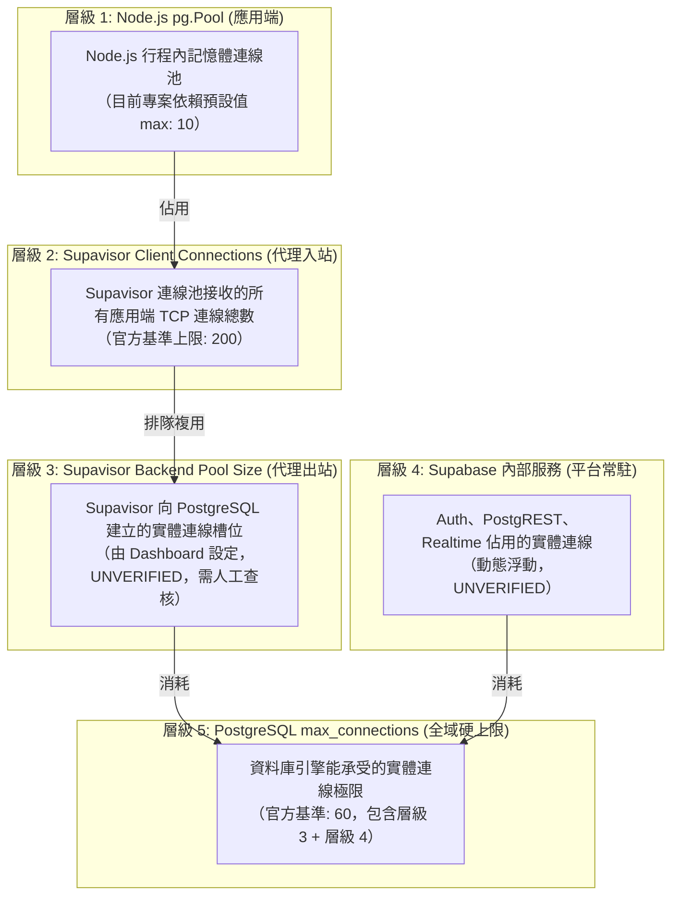
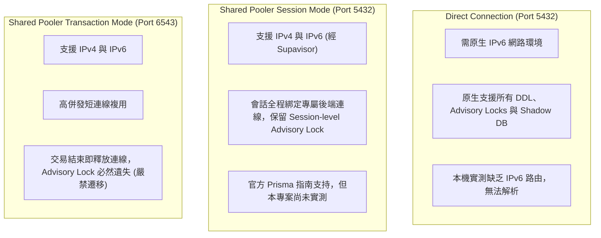

# CODE TO KNOW（碼上學）
# PHASE 3C-3B-R2：Supabase 連線安全補充報告修正與證據核實
# (Secondary Independent Evidence Verification & Architecture Safety Review)

- **系統名稱**：碼上學 AI 智慧學習與教育科技平台 (CODE TO KNOW)
- **文件版本**：v1.2.0 (Phase 3C-3B-R2 Evidence Calibration & Audit)
- **審核日期**：2026-11-08
- **審核團隊**：PostgreSQL / Prisma 資料庫架構師、Supabase 連線安全工程師、Node.js / pg Pool 工程師、技術文件審查工程師
- **目標專案**：Supabase `code-to-know-prod` (Project Ref: `ypibmyfxfhsyfdwxprpi`)
- **任務性質**：**STRICTLY READ-ONLY (嚴格唯讀獨立核實、文件修正與證據校正，零雲端連線、零程式碼異動、零費用)**
- **前置文件**：保留並對照 `docs/DATABASE_PHASE3C3B_R1_CONNECTION_SAFETY_SUPPLEMENT.md` (不予覆寫)
- **狀態標記規範**：
  - `[VERIFIED]`：有程式碼行號、測試案例或官方文件確切依據。
  - `[PARTIALLY VERIFIED]`：官方文件有通則說明，但尚未取得本專案實體量測證據。
  - `[UNVERIFIED]`：未經實測或無法自控制台取得數據，**不可作為正式設定依據**。
  - `[BLOCKED]`：受環境或架構硬性限制，目前條件不允許進行。

---

## 一、R1 報告發現事項與需要修正之內容

審查團隊針對上一階段文件（`DATABASE_PHASE3C3B_R1_CONNECTION_SAFETY_SUPPLEMENT.md`）進行第二輪獨立審查，逐一識別出需要校正的過度宣稱、未證實數據與名詞偏差：

| 檢驗項目 | R1 原始陳述 | R2 核實結果與校正動作 | 校正後狀態判定 |
| :--- | :--- | :--- | :---: |
| **Pooler 容量數據** | 引用「Pooler Client: 200」、「Pooler Backend: 15~20」、「max_connections: 60」等具體數字。 | 該數字屬於官方通則範例或 Nano Compute 基準，**本專案控制台設定尚未登入查核**，不能直接視為本專案設定依據。 | 標記為 **`[UNVERIFIED]`** |
| **CA 根憑證檔名** | 宣稱根憑證檔名為 `prod-ca-2021.crt`。 | 官方 Dashboard 隨憑證輪替與格式可能提供不同檔名或 `.cer` 格式，預設固定檔名存在風險。 | 改為：**以 Dashboard 實際提供為準，不預設檔名** |
| **Session Pooler 遷移** | 宣稱 Session Pooler「相容官方推薦解法，支援 Advisory Lock」。 | 官方文件確實有純 IPv4 下的指引，但**本專案尚未在雲端執行實測**，必須嚴格區分「官方文件支持」與「專案尚未實測」。 | 標記為 **`[PARTIALLY VERIFIED]`** |
| **本機隔離保證用語** | 使用「100% 隔離防護」等絕對用語。 | 程式碼與測試已在 `NODE_ENV=development` 下驗證，但在人為誤植 `MIGRATION_ENV=cloud` 等極端邊界下仍有例外路徑。 | **收回絕對用語**，改以客觀層次描述證據邊界 |

---

## 二、任務 1：Pooler 容量數字獨立核實

### 1. 各項連線數據之官方來源與適用範圍查核

| 數據項目 | 數值 / 描述 | 官方文件依據與適用條件 | 本專案適用性判定 |
| :--- | :---: | :--- | :--- |
| **PostgreSQL `max_connections`** | 60 | Supabase 官方文件（*Connection management*）：適用於 Free Plan / Nano / Micro Compute 共享實例。查驗日期：2026-11-08。 | **`[PARTIALLY VERIFIED]`** (官方基準，但本專案實體實例待確認) |
| **Supavisor Client Connections** | 200 | Supabase 官方文件：Nano / Micro 實例之預設連線池客戶端入站上限。 | **`[PARTIALLY VERIFIED]`** (官方基準，但需 Dashboard 核實) |
| **Supavisor Backend Pool Size** | 15～20 | 官方通則建議（非硬性固定值）：官方建議若無大量 PostgREST，Pool Size 可設定為 `max_connections` 的 40%～80%。 | **`[UNVERIFIED — 不可作為正式設定依據]`** (本專案設定值需登入 Dashboard 查看) |
| **內部服務保留連線** | 30～40 | 官方說明 GoTrue (Auth)、PostgREST、Realtime、Storage 等內部服務會共享 `max_connections`。 | **`[UNVERIFIED — 不可作為正式設定依據]`** (動態浮動值，非固定配額) |

### 2. 五個連線層級嚴格區分（嚴禁直接相加或混淆）

- **架構警示**：
  1. `pg.Pool max: 10` 僅代表「單一 Express 行程最多對 Supavisor 發起 10 條客戶端連線」（層級 1），絕對不等於 Supabase 的總容量。
  2. 在 **Session Mode** 下，每條 Client 連線會**一對一佔用一條 Backend 連線**。若 Backend Pool Size 在 Dashboard 僅配置為 15，則 2 個 Express 實例（20 條連線）將導致後續連線排隊阻塞。

---

## 三、任務 2：CA 憑證與 TLS 設定核實

### 1. CA 憑證檔名校正
- **核實結果**：R1 報告提及之 `prod-ca-2021.crt` 屬於歷史專案之常見檔名。依據 Supabase 官方 SSL 指南，專案憑證可能隨地區、版本或輪替更新而變動（如 `.cer` 或自訂檔名）。
- **校正結論**：**以目前 Supabase Dashboard 提供下載的 Root Certificate 為準，不預設檔名。**

### 2. TLS 設定等級與 Node.js `pg` 行為比對

| 連線模式 / 參數 | 傳輸加密 | 驗證 CA 信任鏈 | 驗證端點 Hostname | Node.js `pg` 實作方式 | 安全評價 |
| :--- | :---: | :---: | :---: | :--- | :--- |
| **`sslmode=require`** | **YES** | **NO** | **NO** | URL 帶有 `?sslmode=require`，由 `pg-connection-string` 解析。 | 基礎加密，易受 MITM 攻擊。 |
| **`sslmode=verify-ca`** | **YES** | **YES** | **NO** | 需於 Node.js 傳入 `ssl: { ca: fs.readFileSync(...) }`。 | 驗證 CA，但不防範主機名稱偽造。 |
| **`sslmode=verify-full`** | **YES** | **YES** | **YES** | 需傳入 `ssl: { ca, rejectUnauthorized: true }` 並匹配域名。 | **金融級最高標準**。 |
| **`rejectUnauthorized: false`** | **YES** | **關閉** | **關閉** | 關閉 TLS 證書校驗。 | **嚴格禁止使用**。 |

### 3. Node.js `pg` 對 Supabase Pooler 憑證鏈的驗證特性
- **`aws-0-ap-southeast-2.pooler.supabase.com`**：
  - 該端點使用 Amazon Trust Services / Let's Encrypt 頒發的公開合格 SSL 憑證。
  - Node.js 內建的 Mozilla Root CA 庫原生支援該憑證鏈。
  - 若連線字串啟用標準憑證驗證，Node.js 可以驗證其有效性。
- **Direct Host / 專有資料庫憑證**：
  - 若未來切換至 Direct Host 或特定專屬端點，則必須從 Dashboard 下載專屬 Root CA 載入 `ssl.ca`。

---

## 四、任務 3：Session Pooler Migration 適用性獨立核實

審查團隊嚴格比對 Supabase 與 Prisma 官方文獻，杜絕將不同產品文獻混為一談：

### 1. 三種連線模式精準定位

### 2. 官方文件支持 vs 本專案實測狀態

| 評估項目 | 官方文件支持狀況 (Official Docs) | 本專案實測狀態 (Project Status) | 最終結論 |
| :--- | :--- | :--- | :---: |
| **Session Pooler IPv4 相容性** | 官方 Prisma 指南載明純 IPv4 下推薦使用 Port 5432。 | **已實測通過**（本機 TCP 5432 握手成功）。 | `[VERIFIED]` |
| **Session Advisory Lock 保留** | 官方 Supavisor 架構載明 Session Mode 維持持久工作階段。 | **尚未在雲端資料庫執行 DDL 遷移實測**。 | `[PARTIALLY VERIFIED]` |
| **Transaction Pooler 排除遷移** | 官方文獻明確指出其不相容 Session-level 鎖定。 | 依官方架構確認不適用，已由程式碼層級阻斷（Port 6543）。 | `[VERIFIED]` |
| **Prisma Postgres 混淆防範** | 確認本次核對均為 **Supabase 官方文件**，未引用 Prisma Postgres 託管文獻。 | 文獻來源已嚴格過濾。 | `[VERIFIED]` |

---

## 五、任務 4：本機隔離保證用語校正與證據邊界

審查團隊重新檢查 [backend/src/config/db-validation.ts](file:///c:/Users/user/Documents/CODE-TO-KNOW/backend/src/config/db-validation.ts)、[backend/prisma.config.ts](file:///c:/Users/user/Documents/CODE-TO-KNOW/backend/prisma.config.ts) 與 [backend/src/config/database.ts](file:///c:/Users/user/Documents/CODE-TO-KNOW/backend/src/config/database.ts)，將「100% 隔離」等絕對用語依客觀證據拆解：

### 1. 隔離證據層次劃分

#### A. 已由程式碼確認 (Confirmed by Code) `[VERIFIED]`
1. **開發端連線校驗**：[backend/src/config/db-validation.ts:200-259](file:///c:/Users/user/Documents/CODE-TO-KNOW/backend/src/config/db-validation.ts#L200-L259) `validateDevelopmentDatabaseUrl` 嚴格限制：
   - 協定必須為 `postgresql:` 或 `postgres:`。
   - 主機必須在 `ALLOWED_DEV_HOSTS` 白名單內（`localhost`、`127.0.0.1`）。
   - 主機名稱若包含 `supabase.co` 或 `pooler.supabase.com`，直接拋錯中斷。
   - 資料庫名稱必須為 `code_to_know`。
2. **Runtime 路由**：[backend/src/config/database.ts:30](file:///c:/Users/user/Documents/CODE-TO-KNOW/backend/src/config/database.ts#L30) 在非 production 模式下強制呼叫 `validateDevelopmentDatabaseUrl`。
3. **CLI 遷移路由**：[backend/src/config/db-validation.ts:399-405](file:///c:/Users/user/Documents/CODE-TO-KNOW/backend/src/config/db-validation.ts#L399-L405) 在 `NODE_ENV=development` 且未設定 `MIGRATION_ENV=cloud` 時，讀取本地 `DATABASE_URL` 並執行開發校驗。

#### B. 已由測試確認 (Confirmed by Tests) `[VERIFIED]`
在 [backend/tests/db-config-safety.test.ts:258-324](file:///c:/Users/user/Documents/CODE-TO-KNOW/backend/tests/db-config-safety.test.ts#L258-L324) 中，以下 9 項測試已全數通過：
- `[4.3.1]` 合法本機 DATABASE_URL 通過。
- `[4.3.2]` 阻斷開發模式指向 `supabase.co` 與 `pooler.supabase.com`。
- `[4.3.3]` 阻斷缺少 DATABASE_URL。
- `[4.3.4]` 阻斷錯誤協定。
- `[4.3.5]` 開發模式解析本地 DATABASE_URL。
- `[4.3.6]` 阻斷開發模式解析雲端 URL。
- `[4.3.7]` 阻斷非 5432 埠位。
- `[4.3.8]` 阻斷非 `code_to_know` 資料庫名稱。
- `[4.3.9]` 阻斷非本機 IP 主機。

#### C. 尚未測試 (Not Tested) `[UNVERIFIED]`
- 尚未在本機同時載入髒環境變數（同時包含本地與雲端變數）的情境下，執行完整的端對端 `npx tsx src/server.ts` 開發啟動測試。

#### D. 可能存在的例外情境 (Possible Exceptional Scenarios) `[WARN]`
1. **人為誤植環境變數**：若開發者在本機 shell 不慎執行 `export MIGRATION_ENV=cloud`，`resolveDatasourceUrl`（Line 381）將強制切換為雲端模式，進而嘗試讀取雲端變數。
2. **`NODE_ENV` 拼寫錯誤**：若環境變數設為 `NODE_ENV=dev`（非標準 `development`），`db-validation.ts` Line 368 會因 `|| 'development'` 容錯回退，但第三方套件或外部腳本可能產生非預期行為。
3. **繞過 Prisma 設定檔之原生指令**：若開發者不透過 `prisma.config.ts`，而是手動在命令列傳入 `--url="postgresql://..."`，本機防護邏輯將被命令列旗標旁路。

---

## 六、任務 5：Migration URL 最終決策表

針對各環境連線配置，確立正式決策矩陣：

| 執行維度 | 建議配置方案 | 依據與防護邏輯 | 狀態判定 |
| :--- | :--- | :--- | :---: |
| **本機 Runtime** | 本機 Docker `DATABASE_URL` (`127.0.0.1:5432/code_to_know`) | 鎖定本機 Docker，受 `validateDevelopmentDatabaseUrl` 嚴格防護。 | `[VERIFIED]` |
| **本機 Migration** | 本機 Docker Migration URL (回退至本機 `DATABASE_URL`) | 透過 `prisma.config.ts` 自動指派本地庫，禁止雲端混用。 | `[VERIFIED]` |
| **雲端 Runtime** | Supabase Session Pooler 5432 (`aws-0-ap-southeast-2.pooler.supabase.com`) | 支援 IPv4、SSL、Prepared Statements 與 `@prisma/adapter-pg`。 | `[PARTIALLY VERIFIED]` (待帳密與網路實測) |
| **雲端 Migration** | **優先評估 Session Pooler 5432** | 規避本機 IPv6 直連阻礙，相容 Session-level Advisory Locks。 | `[PARTIALLY VERIFIED]` (待受控 DDL 實測) |
| **DIRECT_URL 處置** | **不可殘留舊 IPv6 Direct URL 覆蓋預期設定** | 現行程式碼 `DIRECT_URL` 優先級高於 `MIGRATION_DATABASE_URL`，遺留舊值將引發 IPv6 解析失敗。 | `[WARN]` (需人工清理或同步變數) |
| **Transaction Pooler** | **不作為本專案 Prisma Migration 預設通道** | 交易結束即釋放連線，必定造成 Advisory Lock 遺失或命令掛起。 | `[VERIFIED]` |
| **TLS 驗證** | **正式連線前必須完成憑證驗證設計** | 拒絕 `rejectUnauthorized: false`，待下載官方 Root CA 進行完整校驗。 | `[WARN]` (待 Dashboard 取得 CA) |

---

## 七、尚未驗證的風險清單 (Unverified Risks)

1. **`[UNVERIFIED]` Supabase 後端連線配額風險**：
   目前尚未登入 Dashboard 確認本專案實際分配的「Pool Size」數值。若該值低於預期（例如僅 10 條），多個 Express 實例同時啟動將引發連線排隊。
2. **`[UNVERIFIED]` Session Pooler 長時間 DDL 穩定性**：
   若 Migration 執行涉及大表建立與索引建立，Supavisor 的閒置超時或 TCP 斷線機制是否會中途干擾，尚未取得專案實測數據。
3. **`[UNVERIFIED]` 雲端實體資料庫狀態**：
   雲端專案是否處於 Paused 狀態、Public Schema 是否已包含髒資料，仍待控制台人工查核。

---

## 八、Supabase Dashboard 待人工確認清單

請專案管理員登入 [Supabase 控制台](https://supabase.com/dashboard) 完成以下 5 項核實：

- [ ] **1. 連線池後端配置 (Pool Size)**：進入 **Settings -> Database -> Connection Pooling**，記錄「Pool Size」之具體數值，並確認 Pool Mode 支援 **Session**。
- [ ] **2. 專案存活狀態 (Status)**：確認首頁為綠燈 **Active**（未處於 Paused 暫停）。
- [ ] **3. SSL 強制啟用狀態**：確認 **Database Settings -> SSL Configuration** 是否開啟「Enforce SSL」。
- [ ] **4. 下載官方 Root Certificate**：在 SSL Configuration 區域下載目前提供的根憑證檔案（不預設檔名，以下載檔案為準）。
- [ ] **5. 資料庫密碼與使用者**：確認具備專案建立時設定之資料庫密碼，並核對使用者名稱格式為 `postgres.[project_ref]`。

---

## 九、下一階段執行前置條件 (Gate Conditions)

在獲准進入雲端建置或遷移階段前，必須滿足以下所有前置條件：

1. **條件一**：管理員已完成上述 Dashboard 5 項人工確認，並確認專案處於 Active。
2. **條件二**：本機執行雲端遷移前，確認環境變數中**無殘留指向 `db.[ref].supabase.co` 之 `DIRECT_URL`**。
3. **條件三**：取得正式授權之雲端資料庫連線密碼（僅透過安全環境變數注入，嚴禁貼在對話框）。
4. **條件四**：在受控條件下執行第一次唯讀連線測試（確認密碼驗證、TLS 握手與 Advisory Lock 取得正常）。

---

*報告產出時間：2026-11-08*  
*報告路徑：`docs/DATABASE_PHASE3C3B_R2_FINAL_CONNECTION_SAFETY_REVIEW.md`*
