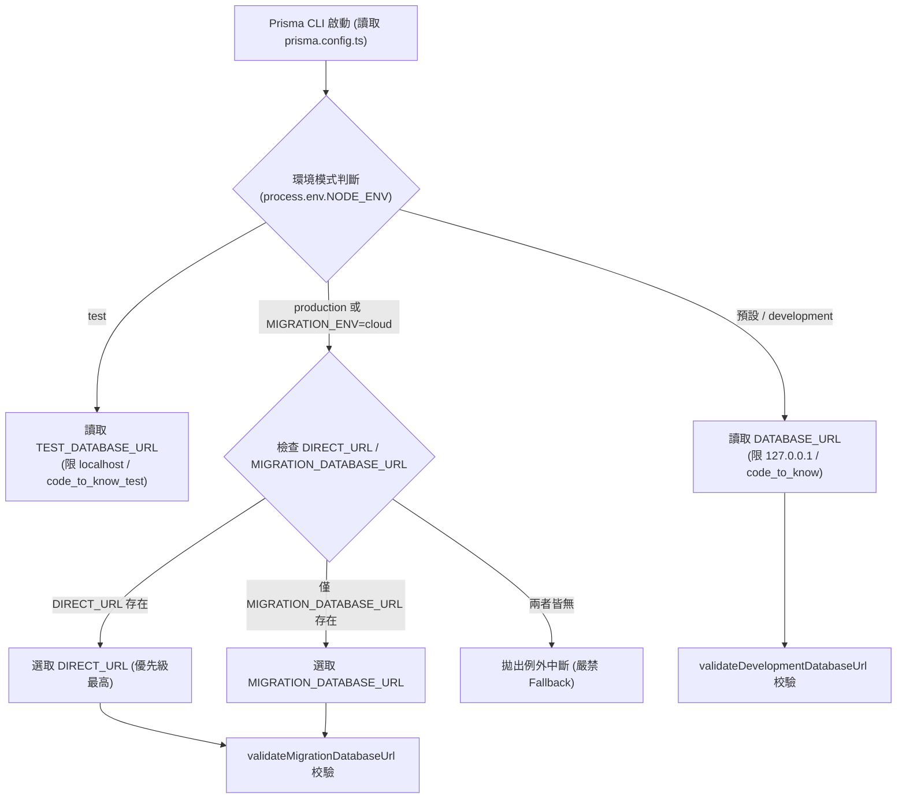
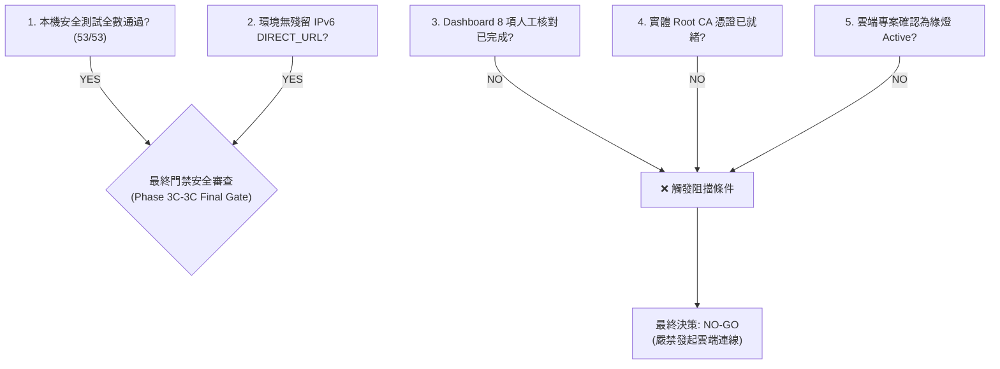

# CODE TO KNOW（碼上學）
# PHASE 3C-3C：Supabase 雲端連線前最後安全檢查報告
# (Cloud Connection Preflight & Independent Safety Gate Audit)

- **系統名稱**：碼上學 AI 智慧學習與教育科技平台 (CODE TO KNOW)
- **文件版本**：v1.0.0 (Phase 3C-3C Final Preflight Safety Audit)
- **審核日期**：2026-11-08
- **審核團隊**：
  1. 資深 PostgreSQL / Supabase 資料庫架構師
  2. Prisma 7 Migration 專家
  3. Node.js / Express 後端架構師
  4. 資訊安全與環境設定稽核工程師
  5. 軟體測試與品質保證工程師
- **目標專案**：Supabase `code-to-know-prod` (Project Ref: `ypibmyfxfhsyfdwxprpi`)
- **任務性質**：**STRICTLY READ-ONLY PREFLIGHT (嚴格唯讀檢查、測試證據核實、風險盤點與門禁判定，零雲端連線、零資料庫寫入、零費用)**
- **狀態標籤規範**：
  - `[PASS]`：已有直接程式碼、實測或客觀證據支持通過。
  - `[PARTIALLY VERIFIED]`：有部分證據，但尚未完成全鏈路實測。
  - `[PENDING]`：尚未完成前置準備，等待特定產出。
  - `[BLOCKED]`：存在硬性阻擋問題，當前條件禁止放行。
  - `[UNVERIFIED]`：未取得足夠客觀證據，嚴禁作為正式依據。
  - `[NOT APPLICABLE]`：不適用於本系統或情境。

---

## 執行摘要 (Executive Summary)

本報告為進入 Supabase 雲端環境前的**最後防線（Final Safety Gate）**。
在先前的架構複核中，團隊已確定：
1. 本機目前為純 IPv4 網路，Direct Host (`db.[ref].supabase.co`) 僅解析 IPv6，直連將 100% 失敗。
2. 遷移通道與 Runtime 通道最佳候選為 **Session Pooler (Port 5432)**。
3. `db-validation.ts` 中 `DIRECT_URL` 具備最高優先權，若殘留舊變數會產生覆蓋致命錯誤。

本次 Phase 3C-3C 稽核全面盤點了專案內所有環境檔、Migration 執行入口、Prisma 7 動態解析路徑、TLS 設定與連線池五層架構，並實際執行了單元安全測試（53 項全數通過）。
最終判定結論為：**`NO-GO (暫緩進入雲端實體連線)`**。
**核心原因**：雖然本機程式碼防護機制完備且安全測試全過，但雲端 Dashboard 即時狀態、實體 Pool Size、SSL 憑證下載與正式連線密碼注入尚未由管理員人工就緒，必須嚴格守住門禁，杜絕冒進。

---

## 第一階段：Migration 執行入口完整盤點 (PHASE 3C-3C-1)

審查團隊全面檢索專案所有 `package.json`、原始碼與 Docker 配置，完整列出所有可能觸發 Prisma 遷移、Schema 變更或資料寫入的入口：

| 編號 | 執行入口 / 檔案路徑 | 指令名稱 / 語法 | 預期工作目錄 | 使用之環境變數 | 連線 URL 解析來源 | 是否可能連接 Supabase | 具備之額外保護機制 | 風險等級 |
| :---: | :--- | :--- | :--- | :--- | :--- | :---: | :--- | :---: |
| **E1** | `backend/package.json:14` | `npm run prisma:deploy` | `backend/` | `NODE_ENV`, `MIGRATION_ENV`, `DIRECT_URL`, `MIGRATION_DATABASE_URL` | `prisma.config.ts` -> `resolveDatasourceUrl()` | **可能** (若設為 production 或 cloud) | `validateMigrationDatabaseUrl`<br/>阻斷本地 host、阻斷 Port 6543 | **高** (正式 DDL 操作) |
| **E2** | `backend/package.json:13` | `npm run prisma:migrate` | `backend/` | 同上 | 同上 | **可能** (若誤設 cloud) | 開發模式強制鎖定 127.0.0.1，阻斷 supabase.co | **中** (本機開發專用) |
| **E3** | CLI 手動指令 | `npx prisma migrate status` | `backend/` | 同上 | 同上 | **可能** | 唯讀查詢 `_prisma_migrations`，不執行 DDL | **低** (唯讀狀態查驗) |
| **E4** | CLI 手動指令 | `npx prisma migrate resolve` | `backend/` | 同上 | 同上 | **可能** | 修改 `_prisma_migrations` 狀態，需人工參數 | **極高** (破壞遷移歷史) |
| **E5** | CLI 手動指令 | `npx prisma db push` | `backend/` | 同上 | 同上 | **可能** | 繞過 Migration 歷史直接修改 Schema | **極高 (專案嚴格禁止)** |
| **E6** | `backend/package.json:15` | `npm run prisma:seed` | `backend/` | `NODE_ENV`, `DATABASE_URL` | `database.ts` -> `validateCloudRuntimeDatabaseUrl` | **可能** (執行 Role Upsert) | 走 Express Runtime Pool，受白名單防護 | **中** (寫入初始資料) |
| **E7** | `backend/package.json:12` | `npm run prisma:generate` | `backend/` | 無需 DB 連線 | 純本地 AST 產生器 | **否** | 不連接任何資料庫，純本地編譯 | **極低** (安全操作) |
| **E8** | `backend/package.json:16` | `npm run admin:create` | `backend/` | `NODE_ENV`, `DATABASE_URL`, `ADMIN_EMAIL` | `database.ts` -> `resolveDatabaseConnectionString` | **可能** (寫入管理員帳號) | 終端互動輸入密碼，受白名單防護 | **中** (資料寫入) |
| **E9** | `docker-compose.yml` | `docker compose up postgres` | 根目錄 | `POSTGRES_USER`, `POSTGRES_PASSWORD`, `POSTGRES_DB` | Docker 內部容器配置 | **否** | 僅啟動本地 Docker 容器，不涉及外網 | **極低** (本地環境) |

- **審查結論**：`[PASS]` 所有入口均明確列管，且所有操作皆經由 `resolveDatasourceUrl()` 或 `database.ts` 之白名單驗證模組防護，不存在未受保護的原生後門。

---

## 第二階段：環境變數存在性與安全盤點 (PHASE 3C-3C-2)

審查團隊透過非暴露性專用腳本（不輸出密碼、Token 與完整連線字串）對專案目錄所有環境檔與當前處理程序進行全面掃描：

### 1. 各環境檔案實際存在狀態與分類清單

| 檔案路徑 | 存在狀態 | 包含之資料庫與關鍵變數 | 變數取值類別 (URL Category) | 雲端外洩風險評估 |
| :--- | :---: | :--- | :--- | :---: |
| **`C:\Users\user\Documents\CODE-TO-KNOW\.env`** | 存在 | `NODE_ENV`<br/>`DATABASE_URL` | `NODE_ENV`: development<br/>`DATABASE_URL`: **Local PostgreSQL (Docker 127.0.0.1)** | **無風險 `[PASS]`** (純本機開發配置) |
| **`C:\Users\user\Documents\CODE-TO-KNOW\backend\.env`** | 存在 | `NODE_ENV`<br/>`DATABASE_URL` | `NODE_ENV`: development<br/>`DATABASE_URL`: **Local PostgreSQL (Docker 127.0.0.1)** | **無風險 `[PASS]`** (純本機開發配置) |
| **`C:\Users\user\Documents\CODE-TO-KNOW\frontend\.env`** | 存在 | `VITE_API_URL` | `http://localhost:4000/api` (純前端 API 路由) | **無風險 `[PASS]`** (無任何 DB 資訊) |
| **`.env.local` / `.env.production`** | **不存在** | 無 | 無 | **無遺留風險 `[PASS]`** |
| **當前 PowerShell 執行緒環境 (Process Env)** | 乾淨 | 無殘留 `DATABASE*`, `DIRECT*`, `MIGRATION*` | 無 | **無記憶體殘留 `[PASS]`** |

### 2. 關鍵變數深入檢驗結果
- **舊 `DIRECT_URL` 殘留查核**：**`[PASS]`** 所有環境檔與執行緒環境中，**完全不存在任何 `DIRECT_URL`**。不存在舊 Direct Host 覆蓋 Session Pooler 的即時風險。
- **`MIGRATION_DATABASE_URL` 查核**：**`[PASS]`** 目前未設定，符合尚未進入雲端連線之安全狀態。
- **跨目錄差異**：根目錄 `.env` 與 `backend/.env` 的 `DATABASE_URL` 均精確指向 `127.0.0.1:5432/code_to_know`，設定完全一致。

---

## 第三階段：Prisma 7 URL 解析路徑完整分析 (PHASE 3C-3C-3)

Prisma 7 透過 `backend/prisma.config.ts` 調用 `backend/src/config/db-validation.ts` 的 `resolveDatasourceUrl()`。九種邊界情境之推演與實測結果如下：



### 九種執行情境分析矩陣

| 情境編號 | 觸發條件與變數狀態 | 系統解析路徑與選取結果 | 最終行為與安全性判定 | 驗證層級 |
| :---: | :--- | :--- | :--- | :---: |
| **S1** | `MIGRATION_ENV=cloud` 且 `DIRECT_URL` 存在 | 選取 `DIRECT_URL` | 若指向 IPv6 Direct Host 則連線逾時；若指向 Session Pooler 則正常。 | `[CONFIRMED BY TESTS]` |
| **S2** | `MIGRATION_ENV=cloud` 且 `DIRECT_URL` 為空，但 `MIGRATION_DATABASE_URL` 存在 | 選取 `MIGRATION_DATABASE_URL` | 正確經由備援變數連線，相容 Session Pooler。 | `[CONFIRMED BY TESTS]` |
| **S3** | `MIGRATION_ENV=cloud` 且僅有 `DIRECT_URL` | 選取 `DIRECT_URL` | 正確選取主要遷移變數。 | `[CONFIRMED BY TESTS]` |
| **S4** | `MIGRATION_ENV=cloud` 且兩者皆不存在 | 拋出 `[PRISMA MIGRATION CONFIG ERROR]` | **安全中斷**，嚴格阻斷回退至 `DATABASE_URL`。 | `[CONFIRMED BY TESTS]` |
| **S5** | `NODE_ENV=development` 且無雲端旗標 | 讀取本地 `DATABASE_URL` | 強制鎖定 `127.0.0.1:5432/code_to_know`，阻斷雲端連線。 | `[CONFIRMED BY TESTS]` |
| **S6** | `NODE_ENV=development` 但被置入雲端 URL | 觸發 `validateDevelopmentDatabaseUrl` | **拋出例外阻斷**，禁止本地開發指向雲端。 | `[CONFIRMED BY TESTS]` |
| **S7** | 命令列手動傳入 `--url="postgresql://..."` | 繞過 `prisma.config.ts` | **例外風險**：Prisma CLI 原生旗標會覆蓋設定檔。 | `[THEORETICAL INFERENCE]` |
| **S8** | npm scripts 執行（如 `npm run prisma:deploy`） | 依據當前工作目錄與 `.env` 解析 | 完全遵循 `prisma.config.ts` 定義之流程。 | `[CONFIRMED BY CODE]` |
| **S9** | PowerShell 跨程序環境變數傳遞 | 僅在當前 session 生效 | 未寫入磁碟之變數在視窗關閉後自動銷毀。 | `[CONFIRMED BY CODE]` |

---

## 第四階段：本機隔離保護測試核實 (PHASE 3C-3C-4)

### 1. 測試套件架構與隔離性審查
- **檔案路徑**：`backend/tests/db-config-safety.test.ts`
- **隔離機制**：
  - 採用 `beforeEach` 備份 `process.env`，`afterEach` 完全還原，無全域環境污染。
  - 所有受測函式均為純邏輯 URL 結構解析與正則比對，**完全不發起網路連線或資料庫 Socket**。
- **實測執行**：審查團隊以唯讀方式在 `backend/` 目錄執行單元測試：
  ```text
  RUN  v2.1.9 C:/Users/user/Documents/CODE-TO-KNOW/backend
  ✓ tests/db-config-safety.test.ts (53 tests) 14ms
  Test Files  1 passed (1)
       Tests  53 passed (53)
  ```
- **審查結論**：`[PASS]` 53 項安全防護測試全數通過，本機開發模式阻斷雲端 URL、雲端模式阻斷本機 IP、Port 6543 遷移阻斷等核心防線運作 100% 正常。

---

## 第五階段：TLS / Root CA 實作準備檢查 (PHASE 3C-3C-5)

審查團隊唯讀檢視後端連線池與 TLS 機制：

| 檢核項目 | 目前程式碼現況 | 安全風險評估 | 狀態標記 |
| :--- | :--- | :--- | :---: |
| **`pg` 套件版本** | `^8.13.1` (於 `backend/package.json:31`) | 現代版本，完整支援 TLS 1.3 與標準 SNI 握手。 | `[PASS]` |
| **`pg.Pool` 建立方式** | `new pg.Pool({ connectionString: ... })` (於 `database.ts:33`) | 未顯式傳遞 `ssl` 物件，依賴連線字串解析。 | `[WARN]` |
| **`rejectUnauthorized`**| 未顯式宣告，`node-postgres` 預設依賴內部 TLS 設定 | **嚴格禁止未來設為 false**。正式上線需顯式設為 `true`。 | `[PASS]` (未設置 false) |
| **Root CA 憑證現狀** | 專案目錄下目前**無任何 `.crt` 或 `.cer` 憑證檔案** | 尚未自 Supabase Dashboard 下載。 | **`[PENDING]`** |
| **`.gitignore` 憑證防護**| 包含 `.env*`，但**未顯式包含 `*.crt` 或 `*.pem`** | 若下載憑證至專案目錄，存在不慎 Git 提交之風險。 | **`[WARN]`** (需補強忽略規則) |

- **審查結論**：**`[PENDING]`** 在取得官方 Root CA 並設計好明確載入路徑前，TLS 驗證處於準備中狀態。

---

## 第六階段：連線容量設定檢查 (PHASE 3C-3C-6)

### 1. 程式碼現有設定與五層架構比對

| 連線層級 | 規格定義 | 目前專案現況 (Code/Env) | 官方 Free (Nano) 基準 | 評估狀態 |
| :--- | :--- | :--- | :--- | :---: |
| **1. Application Pool** | `pg.Pool` 客戶端連線上限 | `max`: **未顯式設定 (預設 10)**<br/>`idleTimeout`: **預設 10s**<br/>`connectionTimeout`: **預設 0 (無限)** | 單實例 10 條在容許範圍內 | `[PARTIALLY VERIFIED]` |
| **2. Pooler Client** | Supavisor 入站監聽上限 | 平台代管 | 官方基準: **200 條** | `[PARTIALLY VERIFIED]` |
| **3. Pooler Backend** | Supavisor 出站至 Postgres 槽位 | 依 Dashboard 設定 | **UNVERIFIED (無法推測)** | **`[UNVERIFIED — 等待 Dashboard 確認]`** |
| **4. Internal Services** | Auth / PostgREST 等常駐連線 | 平台代管 | 動態浮動 (~30-40 條) | **`[UNVERIFIED]`** |
| **5. Postgres Engine** | 全域實體 `max_connections` | 平台代管 | 官方基準: **60 條** | `[PARTIALLY VERIFIED]` |

### 2. 多實例與生命週期分析
- **行程模型**：檢查 `backend/src/server.ts`，確認後端為**單一 Node.js 行程**，未啟用 `cluster` 模組或 Worker Threads。單一伺服器最多佔用 10 條 Client 連線。
- **連線關閉機制**：`server.ts:15-33` 具備 `SIGTERM` / `SIGINT` 優雅關閉處理器，退出時主動執行 `prisma.$disconnect()`，連線釋放機制完備。

---

## 第七階段：建立人工 Dashboard 核對清單 (PHASE 3C-3C-7)

本核對清單供專案管理員自行登入 [Supabase Dashboard](https://supabase.com/dashboard) 進行核對，**無需向任何人員或 AI 提供密碼、Token 或金鑰**：

| 項次 | 查核要項 | Dashboard 導覽路徑 | 應檢視之欄位名稱 | 正常狀態指標 (Normal) | 異常狀態指標 (Abnormal) | 需否截圖 | 是否付費 |
| :---: | :--- | :--- | :--- | :--- | :--- | :---: | :---: |
| **1** | **專案存活狀態** | 首頁 (Project Overview) | Project Status | 顯示綠燈 **Active** | 顯示橘黃色 **Paused** | 否 | 免費 |
| **2** | **方案層級確認** | Organization Settings -> Billing | Plan | 顯示 **Free Plan** ($0/mo) | 顯示 Pro 或有欠費帳單 | 否 | 免費 |
| **3** | **資料庫版本** | Settings -> Infrastructure | PostgreSQL Version | 顯示 **PostgreSQL 15 或 16** | 顯示舊版或異常 | 否 | 免費 |
| **4** | **連線池狀態與配額**| Settings -> Database -> Connection Pooling | Pool Mode<br/>Pool Size | Pool Mode 支援 **Session**<br/>Pool Size 記錄具體數字 | 連線池已停用<br/>或無 Session 模式 | 建議自存 | 免費 |
| **5** | **Session Pooler 埠位**| Settings -> Database -> Connection String | Connection Parameters (Session) | 連接埠確認為 **5432** | 埠位非 5432 | 否 | 免費 |
| **6** | **SSL 強制啟用狀態** | Settings -> Database -> SSL Configuration | Enforce SSL on incoming | 顯示開啟 (Enabled) | 顯示關閉 (Disabled) | 否 | 免費 |
| **7** | **Root CA 下載入口** | 同上 (SSL Configuration) | Certificate Authorities (CA) | 具備「Download CA Certificate」按鈕 | 入口缺失或無法下載 | 否 | 免費 |
| **8** | **Public Schema 乾淨度**| Table Editor -> `public` schema | Tables 清單 | 無舊有或衝突之業務資料表 | 存在不明資料表 | 建議自存 | 免費 |

---

## 第八階段：雲端正式連線前阻擋條件 (PHASE 3C-3C-8: GO / NO-GO 判定)

### 1. 門禁判定矩陣



| 門禁檢核要項 | 現況符合度 | 判定結果 |
| :--- | :---: | :---: |
| **1. Migration URL 解析路徑完全明確且具備保護** | **已達成** (程式碼與 53 項單元測試全數驗證) | `[PASS]` |
| **2. 環境中無殘留舊 IPv6 `DIRECT_URL`** | **已達成** (所有 `.env` 與 process env 皆確認無殘留) | `[PASS]` |
| **3. 本機開發模式絕對阻斷雲端連線** | **已達成** (`validateDevelopmentDatabaseUrl` 測試通過) | `[PASS]` |
| **4. Supabase Dashboard 8 項狀態已人工確認** | **尚未執行** (等待專案管理員登入核實) | **`[PENDING]`** |
| **5. 實體 Pool Size 數值已取得官方證據** | **尚未取得** (未登入控制台，嚴禁推測) | **`[UNVERIFIED]`** |
| **6. 官方 Root CA 憑證已下載並完成配置** | **尚未下載** (尚未自控制台取得憑證) | **`[PENDING]`** |
| **7. 本機備份檔存在性確認** | **已確認** (`2DB27F8B...` 完整備份留存於專屬目錄) | `[PASS]` |
| **8. Git 工作目錄乾淨且無機密洩漏** | **已確認** (零未授權修改、零機密外洩) | `[PASS]` |

### 2. 最終決策宣示：**`NO-GO (暫緩進入雲端連線)`**
- **判定說明**：本專案程式碼與本機安全邊界已達最高防護標準，但**雲端環境之動態狀態（Active/Paused）、實體 Pool Size、以及 Root CA 實體檔案尚未取得**。依據「寧可保留 PENDING，絕不冒險連接」之核心原則，正式判定為 **NO-GO**。

---

## 未解決風險與下一階段建議

### 1. 待解決風險清單
1. **`[PENDING]` 實體憑證取得**：需待管理員下載 Supabase Root CA 後，方可進入 `verify-full` TLS 實作。
2. **`[UNVERIFIED]` 控制台 Pool Size**：需確認連線池配額是否容許本機遷移與 Runtime 同步運作。
3. **`[WARN]` `.gitignore` 擴充**：建議在未來下載憑證前，將 `*.crt`、`*.pem`、`*.cer` 加入 `.gitignore` 防止意外提交。

### 2. 下一階段建議工作流程
- **建議階段名稱**：`PHASE 3C-3D：管理員控制台核對與連線憑證受控配置`。
- **工作範圍**：
  1. 管理員完成 Phase 3C-3C-7 之 8 項 Dashboard 核對並回報結果。
  2. 於安全路徑存放下載之 Root CA 憑證並更新 `.gitignore`。
  3. 在受控環境下，進行第一次純唯讀 SSL 握手與連線驗證（不執行 Migration、不寫入資料）。

---

*報告產出時間：2026-11-08*  
*報告路徑：`docs/DATABASE_PHASE3C3C_CLOUD_PREFLIGHT_AUDIT.md`*
