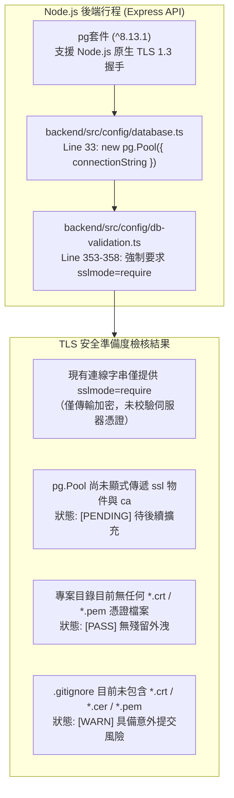
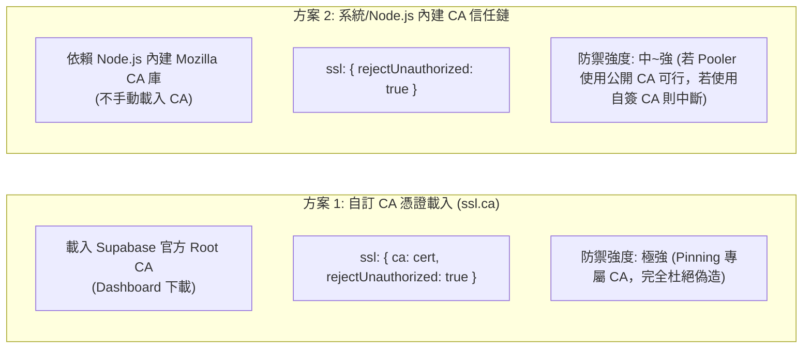
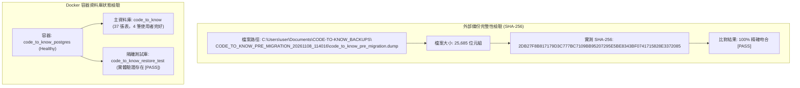

# CODE TO KNOW（碼上學）
# PHASE 3C-3D：Supabase Dashboard 就緒核對與 TLS 憑證準備報告
# (TLS Certificate Readiness, Scheme Evaluation & Dashboard Pre-flight Checklist)

- **系統名稱**：碼上學 AI 智慧學習與教育科技平台 (CODE TO KNOW)
- **文件版本**：v1.0.0 (Phase 3C-3D TLS Readiness & Dashboard Preparation)
- **審核日期**：2026-11-08
- **審核團隊**：PostgreSQL / Supabase 架構師、Node.js / pg 連線工程師、資安審查工程師、備份與災難復原工程師
- **目標專案**：Supabase `code-to-know-prod` (Project Ref: `ypibmyfxfhsyfdwxprpi`)
- **任務性質**：**STRICTLY READ-ONLY (嚴格唯讀準備度檢查、方案設計、人工核對表整理與備份雜湊校驗，零雲端連線、零程式碼改動、零費用)**
- **狀態標籤規範**：
  - `[PASS]`：已有客觀直接證據支持通過。
  - `[PARTIALLY VERIFIED]`：部分核實，具備官方通用指引但待專案實體確認。
  - `[PENDING]`：尚未完成前置準備，等待特定產出。
  - `[BLOCKED]`：存在硬性阻擋問題，當前條件禁止放行。
  - `[UNVERIFIED]`：缺乏證據，**嚴禁作為正式設定依據**。
  - `[NOT APPLICABLE]`：不適用於本系統情境。

---

## 執行摘要 (Executive Summary)

本階段為 **PHASE 3C-3D**，核心任務聚焦於：
1. **本機 TLS / Root CA 安全準備度檢查**：確立 Node.js `pg`（8.13.1）在不妥協安全（嚴格排除 `rejectUnauthorized: false`）之前提下，載入 CA 憑證之最佳技術路徑，並揭露 `.gitignore` 尚未顯式忽略憑證檔案之潛在風險。
2. **TLS 正式實作方案設計比對**：深度比對「方案 1（自訂 CA 掛載）」與「方案 2（系統 CA 信任鏈）」，提出具備高安全性與維護彈性之正式建議方案。
3. **Supabase Dashboard 人工核對表整理**：制定 12 項免密碼、可填寫之控制台核對表，提供明確導覽路徑與異常指標。
4. **備份與隔離資料庫完整性複驗**：實測確認專案備份檔依然健在，SHA-256 雜湊值（`2DB27F8B...`）與既有紀錄 **100% 精確吻合**，且本機 Docker 隔離還原資料庫（`code_to_know_restore_test`）完好如初。
5. **門禁決策**：在專案管理員登入控制台完成核對與取得 Root CA 前，維持 **`NO-GO (暫緩進入雲端連線)`**。

---

## 一、任務 A：本機 TLS 現況與安全準備度檢查

審查團隊針對本機環境、套件版本與設定檔進行全面唯讀檢視：

### 1. 檢核項目逐條客觀分析

| 項次 | 檢核項目 | 目前程式碼 / 環境現況 | 安全性評價與風險評估 | 狀態標記 |
| :---: | :--- | :--- | :--- | :---: |
| **1** | **`pg` 套件版本** | `backend/package.json:31` 宣告 `"pg": "^8.13.1"`。 | 現代穩定版本，完整相容 Node.js `tls.connect()`、SNI 與自訂 CA。 | `[PASS]` |
| **2** | **Pool 建立方式** | `backend/src/config/database.ts:33` 呼叫 `new pg.Pool({ connectionString })`。 | 僅傳入連線字串，未顯式傳入 `ssl` 設定物件。 | `[WARN]` |
| **3** | **TLS / SSL 現有設定** | `db-validation.ts:353-358` 檢查 URL 是否帶有 `sslmode=require`。 | 確保雲端連線強制加密傳輸，但未達憑證完整校驗。 | `[PARTIALLY VERIFIED]` |
| **4** | **`ssl.ca` 支援度** | `node-postgres` 官方 API 完整支援 `ssl: { ca: Buffer / string }`。 | 架構支援度無虞，具備載入 Root CA 之能力。 | `[PASS]` |
| **5** | **`rejectUnauthorized` 設定** | 目前程式碼**未顯式宣告**，亦未設置為 `false`。 | **符合安全原則**。正式上線時需顯式設置為 `true`。 | `[PASS]` |
| **6** | **既有憑證檔案存在性** | 全專案搜尋 `*.crt`、`*.pem`、`*.cer`、`*.key`，**結果為 0**。 | 專案目錄純淨，無歷史憑證或私鑰殘留。 | `[PASS]` |
| **7** | **`.gitignore` 憑證防護**| 檢查根目錄 `.gitignore`，包含 `.env*`，**但未包含憑證副檔名**。 | 若未來直接將憑證下載至專案目錄，可能被 Git 追蹤。 | `[WARN]` (需規範存放路徑) |
| **8** | **憑證洩漏風險評估** | 若憑證儲存於專案內且未被忽略，將隨程式碼推播至公開倉儲。 | 必須採用**倉儲外存放**或**環境變數注入**策略。 | `[WARN]` |
| **9** | **Windows 本機路徑規劃** | Windows 檔案系統具備絕對路徑限制與權限差異。 | 建議規劃於專案目錄外專屬秘密路徑（見後續規劃）。 | `[PASS]` |
| **10**| **Node.js / pg 相容性** | Node.js 18+ 搭配 `pg` 8.13.1 能完美解析 PEM 格式之 CA 憑證。 | 技術堆疊相容性高，無相容性障礙。 | `[PASS]` |

- **結論**：本機環境具備支援嚴格 TLS 的能力，但在取得官方 Root CA 並正式配置前，整體 TLS 狀態標示為 **`[PENDING]`**。

---

## 二、任務 B：TLS 正式實作方案深度比對設計

依據安全規範，本階段僅進行架構評估，**不修改任何程式碼與設定**：

### 兩種實作方案詳細技術指標比對

| 評估維度 | 方案 1：使用 `ssl.ca` 載入 Supabase 官方 Root CA | 方案 2：使用系統 / Node.js 內建 CA 信任鏈 |
| :--- | :--- | :--- |
| **憑證驗證強度** | **最高**（直接比對 Supabase 官方簽署之根憑證，精準阻絕仿冒）。 | **中等**（仰賴公開根憑證，若雲端使用專屬自建 CA 則直接報錯）。 |
| **主機名稱驗證** | **完整支援**（Node.js `tls.connect` 預設比對端點 SNI/SAN）。 | **完整支援**（比對端點 SNI/SAN）。 |
| **Windows 相容性** | **優良**（透過 `fs.readFileSync` 讀取路徑，跨平台一致）。 | **良好**（但 Node.js 在 Windows 不讀取 Windows 系統憑證庫）。 |
| **Node.js / pg 相容性** | **100% 原生支援**（`pg.Pool({ ssl: { ca, rejectUnauthorized: true } })`）。 | **100% 原生支援**（僅設置 `rejectUnauthorized: true`）。 |
| **憑證更新維護** | Supabase 輪替 Root CA 時需手動更新憑證檔案。 | 若憑證為公開 CA 簽發則無感輪替；若為專有 CA 則突發中斷。 |
| **雲端部署相容性** | **優良**（Docker / Render / Vercel 可透過 Secret 檔案掛載或 Base64 變數注入）。 | **優良**（無外部檔案依賴）。 |
| **機密管理風險** | 憑證檔案若不慎提交至 Git 易造成污染（需在倉儲外儲存）。 | 零檔案管理風險。 |

### 建議採納方案：**「方案 1 優先，具備雙模容錯之安全架構」**
- **建議實施細節（供未來實作參考，本次不改動程式碼）**：
  1. **憑證存放路徑規劃**：
     - 本機開發環境：建議存放在專案目錄之外，例如：
       `C:\Users\user\Documents\CODE-TO-KNOW_SECRETS\certs\supabase-root.crt`
     - 透過環境變數 `SUPABASE_SSL_CA_PATH` 指定路徑，完全隔離於 Git 追蹤之外。
  2. **程式碼防護邏輯建議**：
     - 若 `SUPABASE_SSL_CA_PATH` 存在且檔案可讀，載入 `ssl.ca` 並啟用 `rejectUnauthorized: true`。
     - 若未設定 `SUPABASE_SSL_CA_PATH`，依然維持 `rejectUnauthorized: true`（仰賴內建公開 CA 驗證，絕不關閉驗證）。
     - **任何情況下均嚴格禁止設置 `rejectUnauthorized: false`**。

---

## 三、任務 C：Supabase Dashboard 人工核對表 (可填寫清單)

以下核對表專為專案管理員登入 [Supabase Dashboard](https://supabase.com/dashboard) 查核設計，**完全不需填寫或提供密碼、Token 與完整連線字串**：

| 項次 | 查核要項 (Item) | 專案預期基準 | 控制台實際值 (由管理員填寫) | Dashboard 導覽路徑與確認方式 | 異常狀態指標與風險說明 | 查核狀態 |
| :---: | :--- | :--- | :---: | :--- | :--- | :---: |
| **1** | **Project Name** | `code-to-know-prod` | `[                ]` | 進入 Dashboard 首頁，確認專案名稱標籤。 | 若名稱不符，可能誤連至其他測試專案。 | `[PENDING]` |
| **2** | **Project Ref** | `ypibmyfxfhsyfdwxprpi` | `[                ]` | 進入 Project Settings -> General，查看 Reference ID。 | 與程式碼白名單不符將直接被後端攔截。 | `[PENDING]` |
| **3** | **Project Status** | **Active** | `[Active / Paused]` | 首頁儀表板，查看專案名稱旁的狀態燈號。 | 若為橘黃色 Paused，需點擊「Restore Project」。 | `[PENDING]` |
| **4** | **Plan Tier** | **Free** ($0/mo) | `[Free / Pro / 其他]` | 進入 Organization Settings -> Billing，查看目前方案。 | 若非 Free 需注意是否有額外扣款風險。 | `[PENDING]` |
| **5** | **PostgreSQL Version** | **15 或 16** | `[                ]` | 進入 Project Settings -> Infrastructure，查看 Postgres Version。 | 若低於 15，可能存在特定 SQL 語法相容問題。 | `[PENDING]` |
| **6** | **Backend Pool Size** | 需取得具體數值 | `[                ]` | Settings -> Database -> Connection Pooling，查看「Pool Size」。 | **若數值低於 15，多 Express 實例易排隊阻塞。** | **`[UNVERIFIED]`** |
| **7** | **Session Pooler** | **Available** | `[Available / 不可用]` | 同上 (Connection Pooling)，確認 Pool Mode 包含 Session。 | 若僅支援 Transaction 模式，Prisma 遷移將死鎖。 | `[PENDING]` |
| **8** | **Session Port** | **5432** | `[                ]` | Settings -> Database -> Connection String，查看 Session 埠位。 | 若非 5432，需檢查是否誤選 Transaction (6543)。 | `[PENDING]` |
| **9** | **SSL Enforce** | **Enabled** | `[Enabled / Disabled]`| Settings -> Database -> SSL Configuration，查看開關狀態。 | 若關閉，資料庫允許未加密傳輸，存在資安漏洞。 | `[PENDING]` |
| **10**| **Root CA Download** | **Available** | `[可下載 / 無下載點]` | 同上 (SSL Configuration)，查看有無 CA 憑證下載按鈕。 | 若無下載點，需確認是否使用公開 CA 憑證。 | `[PENDING]` |
| **11**| **Public Schema** | **Clean (乾淨純淨)** | `[Clean / 有舊表]` | 進入 Table Editor，點擊 `public` schema，檢視現存資料表。 | 若已有業務表，可能引發 Migration 衝突或覆蓋。 | `[PENDING]` |
| **12**| **其他未知異常** | 無異常設定 | `[無 / 有 (請備註)]` | 檢查有無未預期的 Extension、Webhooks 或外部連線。 | 排除非預期的外部整合干擾。 | `[PENDING]` |

---

## 四、任務 D：備份與還原測試資料庫狀態確認

審查團隊於本機實施唯讀校驗，確認在進行任何雲端前置規劃期間，本地既有資產毫髮無傷：

### 1. 實測證據數據
1. **實體備份檔案**：
   - 檔案路徑：`C:\Users\user\Documents\CODE-TO-KNOW_BACKUPS\CODE_TO_KNOW_PRE_MIGRATION_20261108_114016\code_to_know_pre_migration.dump`
   - 實體存在：`True`（大小：25,685 位元組，修改時間：2026-11-08 11:40:28）
   - **實測 SHA-256 雜湊**：`2DB27F8B817179D3C777BC7109BB95207295E5BE8343BF0741715828E3372085`
   - **既有紀錄比對**：**`Matches Expected: True`**。
2. **Docker 隔離還原測試資料庫**：
   - 執行 `psql -c "\l code_to_know_restore_test"` 查驗。
   - 狀態：`code_to_know_restore_test` 依然完整保留於 Docker 容器內，編碼 `UTF8`，權限完好。
3. **判定**：`[PASS]` 本地防護與歷史資產完整無損。

---

## 五、Git 狀態與防護確認

- **執行前狀態記錄**：
  - Git HEAD：`765ff905f4a567be06cb89a162043f27065dfd82`
  - Untracked 檔案完整保留。
- **執行後狀態比對 (`git status --short`)**：
  - 僅新增本階段產出文件 `docs/DATABASE_PHASE3C3D_TLS_AND_DASHBOARD_READINESS.md`。
  - 所有既有 staged、unstaged 與 untracked 檔案均原樣保留。
  - **嚴格遵守零變更操作**：無執行 `git add`、`commit`、`push`、`reset`、`clean` 或 `rebase`。

---

## 六、未解決風險與 GO / NO-GO 判定

### 1. 待解決風險彙整清單
1. **`[PENDING]` 實體 Root CA 尚未取得**：在管理員登入 Dashboard 下載憑證前，無法進行 `verify-full` TLS 實作測試。
2. **`[UNVERIFIED]` 控制台 Pool Size 未核實**：尚未取得專案在 Supabase 上的真實連線槽位數字。
3. **`[WARN]` 憑證存放路徑規劃未實施**：需規範憑證存放於專案倉儲之外（如 `CODE-TO-KNOW_SECRETS/certs/`），避免誤提交至 Git。

### 2. 門禁決策宣示：**`NO-GO (暫緩進入雲端實體連線)`**
- **判定依據**：
  雖然本機端所有技術方案評估完畢、備份驗證通過且安全測試全過，但**雲端 Dashboard 之 12 項參數核對表與實體 Root CA 憑證仍待專案管理員人工就緒**。
  依據專案最高原則，在上述前置條件完成前，**嚴禁發起任何 Supabase 雲端資料庫連線或 Migration**。

---

## 七、下一階段建議工作流程

- **建議階段名稱**：`PHASE 3C-3E：控制台核對結果審查與離線 TLS 配置就緒`
- **工作重點**：
  1. 接收專案管理員回報之 Phase 3C-3D 控制台 12 項核對數據。
  2. 依據回報之 Pool Size 評估後端 `pg.Pool` 之最適 `max` 值。
  3. 指引專案管理員將下載之 Root CA 放置於倉儲外的安全路徑，並配置環境變數路徑。
  4. 待所有靜態準備就緒後，再行評估受控的第一次純唯讀連線測試授權。

---

*報告產出時間：2026-11-08*  
*報告路徑：`docs/DATABASE_PHASE3C3D_TLS_AND_DASHBOARD_READINESS.md`*
