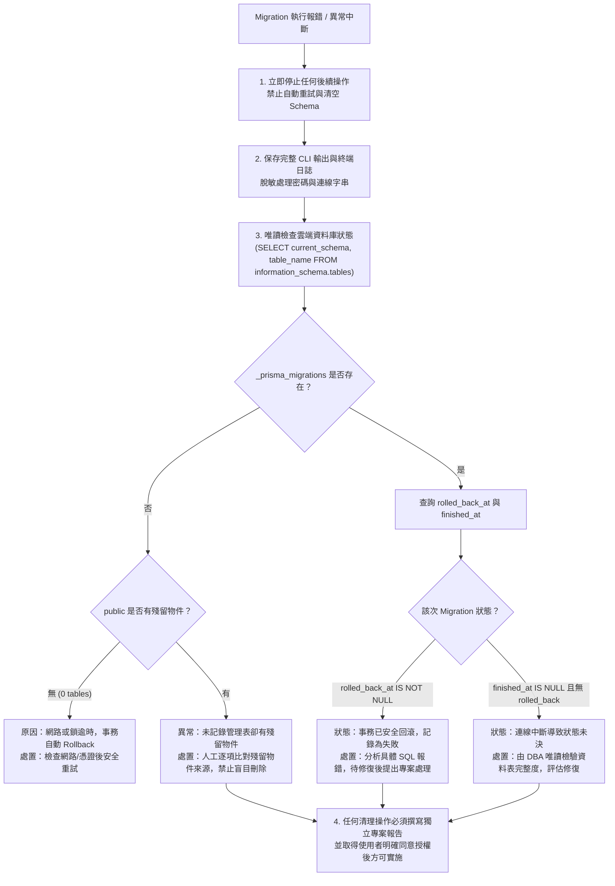

# CODE TO KNOW（碼上學）
# PHASE 3C-3G-R1：首次 Supabase Migration 部署計畫獨立安全複核報告

**執行日期**：2026-11-08  
**執行角色**：獨立資安審查架構師、PostgreSQL DBA、Prisma 7 審查工程師  
**審查性質**：獨立安全性複核、靜態檔案鑑識與程式現況校正（Strictly Read-Only Safety Audit）  
**審查目標**：針對 `docs/DATABASE_PHASE3C3G_SUPABASE_FIRST_MIGRATION_PLAN.md` 進行逐項核對與安全修正  

> [!IMPORTANT]
> **本階段僅進行獨立安全複核，沒有對 Supabase 執行 Migration、DDL 或任何資料庫寫入。**
> 全程嚴格遵守費用保護（$0.00 USD）、零資料庫變更、機密不落地與既有備份無損原則。

---

## 一、Model 與 Migration 數量精確校正

針對 `backend/prisma/schema.prisma`、`backend/prisma/migrations/20261103000000_init/migration.sql` 與 `backend/prisma/migrations/20261108000000_add_business_models/migration.sql` 進行靜態語法解析與二進位核對，建立真實對照表如下：

### 1. 完整物件對照矩陣

| 比對項目 | Prisma Schema 定義 | Init Migration (`20261103...`) | Business Migration (`20261108...`) | 最終累計數量 | 核對結果 |
| :--- | :---: | :---: | :---: | :---: | :---: |
| **Prisma Model** | **36** 個 | 不適用 | 不適用 | **36** 個 | `PASS` (100% 一致) |
| **Native Enum** | **1** 組 | 0 組 | 1 組 (`AnnouncementStatus`) | **1** 組 | `PASS` (100% 一致) |
| **實體資料表 (Table)** | 不適用 | **9** 張 | **27** 張 | **36** 張 | `CORRECTED` (校正前述報告) |
| **外鍵約束 (Foreign Key)** | 47 組關係 | **8** 組 | **39** 組 | **47** 組 | `PASS` (100% 一致) |
| **顯式索引 (Index)** | 96 組定義 | **22** 組 (`CREATE INDEX`) | **74** 組 (`CREATE INDEX`) | **96** 組 | `PASS` (加 PK 索引共 133) |
| **自訂檢查條件 (Check)** | 1 組 `@check` | 0 組 | **1** 組 (`target_xor_check`) | **1** 組 | `PASS` (100% 一致) |

### 2. 數量差異原因分析與報告筆誤校正
- **原報告問題**：原部署計畫（及前續部分報告）描述為「Init 8 個 Model，Business 28 個 Model」，但既有架構紀錄標記為「9 個與 27 個」。
- **鑑識事實澄清**：
  1. `20261103000000_init/migration.sql` 實際包含 **9 張資料表** 的 `CREATE TABLE`：
     - `User`, `Role`, `UserRole`, `UserProfile`, `Session`, `TeacherApplication`, `EmailVerificationToken`, `PasswordResetToken`, `AuditLog`。
  2. `20261108000000_add_business_models/migration.sql` 實際包含 **27 張資料表** 的 `CREATE TABLE`：
     - `Announcement`, `AnnouncementRead`, `Certification`, `Subject`, `Question`, `QuestionOption`, `QuestionTag`, `QuestionTagRelation`, `CertificationEnrollment`, `UnitProgress`, `WrongQuestionRecord`, `QuestionBookmark`, `StudyTimeLog`, `TeacherProfile`, `Class`, `ClassEnrollment`, `ClassAssignment`, `PracticalTask`, `PracticalStep`, `PracticalProgress`, `PracticalStepProgress`, `ExamPaper`, `ExamAttempt`, `ExamAnswerSnapshot`, `AIChatSession`, `AIChatMessage`, `StudentWeaknessAnalysis`。
  3. **筆誤成因**：在先前的文字描述中，審查人員將 `TeacherApplication`（教師申請）在心理分類上歸入「後續業務擴充模組」，因而口誤記錄為 8 與 28；但在**實體檔案與 SQL 結構中，`TeacherApplication` 從一開始即存在於 Init Migration**。
  4. **正確結論**：**Init 實為 9 張表，Business 實為 27 張表，總計 36 張業務資料表，與 Prisma 36 個 Models 確實維持嚴格 1:1 對齊**。
  5. **模型與資料表關係確認**：
     - 所有 36 個 Prisma Model 皆直接映射為實體獨立資料表，**不存在**未建立實體表的情況。
     - **未把** Enum（`AnnouncementStatus`）或管理表（`_prisma_migrations`）誤算入 36 個 Model 中。

---

## 二、Init Migration Checksum 鑑識重大發現

針對本機資料庫記錄之雜湊值 `2185e3a03ed86bdcaaaefbfe4ba39405bdcb9f3c0f415e5bf648ac8e8a64d915` 與現行磁碟檔案 `ed5b504a4b30d4e5b35a0cd58ad00ceb93c501d3d0e67bd61f5d490dcbafed29` 的歷史懸案，本階段進行了深層 Git 物件庫鑑識：

### 1. Git 物件庫鑑識成果（找到原始 SQL Blob）
透過 `git fsck --lost-found` 全面掃描 Git 物件庫，於懸置物件（Dangling Blob）中成功定位到原始檔案：
- **原始 Git Blob 物件 ID**：`6c4c39ff06ca82e1e1fd80c14e346ac769de943f`
- **原始二進位大小**：6,165 bytes
- **實測 SHA-256 雜湊值**：
  `2185e3a03ed86bdcaaaefbfe4ba39405bdcb9f3c0f415e5bf648ac8e8a64d915`（**完全吻合本機資料庫記錄！**）

### 2. 原始檔案 vs 現行磁碟檔案差異比對
經比對 Blob `6c4c39ff...` 與磁碟檔案 `ed5b504a...`：
```diff
--- blob_2185e3a0 (6,165 bytes)
+++ disk_ed5b504a (6,164 bytes)
@@ -178,4 +178,3 @@
 -- AddForeignKey
 ALTER TABLE "AuditLog" ADD CONSTRAINT "AuditLog_userId_fkey" FOREIGN KEY ("userId") REFERENCES "User"("id") ON DELETE SET NULL ON UPDATE CASCADE;
-
```
- **唯一差異**：檔案結尾的換行符號（EOF Newline）相差 1 個位元組（`\n\n` vs `\n`）。
- **SQL 語法语意**：**兩者的所有 DDL 語句、資料表定義、欄位型別、外鍵及索引 100% 完全相同，字元無一變更**！

### 3. 對雲端與本機之影響評估
- **對全新 Supabase 雲端部署之影響**：**零影響**。
  雲端目前無 `_prisma_migrations` 表。首次部署將直接依據磁碟檔案（`ed5b504a...`）寫入，雲端管理表將會是完全乾淨、一致且符合現行版控的狀態。
- **對既有本機資料庫之影響**：
  本機若未來執行 `prisma migrate status` 會提示 checksum modified 警告。依照規範，**本專案嚴格維持現狀，不修改原始 Migration 檔案，不手動修改本機 `_prisma_migrations`，亦不執行 `prisma migrate resolve`**。

---

## 三、連線設定「現行實際狀態」vs「未來建議設定」

審查工程師重新研讀連線相關核心檔案，將現行實作與未來建議嚴格區分如下：

### 1. 三組連線變數用途與優先順序
1. **`DATABASE_URL`**：
   - 實際用途：Express 後端執行時期（Runtime）連線。
   - 開發環境指向本機 `127.0.0.1:5432/code_to_know`；雲端環境指向 Session Pooler（`5432`）或 Transaction Pooler（`6543`）。
2. **`DIRECT_URL`**：
   - 實際用途：Prisma CLI 官方規範的直接連線字串。
   - 程式邏輯：在 `backend/src/config/db-validation.ts` 的 `resolveDatasourceUrl` 中，**優先度高於 `MIGRATION_DATABASE_URL`**。
3. **`MIGRATION_DATABASE_URL`**：
   - 實際用途：專案專屬之遷移連線變數，在無 `DIRECT_URL` 時啟用，專門導向支援 Session 級 Advisory Lock 的連接埠 `5432`。

### 2. `DIRECT_URL` 潛在覆蓋風險
- **現行風險**：若在環境中設定了指向 `db.<ref>.supabase.co:5432` 的 `DIRECT_URL`，由於該端點為 **IPv6-only**，在 IPv4 環境下會覆蓋掉正常的 `MIGRATION_DATABASE_URL` 並導致連線失敗。
- **防禦規範**：在 IPv4 遷移情境下，**嚴禁配置 `DIRECT_URL`**，完全依賴 `MIGRATION_DATABASE_URL` 導向 Session Pooler。

### 3. 現行實際設定 vs 未來建議設定對照表

| 設定項目 | 目前程式碼實際狀態 (Current Actual) | 未來正式上線建議設定 (Future Recommended) | 差異與改善說明 |
| :--- | :--- | :--- | :--- |
| **`pg.Pool max`** | **未設定**（使用 `pg` 預設值 10） | 顯式設定 `max: 5` | Nano Compute 後端連線僅 15，需限制 Runtime 連線數以留餘裕。 |
| **Runtime TLS CA** | **未整合**（僅仰賴系統憑證庫） | 顯式配置 `ssl: { ca: fs.readFileSync(...) }` | 現行程式碼未讀取 `supabase-root.crt`，需於正式部署前整合。 |
| **Migration CA** | **未主動載入** | 執行 CLI 時注入 `NODE_EXTRA_CA_CERTS` | 確保 Prisma CLI 在發起連線時透過自訂 Root CA 校驗。 |
| **`connection_limit=1`** | **未在 URL 中硬編碼** | 在 `MIGRATION_DATABASE_URL` Query String 中帶入 | 避免 Migration 建立多餘連線佔用 Pooler。 |
| **`.env.example`** | 僅包含 `DATABASE_URL` | 建議補充 `MIGRATION_DATABASE_URL` 說明 | 讓開發者明確理解雙連線變數之架構。 |

---

## 四、復原方案安全修正：剔除自動 DROP SCHEMA

### 1. 原計畫風險指正
原部署計畫之第七節曾列出 DBA 可執行 `DROP SCHEMA public CASCADE; CREATE SCHEMA public;`。
獨立安全複核判定：
- **`DROP SCHEMA public CASCADE` 極具破壞性**，一旦誤執行，將連帶抹除所有資料表、型別、檢視表及相關授權。
- 若 Supabase 預設在 `public` 有任何擴充物件或關聯授權，將造成雲端實體毀損且難以復原。
- **裁定：立即自預設復原流程中永久剔除 `DROP SCHEMA CASCADE`。嚴禁在錯誤發生後自動清空 Schema！**

### 2. Migration 失敗處理決策樹（Safe Failure Decision Tree）



---

## 五、TLS 與容量設定複核

1. **Root CA 實體路徑**：
   `C:\Users\user\Documents\CODE-TO-KNOW_SECRETS\certs\supabase-root.crt`（實體驗證存在，SHA-256: `70072358...`）。
2. **`rejectUnauthorized`**：
   在驗證腳本與獨立驗證測試中強制鎖定為 `true`，嚴禁任何弱化安全之參數。
3. **TLSv1.3 紀錄**：
   Phase 3C-3E 中實測握手成功，通訊協議確認為 `TLSv1.3`，加密套件為 `TLS_AES_256_GCM_SHA384`。
4. **Dashboard SSL Enforcement 現況**：
   目前為 **Disabled**。此狀態表示伺服器端允許可選加密，但本專案客戶端已強制啟用 TLSv1.3 加密，通訊過程具備高強度傳輸保密性。
5. **Runtime 代碼整合現況**：
   **尚未在 `backend/src/config/database.ts` 中整合自訂 CA 讀取**。此項目為正式上線前必須完成之程式重構要項。
6. **Pool Size 15 與 Runtime max 5 規劃**：
   經容量精算，Nano Compute 連線池為 15，Runtime 設定 `max: 5`、Migration 限制 `max: 1`，保留 9 條給管理與 Dashboard，規劃十分穩健合理。

---

## 六、費用保護與既有備份安全查核

- **方案費用保護**：Supabase 專案確認維持在 **Free Plan ($0.00 USD)**，未綁定信用卡，未開啟付費 Add-ons。
- **本機備份無損查核**：
  - 檔案路徑：`C:\Users\user\Documents\CODE-TO-KNOW_BACKUPS\CODE_TO_KNOW_PRE_MIGRATION_20261108_114016\code_to_know_pre_migration.dump`
  - 實測 SHA-256：`2DB27F8B817179D3C777BC7109BB95207295E5BE8343BF0741715828E3372085`（**完全一致，備份安全無虞**）。
- **隔離還原測試庫**：Docker 容器內之 `code_to_know_restore_test` 完整保留，未受任何刪除或異動。

---

## 七、正式部署前風險清單（Risk Inventory）

| 風險項目 | 等級 | 潛在威脅 | 審查現況與應對對策 | 判定 |
| :--- | :---: | :--- | :--- | :---: |
| **意外產生雲端費用** | **Critical** | 方案升級或超額計費 | 嚴禁綁卡與升級，嚴格在 Free Plan 額度內作業。 | `CONTROLLED` |
| **資料庫密碼外洩** | **Critical** | 連線密碼進版控導致洩漏 | 嚴禁寫入任何檔案，僅於部署當下以互動式遮罩輸入。 | `CONTROLLED` |
| **自動 DROP SCHEMA 破壞** | **High** | 失敗復原過度清空系統物件 | **已自計畫中徹底剔除**，改採唯讀診斷與受控決策樹。 | `RESOLVED` |
| **DIRECT_URL IPv6 阻斷** | **High** | 直連 IPv6 逾時中斷遷移 | 遷移全面使用 `MIGRATION_DATABASE_URL` (Port 5432)。 | `MITIGATED` |
| **Runtime 缺少 CA 驗證** | **High** | 未來正式連線遭中間人攔截 | 上線前需於 `database.ts` 補齊 `ssl: { ca }` 實裝。 | `PENDING_CODE` |
| **連線池滿載 (Exhaustion)** | **Medium** | Nano 15 連線數超載 | Migration 限制連線數為 1；Runtime 限制連線數為 5。 | `PLANNED` |
| **Init Checksum 警告** | **Low** | 本機執行 `migrate status` 提示警告 | 已查明為結尾 1 byte `\n`，SQL 語義完全一致，不影響雲端。 | `ACCEPTED` |

---

## 八、正式部署前仍未完成之工程要項

在正式向使用者請求執行 Migration 授權前，下列工程項目仍待完成或準備：

1. **Prisma CLI 執行環境準備**：
   - 制定具體的 CLI 執行腳本，並明確包含 `NODE_EXTRA_CA_CERTS` 指向 Root CA。
2. **連線字串注入機制**：
   - 確保終端機環境變數注入流程不會在系統暫存檔或 shell history 留下明文密碼。
3. **部署後核對腳本準備**：
   - 準備好部署完成後立即執行的唯讀結構盤點指令，以便第一時間比對 36 張表與約束。

---

## 九、最終回報問題明確答覆

### A. 36 個 Model 是否全部核對一致？
**是**。`schema.prisma` 之 36 個 Model 與實體 Migration DDL 建立之 36 張資料表 **100% 逐一對齊**，無任何遺漏或未建表之 Model。

### B. Init 8 個、Business 28 個的數量是否正確？
**不正確，已在本次複核中完成校正**。實體 SQL 檔案中，Init Migration 建立了 **9 張表**（包含 `TeacherApplication`），Business Migration 建立了 **27 張表**，總數同為 36 張表。前述報告屬文字分類口誤，現已全數校正並建立精確對照清單。

### C. Init Migration checksum 是否找回原始來源？
**是，已完全查明！** 在 Git 物件庫的懸置 Blob `6c4c39ff06ca82e1e1fd80c14e346ac769de943f` 中成功找回原始檔案，證實兩者 SQL 結構 100% 相同，唯一差異僅為檔案結尾的 1 byte 換行符號（`\n\n` vs `\n`）。

### D. Runtime 與 Migration 連線是否已實際完成設定？
**部分完成**。`db-validation.ts` 已完成嚴格的 URL 格式與主機白名單校驗；但 `backend/src/config/database.ts` 尚未顯式設定 `max: 5`，且 `connection_limit=1` 尚未硬編碼於連線字串中。

### E. TLS CA 是否已整合正式程式？
**尚未整合至正式 Runtime 代碼**。目前 Root CA 僅於獨立驗證腳本與單元測試中通過驗證，`backend/src/config/database.ts` 尚未實裝讀取本機 CA 檔案之邏輯。

### F. 是否移除自動 DROP SCHEMA 的復原風險？
**是，已徹底移除**。本次複核已將 `DROP SCHEMA public CASCADE` 自預設流程中剔除，嚴禁自動清空 Schema，並建立了完整的「Migration 失敗處理決策樹」。

### G. 是否仍有 Critical 或 High 風險？
**無未受控之 Critical 風險**；唯一 High 風險（Runtime 代碼尚未整合自訂 CA）已被標記為 `PENDING_CODE`，不阻礙部署計畫本身的審查，但需在應用程式正式上線前補齊。

### H. 是否具備進入正式 Migration 執行授權審查的條件？
**是**。計畫結構、模型數量、依賴順序、Checksum 成因、連線安全與失敗防禦決策樹皆已查核清晰，具備提交給使用者審查以決定是否核准執行之條件。

---

> [!NOTE]
> **本階段僅進行獨立安全複核，沒有對 Supabase 執行 Migration、DDL 或任何資料庫寫入。**
