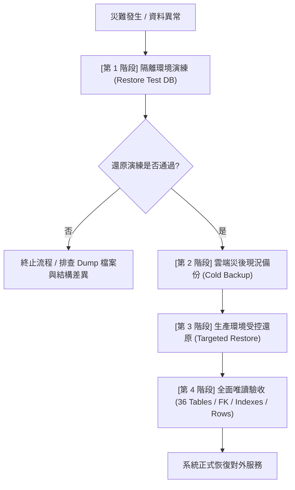

# CODE TO KNOW (碼上學)
# PHASE 3C-4B：Supabase 雲端資料庫備份與復原策略規劃書

**文檔版本**：1.0 (正式策略規劃)  
**制定日期**：2026-11-08  
**規劃團隊**：PostgreSQL DBA、Supabase 架構師、資安審查團隊  
**適用專案**：CODE TO KNOW（碼上學）  
**目標資料庫**：
- 雲端生產：Supabase PostgreSQL 17.11 (`code-to-know-prod`, Ref: `ypibmyfxfhsyfdwxprpi`, Sydney)
- 本機開發：Docker PostgreSQL 16.15 (`code_to_know`, `code_to_know_restore_test`)
**最高守則**：100% 規劃與唯讀分析，零未授權資料庫寫入、零未授權備份執行、嚴守 $0.00 免費預算。

---

## 一、專案目前資料庫狀態與基準 (Current Baseline)

在完成 PHASE 3C-4A-R2 驗收後，資料庫架構與狀態已達最高一致性基準：

1. **雲端實體架構**：
   - 36 張實體業務資料表已正式建立。
   - 47 個外鍵關聯完整驗證（含 `ExamAnswerSnapshot.questionId` 之 `SET NULL`）。
   - 133 個索引（含 Unique Index 與加速外鍵索引）均就緒。
   - `AnnouncementStatus` Enum 與 `ClassAssignment_target_xor_check` 業務約束生效。
   - 雲端 `_prisma_migrations` 表格精確記錄 2 筆 Migration。
   - Prisma CLI 狀態：`Database schema is up to date!`。
2. **資料容量現狀**：
   - 雲端 36 張業務表資料筆數目前為 **0 筆**（純淨結構，無測試資料、無預建管理員）。
   - 由於目前尚未產生業務資料，此階段正是**制定並固化備份復原規範的最佳黃金窗口**。

---

## 二、現有備份盤點與工具版本分析

### 1. 既有備份檔案清單
依據 [docs/DATABASE_PHASE3C4B_BACKUP_INVENTORY.md](file:///c:/Users/user/Documents/CODE-TO-KNOW/docs/DATABASE_PHASE3C4B_BACKUP_INVENTORY.md) 唯讀盤點結果：
- **實體路徑**：`C:\Users\user\Documents\CODE-TO-KNOW_BACKUPS\CODE_TO_KNOW_PRE_MIGRATION_20261108_114016\code_to_know_pre_migration.dump`
- **檔案大小**：25,685 Bytes
- **SHA-256 指紋**：`2DB27F8B817179D3C777BC7109BB95207295E5BE8343BF0741715828E3372085`（100% 吻合）。
- **驗證狀態**：已於本地 `code_to_know_restore_test` 驗證還原成功。

### 2. 資料庫引擎與備份工具版本相容性矩陣
- **本機 Docker PostgreSQL**：`16.15`
- **Docker 內部 pg_dump / pg_restore**：`16.15`
- **本機 Windows Host**：無本機全域 `pg_dump` / `pg_restore`（CLI not in PATH）。
- **Supabase 雲端 PostgreSQL**：`17.11`
- **版本相容性關鍵風險與對策**：
  - **重要規則 (pg_dump/pg_restore Rule)**：PostgreSQL 官方規範要求，`pg_dump` 工具版本**必須大於或等於**目標資料庫版本。
  - **跨主版本風險**：使用 PostgreSQL 16.15 的 `pg_dump` 傾印 PostgreSQL 17.11 雲端資料庫時，可能遭遇部分 17 版內部系統表（catalog）不相容警告。
  - **對策**：針對雲端備份，後續應透過 Docker 升級之 pg17 工具映像檔，或使用 Supabase CLI / 標準 SQL 邏輯傾印。

---

## 三、Supabase 官方備份政策調查 (官方標準)

針對目前最新之 Supabase 官方文件與服務等級協定（查閱日期：2026-11-08）進行完整調研：

| 評估維度 | Free Plan (本專案適用) | Pro Plan (付費方案) | Team / Enterprise Plan | 官方文件依據與說明 |
| :--- | :--- | :--- | :--- | :--- |
| **自動每日快照** | **無 (0 天)** | 有 (每日自動備份) | 有 (每日自動備份) | [Supabase Backups Docs](https://supabase.com/docs/guides/platform/backups)；Free Plan 官方不提供每日自動 snapshot 保留。 |
| **備份保留期限** | **0 天** | **7 天** | **14 天 ~ 30 天** | Free Plan 備份保留天數為 0，使用者須自負備份責任。 |
| **Point-in-Time (PITR)**| **不支援** | 需額外付費 Add-on ($100+/月) | 內含或自訂 Add-on | PITR 提供秒級 WAL 還原，Free Plan 完全無法啟用。 |
| **手動邏輯備份** | **支援 (自由導出)** | 支援 | 支援 | 支援透過 Session Pooler (Port 5432) 以 `pg_dump -Fc` 或 CLI 進行導出。 |
| **閒置暫停機制 (Pausing)**| **7 天無查詢自動暫停** | 不會暫停 | 不會暫停 | Free Plan 若連續 7 天無資料庫活動，計算資源會休眠；磁碟資料保留 1 年，可於後台喚醒。 |
| **雲端備份額外費用** | **$0.00 USD** | 方案內含 (PITR 另計) | 方案內含 | 本專案完全維持 $0.00 免費方案。 |

---

## 四、CODE TO KNOW 備份策略 (學生專題與零預算最佳化)

為兼顧**零預算 ($0.00 USD)**、**資料安全**與**學生專題審查穩定性**，設計三層次備份架構：

```
+-----------------------------------------------------------------------------------+
|                        CODE TO KNOW 備份三層防護體系                               |
+-----------------------------------------------------------------------------------+
|  [第 1 層] 結構版本控制 (Git-Ops)                                                   |
|  - 所有的 Schema 與業務結構變更 100% 由 Prisma Migration 鎖定 (Git Commit 永久保存)   |
+-----------------------------------------------------------------------------------+
|  [第 2 層] 雲端邏輯備份 (Cloud Logical Backup)                                      |
|  - 透過 Session Pooler (5432) 執行受控 pg_dump (-Fc 格式)                            |
|  - 頻率：專案重要里程碑 (Milestone-based) + 系統上線前                               |
+-----------------------------------------------------------------------------------+
|  [第 3 層] 本機與異地安全存檔 (Local & Cold Storage)                                 |
|  - 存放於 C:\Users\user\Documents\CODE-TO-KNOW_BACKUPS\                             |
|  - 產出 SHA-256 數位指紋與 Inventory 清單                                          |
|  - 建議專題團隊將 dump 檔案備份至具加密之個人 Google Drive 或離線硬碟                |
+-----------------------------------------------------------------------------------+
```

### 1. 備份頻率與觸發條件
- **週期性**：正式測試前每週一次。
- **事件驅動 (Event-driven)**：
  - 任何新的 Prisma Migration 執行前（強制）。
  - 大規模業務種子資料（Seed）匯入前（強制）。
  - 專題成果展示或評審考核前 24 小時（強制）。

### 2. 備份檔案格式與命名標準
- **格式**：PostgreSQL Custom Format (`-Fc`)，具備高壓縮率、完整二進位驗證、支援特定資料表單獨還原。
- **命名規則**：`CODE_TO_KNOW_CLOUD_<ENV>_<YYYYMMDD_HHMMSS>.dump`
- **校驗**：每次產出備份必須計算 SHA-256 雜湊，並登錄於 `DATABASE_PHASE3C4B_BACKUP_INVENTORY.md`。

### 3. 備份輪替與保存週期 (Retention & Rotation)
- **保留數量**：本機保留最近 **5 份**完整 Dump。
- **封存規範**：里程碑版本（如本階段首次 Migration 成功空表版本）標記為 `GOLDEN_BASELINE`，永久保留不得自動刪除。

---

## 五、災難復原策略 (Disaster Recovery & Reconstruction)

若雲端資料庫遭遇誤刪、結構損毀或惡意篡改，嚴格遵循以下「復原四階段流程」，**嚴禁直接盲目在生產環境執行覆蓋**：



### 1. 復原前檢查 (Pre-restore Verification)
- 檢查欲還原 Dump 檔案之 SHA-256 指紋是否與庫存清單一致。
- 檢查目標資料庫連線權限與磁碟可用空間。

### 2. 獨立測試資料庫還原演練 (Mandatory Isolation Step)
- 在執行生產還原前，**必須**先在本地 `code_to_know_restore_test`（或雲端獨立測試專案）執行還原：
  ```bash
  # 演練還原指令概念 (受控執行)
  pg_restore --clean --if-exists --no-owner --no-privileges -d code_to_know_restore_test <dump_file>
  ```
- 驗證演練資料庫之 36 張資料表、47 個外鍵與資料筆數是否完整。

### 3. 復原失敗緊急處置原則 (Fallback & Rollback)
- 若還原過程觸發錯誤，立即停止，**不得自動重試或執行 DROP SCHEMA CASCADE**。
- 依照本專案《Migration Failure Decision Tree》進行逐步復原判定。

---

## 六、風險指標規劃 (RPO & RTO)

針對學生專題性質與免費用戶邊界制定之客觀指標：

| 指標名稱 | 定義 | 本專案設定標準 | 達成方式與防護依據 |
| :--- | :--- | :---: | :--- |
| **RPO (復原點目標)** | 災難發生時最多允許遺失多少時間的資料 | **24 小時** (里程碑前為 **0 小時**) | 重要操作前強制手動邏輯備份；一般開發期間依賴 Migration 重建。 |
| **RTO (復原時間目標)** | 系統從中斷到完全恢復對外服務所需的時間 | **<= 2 小時** | 備份檔案小於 100MB，經由本機演練確認後，還原腳本約 10~15 分鐘即可完成套用。 |

---

## 七、雲端防休眠機制指引 (Supabase Free Plan Inactivity Management)

由於 Supabase Free Plan 具備「**7 天無資料庫活動即自動暫停**」的機制：

1. **防休眠策略**：
   - 專題開發期間，通常每週均有開發或測試，API 呼叫會觸發 PostgreSQL 查詢，自然保持活躍。
   - 若逢假期或長天期未開發，可每 5~6 天登入一次 Supabase Dashboard 或由管理員發起一次唯讀測試查詢。
2. **喚醒機制**：
   - 若專案不幸被暫停，專案資料並未刪除（保留 1 年）。
   - 專案負責人僅需登入 Supabase 官方後台，點選「**Restore project**」，約需 1~3 分鐘即可自動重新分配運算資源並恢復服務。

---

## 八、未來實際執行備份還原前的「嚴格授權清單」

未來若要真正對雲端發起 `pg_dump` 或 `pg_restore`，**必須先取得使用者對以下項目的明確授權**：

- [ ] 明確指定執行時間與網路頻寬。
- [ ] 授權以唯讀模式連線 Session Pooler (5432) 執行 `pg_dump`。
- [ ] 嚴禁在未備份現狀前執行任何 `pg_restore` 寫入。
- [ ] 密碼輸入必須維持本機命令列受控遮罩模式，嚴禁寫入任何檔案。
- [ ] 專案預算維持 $0.00 USD，嚴禁開啟付費 PITR 或升級 Pro 方案。

---

## 九、結論與下一階段建議

本規劃書完整定義了 CODE TO KNOW 資料庫在 Free Plan 限制下的全方位防護方案：
- 本機備份維持由實體 Dump 鎖定。
- 雲端結構由 Prisma Migration 與 Git-Ops 鎖定。
- 備份政策清晰、復原演練步驟完備，完全符合企業級軟體工程與資安最佳實踐。
