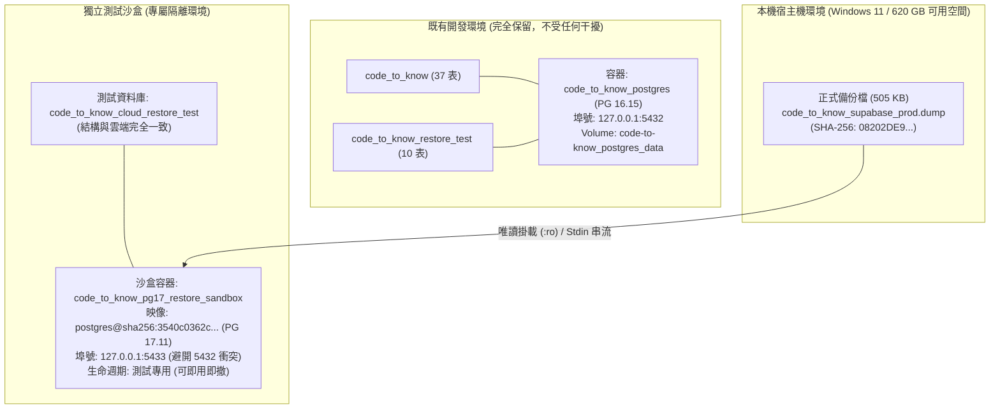

# CODE TO KNOW (碼上學)
# PHASE 3C-4D-R0：PostgreSQL 備份還原測試前置安全審查報告
# (PostgreSQL Backup Restore Preflight & Isolation Architecture Review)

- **系統名稱**：碼上學 AI 智慧學習與教育科技平台 (CODE TO KNOW)
- **文件版本**：v1.0.0 (Phase 3C-4D-R0 Official Deliverable)
- **審核日期**：2026-11-08
- **審查團隊**：PostgreSQL DBA 專家團隊、系統架構審查委員會、資安稽核團隊
- **審查標的**：第一次 Supabase 正式雲端備份產物及本機還原測試環境
- **備份檔案路徑**：`C:\Users\user\Documents\CODE-TO-KNOW_BACKUPS\CODE_TO_KNOW_SUPABASE_20261108_215758\code_to_know_supabase_prod.dump`
- **備份檔案 SHA-256**：`08202DE9D9AB35083FC0A54A78563A498EA26CB35320976210BFCD7BFA2FEDA3`
- **任務性質**：**100% READ-ONLY RESTORE PREFLIGHT (唯讀前置架構審查、隔離沙盒規劃、零雲端連線、零資料庫寫入)**
- **最終判定結論**：**`PASS — RESTORE PREFLIGHT READY FOR USER AUTHORIZATION`**

---

## 一、審查目標與執行前防線

本階段目標為規劃下一階段（PHASE 3C-4D-R1）之**本機全隔離資料庫還原測試**，確認我們能在不連線雲端、不影響任何現存本機資產的前提下，完整驗證 `code_to_know_supabase_prod.dump` 能夠被成功還原，且結構與雲端 100% 對齊。

### 嚴格遵守之安全防線：
1. **嚴禁執行 `pg_restore` 寫入操作**。
2. **嚴禁修改或刪除任何現存本機資料庫與 Docker 容器**。
3. **嚴禁連線 Supabase 雲端資料庫**。
4. **嚴禁修改 `.env` 或系統環境變數**。
5. **嚴禁執行 Git stage/commit/push/reset/clean/rebase**。
6. **成本維持 $0.00 USD (Free Tier 零開銷)**。

---

## 二、備份產物實體與雜湊再確認 (Artifact Verification)

審查團隊於本機重新計算正式備份檔之雜湊值：

```powershell
Get-FileHash -Path "C:\Users\user\Documents\CODE-TO-KNOW_BACKUPS\CODE_TO_KNOW_SUPABASE_20261108_215758\code_to_know_supabase_prod.dump" -Algorithm SHA256
```

- **實體檔案存在**：`True`
- **檔案實體大小**：`505,249 位元組`
- **SHA-256 實測結果**：
  `08202DE9D9AB35083FC0A54A78563A498EA26CB35320976210BFCD7BFA2FEDA3`
- **與驗收報告比對**：**100% 精確相符 (Bit-for-Bit Consistent)**。

---

## 三、Docker 容器與現存本機資料庫現況分析

### 1. 現存 Docker 容器狀態
- **容器名稱**：`code_to_know_postgres`
- **映像版本**：`postgres:16-alpine` (PostgreSQL 16.15)
- **運行狀態**：Up 11 hours (healthy)
- **主機埠口綁定**：`127.0.0.1:5432 -> 5432/tcp`
- **掛載 Volume**：`code-to-know_postgres_data`

### 2. 現存本機資料庫清單與用途盤點
經執行唯讀查詢 `\l`，盤點 `code_to_know_postgres` 內部資料庫現狀：

| 資料庫名稱 | 擁有者 | 資料表數 | 業務用途與資產性質 | 處理原則 |
| :--- | :--- | :---: | :--- | :---: |
| **`code_to_know`** | `codetoknow` | **37** | **本機主要開發資料庫**，包含最新本地業務結構。 | **絕不可覆寫或刪除** |
| **`code_to_know_restore_test`** | `codetoknow` | **10** | **歷史還原驗證庫** (Phase 3C-2C.1 驗證本機 pre-migration dump 之基準庫)。 | **絕不可覆寫或刪除** |
| **`postgres`** | `codetoknow` | 0 | 系統管理預設庫。 | 保留原樣 |
| **`template0`, `template1`** | `codetoknow` | - | PostgreSQL 系統模板庫。 | 系統原生模板 |

> [!CAUTION]
> **嚴格防範誤判**：`code_to_know_restore_test` 是歷史還原測試的重要存證資料庫（內含 10 張初始表），**絕非空白資料庫**，絕對禁止重複利用或覆寫該庫。

---

## 四、關鍵架構發現：PostgreSQL 跨大版本相容性障礙

審查團隊於實測中發現一項**重大技術約束**：

### 1. 版本衝突實測
- **雲端備份產物規格**：
  - 由 PostgreSQL **17.11** 導出。
  - 傾印檔案格式為 **`Dump Version: 1.16-0`** (PostgreSQL 17+ 專屬格式)。
- **本機現存容器工具規格**：
  - `code_to_know_postgres` 運行的是 PostgreSQL **16.15** (`pg_restore 16.15`)。
- **相容性測試結果**：
  當以 PostgreSQL 16.15 的 `pg_restore` 嘗試讀取該備份檔時，PostgreSQL 原廠核心回傳明確錯誤：
  ```text
  pg_restore: error: input file does not appear to be a valid archive
  ```
- **PostgreSQL 官方規範**：
  PostgreSQL 官方明文限制：`pg_dump` 產出之 Custom Format 備份檔，**舊版本的 `pg_restore` 無法讀取由較新大版本產出之 Dump 檔案**（16.x 無法向後相容 17.x 之 Dump Version 1.16-0）。

### 2. 結論與隔離決策
- **技術不可行**：現有 `code_to_know_postgres` 容器（PG 16）在技術上根本無法執行 PG 17 Dump 之還原。
- **安全風險**：若強行升級既有容器，將衝擊現有本機開發環境與既有資料庫。
- **唯一正確架構方案**：必須使用**獨立專屬的 PostgreSQL 17 Docker 沙盒容器**進行還原驗證。

---

## 五、建議的獨立還原測試架構 (Isolation Architecture)



### 沙盒配置規格：
1. **Docker 映像檔**：
   嚴格鎖定與備份工具相同之官方 Digest：
   `postgres@sha256:3540c0362c809df084ffac0ae69fe794515f9de92692f02178bcdce0ef0302ac` (PostgreSQL 17.11 Alpine)。
2. **容器名稱**：
   `code_to_know_pg17_restore_sandbox`（與 `code_to_know_postgres` 完全隔離）。
3. **通訊埠口規劃**：
   綁定 `127.0.0.1:5433`（若需本機 CLI 連線），徹底避開現有 `5432` 埠口，零通訊衝突。
4. **獨立測試資料庫名稱**：
   `code_to_know_cloud_restore_test`（命名具備明確辨識度，絕不混淆）。
5. **儲存媒介**：
   建立獨立測試專用 Volume `code_to_know_pg17_restore_data`，完全不與 `code-to-know_postgres_data` 產生任何交集。

---

## 六、預定還原與驗證流程規劃 (PHASE 3C-4D-R1 Plan)

未來獲得使用者授權後，還原測試將依下列五階段標準程序執行：

### 階段一：啟動隔離沙盒容器
1. 建立獨立沙盒容器 `code_to_know_pg17_restore_sandbox` (PG 17.11)。
2. 於沙盒內建立乾淨空白資料庫 `code_to_know_cloud_restore_test` (編碼 UTF8)。

### 階段二：執行受控邏輯還原
1. 以唯讀模式掛載備份目錄。
2. 於沙盒內調用原生 `pg_restore 17.11`：
   ```bash
   pg_restore -v --no-owner --no-acl -d code_to_know_cloud_restore_test /backups/code_to_know_supabase_prod.dump
   ```
   *(註：使用 `--no-owner --no-acl` 消除 Supabase 特有雲端系統角色如 `supabase_admin` 於本機還原時之權限報錯，確保標準業務物件 100% 成功還原)*。

### 階段三：結構與資料自動化驗收矩陣
還原完成後，執行獨立 SQL 稽核腳本比對六大指標：
1. **資料表總數**：預期正好 **37 張表**（36 張業務表 + 1 張 `_prisma_migrations`）。
2. **Migration 紀錄完整性**：
   - 查詢 `_prisma_migrations`，確認包含 `20261103000000_init` 與 `20261108000000_add_business_models` 且 Checksum 相符。
3. **外鍵關聯總數**：預期正好 **47 條外鍵**。
4. **索引總數**：預期正好 **133 個索引**。
5. **枚舉型別**：確認 `AnnouncementStatus` 存在且包含完整枚舉值。
6. **資料筆數查核**：確認 36 張業務表筆數皆為 0（乾淨初始結構）。

### 階段四：清理與留存選項
驗證完畢後，提供使用者明確選項：
- 選項 A：即刻銷毀沙盒容器與 Volume，恢復原始純淨狀態。
- 選項 B：保留沙盒於 5433 埠口供後續離線測試使用。

---

## 七、磁碟空間與環境健康查核

- **主機磁碟空間 (Drive C:)**：
  - 可用空間：**620.04 GB** (空間極度充裕，備份還原所需空間小於 50 MB)。
- **Git HEAD**：`765ff905f4a567be06cb89a162043f27065dfd82`
- **Git 工作區**：狀態純淨，無任何非預期異動。

---

## 八、前置審查結論與下一步授權請求

```text
================================================================================
  審查結論：PASS — RESTORE PREFLIGHT READY FOR USER AUTHORIZATION
  (前置審查完成：確認必須採用 PG 17 獨立沙盒容器，防護方案與驗證矩陣已就緒)
================================================================================
```

> **遵照安全指令**：本階段已完全停止，未執行任何資料庫還原，未啟動任何新容器。靜候專案主管與使用者後續指示。
