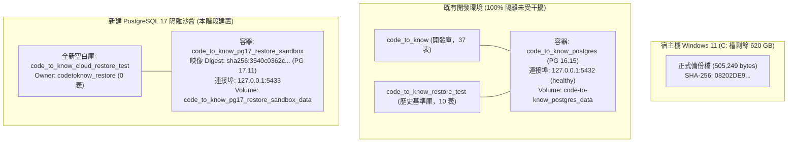

# CODE TO KNOW (碼上學)
# PHASE 3C-4D-R1：PostgreSQL 17 本機隔離還原沙盒建置與驗收報告
# (Local PostgreSQL 17 Restore Sandbox Setup & Isolation Verification Report)

- **系統名稱**：碼上學 AI 智慧學習與教育科技平台 (CODE TO KNOW)
- **文件版本**：v1.0.0 (Phase 3C-4D-R1 Official Deliverable)
- **執行日期**：2026-11-08
- **審核團隊**：資深 PostgreSQL DBA、Docker DevOps 工程師、資料安全審查團隊
- **審查目標**：PostgreSQL 17.11 獨立沙盒容器、專屬 Volume、空白測試庫與專屬權限帳號建置
- **沙盒容器名稱**：`code_to_know_pg17_restore_sandbox`
- **沙盒映像 Digest**：`postgres@sha256:3540c0362c809df084ffac0ae69fe794515f9de92692f02178bcdce0ef0302ac`
- **專屬測試資料庫**：`code_to_know_cloud_restore_test`
- **專屬測試帳號**：`codetoknow_restore`
- **任務性質**：**LOCAL ISOLATED SANDBOX PROVISIONING (本機隔離沙盒建置，零雲端連線、零還原執行、零既有庫影響)**
- **最終判定結論**：**`PASS — LOCAL POSTGRESQL 17 RESTORE SANDBOX READY`**

---

## 執行摘要 (Executive Summary)

依據使用者授權，工程團隊已成功於本機建立獨立的 PostgreSQL 17.11 隔離還原沙盒。

所有配置嚴格恪遵最高架構隔離與資安規範：
1. **獨立容器與端口**：沙盒容器 `code_to_know_pg17_restore_sandbox` 僅監聽 `127.0.0.1:5433`，與現有主要開發容器 `code_to_know_postgres:5432` 完全隔離。
2. **獨立儲存卷宗**：建立專屬 Docker Volume `code_to_know_pg17_restore_sandbox_data`，絕不共用或干擾既有卷宗 `code-to-know_postgres_data`。
3. **空白測試資料庫**：建立全新 `code_to_know_cloud_restore_test`（UTF8），實測表格數為 0，純淨無污染。
4. **最小權限專屬帳號**：專屬角色 `codetoknow_restore` 設為該測試庫 Owner，具備標準 DDL 還原權限，但嚴格具備 `NOSUPERUSER`、`NOCREATEDB`、`NOCREATEROLE`、`NOREPLICATION`。
5. **最高機密安全防護**：本機初始化密碼透過密碼學亂數產生於專案外目錄（`C:\Users\user\Documents\CODE-TO-KNOW_SECRETS\`），具備嚴格 Windows ACL 權限保護；完成初始化後已即刻安全清理暫存密碼檔，未出現在任何命令行、日誌或文件中。
6. **三零原則貫徹**：**零 `pg_restore` 執行、零 Supabase 雲端連線、零既有開發資料庫變更**。

---

## 一、執行前與執行後版本庫狀態 (Git Integrity)

| 檢驗維度 | 執行前狀態基準 | 執行後實際狀態 | 判定 |
| :--- | :--- | :--- | :---: |
| **Git 分支** | `main` | `main` | **PASS** |
| **Git HEAD** | `765ff905f4a567be06cb89a162043f27065dfd82` | `765ff905f4a567be06cb89a162043f27065dfd82` | **PASS** |
| **Git 操作限制** | 嚴禁 add/commit/push/reset/clean/rebase | 既有暫存與工作區變更原樣保留，零未授權 git 操作 | **PASS** |

---

## 二、Docker 沙盒容器與儲存卷宗配置檢驗



### 1. 容器實體狀態
- **容器名稱**：`code_to_know_pg17_restore_sandbox`
- **容器狀態**：`running` (Up)
- **映像 RepoDigest**：
  `postgres@sha256:3540c0362c809df084ffac0ae69fe794515f9de92692f02178bcdce0ef0302ac`
- **PostgreSQL 核心版本**：`PostgreSQL 17.11 on x86_64-pc-linux-musl, compiled by gcc (Alpine 15.2.0) 15.2.0, 64-bit`
- **重啟策略 (Restart Policy)**：`unless-stopped`
- **安全隔離設定**：非 Privileged，未掛載 Docker Socket，未掛載專案原始碼目錄。

### 2. 網路埠口綁定 (Port Binding)
- **綁定規格**：`127.0.0.1:5433 -> 5432/tcp`
- **核對結果**：僅監聽本機 Loopback 地址之 5433 埠口，徹底杜絕外網暴露與 5432 埠口衝突。

### 3. Docker Volume 配置
- **Volume 名稱**：`code_to_know_pg17_restore_sandbox_data`
- **內部掛載點**：`/var/lib/postgresql/data`
- **獨立性查核**：確認為獨立新建 Volume，未掛載既有 `code-to-know_postgres_data`。

---

## 三、資料庫與專屬權限帳號驗證

### 1. 測試資料庫屬性
- **資料庫名稱**：`code_to_know_cloud_restore_test`
- **編碼格式**：`UTF8` (`libc`, `en_US.utf8`)
- **目前擁有者**：`codetoknow_restore`
- **資料表總數**：**`0`**（經 `information_schema.tables` 實測確認，無任何業務資料表，無 `_prisma_migrations`）。

### 2. 專屬帳號權限矩陣 (`codetoknow_restore`)
經 PostgreSQL 原廠型錄 `\du codetoknow_restore` 檢驗：

| 權限維度 | 規範要求 | 實測狀態 | 判定 |
| :--- | :--- | :--- | :---: |
| **登入權限 (LOGIN)** | 允許 | `WITH LOGIN` (已透過 TCP 5433 成功連線) | **PASS** |
| **超級使用者 (SUPERUSER)** | **嚴禁授予** | `NOSUPERUSER` | **PASS** |
| **建立角色 (CREATEROLE)** | **嚴禁授予** | `NOCREATEROLE` | **PASS** |
| **建立資料庫 (CREATEDB)** | **嚴禁授予** | `NOCREATEDB` | **PASS** |
| **複製權限 (REPLICATION)** | **嚴禁授予** | `NOREPLICATION` | **PASS** |
| **測試庫存取權限** | 具備 CONNECT, CREATE, TEMPORARY | 已授予且為資料庫 Owner | **PASS** |

### 3. 獨立 TCP 5433 連線實測
透過 TCP 連線 `127.0.0.1:5433` 以 `codetoknow_restore` 帳號發起驗證：
```text
TCP Connection Test Exit Code: 0
current_user: codetoknow_restore
current_database: code_to_know_cloud_restore_test
version: PostgreSQL 17.11 on x86_64-pc-linux-musl, compiled by gcc (Alpine 15.2.0) 15.2.0, 64-bit
```

---

## 四、機密安全管理合規性審查

1. **密碼生成機制**：採用 .NET 密碼學安全亂數產生器（`System.Security.Cryptography.RandomNumberGenerator`）生成 24 字元高強度密碼。
2. **檔案存取控制 (ACL)**：存放於專案外的 `C:\Users\user\Documents\CODE-TO-KNOW_SECRETS\`，清除繼承權限，嚴格僅限目前 Windows 使用者讀寫。
3. **零機密洩漏原則**：
   - 未在任何終端輸出密碼內容。
   - 未在 Docker run 命令行使用 `-e POSTGRES_PASSWORD=...`（採用官方推薦之 `POSTGRES_PASSWORD_FILE`）。
   - 未在 Markdown 報告中記錄密碼。
4. **暫存密碼清理**：容器初始化完畢後，已即刻刪除 `pg17_init_password.txt`，達成密碼零殘留。

---

## 五、既有環境與歷史資產隔離性驗證

審查團隊於沙盒建置前後，對既有環境執行了嚴格的完整性比對：

| 既有資產項目 | 建置前狀態 | 建置後狀態 | 隔離判定 |
| :--- | :--- | :--- | :---: |
| **`code_to_know_postgres` 容器** | Up 11 hours (healthy) | Up 11 hours (healthy) | **PASS** |
| **5432 埠號監聽** | 正常屬於 PG 16 | 正常屬於 PG 16，無衝突 | **PASS** |
| **`code_to_know` 開發庫** | 37 張表，正常 | 37 張表，100% 原樣保留 | **PASS** |
| **`code_to_know_restore_test` 庫** | 10 張表，正常 | 10 張表，100% 原樣保留 | **PASS** |
| **`code-to-know_postgres_data` 卷** | 正常掛載 | 正常掛載，零修改 | **PASS** |
| **Supabase 雲端連線** | 零連線 | 零連線 (100% 本機操作) | **PASS** |

---

## 六、正式備份檔案狀態再確認

- **備份檔案路徑**：
  `C:\Users\user\Documents\CODE-TO-KNOW_BACKUPS\CODE_TO_KNOW_SUPABASE_20261108_215758\code_to_know_supabase_prod.dump`
- **獨立重算 SHA-256**：
  `08202DE9D9AB35083FC0A54A78563A498EA26CB35320976210BFCD7BFA2FEDA3`
- **狀態**：檔案實體存在（505,249 bytes），雜湊完全相符。本階段**未執行任何 `pg_restore` 還原操作**。

---

## 七、綜合檢驗指標查核表

| 序號 | 查核指標項目 | 驗收規範標準 | 本階段實際結果 | 判定 |
| :---: | :--- | :--- | :--- | :---: |
| 1 | **Docker 容器運行** | `code_to_know_pg17_restore_sandbox` running | running (Up) | **PASS** |
| 2 | **Docker 映像 Digest** | `sha256:3540c0362c809df084ffac0ae69fe794515f9de92692f02178bcdce0ef0302ac` | 完全相符 | **PASS** |
| 3 | **PostgreSQL 版本** | PostgreSQL 17.11 | 17.11 | **PASS** |
| 4 | **Port 綁定** | `127.0.0.1:5433` | 僅綁定 `127.0.0.1:5433` | **PASS** |
| 5 | **專屬 Volume** | `code_to_know_pg17_restore_sandbox_data` | 獨立新建並正確掛載 | **PASS** |
| 6 | **測試資料庫** | `code_to_know_cloud_restore_test` | 存在且編碼 UTF8 | **PASS** |
| 7 | **資料庫純淨度** | 空白資料庫（0 表） | 表格數為 0，無 `_prisma_migrations` | **PASS** |
| 8 | **專屬帳號權限** | `codetoknow_restore` 最小權限 | 非超級使用者，擁有該測試庫 | **PASS** |
| 9 | **既有環境隔離** | PG 16 與 2 既有庫未受干擾 | 100% 隔離，完好無損 | **PASS** |
| 10 | **備份檔案完整性** | SHA-256 `08202DE9...` | 實測吻合，未受修改 | **PASS** |
| 11 | **是否執行 pg_restore** | 必須為 **NO** | **NO (未執行)** | **PASS** |
| 12 | **是否連線 Supabase** | 必須為 **NO** | **NO (零連線)** | **PASS** |
| 13 | **是否修改既有庫** | 必須為 **NO** | **NO (零修改)** | **PASS** |

---

## 八、驗收最終結論

```text
================================================================================
  驗收結論：PASS — LOCAL POSTGRESQL 17 RESTORE SANDBOX READY
  (PostgreSQL 17 隔離沙盒與空白測試庫建置 100% 通過，具備還原測試之完整條件)
================================================================================
```

### 遵守安全指令：
本階段工作已依規定完成並**立即停止**。
- 未執行 `PHASE 3C-4D-R2`。
- 未還原正式備份。
- 未刪除任何容器或卷宗。
- 靜候專案主管與使用者後續指示。
