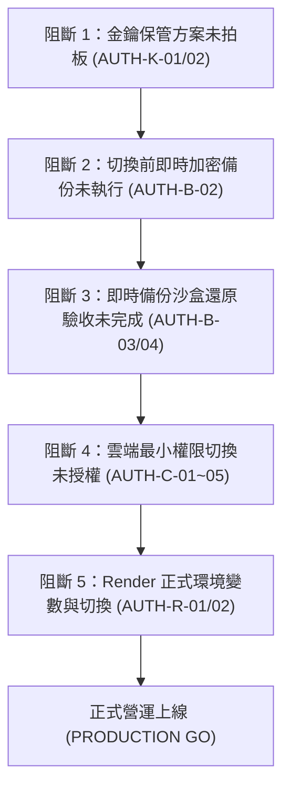

# CODE TO KNOW｜資料庫正式收尾 Phase 1：全階段進度盤點與待辦確認報告

**文件編號**：`docs/DATABASE_PHASE3C4F_FINAL_COMPLETION_INVENTORY.md`  
**盤點日期**：2026 年 11 月 10 日  
**專案名稱**：碼上學｜CODE TO KNOW — AI 智慧學習與教育科技平台  
**審查人員**：資深 PostgreSQL DBA、Supabase 資料庫安全架構師、DevSecOps 工程師  
**審查性質**：100% 唯讀盤點與架構審查（零雲端連線、零憑證注入、零資料寫入、零 Git 變更）  
**當前資料庫上線判定**：**NO-GO / 嚴格阻斷（STRICTLY BLOCKED）**

---

## 一、PHASE 3C-4F-R8 至 R14 階段完成狀態總表

本表嚴格依據**客觀實體證據**（程式碼、日誌、實體檔案）進行分類，杜絕將「文件規劃」誤植為「實際執行」：

| 階段代號 | 階段核心任務 | 交付關鍵文件 | 實作現況分類 | 最終判定 | 關鍵證據與事實說明 |
| :---: | :--- | :--- | :---: | :---: | :--- |
| **R8** | 正式環境安全設定與變數規劃 | `...R8_PRODUCTION_SECURITY_CONFIGURATION_PLAN.md`<br>`...R8_PRODUCTION_CUTOVER_CHECKLIST.md` | **文件規劃** | PASS | 盤點 8 項必要環境變數、角色矩陣與切換檢核表；**Render 與 Supabase 尚未執行配置** |
| **R9** | Session/Token 逾期清理機制 | `...R9_SESSION_TOKEN_CLEANUP_DESIGN.md`<br>`...R9_SESSION_TOKEN_CLEANUP_CHECKLIST.md` | **文件規劃** | PASS | 釐清 3 款 Token 模型與邏輯/實體清理差異；**未在資料庫建立清理排程或 Trigger** |
| **R10** | 異地備份與自動排程規劃 | `...R10_BACKUP_ARCHITECTURE_PLAN.md`<br>`...R10_BACKUP_SECURITY_CHECKLIST.md` | **文件規劃** | PASS | 評估 GitHub Actions + R2 零成本異地架構；**尚未部署自動排程** |
| **R11** | 全鏈路封關總結與就緒評估 | `...R11_FINAL_POSTGRESQL_READINESS_ASSESSMENT.md`<br>`...R11_FINAL_GO_NO_GO_CHECKLIST.md` | **架構評估** | CONDITIONAL GO | 核定具備切換前置條件，列出 5 大前置阻擋項目 |
| **R12** | 切換前最終檢核與修復計畫 | `...R12_PRE_CUTOVER_FINAL_CHECKLIST.md`<br>`...R12_PRE_CUTOVER_REMEDIATION_PLAN.md` | **架構評估** | PASS | 揭露 Render 使用單一 postgres 超級使用者與缺少 verify-full 之資安隱患 |
| **R13** | 技術正確性審查與安全實作路徑 | `...R13_TECHNICAL_CORRECTNESS_AUDIT.md`<br>`...R13_SAFE_IMPLEMENTATION_ROADMAP.md` | **架構評估** | PASS | 確立 R14 四大工程分期（R14A 授權、R14B 工具、R14C 權限、R14D 遷移） |
| **R14-A** | 變更矩陣與前置審查 | `...R14A_CHANGE_AND_AUTHORIZATION_MATRIX.md`<br>`...R14A_IMPLEMENTATION_PREFLIGHT_AUDIT.md` | **架構評估** | PASS | 建立 AUTH-K/AUTH-B/AUTH-C 授權分級管制矩陣 |
| **R14-B** | AES-GCM 工具與 TLS verify-full | `...R14B_IMPLEMENTATION_REPORT.md`<br>`...R14B_IMPLEMENTATION_SPECIFICATION.md` | **已實際執行** | **100% PASS** | 實作 `backup-crypto.cjs` (14/14 測試通過)；升級 `database.ts` 載入 Root CA (105/105 通過) |
| **R14-C-0** | 最小權限實施計畫與 SQL 草案 | `...R14C0_MINIMUM_PRIVILEGE_IMPLEMENTATION_PLAN.md`<br>`...R14C0_SQL_REVIEW_AND_ROLLBACK_PLAN.md` | **文件規劃** | PASS | 設計 `app_runtime` 與 `migration_admin`；回滾腳本剔除 `DROP OWNED BY` |
| **R14-C-0.5** | SQL 靜態安全複核與權限矩陣 | `...R14C05_FINAL_SQL_SECURITY_REVIEW.md`<br>`...R14C05_PERMISSION_MATRIX_FINAL.md` | **文件規劃** | PASS | 修正 `migration_admin` 移除 CREATEDB；確認 AuditLog Append-Only 語法 |
| **R14-C-0.6** | 執行期權限與列舉驗證 | `...R14C06_RUNTIME_PERMISSION_FINAL_AUDIT.md`<br>`...R14C06_ENUM_AND_DEFAULT_PRIVILEGES_VERIFICATION.md` | **文件規劃** | PASS | 驗證自訂 Enum (`UserStatus`) 所有權轉移語法與 Default Privileges 繼承 |
| **R14-C-1-0** | 正式備份前置審查與金鑰規範 | `...R14C10_BACKUP_EXECUTION_PLAN.md`<br>`...R14C10_ENCRYPTION_KEY_MANAGEMENT.md` | **文件規劃** | PASS | 規劃第一次正式切換前備份步驟、金鑰雙人保管與還原驗收條件 |
| **R14-C-1-1** | 正式備份最終安全複核 | `...R14C11_FINAL_BACKUP_SECURITY_REVIEW.md`<br>`...R14C11_FINAL_GO_NO_GO_CHECKLIST.md` | **架構評估** | PARTIAL PASS | 備份腳本 DryRun 通過；**因使用者暫緩 Bitwarden/MFA，金鑰保管未落實** |
| **R14-C-1-2** | 簡化金鑰保管方案評估 | `...R14C12_LOCAL_KEY_CUSTODY_OPTIONS.md`<br>`...R14C12_NEXT_STEP_AND_BLOCKER_MATRIX.md` | **架構評估** | PARTIAL PASS | 評估 KeePassXC 與 BitLocker 隨身碟替代方案；**使用者尚未拍板建立** |
| **R14-C-1-3** | 本機工作盤點與路線圖規劃 | `...R14C13_FINAL_BLOCKER_MATRIX.md`<br>`...R14C13_NEXT_PHASE_ROADMAP.md` | **架構評估** | PARTIAL PASS | 確立雲端連線持續凍結，轉向本機 PG17 沙盒切換演練 |
| **R14-C-2-0** | PG17 沙盒演練前置安全審查 | `...R14C20_SANDBOX_EXECUTION_SAFETY_PLAN.md`<br>`...R14C20_SQL_STATIC_SECURITY_REVIEW.md` | **文件規劃** | PASS | 規劃獨立沙盒庫 `c2k_dryrun_sandbox`，鎖定測試角色字首 `c2k_test_*` |
| **R14-C-2-1** | PG17 沙盒最小權限實測演練 | `...R14C21_PG17_SANDBOX_EXECUTION_REPORT.md`<br>`...R14C21_CONTROLLED_ROLLBACK_REPORT.md` | **已實際執行 (本地沙盒)** | **100% PASS** | 實測還原 37 表、轉移所有權、AuditLog 防護、受控 7 步回滾；**揭露 RLS 阻斷與 Sequence 權限問題** |
| **R14-C-2-2** | RLS、BYPASSRLS 與 Sequence 審查 | `...R14C22_RLS_BYPASSRLS_SECURITY_REVIEW.md`<br>`...R14C22_SEQUENCE_PRIVILEGE_REVIEW.md`<br>`...R14C22_FINAL_SECURITY_DECISION.md` | **已實際執行 (唯讀審查)** | **100% PASS** | 查明 Supabase `ensure_rls` 特性確立 `BYPASSRLS`；Sequence 剔除 `UPDATE`；5 次 Exit Code 1 完整對帳 |

---

## 二、十大必須確認項目深度分析

### 1. R8 正式環境安全設定與資料庫權限規劃
- **已完成（文件規劃層級）**：
  - 盤點正式環境 8 大必要環境變數（`NODE_ENV`, `DATABASE_URL`, `DIRECT_URL`, `SESSION_SECRET`, `BCRYPT_ROUNDS`, `CORS_ORIGIN`, `FRONTEND_URL`, `VITE_API_URL`）。
  - 確認郵件服務在生產環境暫為 `DisabledEmailProvider`（服務停用，不發真信，無 SMTP 虛構變數）。
  - 制定切換檢核表。
- **未解決 / 變更事項**：
  - **TLS 模式升級**：R8 原規劃 `sslmode=require`，已於 R14-B-1 正式在程式碼中升級為強安全性的 `sslmode=verify-full` 並綁定官方 Root CA 憑證。
  - **雲端尚未套用**：Render Web Service 與 Supabase 尚未建立環境變數，尚未執行任何雲端切換。

### 2. AES-256-GCM 加密備份系統完成狀態
- **已完成（已實際執行層級）**：
  - 加解密核心模組 [`scripts/database/backup-crypto.cjs`](file:///c:/Users/user/Documents/CODE-TO-KNOW/scripts/database/backup-crypto.cjs) 開發完成。
  - 測試模組 [`scripts/database/backup-crypto.test.cjs`](file:///c:/Users/user/Documents/CODE-TO-KNOW/scripts/database/backup-crypto.test.cjs) 14 項極限邊界測試全數通過（Exit Code 0）。
  - 具備 C2KB Magic Header、安全隨機 12-byte Nonce、末端 16-byte Auth Tag 驗證與原子化 rename 防損壞機制。
- **尚未完成**：
  - 目前 `run_supabase_backup.ps1` 產出明文 `.dump`，加解密工具為獨立 Node CLI 模組，兩者尚未整合成全自動單一流水線指令。
  - 尚未產出任何正式 Supabase 雲端資料庫的加密備份實體檔。

### 3. 加密金鑰建立、保管與離線副本狀態
- **實質狀態**：**尚未執行（PENDING / 暫緩）**。
- **事實紀錄**：
  - R14-C-1-0 規劃 Bitwarden + MFA 方案。
  - R14-C-1-1 因使用者指示暫緩密碼管理器與 MFA，標記為 PARTIAL PASS。
  - R14-C-1-2 評估本地替代方案（KeePassXC 單機資料庫、BitLocker 加密隨身碟）。
  - **截至目前**：專案負責人尚未選定保管方案，**正式 AES-256 主金鑰尚未生成**（AUTH-K-01 尚未執行），**離線紙本復原卡尚未建立**（AUTH-K-02 尚未執行）。

### 4. Supabase 正式資料庫備份及還原驗證狀態
- **實質狀態**：**歷史備份已驗證，最新正式切換前備份尚未執行**。
- **客觀事實釐清**：
  - **歷史備份**：存在 2026-11-08 之備份檔 `code_to_know_supabase_prod.dump`（505,249 Bytes，SHA-256: `08202DE9...`），該檔案已在本地 PG17 沙盒（`code_to_know_pg17_restore_sandbox`）中完成 100% 還原驗證。
  - **切換前即時備份（AUTH-B-02）**：**尚未執行**。因正式金鑰未建立且雲端操作未授權，尚未連線 Supabase 執行切換前最後一刻的即時基準備份。
  - **即時備份還原驗收（AUTH-B-03、AUTH-B-04）**：**尚未執行**。

### 5. PG17 沙盒最小權限測試結果
- **實質狀態**：**已實際執行（100% PASS，僅限本地 Docker 沙盒）**。
- **實測數據與結論**（於本地容器 `code_to_know_pg17_restore_sandbox` 之 `c2k_dryrun_sandbox` 庫）：
  - 成功建立測試角色 `c2k_test_migration_admin` 與 `c2k_test_app_runtime`。
  - 成功轉移 37 張業務表與 1 個自訂 Enum 之所有權。
  - 成功驗證 7 步受控回滾程序：`pg_shdepend` 與 `pg_class` 殘留嚴格歸零，測試角色乾淨刪除，37 張表所有權 100% 復原為 `postgres`。
  - **重要邊界**：本項測試為**本機沙盒乾跑**，**絕不可視為 Supabase 正式環境已經切換**。

### 6. `app_runtime`、`migration_admin` 的權限與物件擁有權
- **架構規劃與代碼**：
  - `migration_admin`：DDL 管理角色，擁有所有 Table、Sequence、Type，具備 Schema CREATE 權限，禁止 SUPERUSER/CREATEDB。
  - `app_runtime`：API 執行期角色，僅具備 DML（SELECT/INSERT/UPDATE/DELETE），嚴格禁止 DDL 與 TRUNCATE，完全隔離 `_prisma_migrations`。
- **正式雲端現況**：
  - **Supabase 正式庫目前 0 角色建立**（兩個自訂角色均未在雲端執行 `CREATE ROLE`）。
  - **所有權尚未轉移**（雲端 37 張表目前擁有者仍為預設之 `postgres` 超級使用者）。

### 7. RLS、BYPASSRLS 與 Policies 的未解決問題
- **爭點與技術事實**（R14-C-2-1 揭露，R14-C-2-2 解決）：
  - Supabase 內建 Event Trigger `ensure_rls` 自動對 public 所有新表啟用 RLS。
  - 雲端現有 37 張表全部啟用 RLS，但 **Policies 數量為 0**。
  - 依 PostgreSQL 核心機制，在 0 Policies 下，非 Owner 且未配置 `BYPASSRLS` 的角色會觸發 **DEFAULT DENY ALL**（SELECT 返回 0 筆，INSERT/UPDATE 遭阻斷）。
- **最終裁決與解決方案**：
  - 正式切換草案中，將 `app_runtime` 屬性修正為 **`WITH BYPASSRLS`**。
  - **安全證明**：`BYPASSRLS` 僅跳過資料列政策，**絕對無法跳過 Table ACL**。後續針對 `AuditLog` 執行的 `REVOKE UPDATE, DELETE, TRUNCATE` 依然由 PostgreSQL 核心強制生效。

### 8. AuditLog 的權限與保護機制
- **已完成驗證（本地沙盒）**：
  - 沙盒實測以 `app_runtime` 嘗試寫入 `AuditLog`：INSERT 成功；UPDATE 拋出 `permission denied`；DELETE 拋出 `permission denied`；TRUNCATE 拋出 `permission denied`。
  - `has_table_privilege` 查詢確認 UPDATE/DELETE/TRUNCATE 權限值全數為 `false`。
- **正式環境現況**：
  - **尚未在 Supabase 正式庫生效**（雲端尚未執行收回權限 SQL）。

### 9. TLS、Session Pooler、連線驗證及憑證狀態
- **程式碼實作（已實際執行層級）**：
  - [`backend/src/config/database.ts`](file:///c:/Users/user/Documents/CODE-TO-KNOW/backend/src/config/database.ts) 實裝 `resolveProductionSslConfig()`，設定 `rejectUnauthorized: true`。
  - 實體 Root CA 憑證存於 [`backend/certs/prod-supabase-ca.crt`](file:///c:/Users/user/Documents/CODE-TO-KNOW/backend/certs/prod-supabase-ca.crt)，SHA-256 指紋為 `700723581420DD1AC98FD7E9AC529F0EF210EADCAF87FC868A3AD7D114C2F3B7`。
  - [`backend/src/config/db-validation.ts`](file:///c:/Users/user/Documents/CODE-TO-KNOW/backend/src/config/db-validation.ts) 強制綁定 Session Pooler 主機 `aws-0-ap-southeast-2.pooler.supabase.com`、Port `5432` 與使用者名稱格式 `<role>.<project_ref>`。
  - 後端 105 項單元與整合測試全數 PASS。
- **雲端連線現況**：
  - Phase 3C-3E 曾連線 Supabase 驗證通過 TLS 1.3 唯讀握手。
  - 但目前生產環境尚未切換至 `app_runtime` 帳號。

### 10. Render 正式環境切換及驗收的待辦事項
- **實質狀態**：**尚未執行（STRICTLY PENDING）**。
- **待辦清單**：
  1. Render 後端 Web Service（`code-to-know-api`）環境變數注入（`DATABASE_URL`, `SESSION_SECRET`, `CORS_ORIGIN`, `FRONTEND_URL`）。
  2. 部署觸發與 Build Log 檢驗。
  3. API 存活檢查（`/api/health` 探針）。
  4. 業務功能端到端驗收（使用者登入、Session 建立、AuditLog 寫入、防篡改攔截）。

---

## 三、四分法現況分類矩陣

| 分類層級 | 定義標準 | 涵蓋之專案項目 |
| :--- | :--- | :--- |
| **【類別 A：已實際執行】** | 具備實體程式碼、本機測試日誌、SHA-256 數位指紋佐證 | 1. AES-256-GCM 加密工具與 14 項單元測試 (`backup-crypto.cjs`)<br>2. TLS `verify-full` 與 Pooler 校驗代碼 (`database.ts`, `db-validation.ts`)<br>3. 歷史備份檔案 (`code_to_know_supabase_prod.dump`, 505KB)<br>4. 本機 Docker PG17.11 沙盒最小權限切換與 7 步回滾實測 (`c2k_dryrun_sandbox`)<br>5. 後端 105 項安全測試通過 |
| **【類別 B：只有文件規劃】** | 具備完備架構設計、SQL 腳本或檢核手冊，但未連線執行 | 1. R8 正式環境安全設定與變數規劃規格書<br>2. R9 Session/Token 逾期清理機制規格<br>3. R10 異地自動備份排程技術規劃書<br>4. 正式環境切換 SQL 修正草案（含 `BYPASSRLS` 與剔除 Sequence `UPDATE`）<br>5. 正式切換分鐘級 Runbook |
| **【類別 C：尚未執行】** | 明確列入待辦，但尚未推進或受前置條件阻擋 | 1. AUTH-K-01：正式 AES-256 主金鑰實體產出<br>2. AUTH-K-02：金鑰存入 KeePassXC 保險庫與紙本復原卡建立<br>3. AUTH-B-02：連線 Supabase 執行正式切換前即時加密備份<br>4. AUTH-B-03 ~ 04：最新備份還原與 37 表一致性校驗<br>5. AUTH-C-01 ~ 05：Supabase 雲端角色建立、所有權轉移與權限切換<br>6. Render 生產環境連線字串切換與部署驗收 |
| **【類別 D：無法確認】** | 需待雲端連線授權後，方能取得即時狀態之項目 | 1. Supabase 雲端資料庫目前是否有未記錄的即時資料變更<br>2. Supabase 雲端連線配額與 Pooler 即時連線數負載 |

---

## 四、歷史矛盾與爭點對帳表

在先前的演練與審查過程中，曾出現三項重大技術認知差異與參數爭點，經 R14-C-2-2 唯讀審查已全數查明並形成統一結論：

| 爭點項目 | 早期規劃 / 早期報告宣稱 | 後期實測 / 現況調查事實 | 差異對帳與最終統一結論 |
| :--- | :--- | :--- | :--- |
| **爭點 1：RLS 與 BYPASSRLS** | R14-C-0 規劃 `app_runtime` 為 `NOBYPASSRLS`，宣稱「完全不需 BYPASSRLS 即可安全運作」。 | R14-C-2-1 沙盒實測發現：37 表全啟啟用 RLS 且 0 Policies，`NOBYPASSRLS` 導致查詢全空（0 筆），後端完全癱瘓。 | **對帳結案**：Supabase `ensure_rls` 特性導致必須配置 `BYPASSRLS`。Table ACL 依然可 100% 防護 `AuditLog`，無衝突。已修正 SQL 草案。 |
| **爭點 2：Sequence UPDATE 權限** | R14-C-0 規劃 `GRANT USAGE, SELECT`；但 R14-C-2-1 腳本出現 `GRANT USAGE, SELECT, UPDATE`。 | 清查 Prisma Schema 與 Migration，專案 100% 採用 UUIDv4，實體序列數為 0；`UPDATE` 會暴露 `setval()` 碰撞 DoS 風險。 | **對帳結案**：R14-C-2-1 出現的 `UPDATE` 為非預期過度授權。R14-C-2-2 已裁決徹底自 Default Privileges 與 GRANT 剔除 `UPDATE`。 |
| **爭點 3：備份還原完成狀態** | 部分文件簡述為「備份還原已驗證完成」。 | 實質僅為 **2026-11-08 之歷史備份檔** 驗證完成；**正式切換前之即時備份尚未執行**。 | **對帳結案**：嚴格區分「歷史備份還原成功」與「即時基準備份尚未執行」，不可混為一談。 |
| **爭點 4：環境界線認知** | 部分報告提及「最小權限演練 100% 通過」。 | 實測環境為 **本地 Docker PG17.11 沙盒容器**，並非 Supabase 線上庫。 | **對帳結案**：明確標註為「本地沙盒乾跑演練」，雲端庫目前維持 0 角色、0 權限變更。 |

---

## 五、所有阻斷問題矩陣 (Blocker Matrix)

目前阻礙資料庫正式上線的阻擋鏈如下圖所示：



| 阻斷代號 | 阻斷問題描述 | 嚴重等級 | 解除阻斷所需條件 | 責任角色 |
| :---: | :--- | :---: | :--- | :---: |
| **BLK-01** | 未選定本地金鑰保管工具（KeePassXC 或 BitLocker）且未產出正式主金鑰 | **CRITICAL** | 專案負責人拍板方案，產出金鑰並建立紙本復原卡 | 專案負責人 |
| **BLK-02** | 缺乏切換前最後一刻的 Supabase 即時加密備份 | **CRITICAL** | 解除 BLK-01 後，簽署連線許可執行備份腳本 | 專案負責人 / DBA |
| **BLK-03** | 即時備份未於本機 PG17 獨立庫驗證可還原性 | **HIGH** | 解除 BLK-02 後，執行 `pg_restore` 並核對 37 表一致性 | DBA |
| **BLK-04** | Supabase 正式庫最小權限角色切換尚未獲得雲端授權 | **CRITICAL** | 解除 BLK-03 後，簽署正式切換授權並連線執行 DDL | 專案負責人 / DBA |
| **BLK-05** | Render 正式 Web Service 環境變數未配置，未與新角色整合 | **HIGH** | 解除 BLK-04 後，注入 `DATABASE_URL` 並部署驗收 | 全端工程師 / DevOps |

---

## 六、建議的後續執行順序與路線圖

為保證零資料遺失、零服務中斷與最高資安防護，後續作業應劃分為 5 個嚴格相依之子階段：

```
┌──────────────────────────────────────────────────────────────────────────────────┐
│  Phase 1 (當前階段): 全階段進度盤點與待辦確認 (唯讀審查) ──► 審查完成後停止等待      │
└────────────────────────────────────────┬─────────────────────────────────────────┘
                                         │ 使用者確認報告
                                         ▼
┌──────────────────────────────────────────────────────────────────────────────────┐
│  Phase 2: 本地金鑰保管方案拍板與主金鑰生成 (AUTH-K-01 / 02)                         │
│  - 建立 KeePassXC 保險庫或 BitLocker 隨身碟                                        │
│  - 產出 32-byte (64-char Hex) AES-256 主金鑰並存入                                │
│  - 製作紙本離線復原卡存放於保險箱                                                   │
└────────────────────────────────────────┬─────────────────────────────────────────┘
                                         │ 專案負責人簽核備份授權
                                         ▼
┌──────────────────────────────────────────────────────────────────────────────────┐
│  Phase 3: 切換前正式即時加密備份與還原驗收 (AUTH-B-02 ~ 04)                        │
│  - 連線 Supabase 執行 pg_dump (-Fc, verify-full, Session Pooler)                 │
│  - 使用 backup-crypto.cjs 串流加密產出 .c2kb 檔案與 SHA-256 指紋                   │
│  - 在本機 PG17 獨立沙盒庫還原並校驗 37 表、外鍵與索引完全一致                        │
└────────────────────────────────────────┬─────────────────────────────────────────┘
                                         │ 專案負責人簽核切換授權
                                         ▼
┌──────────────────────────────────────────────────────────────────────────────────┐
│  Phase 4: Supabase 正式庫最小權限角色切換 (AUTH-C-01 ~ 05)                         │
│  - 建立 app_runtime (含 BYPASSRLS) 與 migration_admin                            │
│  - 移轉 37 張表與 Enum 所有權至 migration_admin                                   │
│  - 授予 app_runtime 最小 DML 權限 (Sequence 僅 USAGE/SELECT，無 UPDATE)           │
│  - 強制收回 AuditLog 的 UPDATE/DELETE/TRUNCATE 權限                               │
│  - 隔離 _prisma_migrations 權限                                                   │
└────────────────────────────────────────┬─────────────────────────────────────────┘
                                         │ 切換完成且驗證通過
                                         ▼
┌──────────────────────────────────────────────────────────────────────────────────┐
│  Phase 5: Render 生產環境連線切換與端到端驗收 (AUTH-R-01 ~ 03)                     │
│  - Render Secret 注入以 app_runtime 身分連線之 DATABASE_URL                       │
│  - 觸發部署，驗收 /api/health、身分驗證、Session 撤銷與 AuditLog 寫入               │
└──────────────────────────────────────────────────────────────────────────────────┘
```

---

## 七、各階段所需之授權類型矩陣

依據專案最高安全原則，每個階段跨越時必須取得之授權層級如下：

| 執行階段 | 操作性質 | 所需授權類型 | 授權人 | 具體授權內容與邊界 |
| :--- | :---: | :---: | :---: | :--- |
| **Phase 1 (當前)** | 本機唯讀盤點 | **無需額外授權** | - | 僅讀取本機文件、程式碼與測試結果 |
| **Phase 2** | 本機機密建立 | **【金鑰方案決策授權】** | 專案負責人 | 決定金鑰儲存載具（KeePassXC/隨身碟），確認紙本復原卡建立 |
| **Phase 3** | 正式資料庫讀取 | **【雲端正式備份授權】(AUTH-B-02)** | 專案負責人 | 允許使用固定 Digest Docker 容器連線 Supabase 導出資料 dump |
| **Phase 4** | 正式資料庫寫入 | **【正式庫權限切換授權】(AUTH-C-01~05)** | 專案負責人 | 允許對 Supabase 正式庫執行 CREATE ROLE, ALTER OWNER, GRANT, REVOKE |
| **Phase 5** | 正式平台部署 | **【正式服務切換授權】(AUTH-R-01~03)** | 專案負責人 | 允許修改 Render Production 環境變數並重啟上線服務 |

---

## 八、資料庫是否具備正式啟用條件之最終裁決

### 最終判定：【NO-GO / 嚴格阻斷（STRICTLY BLOCKED）】

### 裁決理由與核心事實：
1. **本地技術準備度**：**100% READY**（程式碼已實裝 TLS `verify-full`、AES-GCM 加密工具已通過 14 項極限測試、PG17 本地沙盒已完成 37 表所有權轉移與回滾演練、RLS 與 Sequence 爭點已完全釐清）。
2. **正式雲端就緒度**：**0% READY（尚未切換）**：
   - 正式加密金鑰尚未生成與保管（AUTH-K 未完成）。
   - 切換前即時加密基準備份尚未執行（AUTH-B 未完成）。
   - Supabase 正式庫角色尚未建立，37 張表所有權仍歸 `postgres`，未具備最小權限防護（AUTH-C 未執行）。
   - Render 正式連線尚未切換至 `app_runtime`。

**結論**：資料庫在技術架構上已完備，但**程序與實體上嚴格不具備正式啟用條件**。在使用者完成金鑰方案裁定並依序完成即時備份驗收前，**嚴禁連線正式資料庫或宣布正式啟用**。
