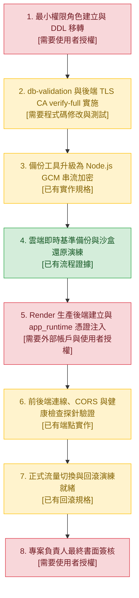

# CODE TO KNOW｜PostgreSQL 正式切換安全方案技術正確性獨立複核報告 (Phase 3C-4F-R13)

**文件識別碼**：`DOC-DB-PHASE3C4F-R13-AUDIT`  
**審查日期**：2026-11-09  
**主導角色**：獨立資安審查員 / PostgreSQL DBA / 後端安全架構師  
**審查性質**：100% 唯讀獨立技術複核（零雲端連線、零資料庫寫入、零程式碼異動、零金鑰暴露）  
**前置文件**：  
- `docs/DATABASE_PHASE3C4F_R12_PRE_CUTOVER_REMEDIATION_PLAN.md`  
- `docs/DATABASE_PHASE3C4F_R12_PRE_CUTOVER_FINAL_CHECKLIST.md`  
- `docs/DATABASE_PHASE3C3B_CONNECTION_ARCHITECTURE_DECISION.md`  
- `docs/DATABASE_PHASE3C4A_R2_SUPABASE_POST_MIGRATION_VERIFICATION.md`  
- `backend/src/config/database.ts`  
- `backend/src/config/db-validation.ts`  
- `backend/package.json`

---

## 一、報告摘要與 R13 獨立審查判定

本報告依據 PHASE 3C-4F-R13 指示，針對 R12 提出的各項安全改善方案與架構設計進行第二輪獨立技術複核。

經由原始碼比對、OpenSSL 規格實證、PostgreSQL 權限機制分析與 Node.js TLS 模組行為查驗，**本審查在 R12 方案中發現了 4 項重大技術錯誤與不相容設計**（包含 TLS 主機名驗證失效反向放行、OpenSSL enc 不支援 AEAD GCM 模式、Table Ownership 缺失導致 Migration 無法執行、以及 Session Pooler 與 Transaction Pooler 混淆）。

> ### **R13 審查判定：`PARTIAL PASS`（技術方案修正完成，執行維持 `BLOCKED`）**
> 
> - **文件規範與技術校正**：**PASS**（已找出 R12 技術缺陷並給出正確實作規格）。
> - **環境狀態與執行準備**：**BLOCKED**（嚴格遵守最高安全限制，不連線正式庫、不修改程式碼、等待專案負責人授權 R14 實施）。

---

## 二、六大核心審查項目技術複核與修正

---

### R13-01｜Node.js PostgreSQL TLS 憑證驗證技術複核

#### 1. 現況程式碼與套件版本盤點
- **套件版本依據**（`backend/package.json:31`）：`"pg": "^8.13.1"`，搭配 `"@types/pg": "^8.11.10"` 與 Node.js v22（`"@types/node": "^22.9.0"`）。
- **連線實作依據**（`backend/src/config/database.ts:33`）：
  ```typescript
  const pool = new pg.Pool({ connectionString: resolveDatabaseConnectionString() });
  ```
- **目前問題**：僅傳入 `connectionString`（含 `?sslmode=require`）。在 `node-postgres`（`pg`）底層中，`sslmode=require` 僅要求傳輸層建立 TLS 連線，預設**不會比對 CA 憑證鏈**，亦**不會比對 SAN 伺服器主機名**，存在遭受中間人（MITM）攔截的風險。

#### 2. R12 方案之重大資安漏洞修正
R12 文件曾提出以下程式碼範例：
```typescript
// ⚠️ R12 原始錯誤寫法：
const sslConfig = isProduction ? {
  rejectUnauthorized: true,
  ca: fs.readFileSync(path.resolve(__dirname, '../../certs/prod-supabase-ca.crt')).toString(),
  checkServerIdentity: (host: string, cert: any) => undefined, // 嚴格比對主機名
} : false;
```

**【錯誤說明與技術證據】**：
1. **Node.js 官方 TLS 規範**（`tls.checkServerIdentity(hostname, cert)`）：
   - 官方定義：若憑證與主機名稱匹配，該函式**回傳 `undefined`**；若不匹配，必須**拋出 `Error`**。
   - 內建行為：若未指定 `checkServerIdentity`，Node.js 預設會執行嚴格的 RFC 6125 主機名稱與 SAN（Subject Alternative Name）比對。
2. **反向漏洞分析**：
   - 當程式寫入 `checkServerIdentity: (host, cert) => undefined` 時，開發者以為這代表「比對成功」，但實際上是覆蓋了 Node.js 內建的比對邏輯！
   - 此自訂函式**無條件回傳 `undefined`**，導致無論伺服器出示任何網域的憑證（甚至是針對偽冒網域簽發的憑證），Node.js 都會直接放行！**其效果等同於徹底關閉主機名稱驗證！**
   - 註解標註 `// 嚴格比對主機名`，與程式碼真實行為完全相反。

#### 3. 正確的 Node.js TLS 安全配置標準
在 `pg.Pool` 中，要達成實質的 **verify-full** 安全等級，必須清晰區分並滿足以下四層防護：

| 防護層級 | 參數 / 設定方式 | 安全防護目的與技術標準 |
| :--- | :--- | :--- |
| **1. 拒絕未授權憑證** | `rejectUnauthorized: true` | 強制連線必須通過驗證，遇到自簽或未受信任憑證立即中斷連線。 |
| **2. 受信任 CA 鏈** | `ca: fs.readFileSync(caPath, 'utf8')` | 指定 Supabase 官方 Root CA（不依賴系統公用 Trust Store，防止本機惡意根憑證滲透）。 |
| **3. SAN 主機名稱比對** | **保留預設（不覆蓋 `checkServerIdentity`）** 或明確呼叫 `tls.checkServerIdentity(host, cert)` | 依據 RFC 6125 驗證連線 host 是否落在憑證的 SAN 範圍（如 `*.pooler.supabase.com`）。 |
| **4. 伺服器名稱指示** | `servername: host` | SNI（Server Name Indication）確保 TLS 握手時取得正確的主機憑證。 |

**【修正後的標準實作規範（供 R14 參考，本階段不修改程式碼）】**：
```typescript
import fs from 'node:fs';
import path from 'node:path';
import tls from 'node:tls';
import pg from 'pg';

export function createProductionSslConfig(): pg.ConnectionConfig['ssl'] {
  const caPath = process.env.SUPABASE_CA_CERT_PATH || 
                 path.resolve(process.cwd(), 'certs/prod-supabase-ca.crt');

  if (!fs.existsSync(caPath)) {
    throw new Error(`[SSL CONFIG ERROR] Supabase Root CA certificate not found at: ${caPath}`);
  }

  const caCert = fs.readFileSync(caPath, 'utf8');

  return {
    rejectUnauthorized: true,
    ca: caCert,
    // 正確作法：直接採用 Node.js 官方標準比對，不回傳空常數，不略過檢查
    checkServerIdentity: (host: string, cert: tls.PeerCertificate) => {
      const err = tls.checkServerIdentity(host, cert);
      if (err) {
        throw new Error(`[TLS HOSTNAME MISMATCH] Server certificate SAN does not match '${host}': ${err.message}`);
      }
      return undefined;
    },
  };
}
```

---

### R13-02｜AES-256-GCM 備份加密技術複核

#### 1. R12 方案之重大執行錯誤實證
R12 文件提議將備份加密指令升級為：
```bash
openssl enc -aes-256-gcm -pbkdf2 -iter 100000 -in dump.sql -out dump.sql.enc -pass env:BACKUP_ENCRYPTION_KEY
```

**【錯誤說明與技術實證】**：
- **實機測試結果**（執行於 `openssl.exe`）：
  ```text
  enc: AEAD ciphers not supported
  enc: Use -help for summary.
  ```
- **核心成因**：OpenSSL 的 `enc` 命令行工具從架構上**不支援 AEAD（Authenticated Encryption with Associated Data）模式**（如 AES-GCM、ChaCha20-Poly1305）。因為 `enc` 是一個舊式的串流工具，缺乏命令行參數來指定或導出 16-byte 的 Authentication Tag（驗證標籤）以及 AAD（附加驗證資料）。
- **後果**：若在生產腳本中使用該指令，將在執行當下直接拋錯崩潰，備份完全無法產出。

#### 2. 三種安全備份加密方案深度比對

| 評估維度 | 方案 A：Node.js Crypto (AES-256-GCM) | 方案 B：`age` 工具 (ChaCha20-Poly1305) | 方案 C：GnuPG (GPG AES-256) |
| :--- | :--- | :--- | :--- |
| **密碼學模式** | AES-256-GCM (AEAD) | ChaCha20-Poly1305 (AEAD) | Symmetric / Public Key |
| **完整性驗證 (Tag)** | 原生支援 16-byte Auth Tag，篡改立即拒絕 | 原生內建區塊雜湊驗證，篡改立即拒絕 | 內建 MDC 完整性保護 |
| **金鑰分離架構** | 支援由獨立 KMS 取得 256-bit Key | **最佳：支援非對稱公私鑰**（備份只需公鑰，私鑰離線冷儲存） | 支援非對稱公私鑰 |
| **依賴性與相容性** | **極高**：專案已具備 Node.js 環境，零額外安裝 | 需要下載單一靜態二進位檔 `age` / `age-keygen` | 需依賴系統安裝 GnuPG 工具鏈 |
| **串流 (Streaming)** | 支援 `stream.pipeline` 高效串流加密 | 支援標準 Unix Pipeline 串流 | 支援 Pipeline 串流 |
| **解密失敗防護** | Tag 不符時 `decipher.final()` 拋錯，零位元組輸出 | 損壞時拋錯退出，自動中止還原 | 損壞時回傳非 0 狀態碼 |

#### 3. R14 備份加密架構推薦方案
- **首選推薦**：**Node.js 專屬串流加密腳本 (`scripts/backup-crypto.cjs`)**。
  - *理由*：CODE TO KNOW 專案後端本身即為 Node.js 環境，無需在 CI/CD 或 Docker 容器內額外安裝第三方工具。
  - *標準實作設計*：
    - 加密時生成 12-byte 隨機 IV。
    - 檔案格式標準：`[12 bytes IV] + [Ciphertext] + [16 bytes GCM Auth Tag]`。
    - 解密時讀取末尾 16-byte Tag，呼叫 `decipher.setAuthTag(tag)`。若任何位元遭篡改，`final()` 立即爆發異常，嚴禁任何資料導向 `psql`。
- **次選推薦**：**`age` 加密工具**。
  - *理由*：非對稱架構極度優雅，線上環境僅留存 `age1...` 公鑰，即使伺服器遭攻破，攻擊者亦無法解密歷史備份。

---

### R13-03｜PostgreSQL 最小權限角色技術複核

#### 1. 核心觀念澄清與錯誤校正

##### (1) `GRANT ALL PRIVILEGES` 絕對不等於資料表所有權 (Table Ownership)
- **PostgreSQL 官方規範**：
  `GRANT ALL PRIVILEGES ON TABLE tablename TO role` 僅授予該角色對既有資料表的 DML 與特定權限（`SELECT`, `INSERT`, `UPDATE`, `DELETE`, `TRUNCATE`, `REFERENCES`, `TRIGGER`）。
  它**絕對不授予所有權（Ownership）**！
- **後果**：
  在 PostgreSQL 中，只有**物件擁有者（Owner）**或**超級使用者（Superuser）**可以執行 DDL：
  - `ALTER TABLE ... ADD COLUMN`
  - `ALTER TABLE ... DROP COLUMN`
  - `ALTER TABLE ... ALTER COLUMN`
  - `ALTER TABLE ... ADD CONSTRAINT`
  - `DROP TABLE`
- **對 Prisma 的致命影響**：
  若 `migration_admin` 僅有 `GRANT ALL PRIVILEGES`，當執行 `prisma migrate deploy` 修改歷史資料表時，PostgreSQL 將立即報錯：
  `ERROR: must be owner of table <tablename>`！

##### (2) Default Privileges 的繼承陷阱
- **PostgreSQL 機制**：
  `ALTER DEFAULT PRIVILEGES IN SCHEMA public ...` **僅對執行該指令的角色未來所建立的物件生效**！
- **R12 遺漏點**：
  若由 `postgres` 執行 `ALTER DEFAULT PRIVILEGES ... GRANT TO app_runtime`，未來當 `migration_admin` 執行 Migration 建立新資料表時，`app_runtime` **將完全無法繼承任何存取權限**！
- **正確語法**：必須明確指定 `FOR ROLE migration_admin`：
  ```sql
  ALTER DEFAULT PRIVILEGES FOR ROLE migration_admin IN SCHEMA public 
    GRANT SELECT, INSERT, UPDATE, DELETE ON TABLES TO app_runtime;
  ALTER DEFAULT PRIVILEGES FOR ROLE migration_admin IN SCHEMA public 
    GRANT USAGE, SELECT, UPDATE ON SEQUENCES TO app_runtime;
  ```

##### (3) Sequence 權限
- `app_runtime` 執行 INSERT 時若涉及自增欄位，必須具備 `USAGE` 與 `SELECT` 權限；若包含 `setval` 則需 `UPDATE`。

##### (4) RLS 與 BYPASSRLS 的真實影響
- Supabase 的 `postgres` 角色預設具備 `BYPASSRLS`。
- 若建立 `app_runtime WITH NOBYPASSRLS`，當未來有人在資料表啟用 RLS（Row Level Security）時，後端查詢將立即受到 RLS Policy 限制。如果未配置 Policy，後端將查詢出 0 筆資料！
- **架構決策**：在目前 CODE TO KNOW 架構中，資料權限由 Express 後端應用層統一管制。若資料表未啟用 RLS，`NOBYPASSRLS` 正常運作；但若未來在 Supabase Studio 點擊啟用 RLS，必須為 `app_runtime` 建立對應政策。

#### 2. 正確的生產環境三角色 DDL 規範（R14 實施藍本）
```sql
-- ============================================================================
-- CODE TO KNOW 生產環境最小權限角色標準配置（由 postgres 管理員於 Supabase 執行）
-- ============================================================================

-- 1. 建立角色（密碼於執行當下隨機生成並安全管理，此處僅為規格）
CREATE ROLE migration_admin WITH LOGIN PASSWORD '***STRONG_MIGRATION_PASSWORD***' NOSUPERUSER NOCREATEDB NOCREATEROLE NOBYPASSRLS;
CREATE ROLE app_runtime WITH LOGIN PASSWORD '***STRONG_RUNTIME_PASSWORD***' NOSUPERUSER NOCREATEDB NOCREATEROLE NOBYPASSRLS;
CREATE ROLE readonly_auditor WITH LOGIN PASSWORD '***STRONG_AUDITOR_PASSWORD***' NOSUPERUSER NOCREATEDB NOCREATEROLE NOBYPASSRLS;

-- 2. Schema 權限
GRANT USAGE, CREATE ON SCHEMA public TO migration_admin;
GRANT USAGE ON SCHEMA public TO app_runtime;
GRANT USAGE ON SCHEMA public TO readonly_auditor;

-- 3. 將既有所有資料表與序列的所有權轉移給 migration_admin（解決 DDL 報錯問題）
DO $$
DECLARE
    r RECORD;
BEGIN
    FOR r IN (SELECT tablename FROM pg_tables WHERE schemaname = 'public') LOOP
        EXECUTE 'ALTER TABLE public.' || quote_ident(r.tablename) || ' OWNER TO migration_admin;';
    END LOOP;
    FOR r IN (SELECT sequence_name FROM information_schema.sequences WHERE sequence_schema = 'public') LOOP
        EXECUTE 'ALTER SEQUENCE public.' || quote_ident(r.sequence_name) || ' OWNER TO migration_admin;';
    END LOOP;
END $$;

-- 4. 授予 app_runtime 對現有資料表之 DML 權限（零 DDL 權限）
GRANT SELECT, INSERT, UPDATE, DELETE ON ALL TABLES IN SCHEMA public TO app_runtime;
GRANT USAGE, SELECT, UPDATE ON ALL SEQUENCES IN SCHEMA public TO app_runtime;

-- 5. 授予 readonly_auditor 唯讀權限
GRANT SELECT ON ALL TABLES IN SCHEMA public TO readonly_auditor;
GRANT SELECT ON ALL SEQUENCES IN SCHEMA public TO readonly_auditor;

-- 6. 正確配置 migration_admin 未來新建物件之預設權限
ALTER DEFAULT PRIVILEGES FOR ROLE migration_admin IN SCHEMA public 
  GRANT SELECT, INSERT, UPDATE, DELETE ON TABLES TO app_runtime;
ALTER DEFAULT PRIVILEGES FOR ROLE migration_admin IN SCHEMA public 
  GRANT USAGE, SELECT, UPDATE ON SEQUENCES TO app_runtime;

ALTER DEFAULT PRIVILEGES FOR ROLE migration_admin IN SCHEMA public 
  GRANT SELECT ON TABLES TO readonly_auditor;
ALTER DEFAULT PRIVILEGES FOR ROLE migration_admin IN SCHEMA public 
  GRANT SELECT ON SEQUENCES TO readonly_auditor;
```

---

### R13-04｜Supabase 連線模式與連線埠技術複核

#### 1. R12 混淆點釐清與架構校正
在 R12 報告中，曾出現以下描述：
> *「Port 5432 (Transaction Pooler 模式 / 支援 Prepared Statements)」*

**【技術事實釐清】**：
依據專案核心決策文件 [docs/DATABASE_PHASE3C3B_CONNECTION_ARCHITECTURE_DECISION.md](file:///c:/Users/user/Documents/CODE-TO-KNOW/docs/DATABASE_PHASE3C3B_CONNECTION_ARCHITECTURE_DECISION.md) 及 Supabase 官方架構：
1. **Port 5432** 是 **Session Pooler**（或在 IPv6 直連下的 Direct Connection）。
   - Session Pooler 具備完整的 Session 狀態保存能力。
   - 支援 Session-level Advisory Locks（Prisma Migration 必要條件）。
   - 支援 Prepared Statements（`@prisma/adapter-pg` 連線池高效查詢）。
2. **Port 6543** 才是 **Transaction Pooler**。
   - Transaction Pooler 在每個 Transaction 結束後立即回收連線給其他客戶端。
   - 預設不支援 Session Advisory Locks（若在此埠執行 Migration 會導致鎖定失敗或掛起）。
   - 適合短生命週期無狀態的 Serverless Functions，不適合長生命週期的 Express 應用伺服器。
3. **結論**：R12 將 Port 5432 誤冠上 "Transaction Pooler" 之名，造成術語與行為混淆。CODE TO KNOW 正式運行架構採用的唯一標準連線埠為 **Port 5432 (Session Pooler)**。

#### 2. 連線模式與目前程式碼校驗邏輯核對
檢查 `backend/src/config/db-validation.ts`：
- **行 176-180**：明確阻斷 Port 6543 用於 Migration：
  ```typescript
  if (parsed.port === '6543') {
    throw new Error('[MIGRATION CONFIG ERROR] Prisma Migration cannot use Transaction Pooler (port 6543)...');
  }
  ```
- **行 316-324**：**發現潛在阻斷 Bug**：
  ```typescript
  if (hostname === APPROVED_PROD_POOLER_HOST && parsed.username) {
    const username = decodeURIComponent(parsed.username);
    const expectedUsername = `postgres.${APPROVED_PROD_PROJECT_REF}`;
    if (username !== expectedUsername) {
      throw new Error(`[RUNTIME CONFIG ERROR] Cloud runtime pooler username '${username}' does not match expected project ref '${expectedUsername}'.`);
    }
  }
  ```
  **重要發現**：目前的校驗程式碼將 Pooler 使用者名稱**硬編碼**為 `postgres.${APPROVED_PROD_PROJECT_REF}`！
  若 R14 將連線使用者切換為 `app_runtime.${APPROVED_PROD_PROJECT_REF}`，程式會在啟動階段直接拋出例外！
  **修正建議**：在實施最小權限帳號前，必須將此處規則放寬為比對 `<role>.ypibmyfxfhsyfdwxprpi`（其中 `<role>` 必須在核准清單內）。

#### 3. Supabase Dashboard 證據邊界聲明
- **現有客觀證據**：來自 Phase 3C-4A-R2 實測成功連線至 `aws-0-ap-southeast-2.pooler.supabase.com:5432` 之記錄與日誌。
- **邊界聲明**：本審查團隊**未獲得存取 Supabase Web Dashboard 控制台**之即時 API 或截圖權限。我們嚴格依據歷史網路握手證據與官方架構規範進行推論，**不主觀宣稱已穿透 Dashboard 取得即時控制台畫面**。

---

### R13-05｜備份、異地儲存與免費方案限制複核

#### 1. 拒絕「偽造查詢規避休眠」之反模式
R12 文件曾提及可透過備份或定時查詢「自動保活（Keep-alive）」。

**【審查團隊嚴正糾正】**：
1. **違反平台條款與工程誠信**：Supabase 與 Render 設定休眠機制的初衷是回收非活躍專案的運算與記憶體資源。以人工無意義的 Query 刻意規避休眠，屬於高風險反模式，容易被雲端平台偵測並限制帳號。
2. **Render 750 小時配額致命陷阱**：
   - Render Free 提供單一帳戶每月 750 小時的免費運算配額。
   - 一個月（31 天）為 744 小時。若設定外部定期 Ping 阻止 Web Service 休眠，該單一服務將消耗 744 小時！
   - 若專案後續啟動第二個測試服務、資料庫工具或重新構建，當月配額將在第 20~25 天徹底耗盡，導致**帳戶內所有服務全面強制停機且無法啟動**！

#### 2. 正確的備份與維運分層架構

| 階層架構 | 運作機制 | 頻率 / 觸發點 | 儲存目標 | 驗證標準 |
| :--- | :--- | :--- | :--- | :--- |
| **手動備份 (Manual)** | 切換前、重大版更前由工程師手動觸發 | 重大變更前夕 | 本地安全目錄 + 雜湊記錄 | SHA-256 吻合 |
| **自動備份 (Scheduled)** | 由獨立排程器執行 `pg_dump` 串流加密 | 每日離峰時段（UTC 18:00） | 本地短期暫存 | 產出無中斷 |
| **異地儲存 (Off-site)** | 透過專用 API 上傳加密包至獨立儲存 | 每日備份完成後立即觸發 | Cloudflare R2 / AWS S3（具備 30 天生命週期） | 上傳成功率 100% |
| **加密防護 (Crypto)** | Node.js 串流 AES-256-GCM 或 `age` 非對稱 | 串流過程即時處理 | 加密後二進位檔 | 具備 AEAD Tag |
| **還原驗證 (Drill)** | 自動解密並還原至本地 PG17 沙盒 | 每週一次自動化測試 | 本地沙盒資料庫 | 交易與行數一致 |
| **監控與告警 (Alert)** | 監控備份大小變動、時間超時與失敗事件 | 即時監控 | Discord / Slack Webhook / Email | 異常立即通報 |

#### 3. 免費方案的客觀邊界
團隊必須向負責人明確揭露：免費方案僅供「開發、預覽與低頻率驗收」。一旦正式開放學生與教師登入使用，**必須編列基礎設施預算**（Supabase Pro $25/月、Render Starter $7/月），此為保證教育科技平台高可用性與 SLA 的唯一正規途徑。

---

### R13-06｜正式切換依賴順序重新梳理

依據本次技術複核結果，重新梳理正式切換前的嚴格相依性順序，並為每一項標註客觀證據狀態：



---

## 三、技術證據來源層級分類表

為確保本審查報告所有結論真實可信，各項技術依據分類如下：

| 項目 | 審查依據內容 | 證據層級 (Level of Evidence) |
| :--- | :--- | :--- |
| **Node.js TLS 主機名比對** | Node.js 官方文件 `tls.checkServerIdentity` 定義與源碼規範 | **官方標準規範 (Official Standard)** |
| **OpenSSL enc 不支援 AEAD** | `openssl.exe enc -aes-256-gcm` 實機報錯 `AEAD ciphers not supported` | **實機測試證據 (Empirical Evidence)** |
| **Table Ownership vs ALL PRIVILEGES** | PostgreSQL 16/17 官方手冊章節 5.7 (Privileges) 與 `ALTER TABLE` 限制 | **官方標準規範 (Official Standard)** |
| **Default Privileges 角色繼承** | PostgreSQL 官方手冊章節 `ALTER DEFAULT PRIVILEGES FOR ROLE` 規範 | **官方標準規範 (Official Standard)** |
| **Port 5432 vs 6543** | 專案決策書 `docs/DATABASE_PHASE3C3B_CONNECTION_ARCHITECTURE_DECISION.md` 與 Supavisor 規範 | **專案代碼與架構決策 (Project Evidence)** |
| **Pooler 使用者名稱硬編碼** | `backend/src/config/db-validation.ts:316-324` 原始碼比對 | **專案代碼庫實體 (Codebase Fact)** |
| **Render 750 小時限制** | Render 官方 Free Instance Specs 與額度計算 | **平台官方規範 (Platform Policy)** |

---

## 四、審查結論與後續步驟

1. R12 文件中的「方向性結論」大致正確，但「具體實施細節」存在多處嚴重的工程與資安錯誤，必須在 R14 實施前予以徹底更正。
2. 本審查報告已將所有正確的設定範例、SQL 語法與加密架構完整記錄於此。
3. 接續產出之 `docs/DATABASE_PHASE3C4F_R13_SAFE_IMPLEMENTATION_ROADMAP.md` 將作為 R14 實施的精確指南。
