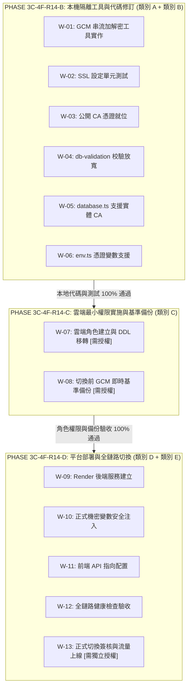

# CODE TO KNOW｜PostgreSQL 安全措施變更範圍與授權分類矩陣 (Phase 3C-4F-R14-A)

**文件識別碼**：`DOC-DB-PHASE3C4F-R14A-MATRIX`  
**建立時間**：2026-11-09  
**版次**：v1.0.0  
**前置基準**：`docs/DATABASE_PHASE3C4F_R14A_IMPLEMENTATION_PREFLIGHT_AUDIT.md`  
**目的**：精確劃分 R14 後續實施作業之變更範圍、操作環境、相依關係與授權邊界，嚴禁跨越授權界線

---

## 一、變更授權五級分類定義

為貫徹資安防禦與權限隔離原則，本專案將 R14 實施相關的所有技術工作劃分為五個不同安全層級：

| 授權類別代號 | 類別名稱 | 定義與操作邊界 | 執行環境 | 授權要求 |
| :---: | :--- | :--- | :--- | :---: |
| **類別 A** | **本機隔離環境準備** | 不影響專案既有代碼、不連線外部網路，僅在本地撰寫獨立工具或單元測試 | 本機 / 隔離沙盒 | **無需外部授權** *(開發團隊內部推進)* |
| **類別 B** | **專案程式碼修改** | 修改代碼庫內既有程式碼（如 database.ts、env.ts、db-validation.ts） | 本機 Git 工作區 | **程式碼審查 (PR)** *(依團隊開發流程核准)* |
| **類別 C** | **雲端資料庫操作** | 於 Supabase 執行 DDL、建立資料庫角色、變更所有權、執行備份 | Supabase 正式資料庫 | **[必須使用者明確授權]** *(高風險資料庫變更)* |
| **類別 D** | **正式平台帳戶操作** | 於 Render Dashboard 建立服務、配置環境變數、注入生產機密 | Render 雲端平台 | **[必須外部帳戶操作]** *(專案負責人或授權運維)* |
| **類別 E** | **正式流量切換** | 切換公開網域 DNS、切換前端 API 指向、開放使用者註冊與連線 | 全鏈路生產環境 | **[必須獨立最終簽核]** *(最高等級切換卡關)* |

---

## 二、全量工作項目變更與授權矩陣

| 工作編號 | 工作項目描述 | 變更涉及檔案 / 資源 | 變更類別 | 預期測試 / 驗證方式 | 失敗回復方案 (Rollback) | 授權狀態 |
| :---: | :--- | :--- | :---: | :--- | :--- | :---: |
| **W-01** | 實作 Node.js 獨立 AES-256-GCM 備份加解密工具 | `scripts/database/backup-crypto.cjs` *(新增)* | **類別 A** | 本地單元測試：加密隨機字串，人為篡改 1 bit 測試驗證失敗阻斷 | 刪除新增之獨立腳本 | **READY (可執行)** |
| **W-02** | 撰寫 TLS CA 憑證配置邏輯單元測試 | `backend/tests/database-ssl-config.test.ts` *(新增)* | **類別 A** | `npm test` 執行單元測試，驗證正確/錯誤憑證之配置生成 | 刪除測試檔案 | **READY (可执行)** |
| **W-03** | 建立 `backend/certs/` 目錄並放入 Supabase 公開 Root CA 憑證 | `backend/certs/prod-supabase-ca.crt` *(新增)* | **類別 A** | 驗證檔案 SHA-256 為 `700723581420DD...` | 刪除憑證檔案 | **READY (可執行)** |
| **W-04** | 更新 `backend/src/config/db-validation.ts` 允許 `app_runtime` 前綴 | `backend/src/config/db-validation.ts` *(修改)* | **類別 B** | 執行 `tests/db-config-safety.test.ts` 比對通過 | `git checkout -- <file>` | **待代碼審查** |
| **W-05** | 更新 `backend/src/config/database.ts` 支援實體 CA 驗證 | `backend/src/config/database.ts` *(修改)* | **類別 B** | 沙盒 PG17 模擬連線測試，負向測試拒絕自簽憑證 | `git checkout -- <file>` | **待代碼審查** |
| **W-06** | 更新 `backend/src/config/env.ts` 納入 CA 憑證路徑變數 | `backend/src/config/env.ts` *(修改)* | **類別 B** | 測試環境變數解析正常，缺漏時提供友善報錯 | `git checkout -- <file>` | **待代碼審查** |
| **W-07** | 於 Supabase 正式庫執行最小權限角色建立與所有權轉移 DDL | Supabase PostgreSQL 角色與資料表權限 | **類別 C** | 唯讀查詢 `pg_tables` 確認擁有者轉移，`app_runtime` 測試 DDL 遭拒 | 執行 `REASSIGN OWNED BY migration_admin TO postgres` | **[嚴格鎖定 - 需授權]** |
| **W-08** | 執行切換前雲端即時基準備份 (GCM 加密) | `C:\Users\user\Documents\CODE-TO-KNOW_BACKUPS\` | **類別 C** | 產出 `.dump.enc` 與 SHA-256，於 PG17 沙盒解密還原成功 | 刪除損壞之暫存檔 | **[嚴格鎖定 - 需授權]** |
| **W-09** | 於 Render 建立後端 Web Service 並設定構建參數 | Render `code-to-know-backend` | **類別 D** | 構建成功，服務正常監聽 Port 10000 | 刪除或暫停 Render 服務 | **[平台操作 - 需授權]** |
| **W-10** | 於 Render 安全注入正式環境變數（含 `app_runtime` 密鑰） | Render 後端環境變數配置 | **類別 D** | 後端啟動成功，無變數缺失錯誤 | 清空或修改變數值 | **[平台操作 - 需授權]** |
| **W-11** | 前端 Render 靜態站點注入 `VITE_API_URL` 並重新構建 | Render `code-to-know-web` | **類別 D** | 前端頁面 Network Tab 請求正確指向 Render 後端 | 回退前端環境變數 | **[平台操作 - 需授權]** |
| **W-12** | 全鏈路連線與 `/api/health` 探針線上驗收 | 雲端全鏈路 | **類別 D** | 請求 `/api/health` 回傳 HTTP 200 與 `database.status: connected` | 暫停公開訪問 | **[平台操作 - 需授權]** |
| **W-13** | 正式上線流量切換與公開網域對接 | DNS / 公開網域 / 系統入口 | **類別 E** | 外部使用者可正常登入、學習、答題，日誌無連線異常 | 啟動 5 步緊急回滾程序 | **[最高簽核 - 需授權]** |

---

## 三、R14 後續實施分階段推進計畫

為確保工程品質與風險受控，R14 後續應拆分為三個有序子階段推進：

---

## 四、雲端授權與風險防線聲明

1. **AI 代理人權限約束**：
   在執行 R14-B 期間，AI 僅限於在本地工作區新增獨立加解密工具（`scripts/database/backup-crypto.cjs`）與進行本地程式碼修改、執行本地單元測試。
2. **絕對阻斷防線**：
   任何涉及 Supabase 正式資料庫 DDL 執行（W-07）、正式環境備份觸發（W-08）、Render 平台設定變更（W-09～W-11）及最終流量切換（W-13），**均屬於嚴格受控之授權項目**。在未取得使用者於對話中給予「明確執行授權指令」前，AI **絕不主動發起任何外部網路連線或平台 API 呼叫**。
