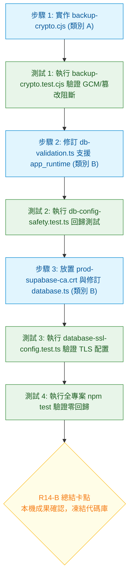

# CODE TO KNOW｜本機安全工具與程式碼修訂詳細實施方案 (Phase 3C-4F-R14-B-0)

**文件識別碼**：`DOC-DB-PHASE3C4F-R14B-SPEC`  
**建立時間**：2026-11-09  
**版次**：v1.0.0  
**主導角色**：獨立資安審查員 / PostgreSQL DBA / 後端安全架構師  
**審查性質**：100% 唯讀實施方案規格確認（零雲端連線、零資料庫寫入、零程式碼修改、零憑證下載、零平台異動）  
**前置文件**：  
- `docs/DATABASE_PHASE3C4F_R13_TECHNICAL_CORRECTNESS_AUDIT.md`  
- `docs/DATABASE_PHASE3C4F_R13_SAFE_IMPLEMENTATION_ROADMAP.md`  
- `docs/DATABASE_PHASE3C4F_R14A_IMPLEMENTATION_PREFLIGHT_AUDIT.md`  
- `docs/DATABASE_PHASE3C4F_R14A_CHANGE_AND_AUTHORIZATION_MATRIX.md`

---

## 一、概述與任務目標

本實施方案依據 R13 技術複核與 R14-A 變更授權矩陣，針對即將推進的 **PHASE 3C-4F-R14-B（類別 A：本機隔離工具實作 + 類別 B：專案代碼庫修訂）** 建立極度嚴密的技術規格、改動細節、驗收測試案例、風險防護與復原計畫。

> [!IMPORTANT]
> **執行邊界聲明**：
> 本文件為**純規格與實施方案設計**。本階段**嚴禁執行任何程式碼修改、不下載憑證、不修改環境設定、不連線 Supabase**。在專案負責人完成審查並正式授權進入 R14-B-1 前，專案代碼庫保持 100% 凍結。

---

## 二、工作項目與影響檔案清單

| 工作編號 | 工作項目名稱 | 授權類別 | 涉及檔案路徑 | 變更性質 | 核心目的 |
| :---: | :--- | :---: | :--- | :---: | :--- |
| **W-01** | **AES-256-GCM 備份加解密工具** | **類別 A** | `scripts/database/backup-crypto.cjs`<br>`scripts/database/backup-crypto.test.cjs` | **新增獨立檔案** | 解決 OpenSSL enc 不支援 AEAD 缺陷，提供串流加解密、動態 Nonce、完整性 Auth Tag 校驗與金鑰分離 |
| **W-02** | **PostgreSQL TLS 實體 CA 與 SAN 驗證** | **類別 B** | `backend/src/config/database.ts`<br>`backend/src/config/env.ts`<br>`backend/certs/prod-supabase-ca.crt` | **修改代碼 / 新增憑證** | 實現實質 `verify-full`，消除 R12 主機名放行漏洞，強制校驗憑證鏈與 SAN |
| **W-03** | **Pooler 使用者名稱校驗擴充** | **類別 B** | `backend/src/config/db-validation.ts` | **修改代碼** | 解除硬編碼 `postgres.<ref>` 限制，支援 `app_runtime.<ref>` 與 `migration_admin.<ref>` |
| **W-04** | **本機單元測試與安全回歸套件** | **類別 A** | `backend/tests/database-ssl-config.test.ts`<br>`backend/tests/db-config-safety.test.ts` | **新增 / 擴充測試** | 實施包括密碼錯誤、標籤篡改、自簽憑證阻斷、主機名不符阻斷等 100% 負向防護測試 |

---

## 三、各項目詳細技術實施方式

---

### W-01｜AES-256-GCM 備份加解密工具實施規格 (`backup-crypto.cjs`)

#### 1. 檔案架構與密碼學設計
- **路徑**：`scripts/database/backup-crypto.cjs`（CommonJS 獨立模組，零第三方依賴，直接使用 Node.js 原生 `node:crypto`、`node:fs` 與 `node:stream`）。
- **密碼學演算法**：`aes-256-gcm`。
- **隨機 Nonce (IV)**：每次加密透過 `crypto.randomBytes(12)` 動態生成 12 位元組唯一 IV，嚴禁重用。
- **Authentication Tag**：16 位元組（128-bit）認證標籤，由 GCM 密碼引擎於資料串流結束時產出。
- **封裝格式標準 (C2KB Binary Container)**：
  ```text
  +----------------+---------------+-----------------+------------------------+------------------+
  | Magic (4 Byte) | Ver (1 Byte)  | Nonce (12 Byte) | Ciphertext (變長串流)  | Auth Tag (16 B)  |
  |  0x43 32 4B 42 |     0x01      |  隨機動態生成   | AES-256-GCM 加密資料流 | GCM 完整性校驗標籤 |
  |   ("C2KB")     |  (Version 1)  |   (IV: 96-bit)  |     (Encrypted Data)   |  (128-bit MAC)   |
  +----------------+---------------+-----------------+------------------------+------------------+
  ```
  - *Magic Header*：固定為 ASCII `"C2KB"`（0x43, 0x32, 0x4B, 0x42），防止誤解密非備份檔案。
  - *Version*：固定為 `0x01`，預留未來金鑰派生或演算法升級空間。

#### 2. 金鑰與密碼分離架構
- 備份加密金鑰**絕對禁止使用資料庫登入密碼**。
- 金鑰規格：256-bit（32 位元組），以 64 位元 Hex 字串表示。
- 輸入管道：透過環境變數 `BACKUP_ENCRYPTION_KEY` 傳入，或透過 `--key` 參數指定（推薦環境變數，避免出現於 ps 處理程序清單）。
- 工具內建金鑰生成指令：`node backup-crypto.cjs genkey`，調用 `crypto.randomBytes(32).toString('hex')`。

#### 3. 大檔串流與篡改中斷防護機制
- 加密與解密全量採用 `node:stream` 的 Pipeline 架構，記憶體開銷低於 30 MB，可輕鬆處理 10 GB 以上大型 PostgreSQL Dump。
- **解密防護鐵律**：
  - 解密時，工具先校驗 Magic Header 與 Version。
  - 擷取 Nonce 後啟動 `createDecipheriv`。
  - 檔案末端 16 位元組傳入 `decipher.setAuthTag()`。
  - 若檔案內容遭遇**位元翻轉（Bit-flip）、截斷、竄改**或**金鑰不匹配**，`decipher.final()` 會在資料流完全寫出前拋出 `Error: Unsupported state or unable to authenticate data`。
  - 捕捉到異常時，工具立即調用 `fs.unlinkSync` 清除未完成之暫存解密檔，並以 `process.exit(1)` 強制終止，**保證損壞資料絕不流入 `psql` 還原管道**。

---

### W-02｜PostgreSQL TLS 安全驗證實施規格

#### 1. 驅動底層行為分析（`pg: ^8.13.1`）
- 在 Node.js `pg`（`pg-pool`）中，若建構子傳入：
  ```typescript
  const pool = new pg.Pool({
    connectionString: resolveDatabaseConnectionString(),
    ssl: customSslOptions,
  });
  ```
- **參數優先順序**：實測證實，顯式傳入之 `ssl` 物件會覆蓋 `connectionString` 中因 `sslmode=require` 解析出的空物件 `{ ssl: {} }`。
- **開發與測試環境隔離**：
  - 當 `NODE_ENV === 'development'` 或 `NODE_ENV === 'test'` 時，`ssl` 屬性**完全不傳入**（`undefined`），確保本地 PG16（Port 5432）與 PG17 沙盒（Port 5433）不觸發 SSL 握手。
  - 僅當 `NODE_ENV === 'production'` 時，才強制載入 CA 憑證並配置嚴格 TLS。

#### 2. 代碼具體修訂規格
##### (1) `backend/src/config/env.ts` 修訂
新增可選之 CA 憑證環境變數：
```typescript
const envSchema = z.object({
  // ... 既有變數維持不變
  SUPABASE_CA_CERT_PATH: z.string().optional(),
});
```

##### (2) `backend/src/config/database.ts` 修訂
導入標準 TLS 設定生成函式，完全依賴 Node.js 原廠 RFC 6125 主機名稱驗證，**絕不覆蓋 `checkServerIdentity` 回傳空值**：
```typescript
import fs from 'node:fs';
import path from 'node:path';
import pg from 'pg';

export function resolveProductionSslConfig(): pg.ConnectionConfig['ssl'] {
  const customPath = process.env.SUPABASE_CA_CERT_PATH;
  const caPath = customPath
    ? path.resolve(process.cwd(), customPath)
    : path.resolve(process.cwd(), 'certs/prod-supabase-ca.crt');

  if (!fs.existsSync(caPath)) {
    throw new Error(
      `[DATABASE SSL CONFIG ERROR] Production CA certificate not found at '${caPath}'. ` +
      `Please ensure 'prod-supabase-ca.crt' is mounted or SUPABASE_CA_CERT_PATH is correctly configured.`
    );
  }

  const caCert = fs.readFileSync(caPath, 'utf8');

  return {
    rejectUnauthorized: true,
    ca: caCert,
    // 不指定 checkServerIdentity，Node.js 預設執行嚴格 RFC 6125 SAN 主機名稱比對
  };
}

export function createDatabasePool(): pg.Pool {
  const connectionString = resolveDatabaseConnectionString();
  const isProduction = env.NODE_ENV === 'production';

  const poolConfig: pg.PoolConfig = {
    connectionString,
    ...(isProduction ? { ssl: resolveProductionSslConfig() } : {}),
  };

  return new pg.Pool(poolConfig);
}

const pool = createDatabasePool();
```

---

### W-03｜Pooler 使用者名稱驗證修訂規格 (`db-validation.ts`)

#### 1. 現存校驗問題
目前 `backend/src/config/db-validation.ts:316-324`：
```typescript
// 既有程式碼（硬編碼 postgres）：
if (hostname === APPROVED_PROD_POOLER_HOST && parsed.username) {
  const username = decodeURIComponent(parsed.username);
  const expectedUsername = `postgres.${APPROVED_PROD_PROJECT_REF}`;
  if (username !== expectedUsername) {
    throw new Error(`[RUNTIME CONFIG ERROR] Cloud runtime pooler username '${username}' does not match expected project ref '${expectedUsername}'.`);
  }
}
```

#### 2. 修訂規格（最小權限三角色白名單）
在保持 `APPROVED_PROD_PROJECT_REF` 嚴格綁定不變的前提下，擴充允許的角色清單：
```typescript
export const ALLOWED_PROD_POOLER_ROLES = [
  'postgres',        // 管理員 / 遷移備援
  'app_runtime',     // 應用程式日常運行帳號 (DML-only)
  'migration_admin', // Prisma Migration 執行帳號 (DDL/Owner)
] as const;

export type AllowedProdPoolerRole = typeof ALLOWED_PROD_POOLER_ROLES[number];

// 修訂後之校驗邏輯：
if (hostname === APPROVED_PROD_POOLER_HOST && parsed.username) {
  const username = decodeURIComponent(parsed.username);
  const parts = username.split('.');

  if (parts.length !== 2) {
    throw new Error(
      `[RUNTIME CONFIG ERROR] Cloud runtime pooler username '${username}' must be in '<role>.<project_ref>' format.`
    );
  }

  const [role, projectRef] = parts;

  if (!(ALLOWED_PROD_POOLER_ROLES as readonly string[]).includes(role)) {
    throw new Error(
      `[RUNTIME CONFIG ERROR] Pooler role '${role}' is not in approved production roles whitelist (${ALLOWED_PROD_POOLER_ROLES.join(', ')}).`
    );
  }

  if (projectRef !== APPROVED_PROD_PROJECT_REF) {
    throw new Error(
      `[RUNTIME CONFIG ERROR] Cloud runtime pooler project ref '${projectRef}' does not match expected project ref '${APPROVED_PROD_PROJECT_REF}'.`
    );
  }
}
```
**安全保證**：
- 依舊嚴格阻斷本機 IP、惡意網域（如 `fake-supabase.com`）。
- 依舊要求連線埠必須為 5432 或 6543。
- 依舊要求資料庫名稱必須為 `postgres`。
- 專案 Reference 依然鎖定 `ypibmyfxfhsyfdwxprpi`，任何其他專案代碼均被拒絕。

---

## 四、本機測試案例與預期結果

本實施方案規劃完整的自動化測試套件，涵蓋正向與極端負向場景：

### 1. 備份加解密測試套件 (`scripts/database/backup-crypto.test.cjs`)

| 測試案例編號 | 測試情境與輸入 | 預期執行行為與結果 | 安全判定標準 |
| :---: | :--- | :--- | :---: |
| **TC-CRYPTO-01** | **正常加解密迴環 (Round-trip)**<br>隨機生成 1 MB 測試檔案，執行加密後再解密 | 解密檔案與原始檔案之 SHA-256 **100% 完全相同** | **PASS** |
| **TC-CRYPTO-02** | **密文遭竄改 (位元翻轉防禦)**<br>加密後隨機竄改密文區段 1 個 Byte | 解密失敗，拋出 `Authentication tag verification failed`，刪除暫存檔，Exit Code 1 | **PASS** |
| **TC-CRYPTO-03** | **Auth Tag 遭竄改**<br>密文保持不變，修改末端 16 Bytes Tag 之任一位元 | 解密失敗，`decipher.final()` 拋出認證例外，刪除暫存檔 | **PASS** |
| **TC-CRYPTO-04** | **錯誤金鑰拒絕**<br>使用 Key-A 加密，使用 Key-B 解密 | 解密失敗，GCM 標籤不匹配，立即中止，絕不產出無效明文 | **PASS** |
| **TC-CRYPTO-05** | **檔案截斷防禦**<br>將加密檔截斷至小於 17 Bytes（缺少 Header/Tag） | 啟動階段立即偵測格式錯誤，拋出 `File incomplete or corrupted` | **PASS** |
| **TC-CRYPTO-06** | **非 C2KB 格式防禦**<br>傳入普通 SQL 純文字檔嘗試解密 | 偵測 Magic Header 非 `"C2KB"`，立即拒絕處理 | **PASS** |

### 2. 資料庫 TLS 與連線校驗測試套件 (`database-ssl-config.test.ts`)

| 測試案例編號 | 測試情境與輸入 | 預期執行行為與結果 | 安全判定標準 |
| :---: | :--- | :--- | :---: |
| **TC-TLS-01** | **正式環境存在正確 CA**<br>指定有效之 `prod-supabase-ca.crt` | 回傳 SSL 物件：`rejectUnauthorized: true`，且 `ca` 包含有效憑證字串 | **PASS** |
| **TC-TLS-02** | **正式環境缺失 CA 憑證**<br>刪除或指向不存在之憑證路徑 | 初始化立即拋出 `[DATABASE SSL CONFIG ERROR]`，阻止連線池建立 | **PASS** |
| **TC-TLS-03** | **開發/測試環境略過 SSL**<br>`NODE_ENV=development` 或 `test` | 連線池 options 中 `ssl` 為 `undefined`，本機免憑證直連 | **PASS** |
| **TC-TLS-04** | **Pooler 使用者名稱 `app_runtime`**<br>`app_runtime.ypibmyfxfhsyfdwxprpi` | 校驗通過，正常回傳連線字串 | **PASS** |
| **TC-TLS-05** | **Pooler 使用者名稱 `migration_admin`**<br>`migration_admin.ypibmyfxfhsyfdwxprpi` | 校驗通過，正常回傳連線字串 | **PASS** |
| **TC-TLS-06** | **未授權之角色前綴**<br>`unauthorized_role.ypibmyfxfhsyfdwxprpi` | 拋出 `[RUNTIME CONFIG ERROR] Pooler role 'unauthorized_role' is not in approved...` | **PASS** |
| **TC-TLS-07** | **未授權之其他專案 Reference**<br>`app_runtime.other_project_ref` | 拋出 `[RUNTIME CONFIG ERROR] ... does not match expected project ref` | **PASS** |

---

## 五、安全風險評估與緩解對策

| 風險項目 | 風險描述 | 嚴重度 | 緩解對策與防護措施 |
| :--- | :--- | :---: | :--- |
| **金鑰遺失風險** | 若 `BACKUP_ENCRYPTION_KEY` 遺失，歷史加密備份將永久無法解密（AES-256 具備計算不可破解性）。 | **高** | 建立金鑰雙人離線備份規範（密碼管理器 + 離線安全隨身碟），切換前確保金鑰已歸檔。 |
| **CA 憑證到期風險** | 若 Supabase 輪替根憑證，後端服務因 `rejectUnauthorized: true` 將拒絕連線。 | **中** | 憑證納入專案版本控制，建立季度憑證到期監控；支援透過 `SUPABASE_CA_CERT_PATH` 動態覆蓋。 |
| **環境變數衝突風險** | 構建時期缺少 CA 憑證導致構建失敗。 | **低** | 僅在 `NODE_ENV === 'production'` 且連線池真正啟動時校驗憑證，單元測試與 build 不依賴雲端 CA。 |
| **程式碼回歸風險** | 修訂 `db-validation.ts` 意外破壞開發環境或測試環境連線。 | **中** | 實施全量既有測試回歸（`backend/tests/db-config-safety.test.ts` 原有 415 條測試），確保零回歸。 |

---

## 六、每項修改之原子化回滾方案 (Rollback Procedures)

若在 R14-B 實施過程中發生任何異常，依據以下原子化回滾步驟執行還原：

1. **W-01 備份工具回滾**：
   - 執行命令：`Remove-Item scripts/database/backup-crypto.cjs, scripts/database/backup-crypto.test.cjs -Force`
   - 影響：乾淨刪除新增檔案，對專案本體零影響。
2. **W-02 TLS 與 CA 設定回滾**：
   - 執行命令：
     ```bash
     git checkout -- backend/src/config/database.ts backend/src/config/env.ts
     rm -rf backend/certs/prod-supabase-ca.crt backend/tests/database-ssl-config.test.ts
     ```
   - 影響：後端連線池與環境變數立即恢復至 HEAD 基準。
3. **W-03 Pooler 使用者名稱校驗回滾**：
   - 執行命令：`git checkout -- backend/src/config/db-validation.ts`
   - 影響：校驗邏輯完全恢復至僅允許 `postgres.<ref>` 之狀態。
4. **全體急速回滾 (Emergency Clean)**：
   - 若本地環境混亂，執行 `git checkout -- backend/` 即可在 1 秒內撤銷所有代碼修改。

---

## 七、執行順序與相依性矩陣



---

## 八、尚未解決的問題與限制

1. **Supabase 雲端角色尚未建立**：本方案僅完成後端程式碼「支援」`app_runtime`，雲端資料庫本體上尚未執行角色建立 DDL。
2. **Render 正式環境變數尚未注入**：正式生產環境中的 `DATABASE_URL` 與 `SESSION_SECRET` 仍需等待後續部署授權。
3. **雲端憑證即時測試受限**：在本機無法且不應連線 Supabase 正式庫的前提下，TLS 測試僅能針對憑證鏈邏輯與沙盒環境進行驗證，雲端連線實測需留待正式切換當日。

---

## 九、需要專案負責人額外授權的事項清單

在 R14-B-0 完成後，若要推進實際程式碼修訂，必須取得專案負責人對以下事項的明確授權：

| 授權項目代號 | 授權事項內容 | 影響範圍 | 授權時機點 |
| :---: | :--- | :--- | :---: |
| **AUTH-REQ-01** | **授權修訂專案代碼庫既有檔案**<br>（包含 `db-validation.ts`、`database.ts`、`env.ts`） | 本機 Git 工作區 | **進入 R14-B-1 實施前** |
| **AUTH-REQ-02** | **授權建立獨立備份加密腳本與測試檔案**<br>（包含 `backup-crypto.cjs`、`backup-crypto.test.cjs`） | `scripts/` 目錄 | **進入 R14-B-1 實施前** |
| **AUTH-REQ-03** | **授權載入官方公開 Root CA 憑證至專案目錄**<br>（將公開憑證置於 `backend/certs/`） | 代碼庫憑證目錄 | **進入 R14-B-1 實施前** |

---
**方案簽核結論**：  
本實施規格文件技術論證嚴謹、測試案例完備、回滾程序清楚，已完全符合最高安全限制，**具備在獲得負責人授權後推進 R14-B-1 代碼修改的全部前提條件**。
