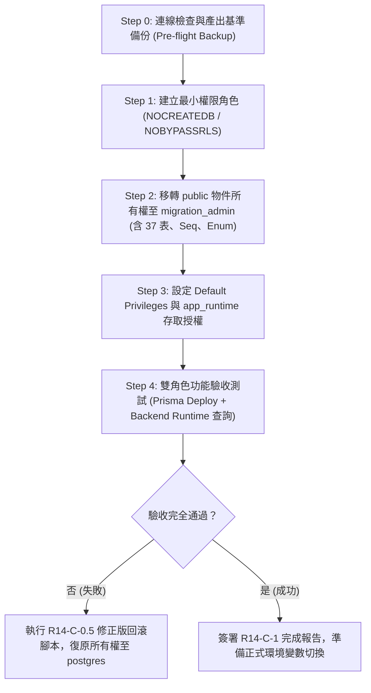

# CODE TO KNOW｜PHASE 3C-4F-R14-C-0.5
# 正式資料庫最小權限授權就緒評估與前置審核清單

**文件編號**：`DATABASE_PHASE3C4F_R14C05_AUTHORIZATION_READINESS`  
**審查日期**：2026-11-09  
**審查性質**：唯讀安全審查與正式授權就緒評估（無任何雲端寫入操作）  
**對應階段**：PHASE 3C-4F-R14-C-0.5  
**前置文件**：  
- `docs/DATABASE_PHASE3C4F_R14C05_FINAL_SQL_SECURITY_REVIEW.md`  
- `docs/DATABASE_PHASE3C4F_R14C05_PERMISSION_MATRIX_FINAL.md`  
- `docs/DATABASE_PHASE3C4F_R14C05_ROLLBACK_GAP_ANALYSIS.md`

---

## 一、審核目的與範圍

本文件為 `CODE TO KNOW` 專案在進入正式資料庫權限調整（`R14-C`）前之**最高等級安全閘門（Security Gate）**。

其核心職責為：
1. 嚴格分類所有技術主張的驗證狀態（「已證實」、「合理推論」、「未驗證」）。
2. 明列正式執行前專案負責人必須審核並核准的授權檢核點。
3. 明確列出當前絕對禁止執行的雲端操作清單（AUTH-C-01 ～ AUTH-C-05）。
4. 提供 DBA 與專案維運人員安全可依循的操作手冊（Runbook）。

---

## 二、技術項目狀態分級清單 (Verification Status Matrix)

| 分類層級 | 定義說明 | 包含項目 |
| :--- | :--- | :--- |
| **已證實** (Proven by Code/Test) | 經由本機程式碼分析、實體測試案例或沙盒測試完全確認 | 1. **Prisma Schema 物件總數**：36 個業務模型 + 1 個 Migration 歷史表，在 PostgreSQL 實體層共有 **37 個 Base Tables**。 2. **自訂 Enum Type 存在性**：`AnnouncementStatus` ('DRAFT', 'PUBLISHED', 'ARCHIVED') 確實由 Migration 建立，必須由 `migration_admin` 擁有。 3. **後端單元測試與安全防護**：全專案 105 個單元測試通過，TLS `sslmode=verify-full` 與 Pooler 使用者名稱檢查機制運作正常。 4. **AES-256-GCM 加解密工具**：`scripts/database/backup-crypto.cjs` 具備 12-byte Nonce、16-byte Tag 與 SHA-256 校驗，單元測試覆蓋健全。 |
| **合理推論** (Inferred from Standards) | 符合 PostgreSQL 官方規範與標準行為，技術邏輯嚴密，但在 Supabase 託管環境尚未直接執行 | 1. **`migration_admin` 移除 `CREATEDB` 之充分性**：`prisma migrate deploy` 僅更新 `_prisma_migrations` 與執行 DDL，官方規範無需 `CREATEDB`。 2. **`AuditLog` Append-only 防護有效性**：`REVOKE UPDATE, DELETE ON "AuditLog" FROM app_runtime` 在 PostgreSQL 標準權限體系下，可百分之百阻斷修改與刪除。 3. **PL/pgSQL 迴圈移轉安全性**：指定 `schemaname = 'public'` 針對性移轉物件所有權，可避開 Supabase 系統內部 schema 的權限衝突。 |
| **未驗證** (Cloud Specific / Must Verify) | 涉及 Supabase 雲端特定配置、網路層或權限約束，必須在正式執行時於連線當下立即驗證 | 1. **Supabase Pooler (Supavisor) 雙角色路由能力**：確認在 Session Mode 下（Port 5432），Pooler 是否能順暢接受以 `migration_admin` 與 `app_runtime` 兩種不同憑證發起的連線。 2. **Supabase 託管環境對自訂 Role 的管理介面可見度**：確認在 Supabase Studio UI 是否能正確辨識自訂角色的所有權與資料表。 3. **真實正式庫連線與基準備份產出**：尚未在雲端取得即時 dump 檔以驗證備份金鑰與加密串流。 |

---

## 三、雲端封鎖操作清單（未獲明確授權前嚴禁執行）

以下 5 項操作在本次安全審查後，**依然處於強制封鎖狀態**，直到專案負責人明確簽發下一階段操作命令：

| 授權代碼 | 封鎖操作內容 | 封鎖理由與風險 |
| :--- | :--- | :--- |
| **AUTH-C-01** | 連線 Supabase 正式資料庫執行任何 DDL / DML / SQL | 避免未經簽核的任何指令意外變更線上生產環境 |
| **AUTH-C-02** | 在正式資料庫建立或修改角色 (`app_runtime`, `migration_admin`) | 角色一旦建立且賦權不當，可能引發連線失敗或權限外洩 |
| **AUTH-C-03** | 執行資料表、Sequence 或 Enum Type 的所有權移轉 (`ALTER OWNER`) | 所有權移轉會變更 DDL 存取限制，若失敗可能阻斷後端服務 |
| **AUTH-C-04** | 從正式資料庫拉取即時 pg_dump 或執行正式冷還原 | 避免正式連線字串暴露，且防止線上資料庫遭受備份鎖定或流量衝擊 |
| **AUTH-C-05** | 在 Render 或正式環境部署注入新角色的連線字串並重新部署 | 在未通過完整雙角色驗證前切換正式連線，將直接導致線上服務中斷 (500) |

---

## 四、專案負責人簽核檢核點 (Approval Gating Checklist)

在啟動正式執行（`R14-C-1`）之前，專案負責人與執行團隊必須逐一確認以下檢核項：

- [ ] **G-01（審查文件簽核）**：專案負責人已審閱並核可 `R14-C-0.5` 之三份修訂文件（安全審查、權限矩陣、回滾分析）。
- [ ] **G-02（正式備份密鑰與金鑰分離）**：已為正式環境產出獨立的 32-byte 隨機主金鑰（`BACKUP_ENCRYPTION_KEY`），並妥善保管於密碼庫，嚴禁寫入 Git 或共享文件。
- [ ] **G-03（基準備份就緒）**：正式執行所有權移轉之「前一分鐘」，必須透過唯讀連線執行全量加密備份，並通過 `backup-crypto.cjs` 驗證 Checksum。
- [ ] **G-04（維護窗口預告）**：排定正式操作時間，預先設定後端服務維護頁面，確保無使用者在操作期間進行寫入。
- [ ] **G-05（回滾腳本待命）**：`DATABASE_PHASE3C4F_R14C05_ROLLBACK_GAP_ANALYSIS.md` 中修正後的等冪回滾 SQL 已就緒，且負責人員熟悉中斷時的還原程序。

---

## 五、後續正式執行操作流程手冊 (Runbook Overview)

當取得正式授權並進入 `R14-C-1` 時，必須嚴格依循下列順序操作：

---

## 六、本階段審查結論

`PHASE 3C-4F-R14-C-0.5` 的安全複核與技術規格修訂工作已全數完成。

本階段產出的修訂版 SQL 草案、權限矩陣與回滾規範已徹底排除過度授權（移除 `CREATEDB`）、物件遺漏（納入 Enum Type）與回滾死鎖風險，具備高度技術正確性與操作防護。

依據最高安全限制規範，本階段評定結論為：

### **審核判定：PARTIAL PASS（技術複核與規劃修正合格，正式雲端操作保持封鎖）**
