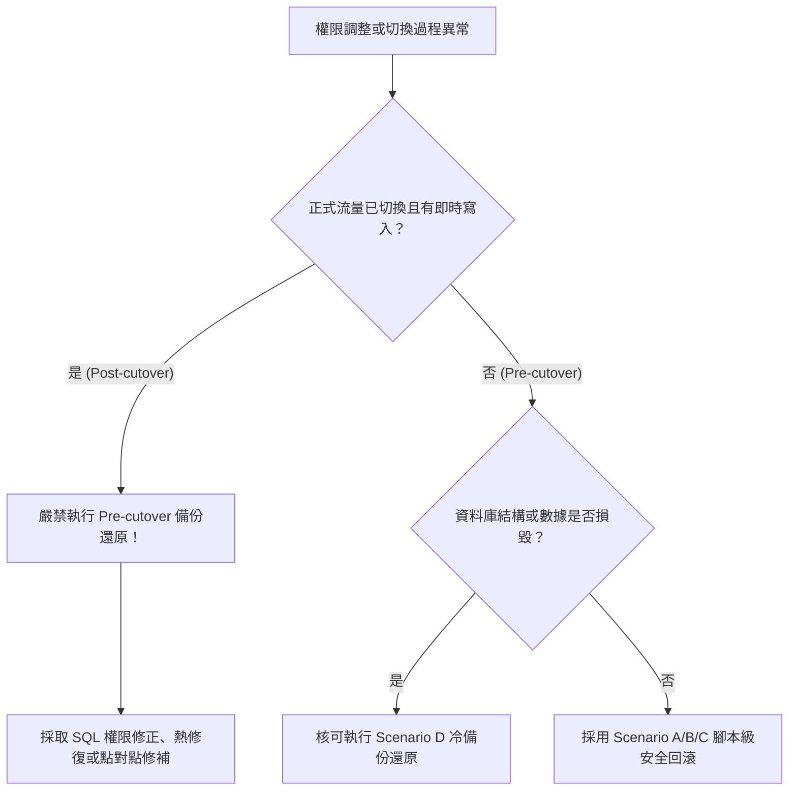

# CODE TO KNOW｜PHASE 3C-4F-R14-C-0.5
# 權限變更回滾缺口深度分析與修訂版回滾腳本規範

**文件編號**：`DATABASE_PHASE3C4F_R14C05_ROLLBACK_GAP_ANALYSIS`  
**審查日期**：2026-11-09  
**審查性質**：唯讀安全分析與回滾規格補強（不連線正式資料庫、不執行任何 SQL）  
**對應階段**：PHASE 3C-4F-R14-C-0.5 (W-05)  
**參照規劃**：`DATABASE_PHASE3C4F_R14C0_ROLLBACK_AND_RECOVERY_PLAN.md`

---

## 一、審查背景與目標

在 `R14-C-0` 的規劃中，提出了四種情境（Scenario A～D）的回滾方案。本複核（`R14-C-0.5`）針對上述回滾邏輯進行深度批判性審查，識別以下四項關鍵安全缺口：

1. **Scenario A（移轉中斷回滾）缺少物件類別涵蓋**：原草案僅考慮 `TABLE` 與 `SEQUENCE`，遺漏自訂 Enum 類型（`TYPE "AnnouncementStatus"`），若中斷回滾未還原 Type 擁有者，將導致系統處於所有權撕裂狀態。
2. **Scenario B（權限不足或異常回滾）缺少嚴謹的 Default Privileges 重設**：原草案未提供復原預設權限至變更前初始狀態的確切 DDL。
3. **Scenario C（完全撤除角色回滾）存在 PostgreSQL `DROP ROLE` 依賴性死鎖**：PostgreSQL 引擎在目標角色仍擁有物件或仍被賦予依賴權限時，執行 `DROP ROLE` 會直接拋出 `ERROR: role "..." cannot be dropped because some objects depend on it`。原草案缺少前置安全清理（`DROP OWNED BY`、`REVOKE ALL` 與相依性檢查）。
4. **Scenario D（冷備份還原）缺乏「上線前」與「上線後」的時機分水嶺**：若系統已切換正式流量並產生真實使用者數據，強行恢復上線前的全量備份將造成**災難性的不可逆數據遺失（Data Loss）**。

---

## 二、四大情境缺口深度剖析 (Gap Analysis)

### 2.1 Scenario A 缺口分析：所有權移轉中斷時的不一致

- **問題定位**：R14-C-0 的移轉腳本包含資料表、Sequence 與 Enum 類型。若在 PL/pgSQL 執行中途拋出例外（例如部分鎖定超時），交易若未完整原子回滾，部分資料表所有人為 `migration_admin`，其餘為 `postgres`，Enum 所有人不明。
- **風險等級**：**HIGH**
- **修訂對策**：
  - 移轉程序必須包裹於單一 `BEGIN ... COMMIT` 交易區塊，或透過顯式例外處理 (`EXCEPTION WHEN OTHERS THEN RAISE NOTICE ...; ROLLBACK;`)。
  - 回滾腳本必須具備「等冪反向移轉」能力：掃描 `public` schema 下所有非 `postgres` 擁有的資料表、Sequence、Views 與自訂 Types，全數無條件安全歸還予 `postgres`。

### 2.2 Scenario B 缺口分析：Default Privileges 撤除遺漏

- **問題定位**：在移轉與授予過程中，若授予了 `ALTER DEFAULT PRIVILEGES FOR ROLE migration_admin IN SCHEMA public GRANT ... TO app_runtime`，回滾時若僅執行 `REVOKE ... ON ALL TABLES`，並未撤銷該 Default Privilege 定義。未來 `migration_admin` 新建的資料表將繼續被自動授予給 `app_runtime`，造成權限幽靈繼承。
- **風險等級**：**MEDIUM**
- **修訂對策**：
  - 回滾腳本必須顯式執行反向的 `ALTER DEFAULT PRIVILEGES FOR ROLE migration_admin IN SCHEMA public REVOKE ...`。

### 2.3 Scenario C 缺口分析：`DROP ROLE` 相依性陷阱

- **問題定位**：PostgreSQL 嚴格要求，在 `DROP ROLE <rolename>` 之前：
  1. 該角色不能擁有任何資料庫物件（包括 Schema、Table、Sequence、Type、Function 等）。
  2. 該角色在其他物件上的權限必須被清理。
  3. 該角色自訂的 Default Privileges 必須被清理。
  若直接執行 `DROP ROLE migration_admin;`，將遭遇：
  ```sql
  ERROR: role "migration_admin" cannot be dropped because some objects depend on it
  DETAIL: owner of type "AnnouncementStatus"
          owner of table "User"
          privileges for database postgres
  ```
- **風險等級**：**HIGH**
- **修訂對策**：
  - 在執行 `DROP ROLE` 之前，必須執行：
    1. 將所有物件重新指派給 `postgres`：`REASSIGN OWNED BY migration_admin TO postgres;`（限於已確認可清空的特定 DB）。
    2. 撤銷該角色擁有的殘留權限：`DROP OWNED BY migration_admin;`。
    3. 斷開該角色的任何活躍連線：`pg_terminate_backend()`。
    4. 查詢 `pg_shdescription` 或 `pg_depend` 確認無殘留，最後方可執行 `DROP ROLE IF EXISTS`。

### 2.4 Scenario D 缺口分析：冷備份還原的災難性數據覆蓋

- **問題定位**：備份還原是最後防線，但**絕不能在上線後且已有即時業務寫入的情境下直接全量覆蓋**。
- **時機邊界明確化**：
  - **適用情境（Pre-cutover Rollback）**：權限調整過程中資料庫結構損毀、系統無法啟動，且此時**尚未切換正式流量**（無任何真實使用者或業務數據）。此時執行 `pg_restore --clean` 是安全的。
  - **禁止情境（Post-cutover Traffic Active）**：正式切換完成、已開放使用者登入、解題、送出考卷後。若此時因權限問題故障，**嚴禁全量還原 pre-cutover 備份**，否則會抹殺所有即時交易與作答紀錄！此時只能透過 SQL 修正權限（Scenario A/B）或執行熱修復。
- **風險等級**：**CRITICAL**

---

## 三、修正版等冪回滾 SQL 規格（審查草案，未授權前禁止執行）

以下腳本為審查修訂版本，具備完整的物件防護（包含 Enum Types 與 Default Privileges），並安全規避 PostgreSQL 依賴性死鎖。

```sql
-- ==============================================================================
-- CODE TO KNOW — Production Rollback Script (R14-C-0.5 Revised)
-- 目的：將 public schema 所有物件所有權安全歸還 postgres，撤銷最小權限角色並清理
-- 注意：此為受控技術規範草案，僅供授權審查，嚴禁未經專案負責人授權私自執行！
-- ==============================================================================

BEGIN;

-- ------------------------------------------------------------------------------
-- 步驟 1：終止目標角色的所有現存連線，防止鎖定競爭
-- ------------------------------------------------------------------------------
SELECT pg_terminate_backend(pid)
FROM pg_stat_activity
WHERE usename IN ('app_runtime', 'migration_admin')
  AND pid <> pg_backend_pid();

-- ------------------------------------------------------------------------------
-- 步驟 2：安全歸還 public schema 下的所有物件所有權至 postgres
-- 涵蓋：TABLES, VIEWS, SEQUENCES, CUSTOM TYPES (ENUMS)
-- ------------------------------------------------------------------------------
DO $$
DECLARE
    r RECORD;
BEGIN
    -- 2.1 歸還所有資料表與檢視表
    FOR r IN (
        SELECT tablename 
        FROM pg_tables 
        WHERE schemaname = 'public' 
          AND tableowner IN ('migration_admin', 'app_runtime')
    ) LOOP
        EXECUTE format('ALTER TABLE public.%I OWNER TO postgres;', r.tablename);
        RAISE NOTICE 'Reverted ownership of table: % to postgres', r.tablename;
    END LOOP;

    -- 2.2 歸還所有 Sequence
    FOR r IN (
        SELECT sequence_name 
        FROM information_schema.sequences 
        WHERE sequence_schema = 'public'
    ) LOOP
        EXECUTE format('ALTER SEQUENCE public.%I OWNER TO postgres;', r.sequence_name);
        RAISE NOTICE 'Reverted ownership of sequence: % to postgres', r.sequence_name;
    END LOOP;

    -- 2.3 歸還所有自訂 Type（包含 Enum "AnnouncementStatus" 等）
    FOR r IN (
        SELECT t.typname
        FROM pg_type t
        JOIN pg_namespace n ON n.oid = t.typnamespace
        JOIN pg_roles ro ON ro.oid = t.typowner
        WHERE n.nspname = 'public'
          AND t.typtype = 'e' -- Enum types
          AND ro.rolname IN ('migration_admin', 'app_runtime')
    ) LOOP
        EXECUTE format('ALTER TYPE public.%I OWNER TO postgres;', r.typname);
        RAISE NOTICE 'Reverted ownership of type: % to postgres', r.typname;
    END LOOP;

    -- 2.4 歸還 public schema 本身
    ALTER SCHEMA public OWNER TO postgres;
    RAISE NOTICE 'Reverted ownership of schema public to postgres';
END $$;

-- ------------------------------------------------------------------------------
-- 步驟 3：清理預設權限 (Default Privileges)
-- ------------------------------------------------------------------------------
ALTER DEFAULT PRIVILEGES FOR ROLE migration_admin IN SCHEMA public REVOKE ALL ON TABLES FROM app_runtime;
ALTER DEFAULT PRIVILEGES FOR ROLE migration_admin IN SCHEMA public REVOKE ALL ON SEQUENCES FROM app_runtime;
ALTER DEFAULT PRIVILEGES FOR ROLE migration_admin IN SCHEMA public REVOKE ALL ON TYPES FROM app_runtime;

-- ------------------------------------------------------------------------------
-- 步驟 4：全面撤銷目標角色的既有權限
-- ------------------------------------------------------------------------------
REVOKE ALL PRIVILEGES ON ALL TABLES IN SCHEMA public FROM app_runtime, migration_admin;
REVOKE ALL PRIVILEGES ON ALL SEQUENCES IN SCHEMA public FROM app_runtime, migration_admin;
REVOKE ALL PRIVILEGES ON ALL FUNCTIONS IN SCHEMA public FROM app_runtime, migration_admin;
REVOKE ALL PRIVILEGES ON SCHEMA public FROM app_runtime, migration_admin;
REVOKE CONNECT ON DATABASE postgres FROM app_runtime, migration_admin;

-- ------------------------------------------------------------------------------
-- 步驟 5：解除相依性並刪除角色 (完全撤除情境)
-- ------------------------------------------------------------------------------
-- 透過 DROP OWNED 確保該角色在整個資料庫無任何殘留依賴
DROP OWNED BY migration_admin;
DROP OWNED BY app_runtime;

-- 正式移除角色
DROP ROLE IF EXISTS app_runtime;
DROP ROLE IF EXISTS migration_admin;

COMMIT;

-- ------------------------------------------------------------------------------
-- 步驟 6：驗證清理結果
-- ------------------------------------------------------------------------------
SELECT rolname FROM pg_roles WHERE rolname IN ('app_runtime', 'migration_admin');
-- 預期輸出：0 列

SELECT tablename, tableowner FROM pg_tables WHERE schemaname = 'public' AND tableowner <> 'postgres';
-- 預期輸出：0 列
```

---

## 四、冷備份還原防線操作規範（Scenario D 專用準則）

### 4.1 觸發時機判斷樹



### 4.2 Scenario D 執行防護清單

1. **解密驗證**：必須使用 `scripts/database/backup-crypto.cjs` 進行解密，且必須驗證：
   - 16-byte GCM Authentication Tag 認證無誤。
   - 解密後 plaintext 之 SHA-256 Checksum 與備份元數據簽章 100% 一致。
2. **連線阻斷**：還原前停止後端服務（Render Web Service 置於維護模式或暫停），確保無並行寫入。
3. **還原驗證**：還原至 PG17 本機沙盒進行空跑驗證，確認資料表計數（37 表）、Sequence 目前值與 Enum 定義皆正確無損，才允許向專案負責人申請正式庫操作。

---

## 五、結論與後續交接

本回滾缺口分析已徹底修補 `R14-C-0` 遺漏的：
1. **Enum Type 所有權歸還**。
2. **Default Privileges 雙向清理**。
3. **`DROP OWNED BY` 解除 `DROP ROLE` 引擎相依性死鎖**。
4. **確立上線前後的還原邊界，杜絕業務數據遭舊備份抹除的嚴重風險**。

本文件為回滾機制的最終技術規範，已收錄於 `DATABASE_PHASE3C4F_R14C05_FINAL_SQL_SECURITY_REVIEW.md` 共同交付。
