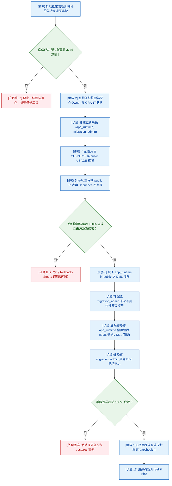

# CODE TO KNOW｜Supabase 正式庫最小權限 DDL 審查與完整回滾方案 (Phase 3C-4F-R14-C-0)

**文件識別碼**：`DOC-DB-PHASE3C4F-R14C0-SQL`  
**建立時間**：2026-11-09  
**版次**：v1.0.0  
**主導角色**：獨立資安審查員 / PostgreSQL DBA / 後端安全架構師  
**審查性質**：100% 唯讀審查與草案制定（零雲端連線、零資料庫執行、草案僅供審核）  
**前置文件**：`docs/DATABASE_PHASE3C4F_R14C0_MINIMUM_PRIVILEGE_IMPLEMENTATION_PLAN.md`

---

## 一、文件性質聲明與安全警告

> [!CAUTION]
> **重要聲明**：
> 本文件中列出之所有 SQL 語句均為**技術審查草案（Review Draft）**，專供專案負責人審核與未來的授權執行參考。
> **本階段嚴格禁止將本草案連線或複製至 Supabase 正式資料庫執行！**

---

## 二、十一階段標準實施順序與停止條件 (W-06)

在獲得正式授權進入 R14-C 實施時，必須依據以下 11 個原子化步驟推展，每一步驟均設有硬性驗收標準與停止條件：



---

## 三、各步驟詳細 SQL 審查草案與執行語法

### 步驟 2：記錄原始狀態唯讀查詢語法
```sql
-- 審查草案：記錄當前 public schema 下所有資料表與序列之原始 Owner
SELECT 
    schemaname, 
    tablename, 
    tableowner 
FROM pg_tables 
WHERE schemaname = 'public' 
ORDER BY tablename;

SELECT 
    sequence_schema, 
    sequence_name, 
    sequenceowner 
FROM information_schema.sequences 
WHERE sequence_schema = 'public' 
ORDER BY sequence_name;
```

### 步驟 3 & 4：角色建立與連線權限配置草案
```sql
-- 審查草案：建立新角色（密碼於執行當下隨機生成，嚴禁硬編碼）
CREATE ROLE migration_admin WITH 
    LOGIN 
    PASSWORD '***MIGRATION_ADMIN_STRONG_PASSWORD***' 
    NOSUPERUSER 
    CREATEDB 
    NOCREATEROLE 
    NOBYPASSRLS;

CREATE ROLE app_runtime WITH 
    LOGIN 
    PASSWORD '***APP_RUNTIME_STRONG_PASSWORD***' 
    NOSUPERUSER 
    NOCREATEDB 
    NOCREATEROLE 
    NOBYPASSRLS;

-- 授予資料庫連線權限與 Schema 基本使用權
GRANT CONNECT ON DATABASE postgres TO migration_admin;
GRANT CONNECT ON DATABASE postgres TO app_runtime;

GRANT USAGE, CREATE ON SCHEMA public TO migration_admin;
GRANT USAGE ON SCHEMA public TO app_runtime;
```

### 步驟 5：手術式所有權移轉草案（排除全局 REASSIGN OWNED）
```sql
-- 審查草案：手術式單一 Schema 所有權移轉（限制於 public，杜絕系統 Schema 污染）
DO $$
DECLARE
    r RECORD;
BEGIN
    -- 1. 移轉 public 下所有實體資料表（包含 36 張業務表與 1 張 _prisma_migrations）
    FOR r IN (SELECT tablename FROM pg_tables WHERE schemaname = 'public') LOOP
        EXECUTE 'ALTER TABLE public.' || quote_ident(r.tablename) || ' OWNER TO migration_admin;';
    END LOOP;

    -- 2. 移轉 public 下所有自增序列
    FOR r IN (SELECT sequence_name FROM information_schema.sequences WHERE sequence_schema = 'public') LOOP
        EXECUTE 'ALTER SEQUENCE public.' || quote_ident(r.sequence_name) || ' OWNER TO migration_admin;';
    END LOOP;
END $$;
```

### 步驟 6 & 7：DML 授權與預設權限配置草案
```sql
-- 審查草案：授予 app_runtime 對既有 public 表之純 DML 權限（零 DDL）
GRANT SELECT, INSERT, UPDATE, DELETE ON ALL TABLES IN SCHEMA public TO app_runtime;
GRANT USAGE, SELECT, UPDATE ON ALL SEQUENCES IN SCHEMA public TO app_runtime;

-- 嚴格收回 app_runtime 對 Prisma 遷移記錄表之存取權限
REVOKE ALL PRIVILEGES ON TABLE public._prisma_migrations FROM app_runtime;

-- 審查草案：配置 migration_admin 未來新建物件之預設權限
ALTER DEFAULT PRIVILEGES FOR ROLE migration_admin IN SCHEMA public 
  GRANT SELECT, INSERT, UPDATE, DELETE ON TABLES TO app_runtime;

ALTER DEFAULT PRIVILEGES FOR ROLE migration_admin IN SCHEMA public 
  GRANT USAGE, SELECT, UPDATE ON SEQUENCES TO app_runtime;
```

### 步驟 8 & 9：權限邊界驗收測試語法（非破壞性）
```sql
-- 驗收 1：確認所有 37 張資料表 Owner 已變更為 migration_admin
SELECT COUNT(*) FROM pg_tables WHERE schemaname = 'public' AND tableowner = 'migration_admin';
-- 預期回傳值：37

-- 驗收 2：確認所有 Sequence Owner 已變更為 migration_admin
SELECT COUNT(*) FROM information_schema.sequences WHERE sequence_schema = 'public' AND sequenceowner = 'migration_admin';

-- 驗收 3：以 app_runtime 模擬查詢業務表（應成功）
SET ROLE app_runtime;
SELECT COUNT(*) FROM public.users;
RESET ROLE;

-- 驗收 4：以 app_runtime 模擬嘗試執行 DDL（應被 PG 強制阻斷報錯）
SET ROLE app_runtime;
-- 預期執行以下語句必須回傳 ERROR: permission denied for schema public
CREATE TABLE public.__security_test_fail (id int);
RESET ROLE;
```

---

## 四、失敗回滾方案 (Rollback Procedures)

若在實施過程中發生任何異常（如所有權移轉中斷、Prisma 連線異常、權限不足報錯），必須立即停止並依序執行以下回滾 DDL：

### 回滾情境 A：所有權移轉中途異常（還原回 `postgres`）
```sql
-- 回滾草案 A：將 public 下已移轉之物件所有權重新交還給 postgres 管理員
DO $$
DECLARE
    r RECORD;
BEGIN
    FOR r IN (SELECT tablename FROM pg_tables WHERE schemaname = 'public' AND tableowner = 'migration_admin') LOOP
        EXECUTE 'ALTER TABLE public.' || quote_ident(r.tablename) || ' OWNER TO postgres;';
    END LOOP;

    FOR r IN (SELECT sequence_name FROM information_schema.sequences WHERE sequence_schema = 'public' AND sequenceowner = 'migration_admin') LOOP
        EXECUTE 'ALTER SEQUENCE public.' || quote_ident(r.sequence_name) || ' OWNER TO postgres;';
    END LOOP;
END $$;
```

### 回滾情境 B：撤銷 Default Privileges 與 Grants
```sql
-- 回滾草案 B：撤銷 Default Privileges 配置
ALTER DEFAULT PRIVILEGES FOR ROLE migration_admin IN SCHEMA public 
  REVOKE SELECT, INSERT, UPDATE, DELETE ON TABLES FROM app_runtime;

ALTER DEFAULT PRIVILEGES FOR ROLE migration_admin IN SCHEMA public 
  REVOKE USAGE, SELECT, UPDATE ON SEQUENCES FROM app_runtime;

-- 撤銷既有物件權限
REVOKE ALL PRIVILEGES ON ALL TABLES IN SCHEMA public FROM app_runtime;
REVOKE ALL PRIVILEGES ON ALL SEQUENCES IN SCHEMA public FROM app_runtime;
REVOKE USAGE ON SCHEMA public FROM app_runtime;
REVOKE USAGE, CREATE ON SCHEMA public FROM migration_admin;
```

### 回滾情境 C：完整清理新增之角色
```sql
-- 回滾草案 C：刪除建立之角色（確認無任何依賴物件後執行）
DROP ROLE IF EXISTS app_runtime;
DROP ROLE IF EXISTS migration_admin;
```

### 回滾情境 D：極端災難復原（資料庫結構受損）
- **處置措施**：
  若資料庫結構在操作過程中遭受非預期損毀，立即終止連線，使用切換前備份之 `pre_cutover_prod.dump.enc`，經由沙盒驗證後執行完整 `pg_restore` 還原，並保留事故日誌供後續審計。

---

## 五、回滾門檻與觸發指標 (Rollback Triggers)

符合以下任何一項條件時，**無須等待，必須立即啟動回滾**：
1. **[TRIG-01]** 執行所有權移轉時出現任何 `ERROR` 或未完成之表數 > 0。
2. **[TRIG-02]** `app_runtime` 連線測試時發現其具備 `CREATE TABLE` 或 `DROP TABLE` 權限。
3. **[TRIG-03]** `app_runtime` 連線後無法執行 `SELECT` 既有資料表。
4. **[TRIG-04]** `migration_admin` 執行 `prisma migrate deploy --dry-run` 或測試 DDL 失敗。
5. **[TRIG-05]** 後端健康檢查端點 `/api/health` 回傳 `database.status: disconnected`。
