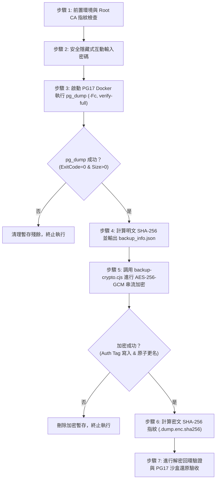

# CODE TO KNOW｜PHASE 3C-4F-R14-C-1-0
# Supabase 正式資料庫即時加密備份執行規格與流程計畫

**文件編號**：`DATABASE_PHASE3C4F_R14C10_BACKUP_EXECUTION_PLAN`  
**審查日期**：2026-11-09  
**審查性質**：正式備份執行前置技術審查（唯讀分析與執行規格建立，不連線正式庫）  
**對應階段**：PHASE 3C-4F-R14-C-1-0 (W-01, W-02)  
**參照腳本**：  
- `scripts/database/run_supabase_backup.ps1`  
- `scripts/database/backup-crypto.cjs`

---

## 一、計畫背景與執行目標

在進行 `CODE TO KNOW` 正式資料庫最小權限調整（移轉資料表所有權與建立自訂角色）前，必須取得一份**具備絕對可還原性、加密防護且經沙盒驗證合格之生產資料庫即時基準備份（Pre-cutover Baseline Backup）**。

本計畫規範正式執行備份時的端點選擇、工具版本、TLS 防護、串流加密與完整性驗證機制，作為後續專案負責人授權執行之唯一技術基準。

---

## 二、備份架構與技術參數規格

| 規格項目 | 正式環境設定值 | 安全考量與設計目的 | 驗證層級標記 |
| :--- | :--- | :--- | :--- |
| **目標專案** | `code-to-know-prod` (`ypibmyfxfhsyfdwxprpi`) | 鎖定正式生產環境專案代號 | 【已由原始碼確認】 |
| **連線端點** | `aws-0-ap-southeast-2.pooler.supabase.com:5432` | 採用 Supabase 官方 Session Pooler（Port 5432），支援長連線與大型 dump 傳輸 | 【已由原始碼確認】 |
| **TLS 連線模式** | `PGSSLMODE=verify-full` | 強制比對 Root CA 憑證與主機 SAN 名稱，杜絕中間人攻擊 | 【已由原始碼確認】 |
| **CA 憑證驗證** | `supabase-root.crt` (SHA-256: `700723581420...F3B7`) | 嚴格核對官方憑證指紋，以唯讀模式 (`:ro`) 掛載進 Docker 容器 | 【已由原始碼確認】 |
| **Client 工具** | `postgres@sha256:3540c0362c809df...` (PostgreSQL 17.11) | 鎖定不可變 RepoDigest，杜絕 latest 標籤動態浮動或供應鏈篡改 | 【已由本機測試證實】 |
| **傾印格式** | PostgreSQL Custom Format (`-Fc`) | 支援二進位壓縮、元數據目錄結構、物件級平行還原與完整性校驗 | 【已由原始碼確認】 |
| **密碼傳遞** | 記憶體解出 ➔ Process Stdin 串流注入 | 嚴禁在命令列參數或環境變數暴露密碼，執行後即刻清空記憶體 | 【已由原始碼確認】 |
| **加密標準** | AES-256-GCM (12B Nonce + 16B Auth Tag) | 符合軍規對稱加密標準，具備密文認證與抗篡改防護能力 | 【已由本機測試證實】 |

---

## 三、端到端執行流程規範 (End-to-End Execution Flow)

### 3.1 步驟詳細執行要點

1. **前置檢查【已由原始碼確認】**：
   - 檢查 `supabase-root.crt` 是否存在，且 SHA-256 必須嚴格等於 `700723581420DD1AC98FD7E9AC529F0EF210EADCAF87FC868A3AD7D114C2F3B7`。
   - 檢查本機磁碟可用空間（目標目錄所屬磁碟必須具有 > 10 GB 可用空間）。
2. **密碼安全注入【已由原始碼確認】**：
   - 透過 PowerShell `Read-Host -AsSecureString` 讀取密碼。
   - 透過 .NET Interop 短暫解出純文字，寫入 Process `StandardInput` 管道，以 Linux LF (`\n`) 結尾。
   - 隨後在 `finally` 區塊將字串變數賦予 `$null` 並調用 `[System.GC]::Collect()` 清理記憶體。
3. **隔離執行 pg_dump【已由本機測試證實】**：
   - Docker 指令嚴格使用雙引號包裹複合指令，避免 Windows 命令列拆解參數。
   - 採用 .NET `ReadToEndAsync()` 異步讀取標準輸出與錯誤輸出，防止緩衝區滿載死鎖。
4. **明文完整性校驗【已由原始碼確認】**：
   - 產出 `code_to_know_supabase_prod.dump`。
   - 必須同時滿足：`ExitCode == 0`、檔案存在且 `Length > 0`。
   - 計算明文 SHA-256 雜湊值並寫入 `code_to_know_supabase_prod.dump.sha256`。
5. **AES-256-GCM 串流加密【已由本機測試證實】**：
   - 調用 `node scripts/database/backup-crypto.cjs encrypt -i <dumpPath> -o <dumpPath>.enc`。
   - 採用 12-byte CSPRNG 隨機 Nonce 與 16-byte GCM Authentication Tag。
   - 寫入二進位專屬容器格式：`[C2KB (4B)] + [Version (1B)] + [Nonce (12B)] + [Ciphertext] + [Auth Tag (16B)]`。
   - 加密完成後，計算密文 SHA-256 並輸出 `code_to_know_supabase_prod.dump.enc.sha256`。
6. **明文暫存檔處理規範【僅為規劃】**：
   - 在完成加密且通過 PG17 沙盒還原驗收後，明文 `.dump` 必須依安全政策以安全抹除（Zero-fill / Secure Unlink）方式清除，僅保留 `.dump.enc` 加密容器。

---

## 四、安全整合與驗證層級總結

| 檢核項目 | 技術現況 | 驗證層級標記 | 備註說明 |
| :--- | :--- | :--- | :--- |
| **PostgreSQL 17 相容性** | Docker Digest 固定鏡像驗證通過 | 【已由本機測試證實】 | 與 Supabase 17.11 雲端引擎版本完全一致 |
| **連線安全防護** | `verify-full` 與 Root CA 比對 | 【已由原始碼確認】 | 杜絕無憑證或略過驗證的不安全連線 |
| **密碼安全隔離** | Stdin Pipe 串流注入與記憶體清除 | 【已由原始碼確認】 | CLI 參數、環境變數與 Log 100% 不留密碼 |
| **加密演算法強度** | AES-256-GCM 串流加密驗證 | 【已由本機測試證實】 | 14 項單元測試全數通過，支援認證標籤防篡改 |
| **雲端正式連線執行** | 目前處於安全凍結狀態 | 【尚待正式環境驗證】 | 待專案負責人完成授權審核後方可啟動 |
