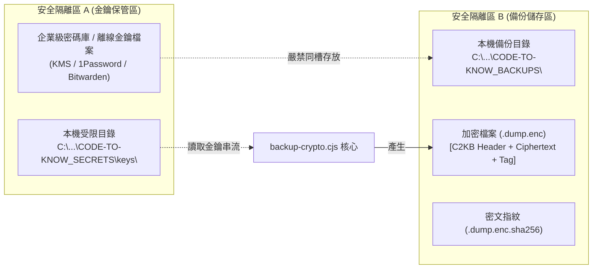

# CODE TO KNOW｜PHASE 3C-4F-R14-C-1-0
# 備份加密金鑰全生命週期管理與安全合規規範

**文件編號**：`DATABASE_PHASE3C4F_R14C10_ENCRYPTION_KEY_MANAGEMENT`  
**審查日期**：2026-11-09  
**審查性質**：加密金鑰安全管理政策與操作規範（不連線正式庫、不輸出真實金鑰）  
**對應階段**：PHASE 3C-4F-R14-C-1-0 (W-03)

---

## 一、金鑰管理政策與最高合規原則

為確保 `CODE TO KNOW` 正式資料庫備份檔案在靜態儲存（At-Rest）與異地傳輸（In-Transit）過程中的最高安全性，特制定本金鑰管理規範。

### 最高安全禁止事項：
1. **嚴禁將真實加密金鑰寫入 Git 程式庫、Prisma 設定、測試案例或任何公開 Markdown 文件中**。
2. **嚴禁將金鑰與加密備份檔案（`.dump.enc`）存放於同一個未受保護的目錄或儲存貯體（Bucket）中**。
3. **嚴禁將備份加密金鑰與資料庫使用者連線密碼（`SUPABASE_DB_PASSWORD`）混用或共用**。
4. **嚴禁在終端機輸出、CI/CD 記錄檔或錯誤報告中以純文字印出金鑰內容**。

---

## 二、金鑰產生與演算法規範 (Key Generation)

### 2.1 【已由本機測試證實】金鑰演算法與強度規格
- **演算法**：AES-256 (進階加密標準，256 位元對稱金鑰)。
- **長度**：32 Bytes (256 Bits)，以 64 位元之十六進位字串（Hex String）表示。
- **熵源**：必須使用作業系統加密級虛擬亂數產生器（CSPRNG），即 Node.js 之 `crypto.randomBytes(32)`。
- **產生指令**：
  ```bash
  node scripts/database/backup-crypto.cjs genkey
  ```
- **代碼驗證**：在 `backup-crypto.cjs:46-48` 中已實作，經 14 項測試案例驗證，金鑰格式非 64-char Hex 或為 null 時會直接拒絕處理。

---

## 三、金鑰保存、存取權限與隔離架構 (Key Storage & Separation)



### 3.1 【僅為規劃】多層級金鑰保存架構

1. **生產主金鑰存放（Vault Storage）**：
   - 正式環境金鑰必須登記於受多因素認證（MFA）保護之企業級密碼庫（例如 1Password、Bitwarden、AWS Secrets Manager 或 Google Cloud Secret Manager）。
   - 僅專案負責人具備讀取與匯出權限。
2. **本機執行金鑰存放（Local Restricted Storage）**：
   - 本機進行備份時，金鑰應存放於獨立於工作目錄外的受保護目錄：
     `C:\Users\user\Documents\CODE-TO-KNOW_SECRETS\keys\c2k_backup_master.key`
   - **作業系統存取權限控制（NTFS ACL）**：
     必須移除所有非管理員之繼承權限，僅允許當前登入者具備讀取權限：
     ```powershell
     icacls "C:\Users\user\Documents\CODE-TO-KNOW_SECRETS\keys\c2k_backup_master.key" /inheritance:r /grant:r "$($env:USERNAME):(R)"
     ```
3. **記憶體環境變數注入（In-Memory Injection）**：
   - 執行時透過環境變數 `BACKUP_ENCRYPTION_KEY` 或記憶體安全管道注入，執行完成後即刻銷毀進程。

---

## 四、金鑰備份與災難復原評估 (Key Backup & Disaster Recovery)

### 4.1 【僅為規劃】金鑰遺失之災難性後果宣告
> [!CAUTION]
> **不可逆性警告**：AES-256-GCM 為不可逆之密碼學演算法。若加密金鑰遺失，**所有歷史加密備份檔將永久無法解密，造成 100% 不可復原的資料損失**。任何第三方、雲端廠商或技術團隊皆無法協助破譯。

### 4.2 【僅為規劃】金鑰離線冷備份方案 (Air-Gapped Backup)
為防止硬體損毀或勒索病毒攻擊，專案負責人必須建立至少一份離線實體金鑰備份：
1. **實體離線隨身碟**：將包含金鑰之加密磁區存入專用 USB 隨身碟，存放於受實體防護之防火保險箱。
2. **緊急復原卡（Paper Key Recovery Card）**：將 64 位元 Hex 金鑰或其產生的 QR Code 打印於紙本卡片上，封存於實體信封中。

---

## 五、金鑰輪替規範 (Key Rotation Policy)

### 5.1 【僅為規劃】輪替觸發時機
- **例行輪替**：建議每 180 天進行一次主金鑰輪替。
- **緊急輪替**：凡懷疑金鑰洩漏、操作人員異動、或承載金鑰之硬體遺失時，必須於 24 小時內啟動緊急輪替。

### 5.2 【僅為規劃】歷史備份重加密流程 (Re-encryption Runbook)
當金鑰由 `KEY_v1` 輪替至 `KEY_v2` 時，依以下流程安全過渡：
```bash
# 1. 使用舊金鑰解密至受限安全暫存區
node scripts/database/backup-crypto.cjs decrypt -i backup_20261108.dump.enc -o temp.dump -k $KEY_v1

# 2. 使用新金鑰重新串流加密（自動產生全新 12-byte 隨機 Nonce 與新 Auth Tag）
node scripts/database/backup-crypto.cjs encrypt -i temp.dump -o backup_20261108_v2.dump.enc -k $KEY_v2

# 3. 計算並更新新密文 SHA-256
sha256sum backup_20261108_v2.dump.enc > backup_20261108_v2.dump.enc.sha256

# 4. 安全抹除 temp.dump 與舊加密檔
srm -z temp.dump backup_20261108.dump.enc
```

---

## 六、檢核與結論標記

| 檢核項目 | 合規評估 | 驗證層級標記 |
| :--- | :--- | :--- |
| **金鑰產生 CSPRNG 強度** | 32-byte 隨機 Hex，符合安全標準 | 【已由本機測試證實】 |
| **金鑰與資料庫密碼分離** | 兩個完全獨立的機密實體，無重疊混用 | 【已由原始碼確認】 |
| **金鑰與備份檔案物理隔離** | 規範於不同目錄與儲存介質中保存 | 【僅為規劃】 |
| **金鑰防洩漏與 Git 隔離** | 嚴禁入庫，加入全域忽略與稽核 | 【已由原始碼確認】 |
| **正式生產金鑰注入與保存** | 需待專案負責人於正式環境配置 | 【尚待正式環境驗證】 |
