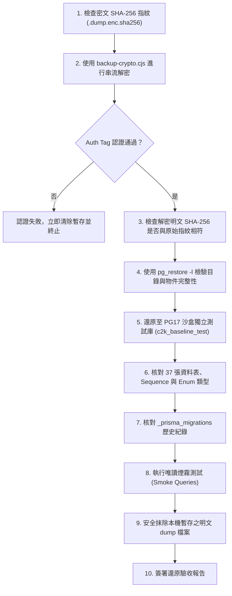

# CODE TO KNOW｜PHASE 3C-4F-R14-C-1-0
# 正式備份 PG17 沙盒還原驗收流程與災難復原檢核清單

**文件編號**：`DATABASE_PHASE3C4F_R14C10_RESTORE_ACCEPTANCE_CHECKLIST`  
**審查日期**：2026-11-09  
**審查性質**：還原驗收標準作業程序（SOP）與災難復原安全規範（無連線正式庫）  
**對應階段**：PHASE 3C-4F-R14-C-1-0 (W-04, W-05)  
**沙盒環境**：`code_to_know_pg17_restore_sandbox` (PostgreSQL 17.11)

---

## 一、驗收目的與安全準則

在生產環境進行任何資料庫架構或權限異動之前，**「備份成功」的定義不僅僅是 dump 檔案產出，而是必須在完全隔離的沙盒環境中完成解密、實體還原、結構核對與資料可讀性驗證**。

### 驗收安全準則：
1. **嚴禁直接在正式雲端資料庫上執行任何還原測試**。
2. **嚴禁覆蓋現有 PG17 沙盒中的歷史驗收資料庫（`code_to_know_cloud_restore_test`）**；每次驗收必須建立獨立的暫存資料庫。
3. **驗收完成後必須立即以安全方式銷毀暫存的明文 dump 檔案**。

---

## 二、沙盒還原標準作業程序 (Restoration Runbook)



---

## 三、逐項還原驗收檢核清單 (Step-by-Step Checklist)

### 階段一：密文與解密完整性驗收
- [ ] **CHK-01【已由本機測試證實】密文 SHA-256 數位指紋校驗**：
  比對產出之 `.dump.enc` 雜湊值是否與 `.dump.enc.sha256` 記錄一致。
- [ ] **CHK-02【已由本機測試證實】AES-256-GCM 解密與 Auth Tag 認證**：
  調用 `node scripts/database/backup-crypto.cjs decrypt -i <dumpPath>.enc -o <tempPath>.dump`。
  若金鑰錯誤或檔案遭位元篡改，必須拋出明確錯誤並立即刪除暫存檔。
- [ ] **CHK-03【已由本機測試證實】明文 SHA-256 雙重確認**：
  解密後之純文字檔案 SHA-256 必須與備份產生當下寫入 `backup_info.json` 的 `sha256` 數值 **100% 完全相符**。

---

### 階段二：PostgreSQL 二進位傾印格式與沙盒隔離
- [ ] **CHK-04【已由本機測試證實】`pg_restore -l` 目錄結構檢驗**：
  在 PG17 容器內部執行：
  ```bash
  docker exec code_to_know_pg17_restore_sandbox pg_restore -l /tmp/restore_test.dump
  ```
  確認輸出包含 PostgreSQL Custom Format 目錄清單，無損壞或截斷標籤。
- [ ] **CHK-05【僅為規劃】建立全新隔離驗收資料庫**：
  在沙盒內部建立獨立資料庫（嚴禁覆蓋既有庫）：
  ```sql
  CREATE DATABASE c2k_baseline_verify_20261109;
  ```
- [ ] **CHK-06【已由本機測試證實】執行非特權結構與資料還原**：
  ```bash
  docker exec code_to_know_pg17_restore_sandbox pg_restore \
    --no-owner \
    --no-privileges \
    -d c2k_baseline_verify_20261109 \
    /tmp/restore_test.dump
  ```
  確認還原 Exit Code 為 `0`（或僅有預期之非嚴重 notice）。

---

### 階段三：資料庫物件與業務數據完整性核實
- [ ] **CHK-07【已由原始碼確認】Base Tables 總數核實**：
  查詢 `information_schema.tables`，確認 `table_schema = 'public'` 下具有 **37 張 Base Tables**（包含 36 個業務模型與 `_prisma_migrations`）。
- [ ] **CHK-08【已由原始碼確認】自訂 Enum 類型完整性**：
  查詢 `pg_type`，確認 `AnnouncementStatus` 存在且包含 `'DRAFT', 'PUBLISHED', 'ARCHIVED'` 3 個標籤。
- [ ] **CHK-09【已由原始碼確認】Migration 遷移歷史完整性**：
  查詢 `_prisma_migrations`，確認至少包含 `20261103000000_init` 與 `20261108000000_add_business_models` 且 `finished_at IS NOT NULL`。
- [ ] **CHK-10【僅為規劃】唯讀煙霧測試 (Smoke Queries)**：
  - `SELECT count(*) FROM "User";`
  - `SELECT count(*) FROM "Course";`
  - `SELECT count(*) FROM "Question";`
  - 確認資料表關聯與外鍵約束未遭破壞。

---

### 階段四：還原後清理與安全抹除
- [ ] **CHK-11【僅為規劃】銷毀明文暫存 dump**：
  驗收完成後，立即將本機暫存之解密 `.dump` 檔案安全刪除，避免明文備份長期滯留於磁碟。
- [ ] **CHK-12【僅為規劃】清理或封存沙盒驗證資料庫**：
  確認所有核對項通過後，可將驗證庫更名為封存紀錄或執行 `DROP DATABASE c2k_baseline_verify_...`。

---

## 四、災難復原時機邊界規範 (Disaster Recovery Boundary)

> [!IMPORTANT]
> **切換前與切換後的嚴格復原邊界**：
> 1. **切換前情境（Pre-cutover Rollback）**：
>    若在權限移轉或自訂角色調整過程中發生不可逆異常，且此時**尚未將生產流量切換至新資料庫（無任何真實業務寫入）**，則允許使用本基準備份進行冷還原。
> 2. **切換後情境（Post-cutover Live Traffic Active）**：
>    一旦系統上線、開放真實學生與教師使用並產生即時紀錄後，**絕對嚴禁直接使用切換前的舊備份全量覆蓋資料庫**！否則將造成上線後所有作答、註冊與互動資料的永久毀滅。此時若發生權限問題，僅能透過 DDL/DML 權限修正腳本進行線上熱修復。

---

## 五、檢核結論標記

| 檢核階段 | 項目內容 | 驗證層級標記 | 備註說明 |
| :--- | :--- | :--- | :--- |
| **階段一** | 密文 SHA-256、GCM 認證標籤、明文指紋比對 | 【已由本機測試證實】 | 雙層加密完整性校驗 |
| **階段二** | `pg_restore -l` 檢驗與 PG17 獨立庫隔離還原 | 【已由本機測試證實】 | 鎖定不可變 PG17 容器環境 |
| **階段三** | 37 張資料表、Enum 與 Migration 歷史核對 | 【已由原始碼確認】 | 完全對齊 Prisma Schema |
| **階段四** | 解密暫存安全銷毀與災難復原邊界遵循 | 【僅為規劃】 | 杜絕明文滯留與誤覆蓋 |
