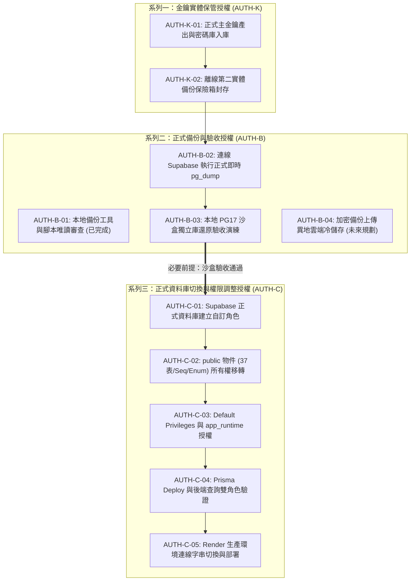

# CODE TO KNOW｜PHASE 3C-4F-R14-C-1-1
# 專案正式授權編號體系統一與跨文件對照規範

**文件編號**：`DATABASE_PHASE3C4F_R14C11_AUTHORIZATION_ID_RECONCILIATION`  
**審查日期**：2026-11-09  
**審查性質**：授權架構梳理與代號標準化（無任何雲端寫入或備份操作）  
**對應階段**：PHASE 3C-4F-R14-C-1-1 (W-05)  
**整合範圍**：`R14-C-0`, `R14-C-0.5`, `R14-C-0.6`, `R14-C-1-0`

---

## 一、歷史代號差異與混淆分析 (Reconciliation Context)

在 R14-C 系列的推進過程中，由於職責切分與安全顆粒度的細化，產生了以下代號演進與潛在重疊：

1. **R14-C-0.5 / R14-C-0.6 中的 `AUTH-C` 系列**：
   原將所有雲端操作混編為 `AUTH-C-01` 至 `AUTH-C-05`，其中 `AUTH-C-04` 定義為「從正式庫拉取 pg_dump 備份」。
2. **R14-C-1-0 中的 `AUTH-B` 系列**：
   為突顯「備份先行於架構變更」的最高安全原則，引入了備份專屬的 `AUTH-B-01` 至 `AUTH-B-05`。其中 `AUTH-B-03` 同樣代表執行雲端 pg_dump。
3. **金鑰保管缺乏獨立代號**：
   原將金鑰入庫與備份執行混在同一大項，造成「備份授權」與「金鑰保管授權」權責不清。

---

## 二、終版唯一且不可混淆之授權體系 (Unified Authorization Taxonomy)

為杜絕任何授權混淆與權限越界，自即日起**全面廢止跨階段混用代號**，正式確立三大獨立授權系列（三大系列各自獨立，**嚴禁合併簽核**）：

---

## 三、跨文件授權代號完整對照矩陣

| 統一標準代號 | 授權操作內容 | 涵蓋範圍與目標 | 舊文件對應代號 | 當前狀態 |
| :--- | :--- | :--- | :--- | :--- |
| **AUTH-K-01** | **正式主金鑰產出與密碼庫入庫** | 專案負責人產出 32-byte Hex 金鑰並存入 MFA 密碼庫 | R14-C-1-0: AUTH-B-04 | **【待負責人執行】** |
| **AUTH-K-02** | **離線第二份實體備份放置** | 打印/抄寫金鑰並置入實體防潮防火保險箱封存 | 新增獨立要項 | **【待負責人執行】** |
| **AUTH-B-01** | **本地備份工具與腳本唯讀審查** | 審查 `run_supabase_backup.ps1` 與 `backup-crypto.cjs` | R14-C-1-0: AUTH-B-01 | **【已授權並完成】** |
| **AUTH-B-02** | **連線 Supabase 執行即時 pg_dump** | 透過 Session Pooler 5432 執行 `-Fc, verify-full` 傾印 | R14-C-0.5: AUTH-C-04 R14-C-1-0: AUTH-B-03 | **【強制封鎖中】** |
| **AUTH-B-03** | **PG17 沙盒獨立庫還原驗收** | 解密、檢驗 Auth Tag 並於沙盒新建庫核對 37 表/Enum | R14-C-1-0: AUTH-B-02 | **【強制封鎖中】** |
| **AUTH-B-04** | **加密備份異地冷儲存上傳** | 上傳至 Cloudflare R2 / AWS S3 WORM 儲存桶 | R14-C-1-0: AUTH-B-05 | **【強制封鎖中】** |
| **AUTH-C-01** | **正式庫建立自訂角色** | 建立 `app_runtime` 與 `migration_admin` (NOCREATEDB) | R14-C-0.5: AUTH-C-02 | **【強制封鎖中】** |
| **AUTH-C-02** | **public schema 物件所有權移轉** | 將 37 表、Sequence、Enum 所有權移轉至 `migration_admin` | R14-C-0.5: AUTH-C-03 | **【強制封鎖中】** |
| **AUTH-C-03** | **設定預設權限與 DML 授權** | 設定 `ALTER DEFAULT PRIVILEGES` 並授權 `app_runtime` | R14-C-0.5: AUTH-C-03 | **【強制封鎖中】** |
| **AUTH-C-04** | **雙角色連線功能驗收** | 驗證 Prisma Migrate Deploy 與後端查詢功能 | R14-C-0.5: AUTH-C-01 | **【強制封鎖中】** |
| **AUTH-C-05** | **Render 正式環境變數切換** | 注入新連線字串並重新部署線上後端服務 | R14-C-0.5: AUTH-C-05 | **【強制封鎖中】** |

---

## 四、授權執行原則與相依性限制

1. **嚴禁跳級執行**：
   - 未完成 `AUTH-K-01` / `AUTH-K-02`（金鑰雙備份）之前，**嚴禁執行 `AUTH-B-02`（正式備份）**。
   - 未完成 `AUTH-B-03`（沙盒還原驗收合格）之前，**嚴禁簽發 `AUTH-C` 系列之任何項目**！
2. **單項簽核原則**：
   每一代號代表一獨立之安全閘門，專案負責人必須逐項審核、簽署並確認執行條件，不可一次性打包授權。
