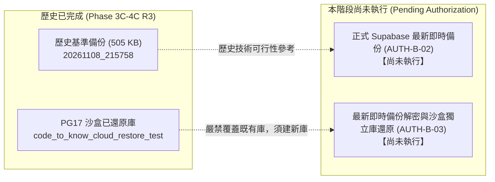

# CODE TO KNOW｜PHASE 3C-4F-R14-C-1-1
# 正式備份前置 Go / No-Go 綜合檢核與授權決策清單

**文件編號**：`DATABASE_PHASE3C4F_R14C11_FINAL_GO_NO_GO_CHECKLIST`  
**審查日期**：2026-11-09  
**審查性質**：正式備份授權前最高安全閘門審核（唯讀檢查，無雲端操作）  
**對應階段**：PHASE 3C-4F-R14-C-1-1 (W-04, W-06)  
**前置檔案**：  
- `DATABASE_PHASE3C4F_R14C11_FINAL_BACKUP_SECURITY_REVIEW.md`  
- `DATABASE_PHASE3C4F_R14C11_KEY_CUSTODY_VERIFICATION.md`  
- `DATABASE_PHASE3C4F_R14C11_AUTHORIZATION_ID_RECONCILIATION.md`

---

## 一、備份與還原邊界嚴格切分宣告 (W-04 核心原則)

在進行 Go / No-Go 判定前，必須以客觀事實嚴格區分「已完成事項」與「尚未執行事項」，嚴禁混為一談：

### 資料庫物件完整性驗收標準（拒絕單一「資料表計數」迷思）：
還原驗收絕不能僅看「是否具有 37 張表」，必須全面涵蓋：
1. **37 張 Base Tables**（36 個業務模型 + `_prisma_migrations`）。
2. **Primary Key 與 Unique 約束**（保證資料唯一性無損）。
3. **Foreign Key 外鍵約束與級聯規則**（如 `AuditLog.user` 之 `ON DELETE SET NULL`）。
4. **B-tree 索引完整性**（主鍵索引、外鍵索引、複合搜尋索引）。
5. **Sequence 序號計數器**（自增欄位目前的 `last_value` 與 `is_called` 狀態）。
6. **自訂 Enum 類型**（`AnnouncementStatus` 之定義與 3 個標籤值完整性）。
7. **Migration 歷史一致性**（`_prisma_migrations` 之紀錄、Checksum 與套用步驟數）。

---

## 二、正式備份執行前 Go / No-Go 檢核表

| 檢核領域 | 具體檢驗項目 | 當前評估結果 | 判定標記 | 證據依據與說明 |
| :--- | :--- | :--- | :--- | :--- |
| **1. 工具與映像鎖定** | PostgreSQL 17 Docker 映像檔使用完整 64 位元 Digest，無截斷 | 驗證一致 | **PASS** | `run_supabase_backup.ps1:31` 鎖定 `postgres@sha256:3540c...` |
| **2. TLS 安全連線** | 強制 `PGSSLMODE=verify-full` 並核對 Root CA 指紋 | 驗證一致 | **PASS** | CA SHA-256 核對為 `70072358...F3B7` 完全相符 |
| **3. 密碼生命週期** | 密碼以 Stdin 管道注入，CLI、Process 參數與 Log 零洩漏 | 驗證通過 | **PASS** | 程式碼採用 .NET 異步串流與記憶體即刻清空 |
| **4. 加密演算法規格** | AES-256-GCM 具備 12B CSPRNG Nonce 與 16B Auth Tag | 驗證通過 | **PASS** | 14 項加密單元測試全數通過，支援原子更名防 EXDEV |
| **5. 實體記憶體與刪除** | 不誇大保證物理抹除，明確界定進程隔離與目錄 Unlink | 觀念精確 | **PASS** | 已於 R14-C-1-1 文件中給予定性，符合系統底層原理 |
| **6. 實體金鑰保管** | 專案負責人已將主金鑰存入 MFA 密碼庫並放置第二離線備份 | 尚未落地 | **PARTIAL** | 工具與演算法就緒，但負責人實體保管設施待落實 (AUTH-K) |
| **7. 沙盒還原獨立性** | 規劃於 PG17 沙盒新建獨立庫驗證，不覆蓋歷史驗證庫 | 流程確立 | **PASS** | 還原 SOP 與 12 項檢核點已就緒，杜絕覆蓋歷史庫 |
| **8. 授權體系統一** | 跨文件代號已統一為 AUTH-K、AUTH-B、AUTH-C 三大獨立系列 | 梳理完畢 | **PASS** | `AUTHORIZATION_ID_RECONCILIATION.md` 已確立唯一標準 |
| **9. 雲端執行授權狀態** | 正式連線與備份指令目前處於強制凍結狀態 | 凍結受控 | **PASS** | 嚴格遵守最高安全限制，無私自連線正式資料庫 |

---

## 三、綜合門檻評估與授權阻斷點 (Gating Decision)

### 3.1 關鍵阻斷項目（Blocking Gaps）
- **阻斷點 GAP-01 (金鑰實體保管)**：
  依據 `W-03` 審查規範：「若沒有可實際使用的安全密碼庫，必須列為尚未完成，不得判定無缺口」。目前正式主金鑰尚未由專案負責人於企業密碼庫完成配置，且離線第二份實體備份尚未放置於實體保險箱中。

### 3.2 簽發正式備份（AUTH-B-02）的前置解除條件
在專案負責人簽署 `AUTH-B-02` 之前，必須完成以下兩個前置步驟：
1. **簽署並落實 `AUTH-K-01`**：專案負責人產生主金鑰並存入個人的 2FA 企業密碼庫。
2. **簽署並落實 `AUTH-K-02`**：專案負責人建立離線第二份實體備份（紙本復原卡）並封存於保險箱。

---

## 四、最終驗收判定結論

依據本階段第二輪獨立安全審查之全域檢查結果：

本專案在備份腳本、TLS 驗證模式、密碼防洩漏設計、AES-256-GCM 加密工具、沙盒還原 SOP 與授權體系方面，**技術準備度已達到生產級標準（PASS）**。  
然而，由於實體金鑰保管與第二離線備份（AUTH-K 系列）屬於專案負責人實體操作範疇，目前處於**待落實狀態（PARTIAL）**，依最高安全合規要求，本階段最終判定為：

### **最終判定結果：PARTIAL PASS（技術複核通過，實體金鑰保管與雲端連線授權待專案負責人完成）**

> **執行邊界聲明**：在專案負責人完成 `AUTH-K-01`、`AUTH-K-02` 並正式簽准 `AUTH-B-02` 之前，**本系統嚴禁連線 Supabase，嚴禁執行任何正式備份！**
