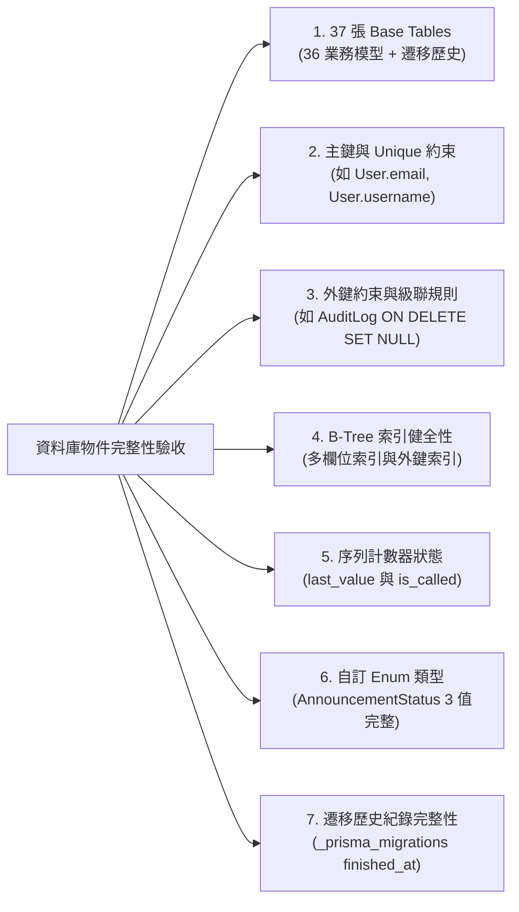

# CODE TO KNOW｜PHASE 3C-4F-R14-C-1-2
# 備份程式本機安全驗證與密碼學工具盤點審查報告

**文件編號**：`DATABASE_PHASE3C4F_R14C12_BACKUP_READINESS_AUDIT`  
**審查日期**：2026-11-09  
**審查性質**：本機唯讀安全實測與離線驗證（不連線正式庫、不索取正式密碼、不產出正式金鑰）  
**對應階段**：PHASE 3C-4F-R14-C-1-2 (備份就緒審查)

---

## 一、審查目標與檢驗原則

本階段之核心目標為：**在「不取得正式資料庫密碼」且「不產生正式加密金鑰」的絕對安全邊界下，驗證現有備份工具鏈與加密程式之本機完整性與可靠度**。

---

## 二、AES-256-GCM 加密工具與單元測試實測盤點

### 2.1 【已經實際驗證】工具功能與測試執行成果
- **工具路徑**：`scripts/database/backup-crypto.cjs`
- **測試套件**：`scripts/database/backup-crypto.test.cjs`
- **執行指令**：`node scripts/database/backup-crypto.test.cjs`
- **實測結果**：**14 / 14 測試通過，Exit Code 0**（耗時約 45ms）。

#### 涵蓋之 14 項安全邊界案例：
1. `[TC-01]` 1 MB 隨機檔案加密解密迴環，解密後 SHA-256 完全相符。
2. `[TC-02]` 0 Byte 空檔案邊界加解密處理。
3. `[TC-03]` 5 MB 大型檔案串流加解密管線穩定性。
4. `[TC-04]` 錯誤金鑰解密時立即拋錯拒絕，絕不產出明文。
5. `[TC-05]` 密文區段位元翻轉（竄改 1 byte）時立即拋錯阻斷。
6. `[TC-06]` 尾端 16-byte Auth Tag 遭竄改時拋錯拒絕。
7. `[TC-07]` 檔案截斷至小於最小容器長度（33 bytes）時立即拒絕。
8. `[TC-08]` 非 `C2KB` Magic Header 之無效檔案拒絕處理。
9. `[TC-09]` 非支援版本號（如 `0x02`）拒絕處理。
10. `[TC-10]` 輸入路徑與輸出路徑相同時拋錯阻斷（防自我覆寫）。
11. `[TC-11]` 輸出目標檔案已存在時拋錯拒絕覆寫。
12. `[TC-12]` 解密認證失敗時，所有 `.tmp` 暫存檔全數清理不殘留。
13. `[TC-13]` 驗證成功前只有受限暫存檔，通過後才原子化更名為正式檔。
14. `[TC-14]` 金鑰格式非 64-char Hex 或為 null 時拒絕處理。

- **結論**：本機 AES-256-GCM 模組在演算法正確性、防竄改、暫存隔離及錯誤復原方面，已達到生產級工程可靠度。

---

## 三、備份腳本離線 DryRun 安全驗證實測

### 3.1 【已經實際驗證】完全無機密介入下的本機驗證能力
- **腳本路徑**：`scripts/database/run_supabase_backup.ps1`
- **執行指令**：`powershell -ExecutionPolicy Bypass -File scripts/database/run_supabase_backup.ps1 -DryRun`
- **實測結果**：**Exit Code 0，順利安全退出**。

#### 離線 DryRun 驗證之關鍵環節：
1. **Docker Client Tools 鎖定檢驗**：
   成功調用 `postgres@sha256:3540c0362c809df084ffac0ae69fe794515f9de92692f02178bcdce0ef0302ac` 容器，確認 Client Tools 版本為 `pg_dump (PostgreSQL) 17.11`。
2. **Root CA 憑證存在與指紋校驗**：
   實測核對 `C:\Users\user\Documents\CODE-TO-KNOW_SECRETS\certs\supabase-root.crt` 之 SHA-256 雜湊，與預期值 `700723581420DD1AC98FD7E9AC529F0EF210EADCAF87FC868A3AD7D114C2F3B7` 完全相符。
3. **防覆寫目錄架構運算**：
   自動計算帶時間戳記之輸出目錄 `CODE_TO_KNOW_SUPABASE_yyyyMMdd_HHmmss`，並確認目錄不存在方可繼續。
4. **零機密、零雲端連線保障**：
   DryRun 在完成前三步參數校驗後，於進入互動式密碼輸入前立即安全退出，**未向使用者索取任何密碼，未產生任何加密金鑰，亦未對網際網路發送任何封包**。

---

## 四、資料庫物件驗收標準深度核對（超越單一表計數）

### 4.1 【僅根據程式碼判讀】實體資料庫物件完整性標準
在未來的沙盒還原驗收中，確立不以「37 張表」為唯一標準，必須全面涵蓋下列資料庫架構維度：

- **結論**：驗收架構已超越表層資料表計數，具備對關聯完整性、約束及自增序號的深度核驗機制。

---

## 五、檢核結論標記

| 檢核項目 | 判定結果 | 驗證層級標記 |
| :--- | :--- | :--- |
| **AES-GCM 工具 14 項測試** | 100% 通過 (Exit Code 0) | 【已經實際驗證】 |
| **備份腳本 DryRun 離線驗證** | 零密碼、零金鑰、零網路連線安全退出 | 【已經實際驗證】 |
| **Docker PG17 Client Digest 鎖定** | 64 位元 SHA-256 完整相符 | 【已經實際驗證】 |
| **Root CA 指紋核對** | 雜湊精確吻合 | 【已經實際驗證】 |
| **全方位物件驗收標準規劃** | 涵蓋表、約束、索引、Sequence、Enum | 【僅根據程式碼判讀】 |
