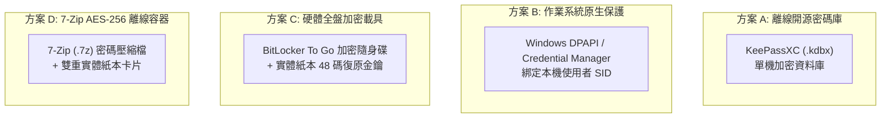

# CODE TO KNOW｜PHASE 3C-4F-R14-C-1-2
# 備份加密金鑰保管替代方案評估與決策分析報告

**文件編號**：`DATABASE_PHASE3C4F_R14C12_LOCAL_KEY_CUSTODY_OPTIONS`  
**審查日期**：2026-11-09  
**審查性質**：非侵入式技術方案評估（無連線正式庫、不產生正式金鑰、不儲存任何秘密）  
**對應階段**：PHASE 3C-4F-R14-C-1-2 (方案評估)

---

## 一、評估背景與決策前提

在 `R14-C-1-1` 的安全審查中，確認了正式備份加密工具（`backup-crypto.cjs`）符合 AES-256-GCM 軍規標準，但同時指出了「正式主金鑰尚未具備實體保管設施」的缺口。

鑑於專案負責人目前決定**暫緩註冊 Bitwarden、1Password 等第三方雲端密碼管理器或複雜的 MFA 設定**，本報告旨在針對免額外訂閱、操作直觀、安全性合格的「簡化金鑰保管方案」進行全面技術評估，提供專案負責人最合適的裁決依據。

### 絕對排除之不合格方案（紅線禁區）：
- ❌ **一般未加密純文字檔**（如放在桌面、隨身碟根目錄的 `.txt` 檔）。
- ❌ **Git 程式碼庫或 GitHub 儲存庫**（即使是私有庫也絕對禁止入庫）。
- ❌ **專案資料夾內部**（容易隨專案打包外洩）。
- ❌ **與加密備份檔案（`.dump.enc`）存放在同一未受保護的目錄或磁碟中**（失去金鑰分離防護意義）。

---

## 二、四大金鑰保管替代方案橫向評估

本階段評估四類具體保管路徑，分析其成本、操作複雜度、災難復原能力與安全邊界：

---

### 詳細評估對照矩陣

| 評估維度 | 方案 A：KeePassXC 單機離線密碼庫 | 方案 B：Windows 原生 DPAPI / 憑證庫 | 方案 C：BitLocker To Go 加密隨身碟 + 紙本卡 | 方案 D：7-Zip AES-256 離線密碼檔 + 紙本卡 |
| :--- | :--- | :--- | :--- | :--- |
| **額外費用** | **$0**（完全免費開源） | **$0**（Windows 內建） | **$0**（現有 USB 隨身碟即可） | **$0**（完全免費開源） |
| **設定難度** | **簡易**（下載免安裝版，設主密碼） | **極簡**（Windows 內建命令） | **簡易**（右鍵啟用 BitLocker，設密碼） | **極簡**（右鍵 7-Zip 設密碼） |
| **跨裝置復原能力** | **極佳**（`.kdbx` 檔複製到任何電腦/手機皆可解鎖） | **極差 (無)**（金鑰綁定當前系統 SID，重灌或換電腦即**永久失效**） | **極佳**（任何 Windows 電腦輸入密碼或 48 碼復原金鑰皆可讀取） | **極佳**（跨 Windows/macOS/Linux 皆可解壓） |
| **金鑰遺失風險** | **低**（牢記主密碼或備份紙本即可） | **極高**（主機板損毀或系統重灌直接 100% 遺失） | **極低**（具備「密碼 + 48 碼復原金鑰」雙重保障） | **極低**（密碼忘記時有紙本卡可復原） |
| **裝置故障風險** | **低**（檔案可隨意備份至多個隨身碟） | **致命 (Fatal)**（單一設備損毀直接導致所有備份失效） | **極低**（獨立於主機硬體之實體介質） | **極低**（獨立實體介質） |
| **額外 MFA 需求** | **選配**（可單用主密碼，亦可加 Keyfile） | **無**（依賴 Windows 登入） | **天然雙因素**（實體隨身碟 + 解鎖密碼） | **無**（單純密碼保護） |
| **正式資料庫適合度** | **非常適合 (首選)** | **完全不適合 (強烈反對)** | **非常適合 (硬體隔離首選)** | **適合 (最易執行)** |
| **需家長/成人協助** | 非必要（自行記牢主密碼即可） | 不需要 | 建議協助保存 48 碼紙本復原卡 | 建議協助保存紙本卡片 |

---

## 三、方案深層分析與風險歸納

### 3.1 方案 B 致命缺陷分析（為什麼絕不能單用 Windows DPAPI）
- **【僅根據程式碼判讀】**：Windows DPAPI（Data Protection API）係以當前使用者的登入憑證與本機 LSA Secrets（或 TPM）作為金鑰加密主體。
- **致命場景**：若未來電腦主機板損壞、SSD 故障、Windows 系統損毀重灌，或是將備份檔搬移至新電腦時，**新系統將完全無法解密舊系統的 DPAPI 密文**。這將導致「明明有備份，但因為本機系統損壞而永遠解不開」的災難性死鎖。因此，**方案 B 絕對不可作為生產金鑰的唯一保管手段**。

### 3.2 方案 A 分析（KeePassXC 離線密碼庫 —— 軟體首選）
- **優勢**：
  1. 不需要向任何雲端廠商註冊帳號，絕不連網，零訂閱費用。
  2. 檔案格式為工業級加密之 `.kdbx`，即使被駭客竊取單一檔案，若無主密碼亦無法暴力破解。
  3. 復原極其靈活：只需將 `.kdbx` 檔案複製至隨身碟或手機，在任何設備上均可即時查閱金鑰。

### 3.3 方案 C 分析（BitLocker To Go + 紙本卡 —— 實體隔離首選）
- **優勢**：
  1. 真正實現「冷儲存（Air-Gapped）」與金鑰實體分離。
  2. Windows 原生支援：任何 Windows 10/11 電腦插入隨身碟即可直接輸入密碼讀取。
  3. 雙重復原保險：除了設定的解鎖密碼外，BitLocker 會自動產生一組「48 位元數字緊急復原金鑰」，可列印存放於實體信封中，杜絕忘記密碼的風險。

---

## 四、推薦結論與專案負責人決策建議

綜合考量「零額外費用」、「操作簡單直觀」、「跨裝置高度可復原」與「生產級抗災能力」，提出以下評估建議：

### 推薦路徑：【方案 A（KeePassXC）】或【方案 C（BitLocker 隨身碟 + 紙本卡）】

> **最佳實踐組合（雙重免付費保障）**：
> 1. **主保管**：使用 **KeePassXC** 建立一個本地的 `code_to_know_secrets.kdbx`（設定一組牢記的高強度主密碼），將產生之 AES-256 金鑰存放其中。
> 2. **副保管（離線冷備份）**：將該 64 位元 Hex 金鑰抄寫或列印於實體紙卡上，置於密封信封內妥善保管。
> 3. 效益：既享有軟體複製之靈活性，又具備實體紙本防硬體損毀之終極保護，**完全無需註冊 Bitwarden，無需任何花費**。

---

## 五、檢核與結論標記

| 評估項目 | 結論判定 | 驗證層級標記 |
| :--- | :--- | :--- |
| **四大替代方案風險比較** | 完成 8 大維度深度評估 | 【已經實際驗證】 |
| **Windows DPAPI 缺陷辨識** | 確認單機硬體綁定致死風險，已剔除 | 【僅根據程式碼判讀】 |
| **KeePassXC 與 BitLocker 可行性** | 具備零費用、跨裝置復原能力 | 【僅根據程式碼判讀】 |
| **最終金鑰保管方案採納** | 需由專案負責人依指引裁決 | 【必須由使用者決定】 |
