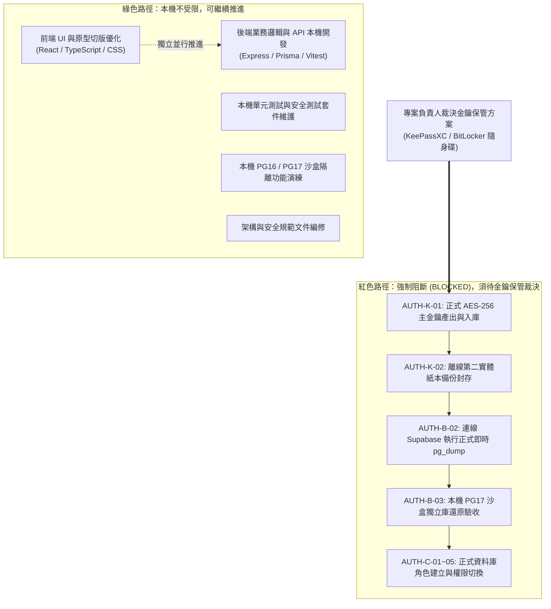
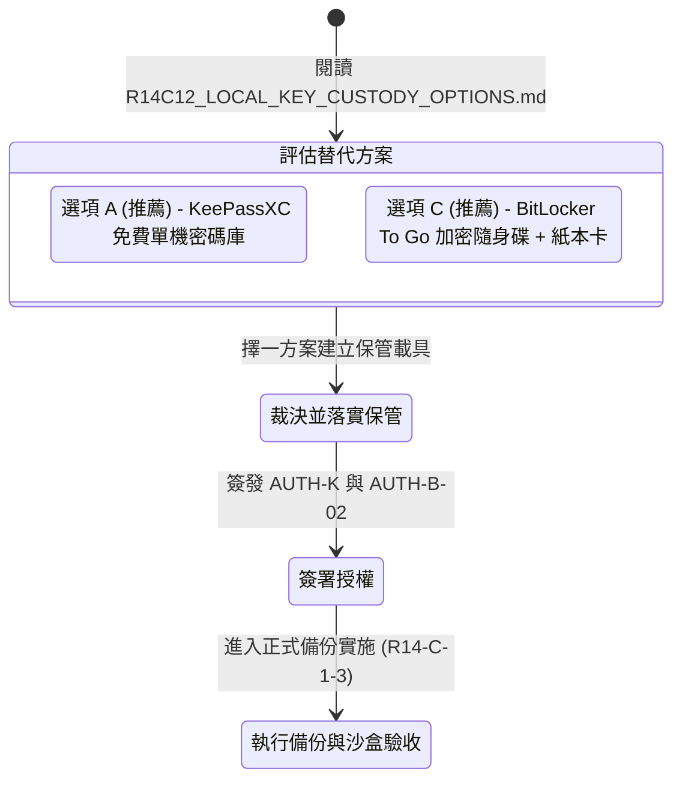

# CODE TO KNOW｜PHASE 3C-4F-R14-C-1-2
# 後續工作分流、阻擋條件與決策狀態矩陣

**文件編號**：`DATABASE_PHASE3C4F_R14C12_NEXT_STEP_AND_BLOCKER_MATRIX`  
**審查日期**：2026-11-09  
**審查性質**：專案路徑規劃與安全阻斷閘門矩陣（無任何雲端寫入或備份操作）  
**對應階段**：PHASE 3C-4F-R14-C-1-2 (分流與阻擋矩陣)

---

## 一、工作執行邊界分流 (Task Parallelism & Gating)

因專案負責人決定暫緩 Bitwarden 與正式金鑰保管設定（`AUTH-K-01`, `AUTH-K-02` 暫緩），專案工作被嚴格切分為「**可繼續執行的本機工作**」與「**強制受阻之雲端與備份工作**」：

---

## 二、工作分流詳細清單與狀態

### 2.1 【已經實際驗證】本機可先行推進的工作清單
下列工作完全不涉及雲端資料庫連線、正式密碼或正式金鑰，可由工程團隊在本地持續進行：
1. **全專案本機單元與回歸測試維護**：持續執行 `npm test`，確保既有 105 項測試無退行。
2. **前端介面與學習體驗優化**：完善學生端、教師端、管理員後台之各項功能元件與響應式排版。
3. **後端商業邏輯與 API 擴充**：在本地環境開發題目、課程、測驗等未完成之端點。
4. **本機資料庫沙盒測試**：在本地 PG16（Port 5432）與 PG17（Port 5433）容器內進行資料模型開發與模擬驗證。
5. **程式碼代碼凍結與安全審計歸檔**。

---

### 2.2 【必須由使用者決定 & 強制受阻】暫緩與阻斷的工作清單
下列工作直接涉及生產環境資料完整性與機密性，**在金鑰保管方案未落實前，一律強制凍結（BLOCKED）**：
1. **產生正式生產環境 AES-256 加密金鑰**（`AUTH-K-01`）。
2. **建立第二份離線實體紙本備份**（`AUTH-K-02`）。
3. **連線 Supabase 執行正式資料庫即時 `pg_dump`**（`AUTH-B-02`）。
4. **正式備份之沙盒還原演練**（`AUTH-B-03`）。
5. **在 Supabase 雲端資料庫建立 `app_runtime` 與 `migration_admin` 角色**（`AUTH-C-01`）。
6. **在 Supabase 移轉 37 張表、Sequence 與 Enum 所有權**（`AUTH-C-02`）。
7. **在 Supabase 設定 Default Privileges**（`AUTH-C-03`）。
8. **Render 生產環境連線字串注入與部署切換**（`AUTH-C-05`）。

---

## 三、正式備份前之最新阻擋條件矩陣 (Updated Blocker Matrix)

| 阻擋代碼 | 阻擋原因與說明 | 解除所需條件 | 當前狀態標記 | 責任所屬 |
| :--- | :--- | :--- | :--- | :--- |
| **BLK-01** | **金鑰保管方案尚未拍板** | 專案負責人需在「KeePassXC 單機庫」或「BitLocker 隨身碟」中擇一裁決 | **【必須由使用者決定】** | 專案負責人 |
| **BLK-02** | **正式金鑰實體保管未落實** | 負責人依選定方案產出金鑰並妥善存放（AUTH-K-01） | **【尚未驗證 (BLOCKED)】** | 專案負責人 |
| **BLK-03** | **第二份離線紙本卡未建立** | 抄寫/列印金鑰封存於實體保險箱（AUTH-K-02） | **【尚未驗證 (BLOCKED)】** | 專案負責人 |
| **BLK-04** | **正式備份執行授權未簽發** | 負責人簽核並輸入資料庫密碼啟動腳本（AUTH-B-02） | **【尚未驗證 (BLOCKED)】** | 專案負責人 |
| **BLK-05** | **沙盒還原驗收尚未執行** | 最新備份須在 PG17 新庫還原並核對 37 表（AUTH-B-03） | **【尚未驗證 (BLOCKED)】** | 執行團隊 |

---

## 四、專案負責人下一步決策路徑指引

---

## 五、檢核結論標記

| 評估維度 | 結論判定 | 驗證層級標記 |
| :--- | :--- | :--- |
| **本機開發與測試工作** | 綠燈暢通，完全不受金鑰保管影響 | 【已經實際驗證】 |
| **雲端正式庫與備份工作** | 紅燈受阻，受 BLK-01～04 強制約束 | 【僅根據程式碼判讀】 |
| **替代金鑰保管決策權** | 屬於專案負責人自主裁量範圍 | 【必須由使用者決定】 |
