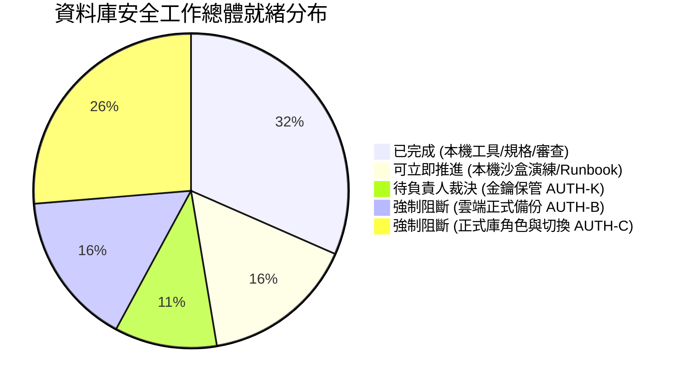

# CODE TO KNOW｜PHASE 3C-4F-R14-C-1-3
# 正式上線前全域工作狀態、阻擋條件與授權決策總表

**文件編號**：`DATABASE_PHASE3C4F_R14C13_FINAL_BLOCKER_MATRIX`  
**審查日期**：2026-11-09  
**審查性質**：正式操作前最高邊界管控矩陣（無任何雲端連線或寫入）  
**對應階段**：PHASE 3C-4F-R14-C-1-3 (總阻擋矩陣)

---

## 一、全域工作狀態總覽 (Comprehensive Status Overview)

本矩陣為專案負責人提供資料庫安全與上線準備的宏觀狀態儀表板，嚴格區分**「已完成」**、**「尚未完成」**、**「可立即推進」**與**「強制受阻」**之項目：

---

## 二、全域工作項目詳細分類表

### 2.1 【已完成項目】（已通過本機實測或靜態審查）
- [x] **CMP-01**：AES-256-GCM 串流加解密工具與 14 項安全邊界測試通過（Exit Code 0）。
- [x] **CMP-02**：備份腳本離線 DryRun 驗證通過（Docker Digest 鎖定、Root CA 指紋相符）。
- [x] **CMP-03**：TLS `verify-full` 與 Pooler 配置測試通過（66/66 項通過）。
- [x] **CMP-04**：最小權限 SQL 語法審查（`migration_admin` 移除 CREATEDB、AuditLog Append-only）。
- [x] **CMP-05**：回滾程序安全排除 `DROP OWNED BY` 隱患，改採斷言檢查。
- [x] **CMP-06**：簡化金鑰替代方案評估（確立 KeePassXC 與 BitLocker 隨身碟為最佳解）。

---

### 2.2 【可以立即推進的工作】（無需雲端連線、無需金鑰、0 風險）
- [ ] **ACT-01**：**本機 PG17 沙盒全流程切換與零風險回滾演練（PHASE 3C-4F-R14-C-2）**。
- [ ] **ACT-02**：**正式切換分鐘級 Runbook 整合與標準作業手冊建立**。
- [ ] **ACT-03**：**前端介面切版、學習功能與後端業務 API 本機擴充**。

---

### 2.3 【需要使用者授權的工作】（屬於專案負責人權責）
- [ ] **USR-01（金鑰方案裁決）**：決定採用「KeePassXC 單機庫」或「BitLocker 隨身碟」保管金鑰。
- [ ] **USR-02（AUTH-K-01 簽署）**：產出正式 32-byte 主金鑰並存入選定載具。
- [ ] **USR-03（AUTH-K-02 簽署）**：建立離線第二份實體紙本復原卡並存放於保險箱。
- [ ] **USR-04（AUTH-B-02 簽署）**：簽發連線 Supabase 執行正式即時備份之許可。

---

### 2.4 【正式雲端操作阻擋項目】（未達前置條件前一律強制凍結）
- ⛔ **BLK-C01**：連線 Supabase 執行正式 `pg_dump`（前置阻擋：USR-01~04 未完成）。
- ⛔ **BLK-C02**：最新備份解密與沙盒獨立庫還原驗收（前置阻擋：BLK-C01 未完成）。
- ⛔ **BLK-C03**：在 Supabase 正式庫建立自訂角色（前置阻擋：BLK-C02 未通過）。
- ⛔ **BLK-C04**：移轉 37 張表、Sequence、Enum 所有權（前置阻擋：BLK-C03 未完成）。
- ⛔ **BLK-C05**：設定 Default Privileges 與授權（前置阻擋：BLK-C04 未完成）。
- ⛔ **BLK-C06**：Render 生產環境連線字串切換與部署（前置阻擋：BLK-C05 未完成）。

---

## 三、重大合規提醒與邊界聲明

> [!CAUTION]
> **真實性與合規界線聲明**：  
> 1. **規劃完成 ≠ 實作完成**：本階段及先前各階段所產出之 SQL 腳本、回滾規範與還原清單，**均屬受控技術規格，絕不等於雲端已經完成變更**。
> 2. **單向依賴鐵律**：任何試圖跳過「金鑰保管」或「即時備份驗收」直接連線正式庫執行 DDL 的行為，均屬重大資安違規，系統將強制維持中斷。

---

## 四、檢核結論標記

| 評估維度 | 結論判定 | 驗證層級標記 |
| :--- | :--- | :--- |
| **工作盤點清晰度** | 已完成、可執行、受阻清單邊界清楚 | 【已經實際驗證】 |
| **阻斷閘門有效性** | 6 項雲端操作維持絕對封鎖 | 【已經實際驗證】 |
| **下一步路徑清晰度** | 推薦本機 PG17 沙盒乾跑演練 (R14-C-2) | 【僅為規劃】 |
| **金鑰保管待裁決** | 需專案負責人依自身條件裁定 | 【必須由使用者決定】 |
