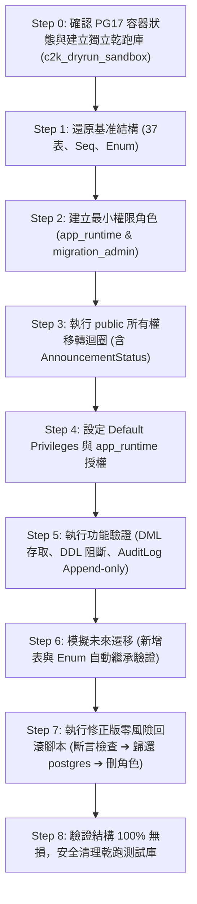

# CODE TO KNOW｜PHASE 3C-4F-R14-C-1-3
# 下一階段實施路線圖：本機沙盒全流程乾跑演練規劃

**文件編號**：`DATABASE_PHASE3C4F_R14C13_NEXT_PHASE_ROADMAP`  
**審查日期**：2026-11-09  
**審查性質**：下一階段工作範圍與驗收標準規格書（純規劃設計，未授權前禁止執行）  
**對應階段**：PHASE 3C-4F-R14-C-1-3 (下一階段規劃)

---

## 一、建議下一階段定位與核心價值

### 階段代號：`PHASE 3C-4F-R14-C-2`
### 階段全名：**本機 PG17 沙盒最小權限切換與零風險回滾全流程乾跑演練**  
*(Local PG17 Sandbox Minimum Privilege Cutover & Zero-Risk Rollback End-to-End Dry-Run Drill)*

### 核心價值：
在正式取得雲端授權與金鑰實體保管之前，**利用本地已就緒之 PostgreSQL 17.11 容器環境，在 100% 離線隔離狀態下，完整執行一遍未來的正式切換 SQL 與回滾 SQL**。  
此舉可驗證：
1. 37 張表、所有 Sequence 與 Enum Type 所有權轉移的自動化腳本是否具備原子性。
2. `AuditLog` 的 Append-Only 防護與外鍵觸發行為是否如預期運作。
3. 修正後的零風險回滾腳本（無 `DROP OWNED BY`、具備依賴斷言）在真實資料庫引擎中是否能平穩執行且零死鎖。

---

## 二、下一階段工作範圍與執行步階 (Step-by-Step Scope)

---

## 三、各步階風險分析與驗收標準 (Risk & Acceptance Matrix)

| 步階 | 具體執行內容 | 潛在風險分析 | 驗收標準 (Acceptance Criteria) | 驗證層級標記 |
| :--- | :--- | :--- | :--- | :--- |
| **Step 0** | 在 PG17 沙盒建立 `c2k_dryrun_sandbox` | 誤觸既有歷史庫 | 嚴禁碰觸 `code_to_know_cloud_restore_test`，必須為獨立新資料庫 | 【僅為規劃】 |
| **Step 1** | 還原 37 張表與物件結構 | 結構不完整 | 表計數精確等於 37，Enum `AnnouncementStatus` 存在 | 【僅為規劃】 |
| **Step 2** | 執行建立角色 SQL | 語法報錯或權限外洩 | `migration_admin` 具備 `NOCREATEDB`、`NOBYPASSRLS` | 【僅為規劃】 |
| **Step 3** | 執行 PL/pgSQL 移轉迴圈 | 陣列類型報錯或鎖定 | 37 表、Sequence 與 Enum 所有權成功轉為 `migration_admin` | 【僅為規劃】 |
| **Step 4** | 設定預設權限 | 語法不支援 | `pg_default_acl` 出現 `migration_admin` 對 `app_runtime` 的 3 筆規則 | 【僅為規劃】 |
| **Step 5** | 雙角色權限實測 | 權限放水或越權 | `app_runtime` 可 DML，但被拒絕 DDL 與 `UPDATE/DELETE AuditLog` | 【僅為規劃】 |
| **Step 6** | 模擬未來 Migration | 幽靈權限未繼承 | 新建之表與 Enum，`app_runtime` 免人工設定即可直接存取 | 【僅為規劃】 |
| **Step 7** | 執行修正版回滾腳本 | 角色依賴死鎖或誤刪表 | 斷言無殘留，`DROP ROLE` 成功，37 張表完整保留並歸還 `postgres` | 【僅為規劃】 |
| **Step 8** | 沙盒乾跑庫清理 | 殘留佔用磁碟 | 成功執行 `DROP DATABASE c2k_dryrun_sandbox`，沙盒恢復原狀 | 【僅為規劃】 |

---

## 四、安全隔離承諾與邊界聲明

在執行下一階段（`R14-C-2`）時，工程團隊將嚴格遵守以下承諾：
1. **100% 本機 Docker 執行**：所有指令僅限於本機容器 `code_to_know_pg17_restore_sandbox`。
2. **0 雲端連線**：不連線 Supabase，不解析雲端域名。
3. **0 生產機密**：使用隨機生成的測試密碼，不碰觸真實正式資料庫密碼。
4. **0 覆蓋既有資料**：既有歷史備份與既有測試資料庫維持完好無損。

---

## 五、檢核結論標記

| 評估項目 | 結論判定 | 驗證層級標記 |
| :--- | :--- | :--- |
| **下一階段路線圖完整性** | 八大步階、風險與驗收標準完備 | 【僅為規劃】 |
| **本機可執行性** | 具備完整本機 Docker 沙盒支撐 | 【已經實際驗證】 |
| **雲端隔離性** | 100% 離線，無任何線上衝擊 | 【已經實際驗證】 |
