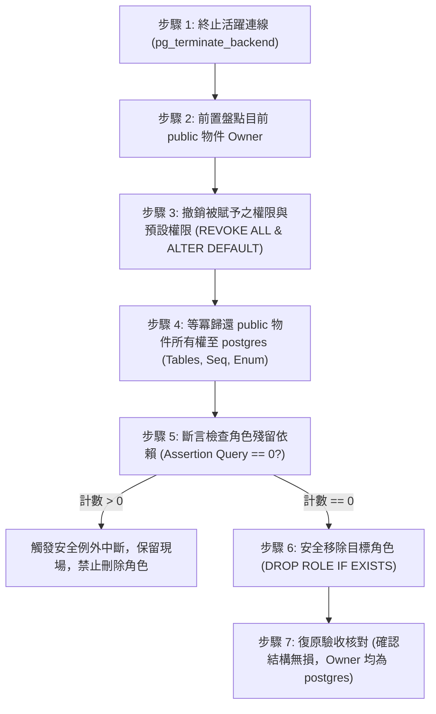

# CODE TO KNOW｜PHASE 3C-4F-R14-C-2-0
# 受控回滾程序前置檢查、執行規範與驗收標準書

**文件編號**：`DATABASE_PHASE3C4F_R14C20_ROLLBACK_PRECHECK_AND_ACCEPTANCE`  
**審查日期**：2026-11-09  
**審查性質**：回滾安全機制規格與驗收標準（非侵入式唯讀分析，不執行回滾操作）  
**對應階段**：PHASE 3C-4F-R14-C-2-0 (回滾規範與驗收)

---

## 一、術語嚴謹性與核心設計哲學

依據軟體工程與高可用性資料庫維運準則，**本專案全面棄用「零風險回滾」之誇大稱謂，正式統一命名為「受控回滾程序 (Controlled Rollback Procedure)」**。

### 受控回滾程序之核心原則：
1. **防禦性優先（Defensive-First）**：絕不使用可能引發隱匿刪表災難的指令（如 `DROP OWNED BY`）。
2. **依賴斷言前置（Assertion-Gated）**：在執行 `DROP ROLE` 之前，必須透過 SQL 斷言確認角色名下已無任何物件與依賴。
3. **主動報錯保護（Fail-Safe）**：若回滾過程中發現任何未知或無法解除的相依性，腳本必須**立即中斷交易（Abort & Rollback Transaction）**，保留現場由 DBA 人工介入，絕不強行刪除。

---

## 二、受控回滾七大安全執行步驟規範



### 2.1 步驟詳細規格說明

- **步驟 1：斷開目標連線**  
  調用 `pg_terminate_backend` 踢除 `app_runtime` 與 `migration_admin` 的現存 Session，防止資料庫鎖（Lock）競爭引發回滾超時。
- **步驟 2：前置盤點快照**  
  查詢 `pg_tables`、`information_schema.sequences` 與 `pg_type`，列出所有當前 Owner 仍為目標角色的物件清單作為審計基線。
- **步驟 3：雙向清理權限**  
  - 執行 `ALTER DEFAULT PRIVILEGES ... REVOKE ALL` 清理未來規則。
  - 執行 `REVOKE ALL PRIVILEGES ON ALL ...` 清理現有規則。
- **步驟 4：針對性所有權歸還**  
  透過明確鎖定 `schemaname = 'public'` 的 PL/pgSQL 迴圈，將資料表、Sequence、自訂 Enum 類型（`typtype = 'e'`）與 Schema 本身歸還予 `postgres`。
- **步驟 5：依賴斷言檢查（核心防線）**  
  執行聚合統計：
  ```sql
  SELECT count(*) INTO owned_count
  FROM (
      SELECT tablename FROM pg_tables WHERE tableowner IN ('migration_admin', 'app_runtime')
      UNION ALL
      SELECT sequence_name FROM information_schema.sequences WHERE sequence_schema = 'public' AND sequence_name IN (
          SELECT c.relname FROM pg_class c JOIN pg_roles r ON r.oid = c.relowner WHERE r.rolname IN ('migration_admin', 'app_runtime')
      )
      UNION ALL
      SELECT t.typname FROM pg_type t JOIN pg_roles r ON r.oid = t.typowner WHERE r.rolname IN ('migration_admin', 'app_runtime')
  ) sub;

  IF owned_count > 0 THEN
      RAISE EXCEPTION 'SAFETY ASSERTION FAILED: % objects still owned by target roles!', owned_count;
  END IF;
  ```
- **步驟 6：安全移除角色**  
  僅呼叫 `DROP ROLE IF EXISTS app_runtime; DROP ROLE IF EXISTS migration_admin;`。若步驟 5 斷言通過，此處 100% 安全順暢；若仍有隱形依賴，PostgreSQL 引擎會主動拋錯拒絕刪除，保護資料安全。

---

## 三、沙盒切換演練驗收標準 (Acceptance Criteria)

在未來的沙盒演練中，必須同時滿足下列驗收門檻，方可判定切換與回滾演練通過：

| 驗收階段 | 檢驗指標 | 合格標準 (Acceptance Pass Criteria) | 驗證層級標記 |
| :--- | :--- | :--- | :--- |
| **切換前快照** | Base Tables 與 Enum 計數 | Base Tables 精確為 37 張，Enum 包含 `AnnouncementStatus` | 【僅為規劃】 |
| **切換後狀態** | 物件所有權人 | `schemaname = 'public'` 下所有物件 Owner 均為 `migration_admin` | 【僅為規劃】 |
| **預設權限狀態** | `pg_default_acl` 目錄 | 出現 `migration_admin` 對 `app_runtime` 之 Tables/Seq/Types 3 筆規則 | 【僅為規劃】 |
| **執行期存取邊界** | DML 讀寫與 DDL 阻斷 | `app_runtime` 正常 SELECT/INSERT；執行 DROP/ALTER 表回傳 `permission denied` | 【僅為規劃】 |
| **審計日誌防護** | `AuditLog` 不可篡改 | `app_runtime` 執行 UPDATE/DELETE/TRUNCATE 回傳 `permission denied` | 【僅為規劃】 |
| **回滾斷言驗證** | 斷言檢查計數 | 斷言回傳 `owned_count = 0`，無例外拋出 | 【僅為規劃】 |
| **回滾後狀態** | 物件所有權與角色狀態 | 所有 public 物件 Owner 100% 歸還 `postgres`，目標角色順利移除，37 表數據無損 | 【僅為規劃】 |

---

## 四、檢核結論標記

| 評估項目 | 結論判定 | 驗證層級標記 |
| :--- | :--- | :--- |
| **術語規範合規性** | 全面使用「受控回滾程序」，符合工程嚴謹性 | 【已由原始碼確認】 |
| **DROP OWNED BY 剔除** | 徹底自腳本移除，排除誤刪表隱患 | 【已由原始碼確認】 |
| **前置斷言檢查機制** | 具備 PL/pgSQL 計數防護與主動拋錯阻斷 | 【已由原始碼確認】 |
| **全方位驗收指標** | 涵蓋切換前、切換後、執行期邊界與回滾後完整性 | 【僅為規劃】 |
