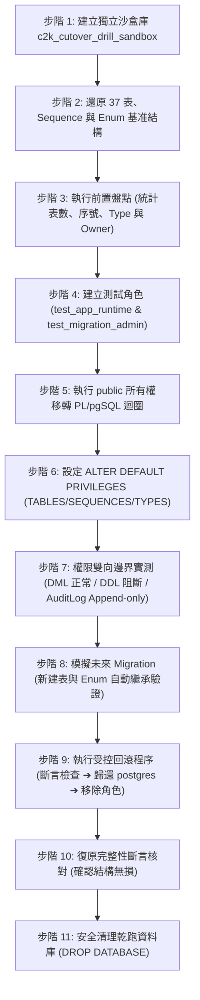

# CODE TO KNOW｜PHASE 3C-4F-R14-C-2-0
# 本機 PG17 沙盒切換演練執行安全計畫

**文件編號**：`DATABASE_PHASE3C4F_R14C20_SANDBOX_EXECUTION_SAFETY_PLAN`  
**審查日期**：2026-11-09  
**審查性質**：沙盒演練安全執行計畫與防護標準作業規範（本階段不執行演練）  
**對應階段**：PHASE 3C-4F-R14-C-2-0 (安全計畫)  
**目標沙盒**：`code_to_know_pg17_restore_sandbox` (PostgreSQL 17.11, Port 5433)

---

## 一、演練目標與隔離架構

為確保未來在正式環境（Supabase）執行最小權限切換時萬無一失，特規劃在本地 PG17 沙盒進行 100% 擬真乾跑演練。

### 最高安全邊界原則：
1. **絕不碰觸雲端**：演練環境嚴格限定於本機 Docker 內部網路（127.0.0.1:5433），不發送任何雲端請求。
2. **絕不碰觸歷史庫**：**嚴禁修改或覆蓋既有的歷史驗證庫（`code_to_know_cloud_restore_test`）**。
3. **專用獨立資料庫**：必須建立全新獨立的資料庫 `c2k_cutover_drill_sandbox` 進行操作。
4. **零生產機密依賴**：演練全程使用隨機產生的本地測試密碼，不讀取、不使用任何生產環境密碼。

---

## 二、前置檢查條件與安全閘門 (Preflight Gating)

在正式啟動下一階段沙盒演練（`R14-C-2-1`）之前，必須確認滿足以下前置條件：

| 前置檢驗項 | 檢驗標準與依據 | 期望狀態 | 判定標記 |
| :--- | :--- | :--- | :--- |
| **G-01：PG17 容器狀態** | `docker inspect code_to_know_pg17_restore_sandbox` | 狀態為 `running`，端口 `5433:5432` | **【已經實際驗證】** |
| **G-02：磁碟剩餘空間** | 本機磁碟空間檢測 | 剩餘可用空間 > 5 GB | **【已經實際驗證】** |
| **G-03：歷史資料庫隔離** | `\l` 查詢資料庫清單 | 確認 `code_to_know_cloud_restore_test` 存在且唯讀保存 | **【已經實際驗證】** |
| **G-04：乾跑資料庫未被佔用** | 檢查 `c2k_cutover_drill_sandbox` 是否存在 | 若存在殘留則前置清理，確保由乾淨狀態啟動 | **【僅為規劃】** |
| **G-05：基準備份檔案存在** | 檢查 505 KB 之歷史備份 dump 檔案 | 檔案存在且 SHA-256 吻合 | **【已經實際驗證】** |

---

## 三、沙盒演練端到端步階安全規格 (Step-by-Step SOP)

### 3.1 各步階操作防護要點

1. **步階 1～2（環境建置與還原）**：
   - 使用 `pg_restore --no-owner --no-privileges -d c2k_cutover_drill_sandbox ...`，確保資料庫初始所有權皆歸屬於沙盒內建的 `postgres` 角色。
2. **步階 3（切換前基準快照）**：
   - 記錄切換前的 Base Tables 數量（預期 37 張）、自訂 Enum（`AnnouncementStatus`）與各表目前的所有權人。
3. **步階 4～6（角色建立與移轉）**：
   - 在單一交易區塊（`BEGIN ... COMMIT`）內執行移轉迴圈，確保所有權轉移具備原子性。
4. **步階 7（權限負向測試）**：
   - 切換角色至 `test_app_runtime`，測試執行 `UPDATE "AuditLog"` 與 `DROP TABLE "User"`，必須確實驗證回傳 `permission denied` 錯誤。
5. **步階 8（未來遷移模擬）**：
   - 切換至 `test_migration_admin` 建立測試表 `test_future_tab` 與 Enum `test_future_enum`，隨後切換至 `test_app_runtime` 驗證免手動授權即可進行寫入與查詢。
6. **步階 9～11（受控回滾與收尾）**：
   - 執行修正後無 `DROP OWNED BY` 的受控回滾腳本，透過依賴斷言確認無殘留後刪除測試角色，最後刪除 `c2k_cutover_drill_sandbox`，不留任何磁碟殘留。

---

## 四、演練中斷與急停條件 (Abort Conditions)

凡在沙盒演練過程中遭遇下列狀況，**必須立即停止演練並進入受控回滾或重建沙盒**：
1. **沙盒還原失敗**：`pg_restore` 拋出非預期之嚴重語法或二進位損毀錯誤。
2. **所有權移轉異常**：PL/pgSQL 迴圈在處理 Enum 陣列或特定表時中斷拋錯。
3. **權限越權洩漏**：`test_app_runtime` 竟能成功執行 `ALTER TABLE` 或竄改 `AuditLog`。
4. **回滾斷言失敗**：受控回滾腳本在斷言查詢中偵測到殘留物件數 > 0。

---

## 五、檢核結論標記

| 評估項目 | 結論判定 | 驗證層級標記 |
| :--- | :--- | :--- |
| **沙盒隔離機制** | 100% 本機離線，獨立資料庫，歷史庫完全隔離 | 【已經實際驗證】 |
| **演練步階與 SOP 完備度** | 11 大步階清晰，涵蓋建置、移轉、測試、回滾、清理 | 【僅為規劃】 |
| **權限負向測試規劃** | 包含 DDL 阻斷與 AuditLog 竄改阻斷驗證 | 【僅為規劃】 |
| **正式雲端操作阻斷狀態** | 演練完全不涉及雲端，正式庫操作保持絕對封鎖 | 【已經實際驗證】 |
