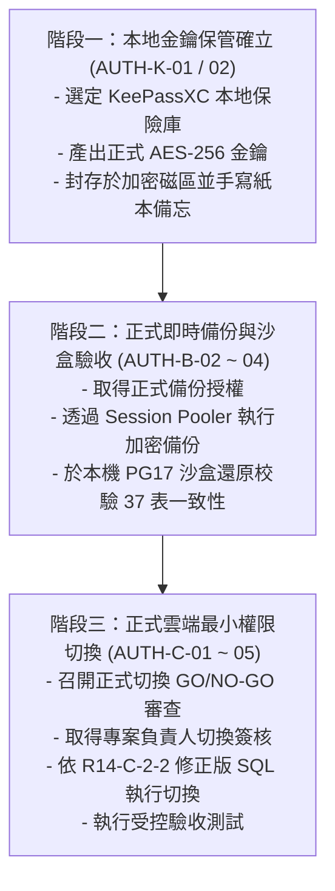

# CODE TO KNOW｜下一階段實施路線圖與阻擋矩陣
# PHASE 3C-4F-R14-C-2-2：資料庫工程後續推進規劃與安全邊界指南

**文件編號**：C2K-DOC-DB-R14C22-ROADMAP-01  
**規劃日期**：2026-11-09  
**主責角色**：資深 PostgreSQL DBA 與資料庫安全架構師  
**前置基準**：PHASE 3C-4F-R14-C-2-2 檢查點  
**總體狀態**：本機驗證 100% 完成，雲端正式操作維持受控阻斷 (BLOCKED)  

---

## 一、全域工作狀態五分類矩陣

依照專案安全守則，明確劃分工作資產之成熟度與授權邊界：

```
+---------------------------------------------------------------------------------------+
| 1. 【已完成 (Completed)】                                                              |
| - AES-256-GCM 獨立加解密核心工具 (backup-crypto.cjs)                                   |
| - PostgreSQL TLS verify-full 與 Pooler 連線安全驗證代碼 (database.ts, db-validation.ts)|
| - Supabase Root 2021 CA 公共憑證載入與 105 項後端單元測試                              |
| - 37 業務模型 Prisma Schema 與 Migration SQL 產生                                     |
| - R14-C-2-2 RLS 與 Sequence 最小權限補強審查                                           |
+---------------------------------------------------------------------------------------+
                                           │
                                           ▼
+---------------------------------------------------------------------------------------+
| 2. 【已驗證 (Verified)】                                                               |
| - AES-GCM 14 項極限邊界與負向防篡改測試 100% 通過                                      |
| - Docker PG17.11 沙盒基准還原 (37 表、1 Enum、47 FK、133 索引)                         |
| - 37 表與 Enum 所有權移轉至 migration_admin                                           |
| - AuditLog Append-Only 防護 (禁止 UPDATE/DELETE/TRUNCATE) 與外鍵 SET NULL 運作驗證    |
| - _prisma_migrations 歷史表隔離防護驗證                                               |
| - 7 步受控回滾程序 (依賴斷言歸零、角色刪除、表結構原樣歸還 postgres)                  |
| - 前端與後端生產建置 (tsc && vite build / tsc) 100% 通過                                |
+---------------------------------------------------------------------------------------+
                                           │
                                           ▼
+---------------------------------------------------------------------------------------+
| 3. 【尚未完成 (Incomplete)】                                                           |
| - 拍板本地簡化金鑰保管工具 (KeePassXC 本地資料庫或 BitLocker 隨身碟)                   |
| - 實體產出正式生產環境 AES-256 主金鑰並建立紙本復原卡                                  |
+---------------------------------------------------------------------------------------+
                                           │
                                           ▼
+---------------------------------------------------------------------------------------+
| 4. 【被阻擋 (Blocked)】                                                                |
| - 連線 Supabase 執行正式切換前即時加密備份 (AUTH-B-02，等待金鑰就緒與備份授權)         |
| - 最新正式備份本機沙盒還原驗收 (AUTH-B-03 ~ 04)                                        |
| - 正式雲端資料庫角色建立與權限切換 (AUTH-C-01 ~ 05，嚴格維持最高鎖定)                  |
+---------------------------------------------------------------------------------------+
                                           │
                                           ▼
+---------------------------------------------------------------------------------------+
| 5. 【需要日後授權 (Needs Future Authorization)】                                       |
| - 正式環境雲端 Session Pooler 備份連線授權 (AUTH-B-01)                                 |
| - 正式環境雲端資料庫 DDL 與所有權變更切換授權 (AUTH-C-01 ~ 05)                         |
| - Render 生產環境變數更新與服務上線授權                                                |
+---------------------------------------------------------------------------------------+
```

---

## 二、後續安全實施三步走路線



### 1. 階段一：本地金鑰保管確立（AUTH-K-01 / 02）
- **建議方案**：使用開源、無雲端同步風險的 **KeePassXC**。
- **實施步驟**：
  1. 建立本機獨立 KeePassXC 資料庫（例如 `c2k_vault.kdbx`），使用強主密碼加密。
  2. 執行 `node -e "console.log(require('crypto').randomBytes(32).toString('hex'))"` 產生 64-char Hex 金鑰。
  3. 將金鑰存入 KeePassXC，並手寫一份 64-char Hex 紙本復原卡存放於安全實體抽屜。
  4. 備份 `.kdbx` 檔案至離線隨身碟。

### 2. 階段二：正式即時備份與沙盒驗收（AUTH-B-02 ~ 04）
- **前置條件**：階段一完成且取得專案負責人發布之 `PHASE 3C-4F-R14-C-1-4` 備份授權。
- **實施步驟**：
  1. 執行 `scripts/database/run_supabase_backup.ps1`，透過官方 Pooler 與 PG17 Client 產出正式加密備份 (`.dump.enc`)。
  2. 驗證 SHA-256 完整性並透過 AES-256-GCM 解密至隔離目錄。
  3. 於本機 Docker PG17 沙盒還原，核對 37 張表、1 Enum、47 FK、133 索引結構 100% 吻合。

### 3. 階段三：正式雲端最小權限切換（AUTH-C-01 ~ 05）
- **前置條件**：即時備份驗收 PASS，且取得正式雲端切換授權。
- **執行規格（依據 R14-C-2-2 修正版）**：
  1. 建立 `migration_admin`（`NOLOGIN, NOCREATEDB, NOCREATEROLE, NOSUPERUSER, NOBYPASSRLS`）。
  2. 建立 `app_runtime`（`NOLOGIN, NOCREATEDB, NOCREATEROLE, NOSUPERUSER, BYPASSRLS`）。
  3. 移轉 37 張表、Enum Type 及 public Schema 至 `migration_admin`。
  4. 配置 Default Privileges（TABLES: CRUD, SEQUENCES: `USAGE, SELECT`，剔除 `UPDATE`）。
  5. 隔離 `_prisma_migrations`，設定 `AuditLog` Append-Only 防護。
  6. 執行線上驗收與連線切換。
