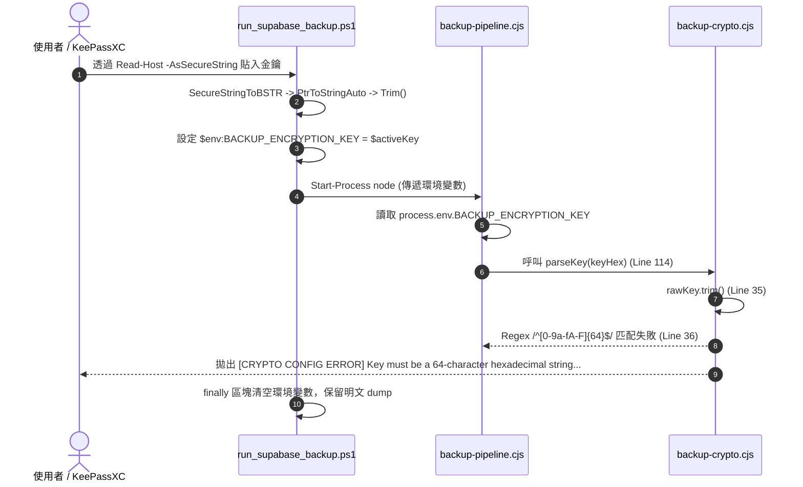

# CODE TO KNOW｜Phase 3-C-7 AES 金鑰輸入失敗唯讀診斷報告
# 資料庫正式備份 AES-256-GCM 金鑰傳遞與驗證機制完整分析

**文件編號**：C2K-DOC-DB-PHASE3C7-KEY-DIAGNOSTIC-01  
**診斷日期**：2026-11-10  
**主檢角色**：資深 PostgreSQL DBA / 應用安全架構師 (AppSec) / DevSecOps 稽核工程師  
**審查性質**：100% 唯讀程式診斷（無連線 Supabase、無正式備份操作、無修改任何專案程式碼、無金鑰讀取）  
**安全規範聲明**：
- 未讀取、記錄、輸出任何真實金鑰、資料庫密碼或機敏資訊。
- 嚴格未觸碰 `新增 文字文件.txt`、`1.docx`、`照片/`。
- 未執行任何 Git 寫入指令（add / commit / push / reset / checkout）。

---

## 執行摘要（Executive Summary）

在 Phase 3-C-7 正式 Supabase 備份執行中，`pg_dump` 透過官方鎖定摘要之 PostgreSQL 17 Client 容器成功完成邏輯備份，產出 **505,249 位元組** 之 Custom Format 明文傾印檔（`code_to_know_supabase_prod.dump`）及其 SHA-256 校驗碼。

隨後在進入第二階段 AES-256-GCM 串流加密時，程式拋出錯誤：
```text
[CRYPTO CONFIG ERROR] Key must be a 64-character hexadecimal string (256-bit).
```
依照 SEC-01 與 SEC-03 安全保護設計，備份管線立即中止，**原始 505,249 位元組明文備份檔完整安全保留於本機備份目錄中**，未受損毀亦未遭無效加密檔覆蓋。

本診斷報告以靜態程式碼審查與離線合成測試金鑰，釐清自 PowerShell `Read-Host -AsSecureString` 至 Node.js `backup-pipeline.cjs` 及 `backup-crypto.cjs` 的完整資料流，鎖定錯誤發生位置與根本原因，並提供零知識（Zero-Knowledge）金鑰檢驗方案與操作指引。

---

## 一、問題發生位置與錯誤呼叫鏈

經靜態呼叫鏈追蹤，錯誤的精確發生點與傳遞路徑如下：



### 1.1 精確程式碼位置
- **錯誤觸發點**：[`scripts/database/backup-crypto.cjs`](file:///C:/Users/user/Documents/CODE-TO-KNOW/scripts/database/backup-crypto.cjs#L36-L38) 第 36–38 行：
  ```javascript
  const trimmed = rawKey.trim();
  if (!/^[0-9a-fA-F]{64}$/.test(trimmed)) {
    throw new Error('[CRYPTO CONFIG ERROR] Key must be a 64-character hexadecimal string (256-bit).');
  }
  ```
- **上層呼叫點**：[`scripts/database/backup-pipeline.cjs`](file:///C:/Users/user/Documents/CODE-TO-KNOW/scripts/database/backup-pipeline.cjs#L113-L115) 第 114 行：
  ```javascript
  // 1. 驗證金鑰格式 (不顯示金鑰)
  parseKey(keyHex);
  ```
- **外部啟動點**：[`scripts/database/run_supabase_backup.ps1`](file:///C:/Users/user/Documents/CODE-TO-KNOW/scripts/database/run_supabase_backup.ps1#L316) 第 316 行：
  ```powershell
  $nodeProc = Start-Process -FilePath "node" -ArgumentList $pipelineArgs -Wait -Passthru -NoNewWindow
  ```

---

## 二、關鍵事實與根本原因剖析

### 2.1 已確認之技術事實（Confirmed Facts）
1. **環境變數傳遞已成功到達 Node.js**：
   `backup-crypto.cjs` 中若金鑰為空或未傳入，會先在第 31–33 行觸發：
   `[CRYPTO CONFIG ERROR] Missing backup encryption key. Set BACKUP_ENCRYPTION_KEY or use --key.`
   既然拋出的是「**Key must be a 64-character hexadecimal string**」，表示 `process.env.BACKUP_ENCRYPTION_KEY` **已成功傳入 Node.js 且為非空字串**，證明父子程序間之環境變數傳遞機制正常。
2. **PowerShell 解碼與 Trim 運作正常**：
   PowerShell 之 `SecureStringToBSTR` 與 `PtrToStringAuto` 轉換邏輯經合成測試驗證，對於標準 64 字元 Hex 能夠 100% 無失真還原，且 `.Trim()` 能正確去除頭尾之 `\r\n` 與空白字元。
3. **明文資料安全防護機制生效**：
   `run_supabase_backup.ps1` 捕捉到 Node.js 退出代碼非 0，立即依照 SEC-01 於 `finally` 清空環境變數，並依照 SEC-03 完整保留明文備份 `code_to_know_supabase_prod.dump`。

### 2.2 根本原因候選假說評估

| 假說編號 | 候選假說 | 發生機制分析 | 可能性評估 |
| :--- | :--- | :--- | :---: |
| **H1** | **KeePassXC 金鑰長度設定為 32 字元而非 64 字元** | 密碼學上 AES-256 需要 256 位元（即 32 位元組 / 32 bytes）。使用者在 KeePassXC 密碼產生器若輸入長度「32」，KeePassXC 會產生 **32 個字元**。但 Hex 字串 1 位元組需以 2 個字元表示，32 個 Hex 字元僅有 128 位元（16 bytes），無法通過 64 字元長度檢驗。 | **極高** |
| **H2** | **KeePassXC 密碼字元集採用預設英數字（包含 g-z）** | KeePassXC 密碼產生器預設字元集為大小寫英文字母（A-Z, a-z）與數字（0-9）。若未切換至「十六進位（Hexadecimal 0-9, A-F）」，產生的 64 字元密碼必然包含 `g` 至 `z` 之字母，導致正則表達式 `/^[0-9a-fA-F]{64}$/` 判定失敗。 | **高** |
| **H3** | **提示文字歧異造成認知混淆** | `run_supabase_backup.ps1` 第 278 行提示文字為：`請輸入 AES-256-GCM 備份主金鑰 (64 位元 Hex...)`。其中「64 位元」（64-bit）為誤植，實際上 64-bit 僅有 8 bytes（16 個 Hex 字元），正確術語應為「**64 字元 Hex（256 位元 / 32 位元組）**」。此筆誤可能誤導了使用者在 KeePassXC 設定的長度。 | **高** |
| **H4** | **複製貼上時夾帶不可見控制字元或引號** | 若在傳統 Windows 主控台（conhost）以鍵盤快捷鍵 `Ctrl+V` 貼上，終端機可能將其解析為 ASCII 控制字元 `^V` (`0x16`)，字串長度增為 65；或從外部文件複製時夾帶了前後雙引號（長度 66）或破折號/空格分組（長度 79）。 | **中** |

---

## 三、離線合成測試金鑰實測結果

為驗證上述假說，本機使用合成測試金鑰（Synthetic Test Keys，非正式金鑰）於 PowerShell 與 Node.js 執行嚴格比對：

```text
[測試結果記錄]
1. 標準 64 字元 Hex (0123...cdef)    --> 長度: 64, 正則匹配: PASS
2. 32 字元 ASCII/Hex (a1B2...3N4o)     --> 長度: 32, 正則匹配: FAIL [CRYPTO CONFIG ERROR]
3. 64 字元含 non-hex (尾端包含 g)       --> 長度: 64, 正則匹配: FAIL [CRYPTO CONFIG ERROR]
4. 64 字元 Hex 夾帶空格分組 (每4字一組) --> 長度: 79, 正則匹配: FAIL [CRYPTO CONFIG ERROR]
5. 64 字元 Hex 夾帶前後引號 ("...")     --> 長度: 66, 正則匹配: FAIL [CRYPTO CONFIG ERROR]
6. 64 字元 Hex 夾帶 Ctrl+V (0x16)     --> 長度: 65, 正則匹配: FAIL [CRYPTO CONFIG ERROR]
7. 64 字元 Hex 夾帶尾端 CRLF (`r`n)   --> 長度: 64, 正則匹配: PASS (PowerShell Trim 成功清除)
```

**測試結論**：
任何長度不為 64、或字元集含有 `g-z`、符號、空格、引號、控制字元之輸入，皆會精確觸發使用者所遇之錯誤訊息。

---

## 四、零知識（Zero-Knowledge）金鑰自主檢查指引

為確保使用者在**不將金鑰透露給 AI、不寫入日誌、不存入檔案**的前提下確認目前 KeePassXC 金鑰狀態，請在本地開啟 PowerShell 視窗，執行以下零知識診斷指令：

### 4.1 本機 PowerShell 零知識檢查指令

```powershell
# 複製並在 PowerShell 執行以下診斷函式（全程遮罩輸入，不輸出任何金鑰內容）：
$sec = Read-Host -Prompt "請貼入 KeePassXC 金鑰進行零知識檢查" -AsSecureString
$bstr = [System.Runtime.InteropServices.Marshal]::SecureStringToBSTR($sec)
$str = [System.Runtime.InteropServices.Marshal]::PtrToStringAuto($bstr)
[System.Runtime.InteropServices.Marshal]::ZeroFreeBSTR($bstr)
$t = $str.Trim()
[PSCustomObject]@{
    "字元長度 (應為 64)"          = $t.Length
    "長度是否完全等於 64"         = ($t.Length -eq 64)
    "是否僅包含十六進位 (0-9,A-F)" = (-not ($t -match '[^0-9a-fA-F]'))
    "是否符合備份加密管線規格"     = [bool]($t -match '^[0-9a-fA-F]{64}$')
    "是否含有空格"               = [bool]($t -match '\s')
    "是否含有前後引號"           = [bool]($t -match '["'']')
    "是否含有破折號"             = [bool]($t -match '-')
} | Format-List
$str = $null; $t = $null; [GC]::Collect()
```

### 4.2 診斷結果判讀速查表

| 診斷輸出數值 | 問題原因說明 | KeePassXC 修正方法 |
| :--- | :--- | :--- |
| **字元長度 = 32** | 誤將 256 位元（32 位元組）設定為「32 字元」 | 在 KeePassXC 密碼產生器中，將長度調整為 **64**。 |
| **長度 = 64 但十六進位為 False** | 產生器字元集選到預設英數字（A-Z, a-z） | 產生器類型務必選取「**十六進位 (0-9, A-F)**」或「Hexadecimal」。 |
| **長度 > 64 且含空格/破折號** | 金鑰包含了分組顯示格式 | 取消 KeePassXC 中的格式化分組，複製純 Hex 字串。 |
| **長度 > 64 且含有前後引號** | 複製時連同外部引號一起複製 | 僅複製引號內部的 64 位元 Hex 字串。 |
| **是否符合規格 = True** | 金鑰格式完全合格 | 可直接在備份流程中貼入使用。 |

---

## 五、KeePassXC 2.8.0 正式金鑰產生步驟（標準規範）

若經檢查發現原金鑰長度為 32 或非 Hex 字元，請依照以下標準規範重新於 KeePassXC 產生正式金鑰：

1. 開啟本機 KeePassXC，開啟專屬密碼庫（`.kdbx`）。
2. 新增或編輯條目：`CODE_TO_KNOW_BACKUP_MASTER_KEY`。
3. 點擊密碼欄位旁的 **「🎲 產生密碼」** 按鈕。
4. 在產生器設定介面中進行配置：
   - **格式類型**：勾選 **「十六進位 (0-9, A-F)」**（Hexadecimal）。
   - **長度（Length）**：設定為 **`64`**（嚴禁設定為 32）。
   - **品質（Entropy）**：應顯示為 **256 位元**（256-bit）。
5. 點擊「套用」並保存密碼庫。
6. 點擊「複製密碼」按鈕至剪貼簿，即可在備份腳本中貼入。

---

## 六、程式碼與人機體驗建議改善方案

經審查，現行加密管線之密碼學演算法與安全架構完全符合業界標準，但可於後續階段實施兩項防禦性精進：

### 建議 1：修正提示文字（Ergonomic Clarification）
- **修改前**（[`run_supabase_backup.ps1:278`](file:///C:/Users/user/Documents/CODE-TO-KNOW/scripts/database/run_supabase_backup.ps1#L278)）：
  ```powershell
  Write-Host "請輸入 AES-256-GCM 備份主金鑰 (64 位元 Hex，輸入全程遮罩隱藏)：" -ForegroundColor Yellow
  ```
- **建議修改後**：
  ```powershell
  Write-Host "請輸入 AES-256-GCM 備份主金鑰 (64 字元 Hex / 256 位元，輸入全程遮罩隱藏)：" -ForegroundColor Yellow
  ```

### 建議 2：PowerShell 前置本地格式檢驗（Pre-flight Validation）
在將金鑰注入環境變數及啟動 Node.js 之前，由 PowerShell 先行實施靜態格式檢驗（僅判斷長度與 Regex，不輸出任何金鑰字元）。若格式不合，直接於終端機提出精確引導（例如：「輸入長度為 32 字元，AES-256 Hex 需要 64 字元」），大幅降低排錯成本。

---

## 七、既有 505,249 bytes 備份處理方案

目前本機備份目錄中已存在完整且經驗證的明文備份檔：
- 目錄：`C:\Users\user\Documents\CODE-TO-KNOW_BACKUPS\CODE_TO_KNOW_SUPABASE_20261110_204519`
- 檔案：`code_to_know_supabase_prod.dump`（505,249 bytes）
- 雜湊：`code_to_know_supabase_prod.dump.sha256`

### 兩種接續方案：
1. **方案 A（直接加密現有 Dump，推薦）**：
   不需重新連線 Supabase 雲端（避免重複對正式庫進行 `pg_dump` 負載），直接呼叫 `backup-pipeline.cjs` 對現有 `code_to_know_supabase_prod.dump` 執行加密、封裝與 PG17 還原驗收。
2. **方案 B（重新執行完整備份腳本）**：
   在使用者確認 KeePassXC 金鑰格式為 64-char Hex 後，重新執行 `.\scripts\database\run_supabase_backup.ps1 -Encrypt`。

---

## 八、審查與操作結論

1. **無安全漏洞**：SEC-01 與 SEC-03 機制在發生錯誤時表現優異，未遺留機敏環境變數，且完整保護了已產出的明文備份。
2. **無需更動後端架構**：本問題純屬金鑰長度/字元集規格與輸入介面之互動問題，無關資料庫綱要、連線或加密演算法。
3. **下一步動作**：請專案負責人依「第四節」之零知識指令檢查金鑰，確認為 64 字元 Hex 後，即可授權接續完成加密與 PG17 沙盒還原驗收。
