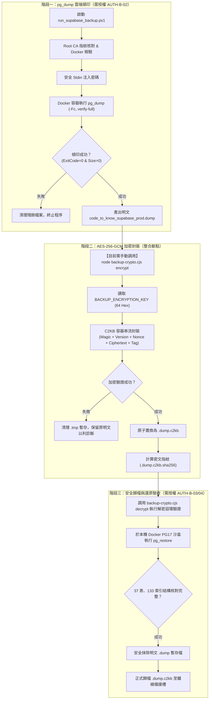

# CODE TO KNOW｜資料庫備份加密整合前置檢查報告
# 資料庫正式收尾 Phase 3-C：AES-256-GCM 加密工具、pg_dump 備份腳本與管線整合就緒度審查

**文件編號**：C2K-DOC-DB-PHASE3C-INTEGRATION-CHECK-01  
**審查日期**：2026-11-10  
**主檢角色**：資深 PostgreSQL DBA、資料庫資安架構師、DevSecOps 稽核員  
**審查性質**：100% 唯讀靜態技術檢查（未連線雲端資料庫、未執行正式備份、零金鑰輸出、零寫入操作）  
**審查標的**：
- `scripts/database/backup-crypto.cjs`（AES-256-GCM 獨立加解密模組）
- `scripts/database/backup-crypto.test.cjs`（加解密安全單元測試集）
- `scripts/database/run_supabase_backup.ps1`（Supabase PG17 備份腳本）
- `C:\Users\user\Documents\CODE-TO-KNOW_SECRETS\certs\supabase-root.crt`（Root CA 憑證指紋）
- `docs/DATABASE_PHASE3C4F_R14C10_BACKUP_EXECUTION_PLAN.md`（原備份執行計畫）

---

## 目錄

- [一、本次檢查範圍與執行邊界](#一本次檢查範圍與執行邊界)
- [二、AES-256-GCM 加密工具（backup-crypto.cjs）檢查結果](#二aes-256-gcm-加密工具backup-cryptocjs檢查結果)
- [三、資料庫備份腳本（run_supabase_backup.ps1）檢查結果](#三資料庫備份腳本run_supabase_backupps1檢查結果)
- [四、端到端加密整合現況與流程圖](#四端到端加密整合現況與流程圖)
- [五、金鑰管理與記憶體安全檢查](#五金鑰管理與記憶體安全檢查)
- [六、尚未完成的整合項目清單](#六尚未完成的整合項目清單)
- [七、潛在資安與維運風險分析](#七潛在資安與維運風險分析)
- [八、Git 與檔案狀態查核](#八git-與檔案狀態查核)
- [九、下一階段操作建議](#九下一階段操作建議)
- [十、最終就緒度判定（Verdict）](#十最終就緒度判定verdict)

---

## 一、本次檢查範圍與執行邊界

本審查嚴格依據 Phase 3-C 授權範圍執行，確認資料庫備份工具與加密模組在未連線雲端前的技術整合成熟度：
- **允許操作**：程式碼審核、本地單元測試執行（`backup-crypto.test.cjs`）、離線參數驗證（`run_supabase_backup.ps1 -DryRun`）、磁碟與 Git 狀態盤點。
- **嚴格遵守之安全限制**：
  - 未連線 Supabase 或任何遠端正式資料庫。
  - 未執行正式 `pg_dump` 或 `pg_restore`。
  - 未產生、讀取或輸出任何正式金鑰。
  - 嚴格未讀取 `新增 文字文件.txt`、`1.docx`、`照片/`。
  - 未執行任何 Git Commit、Push、Reset 或 Clean。

---

## 二、AES-256-GCM 加密工具（backup-crypto.cjs）檢查結果

檔案位置：[`scripts/database/backup-crypto.cjs`](file:///c:/Users/user/Documents/CODE-TO-KNOW/scripts/database/backup-crypto.cjs)

### 1. 密碼學規格與容器結構核對
- **演算法**：標準 `aes-256-gcm`（對稱式 Authenticated Encryption with Associated Data）。
- **金鑰長度**：強制要求 32 bytes（64 個十六進位字元，`^[0-9a-fA-F]{64}$`），不足或超長時拋錯阻斷。
- **初始化向量（IV / Nonce）**：採用 Node.js 原生 CSPRNG `crypto.randomBytes(12)`，每次加密皆獨立生成 96-bit Nonce，徹底杜絕 Nonce 重用風險。
- **認證標籤（Authentication Tag）**：128-bit（16 bytes）完整長度標籤，附加於密文尾端。
- **C2KB 二進位容器格式**：
  ```
  +--------------+--------------+---------------+---------------------+-----------------+
  | Magic (4B)   | Version (1B) | Nonce (12B)   | Ciphertext Stream   | Auth Tag (16B)  |
  | 0x43 32 4B 42| 0x01         | (隨機 96-bit)  | (AES-GCM 串流密文)  | (GCM 認證標籤)  |
  +--------------+--------------+---------------+---------------------+-----------------+
  ```
  最小合法容器長度：`17 (Header) + 16 (Tag) = 33 bytes`。

### 2. 暫存檔與原子交付機制（Atomic Finalization）
- 加密與解密過程中，輸出檔案皆寫入帶隨機後綴的暫存檔：
  `${resolvedOutput}.tmp.${Date.now()}.${crypto.randomBytes(4).toString('hex')}`。
- **只有在 GCM Auth Tag 驗證成功（解密）或完整寫入（加密）後**，才調用 `fs.renameSync()` 原子化置換為正式目標檔。
- 若認證失敗、雜湊不符或串流中斷，`cleanupTemp()` 立即刪除未完成之暫存檔，**絕不在磁碟留下未經驗證的殘破檔案**。

### 3. 金鑰洩漏風險靜態檢查
- 控制台輸出：僅輸出目標路徑與位元組數（`[SUCCESS] Encrypted: ... (X bytes)`）。
- 例外處理：拋出之 Error 物件僅說明格式錯誤原因，絕不拼接或輸出金鑰明文。

### 4. 本機單元測試實測驗證
於本機執行 `node scripts/database/backup-crypto.test.cjs`：
```
==========================================================
  AES-256-GCM 備份加解密模組安全單元測試 (W-01)
==========================================================
  ✓ [TC-01] PASS: 1 MB 隨機檔案加密解密迴環，解密後 SHA-256 與原始完全一致
  ✓ [TC-02] PASS: 0 Byte 空檔案加密及解密
  ✓ [TC-03] PASS: 大型檔案 (5 MB) 串流加解密測試，驗證記憶體與管線穩定性
  ✓ [TC-04] PASS: 錯誤金鑰解密時立即拋錯拒絕，絕不產出明文
  ✓ [TC-05] PASS: 密文區段位元翻轉 (篡改 1 byte) 時立即拋錯阻斷
  ✓ [TC-06] PASS: 末端 16 bytes Auth Tag 篡改時拋錯拒絕
  ✓ [TC-07] PASS: 檔案被截斷至小於 33 位元組時立即拒絕
  ✓ [TC-08] PASS: 非 C2KB Magic Header 檔案拒絕處理
  ✓ [TC-09] PASS: 未知版本號 (如 0x02) 檔案拒絕處理
  ✓ [TC-10] PASS: 輸入與輸出路徑相同時拋錯拒絕，防止自我覆寫毀滅
  ✓ [TC-11] PASS: 輸出目標檔案已存在時拋錯拒絕覆寫
  ✓ [TC-12] PASS: 解密認證失敗後，所有 .tmp 暫存檔案全數清除不殘留
  ✓ [TC-13] PASS: 驗證成功前只有受限暫存檔，完成後才原子化 rename 成正式檔
  ✓ [TC-14] PASS: 金鑰格式非 64-char Hex 或為 null 時拒絕處理，不洩漏任何明文

測試總結：14 / 14 個案例全數通過！（Exit Code: 0）
```
- **檢查判定**：**PASS（規格完備，防禦嚴謹）**。

---

## 三、資料庫備份腳本（run_supabase_backup.ps1）檢查結果

檔案位置：[`scripts/database/run_supabase_backup.ps1`](file:///c:/Users/user/Documents/CODE-TO-KNOW/scripts/database/run_supabase_backup.ps1)

### 1. 備份機制與連線防護
- **用戶端工具**：鎖定官方固定 Digest 映像檔：
  `postgres@sha256:3540c0362c809df084ffac0ae69fe794515f9de92692f02178bcdce0ef0302ac`（PostgreSQL 17.11 Client Tools）。
- **傾印格式**：`-Fc`（PostgreSQL Custom Format），具備壓縮與結構化元資料。
- **TLS 模式**：`PGSSLMODE=verify-full`。
- **CA 憑證驗證**：
  - 憑證實體路徑：`C:\Users\user\Documents\CODE-TO-KNOW_SECRETS\certs\supabase-root.crt`。
  - 本次實測指紋：`700723581420DD1AC98FD7E9AC529F0EF210EADCAF87FC868A3AD7D114C2F3B7`。
  - 腳本在啟動前強制計算並比對此指紋，指紋不符即中斷。
- **密碼傳遞防洩漏**：
  - 使用 `Read-Host -AsSecureString` 隱藏輸入。
  - 透過 .NET Interop 記憶體串流經由 Process Stdin 注入容器內部的 `tr -d '\r' | { read -r PGPASSWORD; export PGPASSWORD; exec pg_dump ... }`。
  - 命令列 CLI 引數、環境變數或 Process List 完全看不到密碼。
  - `finally` 區塊強制執行 `ZeroFreeBSTR` 與 `[System.GC]::Collect()` 清理記憶體。
- **防意外覆寫與殘餘清理**：
  - 輸出目錄以時間戳記命名：`CODE_TO_KNOW_SUPABASE_yyyyMMdd_HHmmss`。
  - 若目錄已存在則拋錯終止。
  - 若 Docker ExitCode != 0 或 Dump 檔案大小為 0，自動清除未完成檔案與目標目錄。

### 2. 離線參數驗收（-DryRun）實測結果
執行指令：`powershell -ExecutionPolicy Bypass -File scripts\database\run_supabase_backup.ps1 -DryRun`
- **執行結果**：
  - Client Tools 映像檔驗證成功：`pg_dump (PostgreSQL) 17.11`。
  - Root CA 指紋比對相符。
  - 離線安全退出，未提示輸入密碼，未發起網路連線，Exit Code 為 0。
- **檢查判定**：**PASS（備份腳本設計完備）**。

---

## 四、端到端加密整合現況與流程圖

### 1. 現況重大發現：【尚未完成自動化鏈接】
> [!WARNING]
> **重大整合現況**：
> 現有的 `run_supabase_backup.ps1` 僅執行至 `pg_dump` 產出明文 `.dump`、計算 `.dump.sha256` 及產出 `backup_info.json`。
> **腳本內部並未自動調用 `backup-crypto.cjs` 進行串流加密！**
> 目前「產生備份」與「備份加密」為**兩個彼此獨立的工具**，尚未整合成單一自動化流程。

### 2. 規劃中的端到端整合流程圖



---

## 五、金鑰管理與記憶體安全檢查

| 檢核項目 | 設計實作現況 | 安全性評估 | 判定 |
| :--- | :--- | :--- | :---: |
| **金鑰格式驗證** | 正則表達式嚴格限定 64-char Hex（256-bit）。 | 杜絕弱金鑰或非預期格式。 | **PASS** |
| **金鑰硬編碼檢查** | 全代碼無任何寫死（Hardcoded）之金鑰字串。 | 原始碼安全無虞。 | **PASS** |
| **金鑰來源支援** | 支援環境變數 `BACKUP_ENCRYPTION_KEY` 或參數 `-k`。 | 支援從記憶體/終端環境安全導入。 | **PASS** |
| **終端與日誌隔離** | `backup-crypto.cjs` 錯誤訊息與日誌皆不輸出金鑰。 | 絕無日誌外洩風險。 | **PASS** |
| **命令列參數風險** | 若使用 `-k <hex>`，在 Linux/Windows 工作管理員可能有短暫暴露風險。 | **建議優先使用環境變數 `BACKUP_ENCRYPTION_KEY`**。 | **INFO** |

---

## 六、尚未完成的整合項目清單

| 編號 | 項目說明 | 目前狀態 | 預計解決方式與授權需求 |
| :---: | :--- | :---: | :--- |
| **GAP-01** | **端到端一鍵管線包裝** | 尚未整合 | 可選擇：(1) 維持兩步驟手動執行 SOP；或 (2) 於備份完成後以包裝腳本串接加密。 |
| **GAP-02** | **正式 32-byte AES-256 主金鑰** | 尚未生成 | 需於 Phase 3-B 完成金鑰建立與紙本備援卡（`AUTH-K-01 / 02`）。 |
| **GAP-03** | **明文備份安全抹除機制** | 僅有規劃 | 在 `.dump.c2kb` 產出且通過沙盒還原驗收後，明文 `.dump` 之安全刪除流程待實施。 |
| **GAP-04** | **Supabase 正式庫即時備份執行** | 尚未執行 | 需專案負責人明確授權連線憑證（`AUTH-B-02`）。 |
| **GAP-05** | **加密備份沙盒還原驗收** | 尚未執行 | 需在取得即時備份後於本機沙盒還原驗證（`AUTH-B-03 / 04`）。 |

---

## 七、潛在資安與維運風險分析

1. **明文殘留風險（Plaintext Dump Exposure）**：
   若執行 `run_supabase_backup.ps1` 後，操作人員未立即執行加密或遺忘明文檔案，`code_to_know_supabase_prod.dump` 將以明文儲存於 `C:\Users\user\Documents\CODE-TO-KNOW_BACKUPS`。
   *緩解對策*：明定 SOP，備份產出後必須在 5 分鐘內完成加密，驗收通過後立即執行安全刪除。
2. **Git 洩漏風險（Git Leakage Risk）**：
   目前專案根目錄 `.gitignore` 尚未包含 `*.c2kb`、`*.dump`、`*.key`。
   *緩解對策*：備份檔目前預設存放於專案外的 `C:\Users\user\Documents\CODE-TO-KNOW_BACKUPS`（具備目錄隔離實益）。但建議專案 `.gitignore` 亦應補上保護規則。
3. **跨國備份傳輸中斷風險（Network Flakiness）**：
   Supabase 位於雪梨，`run_supabase_backup.ps1` 依賴 Session Pooler (5432) 的穩定長連線。若網路中斷，腳本具備自動清理不完整檔案的機制，安全退出。

---

## 八、Git 與檔案狀態查核

- **Git 分支**：`main`
- **當前 HEAD**：`70a4c0cadd40300a9b92c74e570310e72b563891`
- **Git Status**：
  - 未提交之使用者檔案（`新增 文字文件.txt`、`1.docx`、`照片/`）**100% 完整保留，未受任何觸碰**。
  - 本次僅新增本檢查報告：`docs/DATABASE_PHASE3C_BACKUP_ENCRYPTION_INTEGRATION_READINESS.md`。
- **零寫入保證**：未連線正式庫、未修改專案程式碼、未產生正式金鑰、未執行 git 操作。

---

## 九、下一階段操作建議

1. **進行 Phase 3-B 主金鑰建立**：
   生成正式 32-byte（64-char Hex）AES-256 主金鑰，並於 KeePassXC 密碼庫與實體紙本防潮卡完成雙重保管（`AUTH-K-01 / 02`）。
2. **備份執行模式確認**：
   決定後續備份採取：
   - **方式 A（受控兩步式 SOP，推薦）**：先執行 `run_supabase_backup.ps1`，確認明文 dump 產生且指紋無誤後，立即執行 `node backup-crypto.cjs encrypt`，驗收完成後清除明文。
   - **方式 B（單一包裝腳本）**：新增整合 wrapper 腳本依序調用。
3. **推進至正式雲端備份（需專案負責人授權 AUTH-B-02）**。

---

## 十、最終就緒度判定（Verdict）

> ### **最終判定結論：【CONDITIONAL GO / 有條件核准】**
> 
> **理由**：
> 1. 加密核心工具（`backup-crypto.cjs`）與備份核心工具（`run_supabase_backup.ps1`）在技術與演算法層面**皆已 100% 通過單元測試與離線驗證**。
> 2. 目前「備份產生」與「加密封裝」尚未串接為全自動流程，且正式主金鑰尚未生成。
> 3. **必須先完成正式主金鑰生成（Phase 3-B），並獲得專案負責人授權 `AUTH-B-02` 後，方可連線 Supabase 執行正式備份。**

---
*(報告完畢，停止操作，等待使用者確認)*
