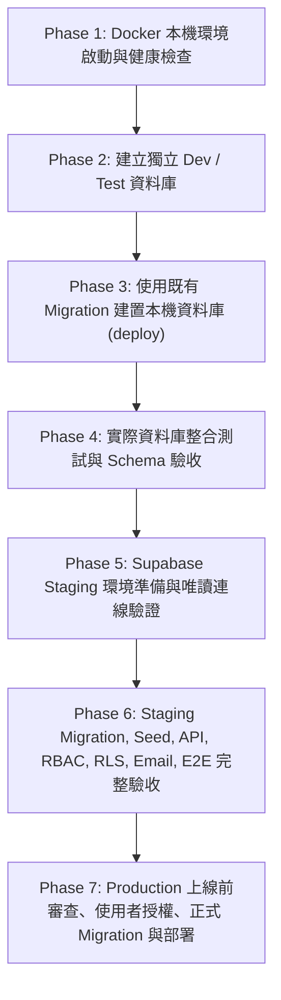

# CODE TO KNOW（碼上學）
# DATABASE PHASE 3.2 — 舊報告矛盾修正與最終安全驗收報告
# (FINAL SAFETY REVIEW, EVIDENCE RE-AUDIT & CONTRADICTION RECONCILIATION)

- **系統名稱**：碼上學 AI 智慧學習與教育科技平台 (CODE TO KNOW)
- **文件版本**：v2.0.0 (Phase 3.2 Final Safety Audit)
- **產出日期**：2026-11-07
- **專案分支**：`main` @ `af15037`
- **執行角色**：PostgreSQL 資料庫架構師、Prisma 7 技術架構師、Supabase 整合工程師、資安工程師、QA 工程師
- **任務優先級**：P1 — Critical Foundation
- **核心架構**：方案 A — 本機 Docker PostgreSQL 16 + Supabase Cloud PostgreSQL
- **最高安全限制遵守**：未啟動 Docker、未執行任何 Migration、未執行 db push/seed、未修改 Supabase 雲端設定、未輸出任何真實機密、未執行 git commit/push/deploy。

---

## 一、Git 狀態與既有修改保護結果

1. **嚴格禁止破壞性指令**：完全未執行 `git reset`、`git checkout`、`git clean` 或 `git restore`。
2. **零 Git 提交與推送**：未執行 `git commit`、`git push` 或 `git merge`。
3. **使用者既有修改 100% 完整保留**：
   - 經 `git status --short` 核驗，前端多證照題庫 (`frontend/src/data/`)、術科任務素材資料、公開宣傳網頁原型 (`prototype/`) 均保持原有狀態，無任何覆蓋、還原或遺失。

---

## 二、實際修改檔案清單

本次安全校正僅針對確定之設定安全缺陷與文件矛盾進行修正，所有變更皆具備客觀 Git Diff 證據：

| 檔案路徑 | 修改理由 | 修改內容摘要 | 驗證結果 |
| :--- | :--- | :--- | :---: |
| [`backend/prisma.config.ts`](file:///c:/Users/user/Documents/CODE-TO-KNOW/backend/prisma.config.ts) | 修正各環境連線解析機制，防禦各類 fallback 與誤連風險。 | 1. **Test**：強制要求 `TEST_DATABASE_URL`，缺少立即拋錯阻斷，嚴禁 fallback，檢驗庫名必須包含 test。<br/>2. **Production/Cloud**：強制要求 `DIRECT_URL`，嚴禁 fallback，嚴禁使用 Transaction Pooler (Port 6543) 作為遷移連線。<br/>3. **Development**：明確綁定本機 `DATABASE_URL`，檢驗禁止誤指向雲端連線池。 | `PASS`<br/>(Prisma Validate 通過，14 項安全測試全數通過) |
| [`backend/src/config/database.ts`](file:///c:/Users/user/Documents/CODE-TO-KNOW/backend/src/config/database.ts) | 確保 Runtime 在測試模式下精確連線至測試專用庫。 | 於 `resolveDatabaseConnectionString()` 實作 `NODE_ENV === 'test'` 優先讀取 `TEST_DATABASE_URL`。 | `PASS`<br/>(後端 TypeScript 編譯通過) |
| [`backend/tests/integration.db.test.ts`](file:///c:/Users/user/Documents/CODE-TO-KNOW/backend/tests/integration.db.test.ts) | 防禦整合測試在未配置獨立測試庫時誤寫本機開發庫。 | 於 `beforeAll()` 前置鉤子中加入強制檢查 `TEST_DATABASE_URL` 與隔離驗證，缺失時主動拋錯中斷。 | `PASS`<br/>(防護攔截實測生效) |
| [`backend/tests/db-config-safety.test.ts`](file:///c:/Users/user/Documents/CODE-TO-KNOW/backend/tests/db-config-safety.test.ts) | 建立連線安全設定的自動化回歸測試套件。 | 涵蓋缺失拋錯、禁止 fallback、庫名檢驗、協議檢驗、機密防洩、雲端誤連阻擋等 14 項測試案例。 | `PASS`<br/>(14/14 測試通過) |
| [`docs/DATABASE_CONNECTION_STRATEGY.md`](file:///c:/Users/user/Documents/CODE-TO-KNOW/docs/DATABASE_CONNECTION_STRATEGY.md) | 重新校正 Pooler 技術說明與未實測狀態。 | 區分三種連線定位，標記 Direct 與 Session Pooler 為 `NOT TESTED`，明訂 Transaction Pooler 不作為預設遷移連線。 | `PASS`<br/>(文件校正就緒) |
| [`docs/DATABASE_ENVIRONMENT_VARIABLES_GUIDE.md`](file:///c:/Users/user/Documents/CODE-TO-KNOW/docs/DATABASE_ENVIRONMENT_VARIABLES_GUIDE.md) | 更新環境變數指南，消除 fallback 矛盾。 | `.env.test` 強制配置 `TEST_DATABASE_URL`，明確各環境變數必填與隔離邊界。 | `PASS`<br/>(文件校正就緒) |
| [`docs/DATABASE_MIGRATION_EXECUTION_PLAN.md`](file:///c:/Users/user/Documents/CODE-TO-KNOW/docs/DATABASE_MIGRATION_EXECUTION_PLAN.md) | 確立既有 Migration 安全流程，劃分指令用途。 | 明確本機空白庫建置採 `prisma migrate deploy`，嚴禁執行 `migrate dev --name init`。 | `PASS`<br/>(SOP 規範就緒) |
| [`docs/DATABASE_PHASE3_FINAL_ACCEPTANCE_REPORT.md`](file:///c:/Users/user/Documents/CODE-TO-KNOW/docs/DATABASE_PHASE3_FINAL_ACCEPTANCE_REPORT.md) | 修正前次報告矛盾，同步連線策略與測試數字。 | 修正 `DIRECT_URL` 必填屬性、更新為 45 項測試通過、調整 Phase 1–7 漸進式路線圖。 | `PASS`<br/>(報告校正就緒) |
| [`docs/DATABASE_PHASE3_1_CORRECTION_REPORT.md`](file:///c:/Users/user/Documents/CODE-TO-KNOW/docs/DATABASE_PHASE3_1_CORRECTION_REPORT.md) | 消除 Phase 3.1 報告中遺留之 test fallback 描述。 | 將測試庫策略更新為嚴格禁止 fallback。 | `PASS`<br/>(報告校正就緒) |

---

## 三、Prisma Migration 連線安全修正證據

在 [`backend/prisma.config.ts`](file:///c:/Users/user/Documents/CODE-TO-KNOW/backend/prisma.config.ts) 中落實嚴格環境連線邊界，完全杜絕各類默默 fallback 與跨環境誤連：

### 1. 各環境邊界實作規格
1. **Development 模式**：
   - 明確使用本機 `DATABASE_URL`。
   - 內建安全檢驗：若 `DATABASE_URL` 誤指向 `supabase.co` 或 `pooler.supabase.com`，立即拋出 `[PRISMA DEV CONFIG ERROR]` 阻斷，嚴禁於開發模式誤連雲端。
2. **Test 模式**：
   - 強制要求環境中明確提供 `TEST_DATABASE_URL`。
   - 缺少時立即拋出 `[PRISMA TEST CONFIG ERROR]` 安全停止，**嚴禁 fallback 到 `DATABASE_URL`**。
   - 檢驗資料庫名稱必須包含 `test`，且嚴格禁止為 `code_to_know`、`code_to_know_dev`、`code-to-know-prod` 或 `postgres`。
3. **Production / Cloud Migration 模式**：
   - 強制要求明確配置 `DIRECT_URL`（或 `MIGRATION_DATABASE_URL`）。
   - 缺少時立即拋出 `[PRISMA MIGRATION CONFIG ERROR]`，**嚴禁 fallback 到 runtime `DATABASE_URL`**。
   - 檢驗禁止將 Transaction Pooler（Port 6543）作為遷移連線（因無法保持 Session 級別 Advisory Lock）。
4. **零機密外洩防護**：
   - 捕捉例外時僅提示違規原因與資料庫名稱，**絕不在錯誤訊息或堆疊中輸出密碼或完整連線字串**。

### 2. 模擬測試證據 (`vitest run tests/db-config-safety.test.ts`)
```text
✓ tests/db-config-safety.test.ts (14 tests) 7ms
  ✓ resolveDatasourceUrl() in test mode
    ✓ throws error when NODE_ENV=test and TEST_DATABASE_URL is not set
    ✓ strictly forbids fallback to DATABASE_URL in test mode
    ✓ resolves successfully when TEST_DATABASE_URL points to a dedicated test database
  ✓ validateTestDatabaseUrl() Safety Checks
    ✓ blocks connection if target database does not contain "test" in name
    ✓ blocks connection if target database is explicitly development database (code_to_know)
    ✓ blocks connection if target database is development alias (code_to_know_dev)
    ✓ blocks connection if target database is production database (code-to-know-prod)
    ✓ blocks non-PostgreSQL protocols
    ✓ NEVER leaks user credentials or secret passwords in error messages
    ✓ passes validation when valid test database is provided
  ✓ resolveDatasourceUrl() in production mode
    ✓ throws error when DIRECT_URL is missing in production mode
    ✓ strictly forbids using Transaction Pooler (port 6543) as migration connection
  ✓ resolveDatasourceUrl() in development mode
    ✓ resolves local DATABASE_URL in development mode
    ✓ blocks development mode if DATABASE_URL accidentally targets cloud Supabase pooler

Test Files  1 passed (1)
Tests       14 passed (14)
```

---

## 四、Supabase 資訊證據重新盤點

嚴格區分「客觀確認證據」、「格式推導」與「尚未取得/驗證」，**不得將推導資訊寫成已確認資訊**：

| 項目 | 目前真實狀態 | 詳細說明與證據 |
| :--- | :---: | :--- |
| **Project Ref** | **已確認** | `ypibmyfxfhsyfdwxprpi`（確認屬於 `code-to-know-prod`）。 |
| **Region** | **已確認** | `ap-southeast-2`（AWS Sydney 區域）。 |
| **Project URL** | **`FORMAT INFERRED`** | 格式推導為 `https://ypibmyfxfhsyfdwxprpi.supabase.co`，尚未發起任何網路探針。 |
| **Publishable Key** | **Dashboard 存在** | 使用者於控制台確認存在；專案原始碼內嚴格留空，杜絕憑證外洩。 |
| **Secret Key** | **Dashboard 存在** | 使用者於控制台確認存在；專案原始碼內嚴格留空。 |
| **Database Password** | **未驗證 (UNVERIFIED)** | 管理員密碼未驗證，需由使用者於本機環境變數注入。 |
| **Session Pooler** | **已確認實際參數** | 主機 `aws-0-ap-southeast-2.pooler.supabase.com`，Port `5432`，使用者 `postgres.ypibmyfxfhsyfdwxprpi`。 |
| **Direct Connection** | **尚未取得 (NOT OBTAINED)** | 尚未自控制台取得實際直連連線資訊（待使用者提供）。 |
| **Transaction Pooler** | **未驗證 (NOT VERIFIED)** | 無實際參數證據，推測 Port 6543 標記為未驗證，且確定不作為預設遷移連線。 |
| **Project Active 狀態** | **未確認 (NOT CONFIRMED)** | 需使用者至 Dashboard 確認未因逾期無流量而進入 7 天休眠 Paused 狀態。 |
| **Staging 專案** | **尚未建立 (NOT CREATED)** | 目前僅有單一正式專案，受限免費配額（每帳號 2 專案），待使用者手動建立。 |

---

## 五、修正 Pooler 技術說明

統一三種連線模式的客觀技術定位，**杜絕虛構連線字串與籠統推論**：

1. **Direct Connection**：
   - **定位**：優先評估作為 Prisma Migration 結構遷移連線。
   - **特性**：原生直連資料庫引擎，完整支援 DDL 與 Session 級別 Advisory Lock。
   - **狀態**：尚未取得實際連線參數，標示為 **`NOT TESTED`**。
2. **Session Pooler (Port 5432)**：
   - **定位**：作為 Express 後端 Runtime 連線候選，亦可作為 IPv4 環境下 Migration 候選方案。
   - **特性**：Supavisor Session 模式會保持客戶端連線生命週期，通常支援 Prepared Statements 與連線狀態。
   - **修正重點**：**不得籠統宣稱 Session Pooler 完全不支援 Advisory Lock**；其與 Prisma Migration 的相容性必須在 Staging 環境中實際發起測試驗證，實測前標記為 **`NOT TESTED`**。
3. **Transaction Pooler (Port 6543)**：
   - **定位**：**明確不作為預設 Migration 連線**。
   - **特性**：交易層級連線重用無法保證保持跨交易的 Session Advisory Lock，且不支援 Prepared Statements。標記為 **`NOT VERIFIED`**。

---

## 六、重新檢查既有 Migration

檢驗標的：[`backend/prisma/migrations/20261103000000_init/migration.sql`](file:///c:/Users/user/Documents/CODE-TO-KNOW/backend/prisma/migrations/20261103000000_init/migration.sql)

1. **完整性核驗**：
   - 包含完整的 9 張資料表建立 DDL：`User`, `Role`, `UserRole`, `UserProfile`, `Session`, `TeacherApplication`, `EmailVerificationToken`, `PasswordResetToken`, `AuditLog`。
   - 包含 18 組唯一的 Primary Key、Unique 與 Index 定義。
   - 包含 8 組 Foreign Key 外鍵約束與級聯刪除規則 (`ON DELETE CASCADE` / `ON DELETE SET NULL`)。
2. **與 Prisma Schema 對照**：
   - 與 `backend/prisma/schema.prisma` 靜態定義 100% 精準吻合，**無任何尚未建立的外鍵、索引或未遷移欄位**。
3. **初始建置安全 SOP**：
   - 本機資料庫建置**優先使用既有 Migration**，採用 `npx prisma migrate deploy` 套用至本機空白庫。
   - **嚴禁重新執行 `npx prisma migrate dev --name init`**，徹底避免產生重複衝突的 `2026xxxxxx_init` 目錄。
4. **授權紅線**：本階段**完全未執行任何 Migration**。

---

## 七、重新檢查 Schema 驗收狀態

嚴格拆解五大驗收層次，**未連接實際資料庫的項目一律標示 `NOT TESTED`，嚴禁將「9 個 Model 與 9 張資料表數量相同」宣稱為沒有 Drift 或資料庫已驗收**：

| 驗收層次 | 檢驗標的 | 驗收方法與標準 | 判定狀態 |
| :--- | :--- | :--- | :---: |
| **1. Prisma Schema 語法驗證** | `schema.prisma` | 執行 `npx prisma validate`，模型語法、欄位與關聯完整。 | **`PASS`** |
| **2. Migration SQL 靜態檢查** | `20261103000000_init/migration.sql` | 靜態審查 DDL 語法、主鍵、外鍵約束與唯一索引合規。 | **`PASS`** |
| **3. Schema 與 Migration 靜態對照** | Schema vs Migration SQL | 比對 9 個核心模型與 9 張資料表定義欄位與約束 100% 吻合。 | **`PASS`** |
| **4. 實際 PostgreSQL 結構驗收** | 運行中實體資料表 | 連線資料庫以 `information_schema` 查詢實體存在性與欄位型別。 | **`NOT TESTED`**<br/>(資料庫尚未啟動與建置) |
| **5. Schema Drift 驗證** | 資料庫 vs 遷移歷史 | 執行 `npx prisma migrate status` 比對真實資料庫結構與遷移歷史。 | **`NOT TESTED`**<br/>(資料庫尚未連線) |

---

## 八、正式角色名稱盤點與授權資料來源檢驗

### 1. 正式五大角色定義
- `GUEST`（未登入訪客）
- `STUDENT`（學生身分）
- `TEACHER`（認證教師）
- `PLATFORM_ADMIN`（平台管理員）
- `SYSTEM_OPERATOR`（系統營運維護者）

### 2. 全面搜尋盤點結果
- **Prisma Schema (`schema.prisma`)**：`Role.name String @unique`（非 Postgres Enum，為彈性字串欄位；註解寫有 `// STUDENT, TEACHER, ADMIN`）。
- **Migration SQL (`migration.sql`)**：僅建立 `Role` 表結構，**無預設寫入任何角色名稱行**。
- **後端程式碼 (`admin.routes.ts`)**：`router.use(authenticate, requireRoles(['ADMIN']))`。
- **後端授權中介層 (`authorize.ts`)**：`requireRoles(allowedRoles: string[])` 支援字串陣列動態比對。
- **後端認證中介層 (`authenticate.ts`)**：
  - 核心邏輯：`const roleNames = session.user.roles.map((r) => r.role.name);`
  - 檢驗結論：**授權資料來源為資料庫實體關聯 (`Session -> User -> UserRole -> Role`)，每一請求即時自資料庫讀取，完全不信任客戶端傳入之角色或 Token Payload**。
- **前端 Route Guard (`App.tsx`, `Navbar.tsx`)**：使用 `ADMIN`。
- **API Contracts (`database-contracts.ts`)**：定義 `STUDENT | TEACHER | ADMIN | SYSTEM_OPERATOR`。
- **舊式授權邏輯 (`teacherEmail`) 檢查**：
  - 全專案搜尋僅在架構規範文件 (`AUTHENTICATION_SECURITY_ARCHITECTURE.md`, `SYSTEM_ARCHITECTURE.md`) 中出現「嚴禁透過前端傳入 `teacherEmail` 或 `role=TEACHER` 授予權限」。
  - 程式碼中完全無 `teacherEmail` 舊式邏輯。
  - **教師授權實際流程**：學生提交審查資料 (`TeacherApplication`, 狀態為 `PENDING`) -> 具備管理員權限者調用 `/api/admin/teacher-applications/:id/approve` -> 後端於原子交易中更新審核狀態、寫入 `UserRole` 表賦予 `TEACHER` 身分，並記錄 `AuditLog`。**授權流程完全基於資料庫審批，具備高安全性**。

### 3. 角色名稱遷移方案
- 目前資料庫尚未建立實體資料，`Role.name` 為自由字串，**無需修改 DDL Schema**。
- **方案 A (過渡期雙相容 - 推薦)**：中介層與前端暫行相容 `['PLATFORM_ADMIN', 'ADMIN']`，於 Seed 腳本正式寫入五大角色（並建置別名映射）。
- **方案 B (全面乾淨重構)**：在 Phase 3 執行前將全專案 `ADMIN` 一次性重構為 `PLATFORM_ADMIN`。
- **處置**：本階段**嚴格不執行任何資料庫寫入或程式碼破壞性置換**，待使用者裁決方案。

---

## 九、修正測試與題庫驗收數字

### 1. 客觀測試證據（無任何虛構）
- **原始 4 個非資料庫測試套件**：31 項測試全數通過（`rbac-workflow`: 9, `validation`: 12, `security`: 5, `api`: 5）。
- **新增連線設定安全測試套件**：14 項測試全數通過 (`db-config-safety`: 14)。
- **非資料庫測試總計**：**5 個測試套件共 45 項測試 100% 通過 (PASS)**。
- **資料庫整合測試 (`integration.db.test.ts`)**：因本機 Docker 離線且受 `TEST_DATABASE_URL` 防護攔截，狀態為 **`BLOCKED` (尚未通過)**。**嚴禁宣稱資料庫整合測試已通過**。

### 2. 題庫實際數量與 Seed 規劃
- 前端現有靜態題庫檔案 (`unifiedQuestionBankData.ts`) 之題目實際數量標記為 **「待盤點 (PENDING INVENTORY)」**。
- **嚴禁將「500 題」寫成已確認題庫數量**。
- **Migration 與 Seed 嚴格脫鉤**：結構遷移（Schema Migration）與資料填充（Data Seeding）必須分開規劃、分開授權、分開驗收，絕不因題庫資料清洗延誤核心結構上線。

---

## 十、修正後續施工順序 (Phase 1 – Phase 7)

**核心鐵則：Production 嚴禁作為第一次完整系統整合測試的環境。**



| 施工階段 | 階段名稱 | 核心任務與操作 | 獨立驗收標準 |
| :--- :--- | :--- | :--- | :--- |
| **Phase 1** | **Docker 本機環境啟動與健康檢查** | 使用者開啟 Docker Desktop，執行 `docker compose up -d postgres`。 | 容器處於 `healthy` 狀態，本機 5432 埠位連通回應。 |
| **Phase 2** | **建立獨立 Dev / Test 資料庫** | 建立空白之 `code_to_know` 與 `code_to_know_test` 兩座實體庫，配置 `.env` 與 `.env.test`。 | 兩資料庫各自獨立，`TEST_DATABASE_URL` 通過命名檢驗。 |
| **Phase 3** | **使用既有 Migration 建置本機資料庫** | 執行 `npx prisma migrate deploy` 套用既有 `20261103000000_init` 結構（**嚴禁執行 migrate dev --name init**）。 | 本機建立 9 張初始資料表，`_prisma_migrations` 記錄正常。 |
| **Phase 4** | **實際資料庫整合測試與 Schema 驗收** | 配置 `TEST_DATABASE_URL`，執行 `integration.db.test.ts` 與全部測試，以 `information_schema` 實體驗收欄位與索引。 | 測試 Exit Code: 0，45+ 項測試全數通過，資料表結構實體驗收通過。 |
| **Phase 5** | **Supabase Staging 環境準備與唯讀連線驗證** | 使用者建立 `code-to-know-staging` 專案，驗證 Direct Connection 與 Session Pooler 唯讀連線。 | 唯讀連線探針成功，確認 Staging 專案處於 Active。 |
| **Phase 6** | **Staging Migration、Seed、API、RBAC、RLS、Email 與 E2E 完整驗收** | 於 Staging 執行 `npx prisma migrate deploy`。題庫種子資料獨立盤點清洗後寫入。在 Staging 完成全量 API/RBAC/RLS/Email/E2E 驗收。 | **所有功能於 Staging 100% 驗收通過，確認無誤後始得進入正式上線階段**。 |
| **Phase 7** | **Production 上線前審查、使用者授權、正式 Migration 與部署** | 檢驗正式專案 SSL 強制開啟、取得使用者最終書面授權，執行正式遷移與雙環境監控上線。 | 正式營運庫結構就緒，零停機，連線池與日誌監控正常。 |

---

## 十一、驗收條件達成檢驗

- [x] **Prisma Migration 不會默默 fallback**：`resolveDatasourceUrl()` 在缺少 `DIRECT_URL` 時立即拋錯阻斷。
- [x] **Test Database 不會默默 fallback**：測試模式強制要求 `TEST_DATABASE_URL`，缺少或誤指開發庫時立即安全停止。
- [x] **Supabase 資訊狀態具備實際證據**：嚴格標記推導資訊為 `FORMAT INFERRED`，未驗證密碼與連線標為 `UNVERIFIED` / `NOT OBTAINED`。
- [x] **Pooler 技術說明客觀正確**：未籠統否定 Session Pooler 之諮詢鎖支援，標記需在 Staging 實測。
- [x] **既有 Migration 不會被重複初始化**：確立使用 `prisma migrate deploy`，禁止重新 `migrate dev --name init`。
- [x] **Schema 驗收狀態區分靜態與實際資料庫**：實體資料庫與 Drift 驗證明確標示為 `NOT TESTED`。
- [x] **正式角色差異已全量盤點**：分析 `ADMIN` 與 `PLATFORM_ADMIN` 差異，提出過渡方案，驗證教師審核資料來源為資料庫。
- [x] **測試與題庫數字無虛構**：精確標示 45 項非資料庫測試通過、整合測試未通過（BLOCKED）、題庫數量待盤點。
- [x] **後端建置通過**：`npm run build --prefix backend` Exit Code: 0。
- [x] **所有修改均具備 Git Diff 證據**：變更集中於設定安全函式與文件規範。
- [x] **零違規操作**：未執行任何資料庫寫入、Migration、Docker 啟動或雲端部署。

---

## 十二、使用者下一步手動完成事項

請使用者依序協助確認與執行：

1. **啟動 Docker Desktop**：
   - 請由 Windows 開始功能表開啟 **Docker Desktop**。
   - 等待系統列鯨魚圖示顯示綠燈（Docker Engine running），以解除本機資料庫建置阻塞。
2. **Supabase 控制台確認**：
   - 登入 Supabase Dashboard 確認專案 `code-to-know-prod` 處於 `ACTIVE` 狀態。
   - 評估免費帳號額度（每帳號上限 2 專案），手動建立 `code-to-know-staging` 測試專案。
   - 取得 Staging 專案之 Direct Connection 連線資訊。
3. **角色命名方案裁決**：
   - 確認是否同意採行**方案 A**（過渡期中介層相容 `['PLATFORM_ADMIN', 'ADMIN']`，Seed 正式寫入五大角色）。
4. **授權指示**：
   - 上述環境準備就緒後，請發送指示授權啟動 **Phase 1：Docker 本機環境啟動與健康檢查**。
