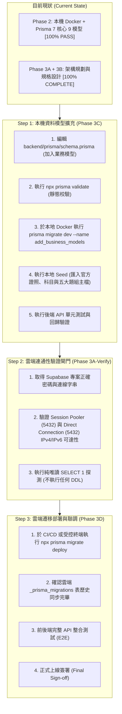

# CODE TO KNOW（碼上學）
# PHASE 3：整合盤點、實作狀態與 Migration 推進路線圖
# (Integration Audit, Implementation Status & Database Roadmap)

- **系統名稱**：碼上學 AI 智慧學習與教育科技平台 (CODE TO KNOW)
- **文件版本**：v1.0.0 (Phase 3 Complete Roadmap)
- **建立日期**：2026-11-07
- **文件路徑**：`docs/DATABASE_PHASE3_ROADMAP.md`
- **審查團隊**：React/TS 全端架構師、Prisma 7 資料庫架構師、軟體測試與品質保證工程師、PostgreSQL DBA
- **管理狀態**：路線規劃（ROADMAP PLANNING）

---

## 一、現有程式碼與功能實作狀態對照矩陣 (Integration Audit)

依據實際檢查 `schema.prisma`、`backend/src/`、`frontend/src/` 及 `prototype/` 之程式碼現況，嚴格區分「已實作」、「部分實作」、「僅有原型」與「尚未實作」，**杜絕將前端 Mock Data 或靜態展示頁面標記為已完成上線**：

| 功能模組 | 前端實作狀態 (`frontend/src/`) | 後端 API 狀態 (`backend/src/`) | Prisma 資料模型 (`schema.prisma`) | 綜合狀態評定 | 備註說明與實作現況 |
| :--- | :--- | :--- | :--- | :---: | :--- |
| **使用者登入與身分認證** | 已實作登入/註冊/登出頁面與 CSRF/Token Cookie 串接 | 已實作 `/api/auth` (註冊、登入、登出、Session 管理、CSRF) | 已實作 `User`, `Role`, `UserRole`, `Session`, `Tokens` | **已實作** | 核心認證、RBAC 授權與 92 項單元測試完全就緒。 |
| **教師審批與資格管理** | 已實作教師端切換與申請入口頁面 | 已實作 `/api/teachers` 與 `/api/admin/teachers` 審批 API | 已實作 `TeacherApplication`, `UserRole` | **已實作** | 教師送審、管理員審批流與日誌完整，`TeacherProfile` 待 Phase 3B 擴充。 |
| **全域安全稽核日誌** | 管理員頁面具備基礎展示預覽 | 後端寫入已實作（身分異動、管理員變更自動記錄） | 已實作 `AuditLog` (採 `onDelete: SetNull` 保護) | **已實作** | 核心資安軌跡機制已落地。 |
| **題庫與教材檢索** | 已實作題庫清單與篩選 UI，使用靜態 `UNIFIED_QUESTION_BANK` | 尚未實作 `/api/questions` | 尚未建表 (已完成 Phase 3B Schema 規格) | **僅有原型** | 目前前端仰賴靜態 Mock Data，尚未有後端資料庫支撐。 |
| **學科模擬測驗** | 已實作測驗倒數、交卷評分與錯題回顧 UI，使用 Mock 試卷 | 尚未實作 `/api/exams` | 尚未建表 (已完成 Phase 3B Schema 規格) | **僅有原型** | 前端具備完整互動原型，後端試卷生成與作答快照待實作。 |
| **術科實戰練習 (五大題組)**| 已實作五大官方題組規格展示、沙盒代碼切版預載與考場陷阱提示 | 尚未實作 `/api/practical-tasks` | 尚未建表 (已完成 Phase 3B Schema 規格) | **部分實作** | 官方題組與 Version A/B 規格已確立，進度保存目前僅為客戶端狀態。 |
| **學生學習歷程與錯題本** | 已實作學習進度儀表板、錯題筆記本與雷達圖 UI | 尚未實作 `/api/students/progress` | 尚未建表 (已完成 Phase 3B Schema 規格) | **僅有原型** | 畫面與互動良好，進度資料尚未對接資料庫持久化儲存。 |
| **班級管理與作業派發** | 已實作教師中心班級介面與作業指派原型畫面 | 尚未實作 `/api/classes` | 尚未建表 (已完成 Phase 3B Schema 規格) | **僅有原型** | 畫面具備，班級成員與作業關聯資料庫尚未建置。 |
| **AI 智慧學習教練** | 已實作雙向對話 UI、4 階思考鷹架提示卡與代碼糾錯界面 | 尚未實作 `/api/ai/coach` (後端串接 Gemini/LLM 引擎) | 尚未建表 (已完成 Phase 3B Schema 規格) | **僅有原型** | 前端為 Mock 對話引導，尚未正式對接 AI API 與會話日誌庫。 |
| **全站公告與通知系統** | 首頁具備跑馬燈與最新消息靜態展示 | 尚未實作 `/api/announcements` | 尚未建表 (已完成 Phase 3B Schema 規格) | **僅有原型** | 規格書（`ANNOUNCEMENT_SYSTEM_SPEC.md`）已完備，資料表待建置。 |

---

## 二、Phase 3 Migration 建議推進順序 (Step-by-Step Phasing)

為確保專案在零停機、零破壞的前提下穩健推進，建議將後續任務劃分為四個互為防護閘門的推進階段：

---

## 三、各階段執行細節與准出條件 (Exit Criteria)

### 階段一：Phase 3C — 本機資料模型擴充與本地遷移（建議下一步）
- **前提條件**：獲得使用者明確授權修改 `schema.prisma` 並在本機 Docker 執行遷移。
- **執行步驟**：
  1. 將 `docs/DATABASE_PHASE3B_BUSINESS_SCHEMA_DESIGN.md` 定義之業務模型增補入 `backend/prisma/schema.prisma`。
  2. 執行 `npx prisma validate` 確保語法與關聯無誤。
  3. 於本機 Docker 執行 `npx prisma migrate dev --name add_business_models` 生成 `2026xxxxxx_add_business_models/migration.sql`。
  4. 擴充 `backend/prisma/seed.ts`，匯入 17300 網頁設計丙級證照資料、工作項目目錄與五大官方術科題組主檔。
  5. 執行 `npm test` 確認既有 92 項測試無回歸問題。
- **准出條件**：本機 Docker 成功套用新 Migration，本機 API 與測試通過。

---

### 階段二：Phase 3A-Verify — Supabase 雲端連線實測驗證
- **前提條件**：本機 Phase 3C 驗證完畢，取得正式 Supabase 雲端環境變數配置。
- **執行步驟**：
  1. 測試本機或部署端對 Supabase Direct Connection（IPv6/IPv4）之 TCP 握手。
  2. 測試對 Supabase Session Pooler（Port 5432）之連通性與 SSL 加密通道。
  3. 執行純唯讀連線測試（`SELECT version()`、`SELECT 1`），確認無連線逾時。
  4. 驗證連線池參數與 Prepared Statements 相容性。
- **准出條件**：雲端連線探測 100% 成功，未發起任何 DDL 或寫入。

---

### 階段三：Phase 3D — 雲端資料庫遷移部署與全站聯調
- **前提條件**：Phase 3C 與 Phase 3A-Verify 皆通過准出標準。
- **執行步驟**：
  1. 配置生產環境 `DIRECT_URL` 與 `DATABASE_URL`。
  2. 執行 `npx prisma migrate deploy` 將 Migration 腳本安全推播至 Supabase。
  3. 驗證雲端 `_prisma_migrations` 表記錄。
  4. 啟動 Express API 進行後端與前端介面聯調。
  5. 執行權限滲透測試與效能驗收。
- **准出條件**：雲端資料庫結構完全與本機同步，線上 API 運作無誤。

---

## 四、風險矩陣與因應對策 (Risk & Mitigation)

| 風險項目 | 風險等級 | 影響範疇 | 具體因應對策 |
| :--- | :---: | :--- | :--- |
| **Supabase 免費版休眠 (Paused)** | 中 | 雲端資料庫無法連線，API 回應 500/503 | 1. 開發階段若休眠，至 Dashboard 點擊 Restore。 2. 建立健康檢查排程每 3 天發送 Ping 保持活躍。 3. 正式商轉時升級 Pro 方案。 |
| **Direct Connection 缺乏 IPv4** | 高 | 開發機無 IPv6 時無法執行 `migrate deploy` | 1. 優先評估購買 IPv4 Add-on。 2. 若無 IPv4，於具備雙棧網路之 GitHub Actions CI/CD 環境執行遷移。 3. 或驗證 Session Pooler (Port 5432) 的 DDL 鎖相容性。 |
| **題庫更新破壞歷史成績** | 高 | 學生過去考卷題目文字跑版或成績失真 | 嚴格落實 `ExamAnswerSnapshot` 機制，交卷時固化題目文字與選項快照，題庫更新不影響歷史紀錄。 |
| **術科進度版本混淆** | 中 | Version A 與 B 互相覆蓋完成狀態 | 透過 `PracticalProgress` 複合唯一鍵 `[userId, taskId, version]` 在資料庫層進行硬性實體隔離。 |
| **測試污染本機開發資料庫** | 高 | 整合測試誤刪或覆寫開發中資料 | 透過 `db-validation.ts` 強制隔離 `TEST_DATABASE_URL`，無獨立測試庫時禁止回退，立即拋錯中斷。 |

---

## 五、Phase 3 路線圖審核總結

1. **現況認知客觀誠實**：清晰區分現行已上線功能（認證、RBAC）與原型功能（題庫、測驗、術科、AI），杜絕灌水。
2. **推進節奏循序漸進**：規劃「本機擴充 (3C) -> 雲端探測 (3A-Verify) -> 雲端部屬 (3D)」之安全推進三部曲。
3. **安全防線牢不可破**：各階段皆設有不可逾越之准出條件與回滾對策。

---
**本路線圖與盤點清單已完成，現處於唯讀規劃狀態，未更動任何程式碼。請靜候使用者審閱與指示。**
