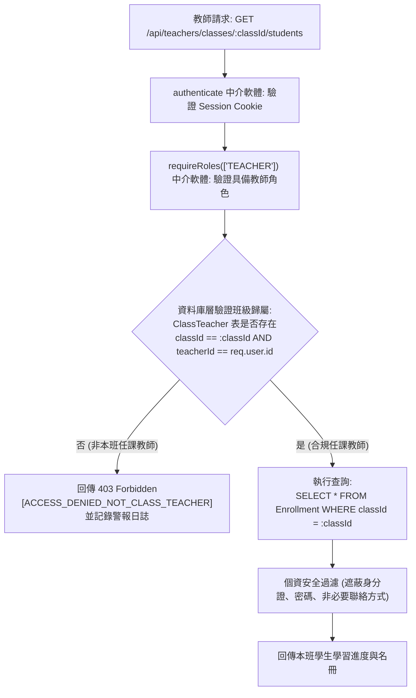

# CODE TO KNOW（碼上學）
# 系統五層角色權限控制矩陣 (DATABASE RBAC MATRIX)

- **系統名稱**：碼上學 AI 智慧學習與教育科技平台 (CODE TO KNOW)
- **文件版本**：v1.0.0 (Pre-Database Implementation)
- **建立日期**：2026-11-07
- **文件路徑**：`docs/DATABASE_RBAC_MATRIX.md`
- **核心架構原則**：
  1. **零信任前端**：前端 Route Guard 僅負責畫面導覽體驗，所有資料存取與修改必須由後端中介軟體（Middleware）與資料庫查詢條件強制執行。
  2. **參數不可篡改**：嚴禁由客戶端傳入 `userId`、`roles`、`teacherId` 等參數直接決定查詢範圍；所有使用者識別一律從經後端 HttpOnly Cookie 驗證後的 `req.user.id` 提取。
  3. **職責分離原則 (SoD)**：平台業務管理者（`PLATFORM_ADMIN`）與基礎設施維運者（`SYSTEM_OPERATOR`）角色嚴格分離。
  4. **多租戶班級資料隔離**：任課教師只能調閱自己獲授權班級內的學生成績與名冊，嚴禁跨班或全校越權存取。

---

## 一、五大角色定義與職能邊界

| 角色識別碼 | 角色正式名稱 | 業務定義與職能邊界 | 預設帳號與取得方式 |
|---|---|---|---|
| **`GUEST`** | 未登入訪客 | 瀏覽公開首頁、證照介紹、體驗免登入之程式沙盒或示範題目；無個人資料儲存權限。 | 無需帳號，公開存取。 |
| **`STUDENT`** | 認證學生 (一般學習者) | 自主練習學科題庫、進行全真模擬考、保存錯題本、雲端筆記、累積學習積分、加入班級並繳交作業。 | 一般使用者完成 Email 註冊後的預設角色。 |
| **`TEACHER`** | 認證教師 (教學管理員) | 建立與管理授權班級、發布班級作業/測驗、檢視本班學生成績報表、進行弱點教學診斷。 | 需由一般使用者提交教師申請，經由平台管理員審核通過後賦予。 |
| **`PLATFORM_ADMIN`** | 平台管理員 (業務治理) | 審核教師身分申請、題庫與教材版本審批、停權/恢復違規帳號、檢舉內容審查、查閱全站管理稽核日誌。 | 由最高系統管理員於後端離線建立，或由現有管理員指派。 |
| **`SYSTEM_OPERATOR`** | 系統營運者 (基礎設施維運) | 監控後端 API 健全狀態、資料庫連線池水位、檢視系統例外錯誤堆疊、管理備份與維護模式。**不可任意調閱個別學生成績或個資**。 | 專屬系統運維工程師帳號，受多因素驗證與 IP 白名單防護。 |

> [!IMPORTANT]
> **舊式角色標記 (`ADMIN`) 相容與授權資料來源校驗**：
> 1. **既有實作相容性**：現有程式碼（`App.tsx`, `Navbar.tsx`, `admin.routes.ts`）中使用的 `ADMIN`，在過渡期內由授權中介層透過陣列比對 `requireRoles(['PLATFORM_ADMIN', 'ADMIN'])` 保持相容，後續將全面規範化為 `PLATFORM_ADMIN`。
> 2. **教師授權安全保證**：系統**嚴格禁止以前端傳入 `teacherEmail` 或 Email 結尾特徵授權教師**。所有教師身分必須經由申請（`TeacherApplication`）並由管理者在資料庫交易中審核開通，授權資料來源嚴格綁定 `UserRole` 實體資料表。

---

## 二、實體層 CRUD 存取權限矩陣

標記定義：
- **`OWN`**：僅限存取與本人關聯的資料（`WHERE userId = req.user.id`）。
- **`CLASS`**：僅限存取本人獲授權班級內關聯的資料。
- **`ALL`**：允許存取全系統資料。
- **`NONE`**：完全禁止存取。

| 資料實體 (Entity) | `GUEST` | `STUDENT` | `TEACHER` | `PLATFORM_ADMIN` | `SYSTEM_OPERATOR` |
|---|:---:|:---:|:---:|:---:|:---:|
| **使用者密碼雜湊 (`User.passwordHash`)** | `NONE` | `NONE` | `NONE` | `NONE` (僅可重設) | `NONE` (嚴禁查看明文) |
| **個人基本檔案 (`UserProfile`)** | `NONE` | `C / R / U (OWN)` | `C / R / U (OWN)` | `R (ALL) / U (ALL)` | `NONE` |
| **連線階段管理 (`Session`)** | `NONE` | `R / D (OWN)` | `R / D (OWN)` | `R (ALL) / D (ALL)` | `NONE` |
| **證照與科目 (`Certification`, `Subject`)** | `R (ALL)` | `R (ALL)` | `R (ALL)` | `C / R / U / D (ALL)` | `R (ALL)` |
| **學科題目與選項 (`Question`, `Option`)** | `R (ALL)` | `R (ALL)` | `R (ALL)` | `C / R / U / D (ALL)` | `R (ALL)` |
| **學生測驗作答記錄 (`ExamAttempt`)** | `NONE` | `C / R (OWN)` | `R (CLASS)` | `R (ALL)` | `NONE` |
| **學生作答明細 (`ExamAnswer`)** | `NONE` | `C / R (OWN)` | `R (CLASS)` | `R (ALL)` | `NONE` |
| **學生個人學習進度 (`UserProgress`)** | `NONE` | `C / R / U (OWN)` | `R (CLASS)` | `R (ALL)` | `NONE` |
| **錯題本 (`WrongQuestion`)** | `NONE` | `C / R / U / D (OWN)` | `R (CLASS - 彙總弱點)` | `NONE` | `NONE` |
| **個人收藏與筆記 (`Bookmark`, `Note`)** | `NONE` | `C / R / U / D (OWN)` | `NONE` (學生隱私) | `NONE` (學生隱私) | `NONE` |
| **班級主數據 (`Class`)** | `NONE` | `R (已加入之班級)` | `C / R / U / D (OWN)` | `R (ALL) / U (ALL)` | `NONE` |
| **學生入班名冊 (`Enrollment`)** | `NONE` | `C (輸入邀請碼) / R (OWN)`| `R / U / D (CLASS)` | `R (ALL)` | `NONE` |
| **教師指派作業 (`AssignedExam`)** | `NONE` | `R (所屬班級)` | `C / R / U / D (CLASS)` | `R (ALL)` | `NONE` |
| **教師認證申請 (`TeacherApplication`)** | `NONE` | `C / R (OWN)` | `R (OWN)` | `R (ALL) / U (審批)` | `NONE` |
| **平台管理稽核日誌 (`AdminAuditLog`)** | `NONE` | `NONE` | `NONE` | `R (ALL) (唯讀不可刪)` | `R (ALL)` |
| **基礎設施與營運日誌 (`APIHealthLog`)** | `NONE` | `NONE` | `NONE` | `NONE` | `R / D (清理舊檔)` |

---

## 三、多租戶班級資料隔離防禦架構 (Multi-Tenant Class Isolation)



### 後端防護實作偽代碼規範：

```typescript
// 嚴禁寫法 (重大資安缺陷 - 越權漏洞 BOLA / IDOR):
const students = await prisma.enrollment.findMany({
  where: { classId: req.params.classId } // 缺少驗證請求者是否為該班教師！
});

// 正確安全規範 (強制造型班級所有權檢查):
const isAuthorizedTeacher = await prisma.classTeacher.findFirst({
  where: {
    classId: req.params.classId,
    teacherId: req.user.id, // 從 Session 提取，絕不用 req.body 或 req.query
  }
});

if (!isAuthorizedTeacher) {
  throw new ForbiddenError('權限不足：您並非此班級之授權任課教師', 'ACCESS_DENIED');
}
```

---

## 四、API 端點層授權規則矩陣

| API 端點前綴 | 允許角色 | 認證方式 | 授權中介軟體 | 稽核需求 (AuditLog) |
|---|---|---|---|:---:|
| `/api/auth/register`, `/api/auth/login` | `GUEST` | 公開 | 無 | 登入失敗達 5 次記錄 IP |
| `/api/auth/logout`, `/api/auth/me` | 任何已登入會員 | Session Cookie | `authenticate` | 否 |
| `/api/students/*` | `STUDENT` | Session Cookie | `authenticate`, `requireRoles(['STUDENT'])` | 個資變更需記錄 |
| `/api/teachers/classes/*` | `TEACHER` | Session Cookie | `authenticate`, `requireRoles(['TEACHER'])` | 班級建立/成績更動需記錄 |
| `/api/admin/teacher-applications/*` | `PLATFORM_ADMIN` | Session Cookie + CSRF | `authenticate`, `requireRoles(['ADMIN'])` | **強制記錄 (審核結果與理由)** |
| `/api/admin/users/:id/suspend` | `PLATFORM_ADMIN` | Session Cookie + CSRF | `authenticate`, `requireRoles(['ADMIN'])` | **強制記錄 (停權處置)** |
| `/api/ops/*` | `SYSTEM_OPERATOR` | Session + IP 白名單 | `authenticate`, `requireRoles(['SYSTEM_OPERATOR'])` | 維護操作強制記錄 |

---

## 五、管理操作稽核留痕規格 (Audit Trail Specifications)

為落實資安防弊，下列高風險操作**必須於同一個資料庫事務（Database Transaction）中原子寫入 `AdminAuditLog`**，日誌寫入失敗則主操作必須回滾（Rollback）：

1. **教師資格審查（核准 / 駁回）**：記錄申請人 ID、審核人 ID、審查決定、審核備註、時間與來源 IP。
2. **使用者帳號停權與解鎖**：記錄受處分者 ID、操作管理員 ID、停權原因。
3. **題庫正式版本上架與題目刪除**：記錄題目 ID、異動前版本、異動後版本、修改人。
4. **全站系統維護模式切換**：記錄維運人員 ID、切換模式、公告預估時程。

---

## 六、公告與通知系統專屬權限控制矩陣 (Announcement & Notification RBAC Matrix)

### 1. 角色對公告類型權限對照表

| 功能操作 / 公告分類 | `GUEST` (未登入訪客) | `STUDENT` (學生學習者) | `TEACHER` (任課教師) | `PLATFORM_ADMIN` (平台管理員) | `SYSTEM_OPERATOR` (系統營運者) |
|---|:---:|:---:|:---:|:---:|:---:|
| **瀏覽平台公開公告 (Platform Public)** | `READ` | `READ` | `READ` | `READ` | `READ` |
| **發布/管理平台重要政策與功能更新** | `NONE` | `NONE` | `NONE` | `FULL (C / R / U / D / Publish)` | `NONE` |
| **發布系統維護與服務異常通知** | `NONE` | `NONE` | `NONE` | `FULL` | **`CREATE / PUBLISH` (限維護/異常類)** |
| **發布班級作業/測驗/教學公告** | `NONE` | `NONE` | **`OWN CLASS ONLY` (需班級授權)** | `READ / MODERATE` | `NONE` |
| **發布學生個人通知** | `NONE` | `NONE` | **`OWN CLASS STUDENTS ONLY`** | `ADMIN ONLY` | `NONE` |
| **發布學習心得與討論分享 (Student Share)**| `NONE` | **`OWN CLASS ONLY` (受限發布)** | `READ / MODERATE` | `READ / MODERATE` | `NONE` |
| **查閱本班學生已讀回條** | `NONE` | `NONE` | **`OWN CLASS ONLY`** | `ALL` | `NONE` |
| **學生分享檢舉與下架管理** | `NONE` | `FLAG ONLY` (僅得檢舉) | `TAKE DOWN (OWN CLASS)` | `TAKE DOWN (ALL)` | `NONE` |
| **非同步郵件外寄觸發權限** | `NONE` | `NONE` | `OWN CLASS (受速率限制)` | `ALL (系統級排程)` | `INCIDENT ONLY` |

### 2. 特殊角色權能邊界保護條款

- **`SYSTEM_OPERATOR` 邊界限制**：
  - 僅限發布 `type IN ('SYSTEM_MAINTENANCE', 'SYSTEM_INCIDENT')` 之公告。
  - 嚴禁發布或修改平台政策、行銷優惠、新增證照或功能更新公告。
  - 嚴禁檢視任何班級內部教學公告、學生個人通知或學生學習心得。
- **`TEACHER` 邊界限制**：
  - 教師發布 `CLASS`、`EXAM`、`ASSIGNMENT` 公告時，後端強制比對 `ClassTeacher` 授權關係；嚴禁越權對未任教之班級發送公告。
  - 教師僅能發送個人通知給已加入其任教班級之有效學生。
- **`STUDENT` 邊界限制**：
  - 學生僅可在所屬班級發布 `LEARNING_SHARE` 或 `DISCUSSION`，受限於單日篇數限制（預設 5 篇/天）與自動防洗版節流（每 60 秒至多 1 篇）。
  - 學生無權將公告設為置頂（`isPinned = false`）或觸發非同步外寄郵件（`sendEmail = false`）。
  - 學生查詢公告時，由後端強制注入 `Enrollment` 條件，無視客戶端傳送之 `classId` 參數。
