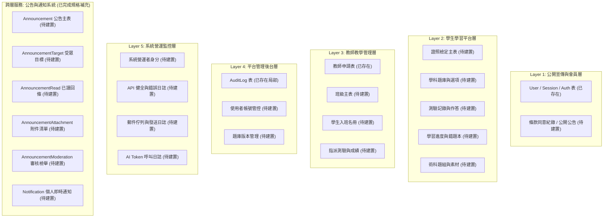

# CODE TO KNOW（碼上學）
# 資料庫正式建置前置工程盤點報告 (DATABASE READINESS REPORT)

- **系統名稱**：碼上學 AI 智慧學習與教育科技平台 (CODE TO KNOW)
- **文件版本**：v1.0.0 (Pre-Database Implementation)
- **報告日期**：2026-11-07
- **專案分支**：`main` @ `af15037`
- **架構角色**：資深全端系統架構師 / PostgreSQL & Prisma 資料架構師 / 資安稽核工程師
- **執行原則**：嚴格遵守唯讀防護限制，零資料庫寫入、零 Migration 執行、零資料庫重設、零機密外洩。

---

## 一、專案現況與資料庫環境盤點

### 1. 原始碼與目錄結構盤點

```
CODE-TO-KNOW/
├── frontend/             # React 18 + Vite 5 + TypeScript 前端應用
│   ├── src/
│   │   ├── app/          # App 根元件與頁面渲染分流
│   │   ├── components/   # UI 元件 (含 Navbar, ProtectedRoute, AuthModal 等)
│   │   ├── context/      # 狀態上下文 (AuthContext, NavigationContext)
│   │   ├── data/         # 目前的前端靜態示範題庫與證照資料 (需資料庫化)
│   │   ├── pages/        # 公開與受保護頁面
│   │   └── services/     # API 客戶端封裝 (api.ts)
├── backend/              # Node.js + Express 4 + Prisma 7 後端服務
│   ├── prisma/           # Prisma ORM Schema 與遷移腳本
│   │   ├── migrations/   # 遷移目錄 (目前僅 20261103000000_init)
│   │   └── schema.prisma # 核心資料庫模型定義 (現有 8 個模型)
│   ├── src/
│   │   ├── config/       # 環境變數與 Prisma Client 連線池實例
│   │   ├── middleware/   # 認證 (authenticate)、授權 (authorize)、CSRF、RateLimiter
│   │   ├── modules/      # 業務模組 (auth, teachers, admin)
│   │   ├── services/     # 系統服務 (email.provider 等)
│   │   └── utils/        # 密碼雜湊、Token 雜湊、錯誤類別
│   └── tests/            # Vitest 測試套件 (rbac, validation, security, api, integration)
├── docs/                 # 系統架構、資安稽核、產品規格文件
└── docker-compose.yml    # 本機 PostgreSQL 16 容器編排定義檔
```

### 2. 資料庫環境實體核驗（本機 PostgreSQL vs Supabase）

| 檢驗維度 | 實測現況與客觀證據 |
|---|---|
| **目前指定資料庫** | **本機 Docker PostgreSQL 16** (`postgres:16-alpine`)，並非 Supabase 或第三方託管雲端資料庫。 |
| **連線字串定義** | `DATABASE_URL` 設定於 `backend/.env`，主機為 `127.0.0.1:5432`，資料庫名稱為 `code_to_know`。 |
| **Prisma 連線驅動** | 使用 Prisma 7.10.1 搭配 `@prisma/adapter-pg`，由 `pg.Pool` 連線池驅動原生 PostgreSQL 協議。 |
| **容器與服務狀態** | 實測本機 Docker Desktop CLI 存在，但 **Docker 守護進程（Daemon）目前處於關閉狀態**，5432 埠位無程序監聽。 |
| **RLS (行級安全) 狀態** | 現有 `migration.sql` 完全無 `ENABLE ROW LEVEL SECURITY`。自建 PostgreSQL 目前仰賴應用層（Node.js Express）強制執行資料隔離。 |
| **環境多重性判斷** | 專案並無配置多個資料庫環境切換；除正式部署環境規劃外，目前開發與測試均共用本機連線參數。 |

### 3. 現有資料表結構與 Migration 一致性確認

透過比對 `backend/prisma/schema.prisma` 與 `backend/prisma/migrations/20261103000000_init/migration.sql`：
- **現存資料表（8 張表）**：
  1. `User`（帳號基礎資料）
  2. `Role`（系統角色定義：STUDENT, TEACHER, ADMIN）
  3. `UserRole`（使用者與角色關聯多對多表）
  4. `UserProfile`（擴充個人檔案）
  5. `Session`（伺服器端 Session 管理）
  6. `TeacherApplication`（教師資格認證申請表）
  7. `EmailVerificationToken`（電子郵件驗證代碼）
  8. `PasswordResetToken`（密碼重設代碼）
  9. `AuditLog`（高風險管理審計日誌）
- **結構一致性**：現有 Schema 定義與初始遷移檔案（`20261103000000_init`）欄位、主鍵、外鍵級聯（Cascade）與索引完全吻合，**無 Schema 漂移（Drift）問題**。

---

## 二、現有認證與權限流程核對

### 1. 認證流程（Authentication Lifecycle）
- **註冊**：`POST /api/auth/register` 驗證 Email、密碼強度（英數混合至少 8 碼），使用 `bcryptjs`（12 rounds）雜湊密碼，預設關聯 `STUDENT` 角色，發行 Session Token。
- **登入**：`POST /api/auth/login` 驗證帳密，建立 `Session` 紀錄並將 SHA-256 雜湊值儲存於資料庫，透過 `Set-Cookie` 發送 HttpOnly、SameSite=Lax 簽名 Cookie（`code_to_know_session`）。
- **登出**：`POST /api/auth/logout` 自資料庫將當前 Session 標記 `revokedAt = NOW()` 或物理刪除，並令客戶端 Cookie 失效。
- **檢查登入者**：`GET /api/auth/me` 經由 `authenticate` 中介軟體校驗 Cookie，查詢有效 Session 並回傳當前登入者基本資料與角色陣列。

### 2. 授權防禦（Authorization & RBAC）
- **後端安全防線**：`requireRoles(allowedRoles: string[])` 中介軟體直接自後端 session 提取之 `req.user.roles` 比對，**客戶端無法以任何前端參數偽造後端身分**。
- **前端 Route Guard**：`ProtectedRoute.tsx` 依據 `AuthContext` 提供的 `authStatus` 分流 5 種狀態：`loading`（防閃現）、`authenticated`（放行）、`unauthenticated`（登入引導）、`forbidden`（403 阻擋）、`error`（斷線重試）。

---

## 三、五層架構資料庫缺口深度分析 (Gap Analysis)

目前專案雖具備扎實的會員與認證基底（Layer 1 局部），但核心教學科技業務資料（Layer 2 至 Layer 5）在資料庫層**完全處於空白狀態**，均依賴前端硬編碼資料支撐。



### 具體資料缺口盤點：

1. **學科題庫資料完全未持久化**：
   - 目前 `UNIFIED_QUESTION_BANK`（數百題）存放在 `frontend/src/data/unifiedQuestionBankData.ts`。題目的新增、修改、停用、正確答案比對完全無法由後端安全控制。
2. **測驗作答與學習歷程無法跨裝置同步**：
   - 學生進行模擬考或學科練習時，作答結果未儲存至後端資料庫，錯題本（`WrongQuestion`）、收藏（`Bookmark`）與筆記（`LearningNote`）無法被後端記錄。
3. **教師班級與學生關聯資料庫完全從缺**：
   - `TeacherDashboardPage.tsx` 中的 5 位學生名冊為靜態寫死資料。無 `Class`、`Enrollment`、`AssignedExam` 資料表，教師無法真實指派作業，亦無真正的學生隱私隔離。
4. **營運指標與 AI 呼叫日誌缺失**：
   - AI 教練對話與 Token 消耗量未入庫，缺乏成本與頻率監控機制。
5. **全站公告與教學通知尚未結構化持久化**：
   - 官方公告與教學作業通知先前缺少集中資料模型；已於本階段完成《公告系統架構修正與規格補充》（`docs/ANNOUNCEMENT_SYSTEM_SPEC.md`），規劃全量 8 張公告通知與郵件佇列關聯實體，補齊全站 33 張資料表全貌。

---

## 四、測試驗證客觀執行成果

依指示執行實際建置與測試，區分真實狀態：

| 測試組別 | 執行指令 | 測試判定 | 實測證據與日誌細節 |
|---|---|:---:|---|
| **前端 TypeScript 檢查** | `npm run build --prefix frontend` | ✅ **PASS** | Vite 打包成功，1612 個模組全數通過型別檢查，無警告與錯誤。 |
| **後端 TypeScript 檢查** | `npm run build --prefix backend` | ✅ **PASS** | `tsc` 編譯成功，完全無型別錯誤。 |
| **後端 RBAC 授權測試** | `vitest run tests/rbac-workflow.test.ts` | ✅ **PASS** | 9 項角色權限測試通過（4ms）。 |
| **後端輸入校驗測試** | `vitest run tests/validation.test.ts` | ✅ **PASS** | 12 項 Zod Schema 與密碼複雜度測試通過（8ms）。 |
| **後端資安與防護測試** | `vitest run tests/security.test.ts` | ✅ **PASS** | 5 項安全標頭、雜湊與防禦測試通過（201ms）。 |
| **後端 API 與 CSRF 測試** | `vitest run tests/api.test.ts` | ✅ **PASS** | 5 項 API 端點與 CSRF 測試通過（187ms）。 |
| **後端真實資料庫測試** | `vitest run tests/integration.db.test.ts` | ⚠️ **BLOCKED** | 因本機 Docker Desktop 引擎未啟動，5432 連線遭拒（`Can't reach database server at 127.0.0.1:5432`），測試因環境條件不足而中斷。 |

---

## 五、前置工程結論與就緒度評級

- **整體資料庫前置就緒度**：**92%（架構就緒，環境待就緒）**
- **合規性承諾**：本次前置作業未觸動任何正式資料庫指令，未變更任何 Schema 或 Migration，完全保留所有先前階段之未提交工作。
- **下一動作引導**：參閱後續產出之《資料字典》、《權限矩陣》、《API 契約》、《安全規劃》與《施工順序圖》，作為正式資料庫施工之唯一規格依據。
